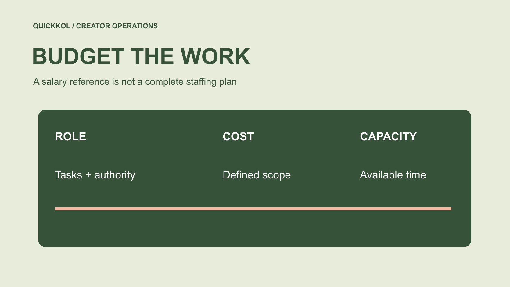

# 达人项目要配怎样的社媒经理预算

状态：本地审阅稿；正式发布日期待确认。

先划清社媒经理在达人项目中的职责，再用有地区与口径的薪资资料规划人力。

QuickKOL 编辑图形；不呈现真实账号指标或平台界面。

Social media manager salary 不能只看一个平均数字。品牌先列出达人发现、Brief、审核、排期、回复和报告分别由谁负责，再选择地区、时期与岗位范围相近的工资参考。美国 BLS 公关专员数据可提供相邻职业背景，不能改名为全球社媒经理薪资。员工工资、雇主福利成本、创作者费用和代理服务是不同预算项；项目容量应按真实可用时间和工作步骤估算，不用年薪直接推导能管理多少达人。

## 先写岗位工作，再研究薪资

同样叫社媒经理，可能主要维护品牌账号，也可能负责达人研究、谈判和多语言项目。先把工作写成任务与批准权限，而不是依赖职位名称。谁准备名单，谁审核事实，谁确认价格，谁发布，谁处理观众问题，要能分别回答。不能把所有未分配事项默认为一个岗位负责。

用[达人 Brief](https://www.quickkol.com/zh/blog/write-a-useful-campaign-brief/#answer) 区分创作者交付与品牌内部执行。创作者拍摄不等于员工无需管理，员工负责联络也不等于能专业审核所有产品主张。明确专家、法务或财务需要参与的位置。岗位范围越清楚，工资参考越有可比性，也越容易判断招聘一人、增加支持还是采购特定服务。

## 给工资资料保留职业与地区标签

[BLS 的公关专员职业资料](https://www.bls.gov/ooh/media-and-communication/public-relations-specialists.htm)显示，美国该职业在 2025 年 5 月的年工资中位数为 74,750 美元。该资料描述包括社交媒体沟通在内的相关工作，但并不是对“社媒经理”这一商业职位名称的单独统计，更不是当前全球招聘报价。引用时保留美国、职业与时期，不能只摘金额。

中位数不是每个人的应得工资，也不是某个候选人的报价。地点、职责、经验与组织条件需要另外核对。品牌可把相邻职业数据放在背景栏，再收集与实际岗位相称的当地资料。若两份资料统计对象不同，不要取平均后假装得到更准确答案。

## 区分工资与完整雇佣成本

[BLS 的 OEWS 口径问答](https://www.bls.gov/oes/oes_ques.htm)说明工资估计不包括雇主的非工资福利成本，也不覆盖自雇者等对象。员工工资不能直接与一个自由职业者的服务报价对比。服务报价可能包含设备、管理与其他成本，统计口径不同。先列比较对象，再讨论总预算。

品牌完整预算还可能涉及适用的雇主成本、设备、软件、培训与其他支持。具体金额由有权人依实际组织确认，不用一个通用比例假装适用于所有地区。把这些项目与创作者服务费、样品、付费媒体分开，避免工资看起来增加后，团队却实际没有内容或发布预算。

## 不要把成本变化指标当成岗位报价

[BLS 的就业成本指数说明](https://www.bls.gov/eci/)介绍的是雇佣成本随时间变化的指标，不能直接用作某一岗位在某城市的薪资报价。工资水平、成本变化和单个供应商费用是不同证据。引用任何年度变化时，都要保留对应对象与时期，不自动加在所有旧报价上。

本文不以指数推算当前应付金额。预算负责人可以核对内部成本更新方法，并说明哪些项目需要重新询价。若缺少匹配资料，保持区间与假设，不通过多个无关统计拼出小数点精度。薪资研究的目标是合理规划职责与资源，而不是把公共数据改造成个人谈判结论。

## 用可用工时估算项目容量

先记录需要做的步骤与大致时间，不用一个达人总数定义负荷。十位只交素材的人，与十位需要寄样、多轮审核和原账号发布的人，工作量可能不同。协调、等待、返工与内部批准也要能看见。空档不一定代表员工闲置，可能在等别人提供条件。

假设一个月有一百小时被批准用于达人项目，常规记录与协调需要二十小时，每位新合作的已列任务需四小时。剩余八十小时对应二十个此类任务单位，仍需考虑时间集中、失败与其他约束。这是规划算例，不是行业产能标准，更不是对员工的永久考核额度。

## 识别工资无法解决的流程缺口

如果产品团队迟迟不确认事实，提高社媒经理工资不会自动缩短该等待。如果每个素材使用都需要补问，先修正采购范围与记录。用[达人活动状态管理方法](https://www.quickkol.com/zh/blog/creator-campaign-status-system/#answer)把制作、批准、发布与等待分开，找出谁能改变阻塞，不把全部问题归成招人不足。

同时不要以流程问题为由否认真实过载。看任务在什么时间集中、哪些需要不同专业能力，再决定增加人员、调整范围或改善分工。招聘与流程改进可以同时需要。一个可信预算应解释新增资源会改变哪一项工作，而不是笼统保证人手更多就能获得更多合作和销售。

## 比较员工、自由职业与代理的实际范围

内部员工提供持续协调与组织知识，外部专家或代理可能补充某项制作、地区或执行能力。先写本次需要什么，再比较相同范围的费用与接手条件。不要把全职工资与一次项目费直接当成便宜贵，也不默认代理包含创作者报酬和媒体费。

评价方案时，看谁持有记录、谁批准价格、失败时谁处理，以及服务结束后怎样继续。访问和素材许可也要有清楚范围。品牌可以购买一个有限任务，不必为了获得支持交出所有历史资料。合适方案由具体项目决定，本文不作哪种用工永远更便宜的普遍结论。

## 把预算交成可复核的岗位方案

交接包括任务、权限、地区、工资参考的时期与职业、完整成本项目、容量假设和未确认项。由人事或财务等有权人员核对适用金额与安排。市场团队可说明实际工作需要，不应把一个公共中位数作为所有人的报价上限。

下一轮用实际任务记录更新容量假设，而不是只看账号规模或总合作数。Social media manager salary 在达人营销中的意义，是让品牌为必要协调、审核和关系工作安排真实资源。清楚的岗位和预算使创作者交付有人接手，也能让团队知道哪些承诺当前还不具备条件。

## 两场活动重叠时怎样检查真实容量

假设月度总工时看起来足够，但两场活动都需要在周四完成最终审核。一个岗位是否可行，取决于工作集中方式和所需能力，不只看整月平均。把样品、事实确认、创作者修改与排期分别放到日历中，再标明哪些动作可以提前，哪些只能在最终版本出现后完成。

如果同一位经理必须同时确认价格、审核技术事实、处理客服并发布，他可能既缺时间也缺权限。先决定产品团队和财务承担哪些确认，再计算经理剩余协调工作。增加一位只会排期的人，未必解决技术审批；采购一次专业审核，也未必解决日常回复。需要的是匹配任务的资源，不是职位数量本身。

工资资料仍只提供特定口径的背景。组织若采用一份假设的年预算，按内部方法计算每月成本时要保留假设，不能把公共中位数说成某候选人的实际费用。临时服务费也按具体范围单列。比较方案时，说明谁持有交接记录、休假或离岗后由谁接替，以及取消外部服务会影响哪些任务。

可以先用一个小项目记录真实任务，再更新工时估计。不要把首次观察当成永久产能定额，也不以一个迟到判断员工能力。交接给预算负责人的应是任务、拥堵位置、建议资源和未知，而不是一个“每人能管二十位达人”的通用口号。这样的方案更能解释为什么需要花钱，以及这笔钱究竟会改变哪一个工作条件。

## 薪资与项目费用的不同对象

| 对象 | 用途 | 不能自动推出 |
| --- | --- | --- |
| 相邻职业工资 | 带地区时期的背景 | 具体岗位当前报价 |
| 完整雇佣成本 | 工资及适用雇主成本 | 创作者服务已包含 |
| 可用时间 | 任务容量情景 | 永久达人管理配额 |
| 代理或自由职业费 | 明确范围的外部任务 | 与员工工资直接可比 |

74,750 美元为美国公关专员 2025 年 5 月中位工资背景；工时数字是明确假设。

## 达人运营岗位预算清单

先确认工作，再核对费用。

- [ ] 明确任务与批准权限。
- [ ] 保留工资参考职业、地区与时期。
- [ ] 分开工资、福利、创作者及媒体费用。
- [ ] 用步骤和可用时间测试容量。
- [ ] 指定实际金额与安排的确认人。

## 研究日期与使用边界

资料核验于 2026 年 11 月 12 日。文中方法、表格和决策规则为编辑建议，标为假设的示例不是实际客户结果或行业基准。外部资料的适用地区与时期按各段说明；本稿处于独立本地审阅阶段，正式发布日期待确认。

## 用清楚的任务开始达人研究

用 QuickKOL 理解 Brief、发现相关达人并研究作品与联系路径；数据、合作条件和结果仍需核验。

[了解 QuickKOL](https://www.quickkol.com/#capabilities)

## 来源

- [BLS 的公关专员职业资料](https://www.bls.gov/ooh/media-and-communication/public-relations-specialists.htm)
- [BLS 的 OEWS 口径问答](https://www.bls.gov/oes/oes_ques.htm)
- [BLS 的就业成本指数说明](https://www.bls.gov/eci/)
