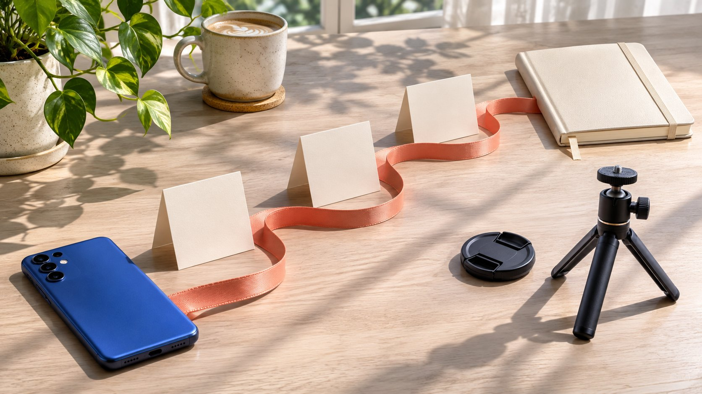

# Add a TikTok Bio Link for a Creator Partnership

Status: local review draft; confirm the publication date before release.

Check account access and destination readiness before using a TikTok bio link to receive creator-partnership traffic.

How to add link to TikTok bio requires two kinds of readiness in a creator project: the account currently permits a website link, and the destination fulfills the invitation in the content. Have the account owner confirm eligibility, use the available website-link control in the current profile editor, save and test the visitor path. If unavailable, adjust the assignment rather than handing credentials to an unlocking service. The brand also needs page content, mobile operation, commercial context and a receiving owner. A working link does not establish that every visit came from the creator or prove caused sales. Treat setup and campaign evidence as separate tasks.

## Identify which account owns the link

A brand may ask a creator to place a link on their own profile or invite viewers to the brand profile instead. Control, timing and audience path differ. Use the [creator brief](https://www.quickkol.com/blog/write-a-useful-campaign-brief/#answer) to specify publication account, link-owning account, retention period and updater. Mentioning the brand in a video does not establish indefinite profile placement.

One profile may support several pieces or projects. Confirm effects on existing work and commercial terms before temporarily replacing its link. The purchase defines a scope, not control of the creator’s whole account.

Without suitable authorization, the brand can prepare a destination and recommendation but cannot edit the other account. Record ready for setup separately from publicly configured. This prevents a project owner from treating a completed landing page as evidence that the creator’s profile already sends people there, or from assuming a change is harmless because the new campaign is currently the brand’s priority.

## Do not infer eligibility from an account label

[TikTok’s business verification explanation](https://ads.tiktok.com/resources/help/article/about-business-registration?lang=en-GB), updated June 2026, lists Link-in-Bio among features and states that market and account factors affect availability. Business verification also differs from a blue-tick identity indication. This is a source for checking business use, not proof that switching any account to an ordinary business label unlocks every feature.

Have the actual owner inspect current help and available controls. Do not promise access solely from a number in an old tutorial or demand that a creator change account type without considering consequences.

If unavailable, modify the invitation or await appropriate confirmation. An unconfirmed route must not be described as already clickable, and credential-based unlocking services are not a substitute. The project can still complete content planning and destination preparation while that question remains unresolved, provided the final piece does not invite viewers to use a link the account cannot supply.

## Make the destination fulfill the invitation

If the piece invites a demonstration booking, the page should explain the demonstration and lead suitable viewers into that process. If it promises compatibility information, do not send people to an unrelated store homepage. Continuity matters more than collecting many destinations.

Prepare a clearly scoped page with product, conditions, actual next step and necessary commercial information. If multiple entries are used, identify the one corresponding to this work instead of making visitors guess from file names.

The brand confirms stock, event timing, language and receiving capacity it owns before release. A completed creator video does not establish that the organization can handle every response. A useful readiness check therefore includes the person receiving inquiries or bookings. They should know what viewers were told, which conditions apply and what to do if a request arrives after the promised opportunity ends.

## Check the visitor path after setup

After the account owner saves the appropriate website address in the current profile editor, return to the public profile and test as a visitor. Labels and availability vary; a historical screenshot does not replace current confirmation. Check displayed text, destination and unnecessary intermediate steps.

At minimum inspect mobile reading, the primary action and forms, including access outside an editor where relevant. A page visible to a logged-in brand colleague may not be visible in the same way to the audience.

Testing does not require real customer information. Use an authorized test method and let the receiver distinguish tests from actual requests. Preserve observation time and problems rather than upgrading one successful test to permanent availability. If the page opens but the intended action fails, setup is not ready for the invitation even though the profile technically contains a link.

## Do not hide the commercial relationship at the destination

[TikTok’s commercial content disclosure guide](https://support.tiktok.com/en/business-and-creator/creator-and-business-accounts/promoting-a-brand-product-or-service?invalid_lang=ms) calls for appropriate disclosure according to the actual commercial arrangement. Brand and creator should confirm applicable treatment in the publication scope, not assume one sentence on a destination replaces every platform and regional requirement. A working link does not establish completed disclosure review.

Assess discounts, commissions, gifts and other relationships according to actual facts. Destination prices and conditions should match the invitation rather than presenting unexpected charges after the video describes something as free.

For a non-sales step, such as professional-event registration, still explain the organizer and actual purpose. Viewers need to understand who invites them, what information is requested and what happens next. The creator should receive these facts before recording the invitation, rather than being asked to endorse a destination whose terms remain unsettled until after publication.

## Campaign tags support classification rather than causal proof

[Google Analytics’s custom campaign URL guide](https://support.google.com/analytics/answer/10917952?hl=en) explains using UTM parameters to identify referring campaigns and emphasizes consistent naming. A brand can add suitable tags under its naming convention and verify that the destination preserves them. Parameters are not secret storage; do not place private contact information or account credentials in them.

A creator-tagged link can generate visits after someone else shares it. Recorded sessions are not distinct viewers and do not automatically establish purchases caused by that creator. Collection also depends on actual implementation and conditions.

Use the [bio-link attribution method](https://www.quickkol.com/blog/link-in-bio-destination-attribution/#answer) to report assets, visits and business events separately. Keep questions the available sources cannot answer unresolved rather than allowing a tag name to replace evidence. A useful report should state what the tag identifies operationally, such as the link assigned to this collaboration, without presenting that assignment as independent proof of every visitor’s exposure or motivation.

## Rehearse a demonstration-booking handoff

Suppose a software brand asks a creator to explain a team-collaboration feature and invite demonstration bookings. The page needs intended participants, language, time zone and confirmation method. Verify the actual receiving process rather than having the creator promise immediate individual service for everyone. This example contains no real client outcomes.

If form submission only produces a generic thank-you page, establish whether it creates a booking or merely a request. Those imply different expectations. Where participation is region-limited, explain that appropriately in the invitation and destination.

Retain approved copy, page version and test status in acceptance. The next step is confirming these facts and conditions, not deriving sales from visit counts. The exercise can reveal a simple repair, such as replacing book now with request a demonstration, without blaming the creator for a receiving workflow the brand had not yet defined.

## Agree on updates and end-of-placement handling

Agree before collaboration on placement duration, who can replace the link and where it leads after the activity ends. An older video may still invite a profile visit after the profile points to another project. Choose appropriate explanation or stable reception so the original invitation does not unintentionally lead somewhere unrelated.

Link changes should not silently rewrite historical reporting. Retain original destination, change time and reason, separating observation windows where necessary. Visits to a new page do not automatically belong to the earlier activity.

When placement ends, the actual account owner removes or changes the entry and confirms state. Removing one entry does not invalidate every shared copy or end unfinished service and payment obligations. The receiving owner needs enough context to handle people arriving through older material without treating every later visit as a fresh endorsement of the current campaign.

## Repair a failed path before assigning blame

For an unavailable page, wrong language or broken form, record discovery time and the specific issue for the destination owner. If the content invitation must change, involve the creator and authorized approver. A content producer should not guess server, stock or business-system conditions.

Explain affected periods and unresolved impact when reviewing outcomes. Few visits alone do not establish a creator generated no interest, and one failed entry does not establish that every collaboration was effective. Retain alternative explanations where evidence is insufficient.

After repair, repeat the visitor-path check and confirm the receiving team knows the change. Record notified, modified and tested separately instead of letting handled conceal unfinished steps. This keeps accountability concrete: an owner can repair the component they control while the campaign report remains honest about what could and could not be observed during the interruption.

## Align the entry, promise and receiver

Preserve eligibility confirmation, actual link, destination, invitation, permission scope, testing and receiving owner. Do not hand over only a URL and leave creator and brand to guess its job. Public access and successful completion of the intended next step each need evidence.

A TikTok bio link is useful in influencer marketing when it connects specific content to a meaningful action. The brand prepares the page and business process, the creator supplies genuine expression within scope and authorized people operate the account.

Alignment makes subsequent performance research reasonable. It still guarantees neither attribution of every visit nor conversion by every viewer. Before closing, check whether the receiving colleague can explain the promised action, its conditions and who handles a person arriving through the link. That understanding is more useful than a profile screenshot alone.

## TikTok bio-link readiness card

| Item | Check | Does not establish |
| --- | --- | --- |
| Account | Eligibility, permission and current route | An account label automatically unlocks access |
| Destination | Invitation, conditions and receiver | Opening means a booking exists |
| Tagging | Naming, preservation and source | All visits were caused by the creator |
| Update | Duration, change and testing | All old links became unavailable |

The software-demonstration case is hypothetical; owners must verify actual eligibility and destination conditions.

## Before inviting viewers to tap

A usable entry must also fulfill the invitation.

- [ ] The account owner confirms available conditions.
- [ ] Destination matches the next step in the work.
- [ ] Mobile and external visitor paths are checked.
- [ ] Commercial context and tags are accurate.
- [ ] Updates, problems and requests have a receiver.

## Research date and limitations

Sources reviewed November 12, 2026. Methods, tables and decision rules are editorial recommendations. Hypothetical examples are not actual client results or industry benchmarks. Source geography and periods are specified where relevant. This draft is in independent local review; confirm its publication date before release.

## Start creator research with a clear task

Use QuickKOL to interpret a brief, discover relevant creators and research their work and contact routes. Verify data, commercial terms and outcomes at their source.

[Explore QuickKOL](https://www.quickkol.com/#capabilities)

## Sources

- [TikTok’s business verification explanation](https://ads.tiktok.com/resources/help/article/about-business-registration?lang=en-GB)
- [TikTok’s commercial content disclosure guide](https://support.tiktok.com/en/business-and-creator/creator-and-business-accounts/promoting-a-brand-product-or-service?invalid_lang=ms)
- [Google Analytics’s custom campaign URL guide](https://support.google.com/analytics/answer/10917952?hl=en)
