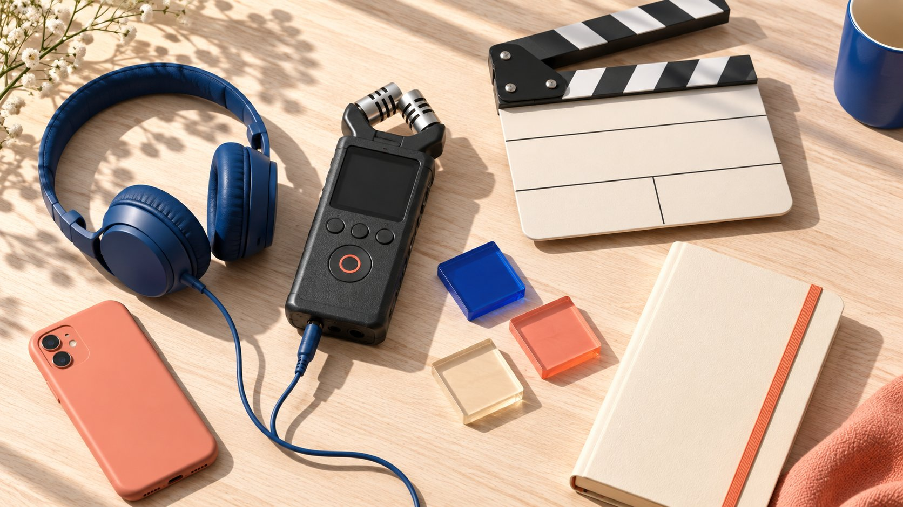

# TikTok Trends Today: Check Relevance Before the Brief

Status: local review draft; confirm the publication date before release.

Turn a TikTok trend observed today into a suitable creator assignment rather than unrelated trend chasing.

TikTok trends today cannot responsibly be answered with an indefinitely reused worldwide list. Use current official trend resources to record region, industry, period and actual examples, then decide whether a creator can use the approach to explain a relevant product or question. A popular sound does not grant commercial permission, and a successful-looking sample does not guarantee partnership performance. This guide supplies a research procedure and selection criteria. Sources were reviewed November 12, 2026; it does not claim a completed live list or a same-day sample of every market. The output should be a suitable creator assignment with traceable reasons to participate or decline.

## Define where and when today applies

Before research, state market, language, local date and time zone. Content trending at headquarters may not fit the event’s region, and a morning observation is not an all-day conclusion. For a same-day decision, agree on a check point and receiving owner rather than using real-time as an adjective without a timestamp.

Put the audience task in the [creator brief](https://www.quickkol.com/blog/write-a-useful-campaign-brief/#answer): event participation, product explanation or a professional question. A trend is a possible expression route, not a reason to replace the intended audience. Decline where no suitable connection exists. That does not establish a brand is behind; it prevents assigning creator time and budget to work that cannot support the task. State the reason before viewing examples where possible, so an entertaining discovery does not quietly become the project’s objective simply because the team likes the format.

## Start an observation through official Trends resources

[TikTok’s Trends usage guide](https://ads.tiktok.com/resources/help/article/how-to-use-trends?redirected=2), updated July 2026, describes logging into Creative Center, opening Trends, filtering by industry or period and viewing a hashtag’s analytics. Verify the actual available interface and fields rather than treating the help page as a search the team already performed.

Record selected conditions, original URL and observation time, then examine the trendline, related work and regional context. If data cannot be accessed, label it not obtained instead of filling imagined hashtags, positions or viewing totals. A usage guide explains a route; it does not provide the brand’s verified complete sample for today. Keep the two records separate. That distinction lets a colleague continue the research without inheriting a fictional observation. It also allows the team to postpone a trend decision while still completing the audience question, production requirements and other parts of the [creator brief](https://www.quickkol.com/blog/write-a-useful-campaign-brief/#answer).

## Distinguish a moment from a broader expression signal

[TikTok’s trend-type explanation](https://ads.tiktok.com/business/en/blog/tiktok-trends-digest?redirected=1) distinguished short-lived Trend Moments from broader Trend Signals in 2024. This classification can inform responsiveness and creative latitude without making the article’s historical examples current trends. Preserve both the source year and the date of the actual observation.

If a moment requires filming tomorrow while samples, review or creator availability make that impossible, choose a broader expression problem or decline. Do not remove necessary conditions to chase a sound or transfer every delay to the creator. Trend adaptation needs audience understanding, genuine content and feasible execution, not merely evidence that someone is using it now. The broader option should still have a clear task. Replacing a missed moment with an unrelated evergreen post may fill the calendar, but it does not establish the original trend-led assignment was completed.

## Check compatibility with the brand’s actual facts

Examine the roles, actions or claims a trend requires. A reveal format may help explain a common misunderstanding but should not turn product limitations into a dramatic guarantee. Have the product owner identify conditions that must remain and the creator describe what they can genuinely demonstrate. Do not request a fabricated personal usage experience.

If relevance depends entirely on a logo added at the end, reconsider the topic. Write one sentence explaining what the product does in the story, then check whether the audience can understand it. Fit comes from an actual role, not applying the same audio to every category. Confirm scope and cost where new props, venues or performers are needed. This check can also expose a misleading association: a humorous format may imply expert approval or a product comparison the project has not established. Address that meaning before filming rather than hoping a small caption will repair it afterward.

## Verify commercial sound conditions first

[TikTok’s Commercial Music Library guide](https://ads.tiktok.com/resources/help/article/commercial-music-library?lang=en) distinguishes the general music library from commercial use and calls for proper licensing of other original or licensed sounds. It is an official starting point, not clearance this article completed for a particular track. Confirm current track, region and intended use rather than inferring advertising permission from a trending listing.

Consider creator publication and paid amplification separately within the agreed scope. If the sound cannot serve the planned use, discuss a suitable alternative or decline the direction. Changing music can change meaning and timing, so review whether the expression still works. Do not turn a music issue into a request for a creator to supply files privately or bypass restrictions. A feasible alternative should preserve the audience task and be approved on its own merits; it should not be described as the identical trend simply because the rest of the footage remains unchanged.

## Choose a creator with the right capability

Familiarity with a sound does not establish the ability to demonstrate a product. Review relevant work for action, explanation, production conditions and language capability. A strong performer may fit a scenario, while a complex procedure may require someone actually practiced in it. Follower scale should not replace evidence of the necessary skill.

Reference a specific piece and the current question in outreach, stating timing, deliverables, budget scope and facts needing confirmation. A fast-moving trend does not remove commercial terms or justify an immediate unpaid trial. Use the [candidate research method](https://www.quickkol.com/blog/influencer-discovery-tool-brief-to-candidates/#answer) to preserve selection reasons so an agency or brand owner understands the fit beyond a name appearing in a popular screenshot. Where a creator cannot meet the required production date, preserve that practical constraint rather than treating lack of availability as evidence that their work or audience is unsuitable in general.

## Rehearse one hypothetical product assignment

Suppose an office-equipment brand observes an apparently complicated, actually step-by-step expression and considers it for a desk-tool demonstration. Ask whether it helps the intended professionals understand the real steps, then verify prerequisites, samples and creator capability. This trend is hypothetical, not an actual November 12, 2026 listing.

If the original format depends on music unavailable for the commercial use, design a distinct original approach rather than continuing to describe it as the same trend collaboration. If review cannot meet the necessary timing, decline and retain the reason. The deliverable is a feasible decision, not publication at all costs. The brand controls selection, facts and work arrangements, not audience reaction. The exercise is complete when the owner can explain what is being commissioned, why its timing is feasible and which elements differ from the inspiration, even if the final decision is not to participate.

## Measure against the assignment

A trend-led piece may receive views, comments or follows without establishing product understanding or relevant inquiries. Before release, agree on available fields, sources and windows, separating acceptance, content learning and commercial events. Missing data should remain missing rather than become zero or an estimate.

When comparing work, check audience, paid distribution and timing. A trend performing well on a large account does not imply the brand’s product will behave identically. If only a few questions can be observed, report those with their limits. Do not combine public trend popularity with the brand’s activity and present the mixture as verified return. A report can still recommend a clearer demonstration based on a repeated misunderstanding, provided it labels that as a content observation. The useful question is what the evidence supports changing, not whether every trend initiative can be assigned an impressive universal success score.

## Preserve changes rather than silently refreshing history

Add a new observation with time and changes when checking again. A hashtag no longer appearing describes the current query; it does not erase yesterday’s record or prove the earlier sample invalid. Yesterday’s popularity likewise cannot establish today’s status.

Before filming or release, check whether the selection reason still holds, without demanding minute-by-minute research. Assign proportionate check points and an owner so real-time does not become an endless work requirement. If direction changes, clarify new scope, cost and creator time, respecting work already completed rather than making the creator responsible for a changing trend. The updated note should identify whether the change affects relevance, permission or merely the team’s preference. These have different implications, and a collaborator needs that distinction before agreeing to redo a piece or accept a revised publication plan.

## Hand over today’s observation as a clear choice

The final note should preserve region, time, source, samples, relevance, permission state, feasibility and decision. Continue, redesign as original work, await evidence or decline. Very popular, film quickly gives neither the creator a responsible assignment nor the brand a basis for purchase.

Same-day TikTok research should serve an actual creator-marketing task. It helps find suitable expression and collaborators while retaining facts and use conditions. The valuable choice today is not necessarily the hottest sound. It is a collaboration whose owner can explain relevance to the intended audience, genuine production capability and the next confirmation step. Keep that note with the brief so a later reviewer can distinguish the observed trend from the brand’s own adaptation and can see which limitations still applied when the work was commissioned. Assign every unresolved condition to an actual owner rather than letting it disappear from the final decision.

## Same-day trend collaboration decision

| Question | Evidence | Supported decision |
| --- | --- | --- |
| Where and when? | Region, zone and query period | Describe that observation only |
| Relevant to the task? | Audience question and product role | Use, redesign or decline |
| Commercially usable? | Specific music and asset conditions | Act after confirmation |
| Feasible to produce? | Creator, sample and approval plan | Purchase the actual scope |

The hypothetical office-equipment case is not an actual same-day trend.

## Before deciding today

Speed does not replace relevance, facts or permission.

- [ ] Time and region are explicit.
- [ ] Actual observations or not-obtained status are recorded.
- [ ] The trend has a specific role in the product task.
- [ ] Music and advertising scope are suitable.
- [ ] The creator can deliver under actual conditions.

## Research date and limitations

Sources reviewed November 12, 2026. Methods, tables and decision rules are editorial recommendations. Hypothetical examples are not actual client results or industry benchmarks. Source geography and periods are specified where relevant. This draft is in independent local review; confirm its publication date before release.

## Start creator research with a clear task

Use QuickKOL to interpret a brief, discover relevant creators and research their work and contact routes. Verify data, commercial terms and outcomes at their source.

[Explore QuickKOL](https://www.quickkol.com/#capabilities)

## Sources

- [TikTok’s Trends usage guide](https://ads.tiktok.com/resources/help/article/how-to-use-trends?redirected=2)
- [TikTok’s trend-type explanation](https://ads.tiktok.com/business/en/blog/tiktok-trends-digest?redirected=1)
- [TikTok’s Commercial Music Library guide](https://ads.tiktok.com/resources/help/article/commercial-music-library?lang=en)
