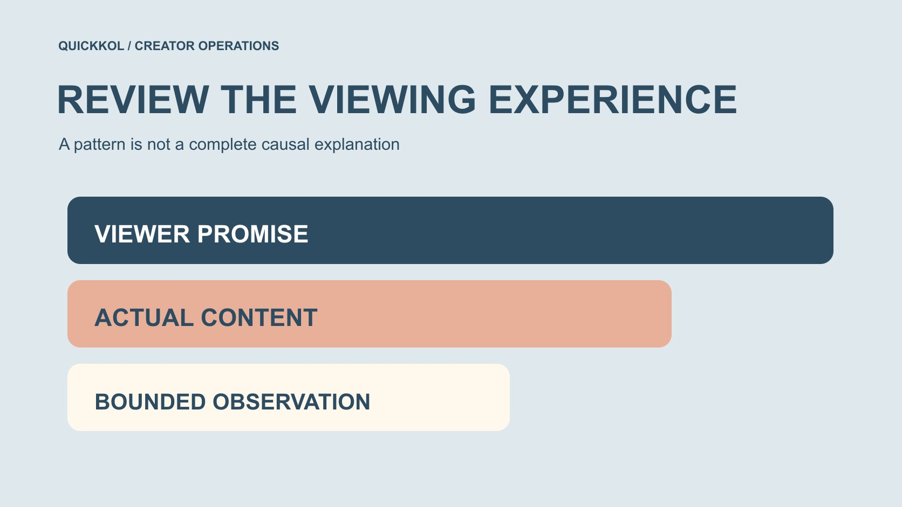

# YouTube Algorithm: Review the Sponsored Viewing Experience

Status: local review draft; confirm the publication date before release.

Review the viewing experience of a sponsored creator video without treating the algorithm as one formula or an unsupported explanation of responsibility.

QuickKOL editorial graphic; not actual account metrics or a platform interface.

The YouTube algorithm should not be treated as a fixed formula a brand can manipulate. A more executable task is checking whether title and content fulfill viewer expectations, whether sponsorship relates to the topic, whether conditions remain clear and what viewing evidence supports. A retention decline alone establishes neither sponsorship as its cause nor platform punishment of the creator. This guide uses official recommendation and retention resources to define observation limits and review creator work. It guarantees no recommendation, rank, viewing or sales outcome. The aim is an appropriate next production decision rather than an algorithm explanation invented after the results arrive.

## Translate the algorithm question into a viewer question

When a brand says the algorithm disliked a video, it may only mean viewing disappointed expectations. Ask what the title invited people to see, whether the work supplies relevant value and whether sponsorship changed the task. Without evidence, an anthropomorphic explanation is not a fact.

Preserve the original audience question and scope in the [creator brief](https://www.quickkol.com/blog/write-a-useful-campaign-brief/#answer). Review the actual version rather than the proposal as remembered. A creator can explain an approach while the brand identifies information it required.

A clear question supports improvement; an undefined algorithm label mainly invites argument. It can also hide practical issues the team could address, such as a missing demonstration condition or a destination that contradicts the invitation, while shifting attention to a system whose full behavior the brand has not observed.

## Understand recommendation context without inventing a formula

[YouTube’s recommendation-system explanation](https://blog.youtube/inside-youtube/on-youtubes-recommendation-system/), published in 2021, describes personalization, viewer value and a system without one fixed recipe. It provides official background rather than today’s universal signal weights, and historical figures should not become current industry proportions.

This helps a brand avoid reducing the experience to clicks or duration alone. An opening, tag or sponsorship position guarantees no recommendation. One different result does not establish that a creator triggered a hidden rule.

Separate system background from project evidence. Official concepts inform questions; actual work and suitable observations support conclusions. A team can improve relevance without claiming it has discovered the platform’s current formula, and it can acknowledge uncertainty without abandoning every practical content decision.

## Align the title with the sponsored experience

If a title promises an operation, the work should actually complete it with prerequisites intact. Sponsorship that turns most of the piece into unrelated promotion can change what viewers receive. Examine that visible difference without first proving an algorithmic cause.

Cover, opening, captions and destination also shape expectations. A brand should not approve selling points while ignoring a changed creator meaning after editing. A more attractive title does not justify an unsupported feature claim.

Identify essential facts and the creator’s expressive latitude. This review concerns quality rather than a performance guarantee. The useful acceptance question is whether the approved combination still represents the same audience task, not whether each isolated sentence appears harmless when removed from the rest of the publication.

## Keep commercial context and content value genuine

[YouTube’s branded content policy](https://support.google.com/youtube/answer/17596007?hl=en) provides official context for brand influence, value exchange and corresponding treatment. Do not hide an actual commercial relationship in pursuit of views or interpret payment as purchasing an invented experience or unconditional praise.

An integration can address a real audience question, using a product to clarify a step rather than forcing in every selling point. Where the product does not fit, discuss another arrangement or decline instead of using creator trust to conceal the mismatch.

Confirm commercial context, product facts and rights separately. A correctly configured platform option does not complete every claim and use review. The creator should know what they can truthfully express before recording, and the brand should supply factual support for claims it wants the piece to carry.

## Retention shows patterns rather than a unique cause

[YouTube’s audience-retention guide](https://support.google.com/youtube/answer/9314415?hl=en) describes patterns involving exits, skipping and repeated viewing. A spike may reflect interest or rewatching because something was unclear.

Where an authorized report supplies viewer segments, preserve which comparison is actually available before grouping results. Organic and paid traffic, or new and returning viewers, may need separate interpretation. Do not assume every account exposes every desired split. If distribution composition changes between works, a difference in the overall curve can coexist with different behavior inside particular groups.

The editorial recommendation is to name the available groups and the missing ones, then limit the conclusion accordingly. It is not necessary to collect personal viewer histories to complete this review. A group-level observation can inform a new question without identifying who left, why they left or whether they purchased later. A dip merits examination without uniquely establishing its cause. Use the current available report and definitions.

Preserve video version, window, source and actual segment availability. Without authorized data, do not invent a retention curve from a public video. Missing screenshot context calls for definition rather than an added conclusion.

Comments can identify questions, but a small response sample is neither an audience-wide satisfaction survey nor sales attribution. A review can note that several people asked about a prerequisite while leaving the proportion of all confused viewers unknown. That bounded observation may still support a useful clarification in the next work.

## Check comparison conditions before evaluating variants

An earlier independent piece and a later sponsored piece may differ in topic, length, traffic and timing. Do not attribute every difference to the commercial relationship. The same creator does not automatically produce a randomized comparison.

Preserve relevant conditions where practical and list changes and uncontrolled factors. Explain unequal windows first. If they cannot be aligned, interpret results descriptively instead of forcing a causal conclusion.

For stronger evidence, design suitable research before release rather than demand an answer the original plan could not produce. This also improves fairness: a creator can agree to the actual measurement arrangement and production scope, while the brand understands which later questions may require another assignment rather than a retrospective certainty claim.

## Rehearse a dip near two minutes

Suppose an equipment demonstration has a dip near two minutes, where sponsorship also begins. Timing alone does not establish causation. Inspect the actual version: did the demonstration stop, topic change, material repeat or a prerequisite disappear? This hypothetical contains no client curve.

If the brand required a long introduction there, record that decision while the creator explains the original structure. Recommend testing a more relevant explanation next time without claiming a proven percentage improvement.

Preserve source, window and other changes, leaving unknowns explicit. A valid review may call for a redesigned comparison rather than a winning format or someone to blame.

One practical review card can pair the timestamp with the visible event, available observation and proposed question. For example, an interruption of the promised operation is a visible editing fact; viewers leaving at that point is an observed pattern; interruption caused the departure remains a hypothesis. Keeping those rows separate gives the team a reason to test a smoother transition without pretending the first review already answered the causal question.

If a necessary product qualification caused a slower explanation, the remedy should preserve the qualification. Removing it merely to shorten the segment could improve a superficial pacing impression while making the claim inaccurate. The next assignment can explore a clearer demonstration instead, with new production and approval appropriately scoped. This is a content decision the brand can review even where recommendation effects remain unknown.

## Separate a new improvement from original acceptance

Accept original work against agreed facts, version and scope. A better next round needs a new question and work. Unpromised viewing should not automatically become an unpaid remake, while real errors need appropriate correction.

Define owners and terms for new filming, edits or licensing. Before requesting algorithm optimization, a brand should identify the actual change instead of asking a creator to keep optimizing until a number grows.

Separating controllable production from unguaranteed audience response supports a sustainable conversation. A useful revision request describes an observable issue, such as a missing prerequisite or an unclear transition, and what acceptance would look like. It should not ask the creator to certify a hidden platform mechanism the project has no evidence to assess.

## Preserve observation and inference in reporting

Report timestamp patterns, relevant questions and recommendations rather than algorithm punished sponsorship. Be honest about conditions that cannot be isolated, and avoid summaries stronger than the underlying review. Verify business events separately instead of deriving revenue from a viewing curve.

Use the [social media metrics decision framework](https://www.quickkol.com/blog/social-media-metrics-creator-decision-tree/#answer) to distinguish acceptance, content learning and business outcomes. Each may be valuable, but their evidence is not interchangeable. Label unobtained data accordingly.

Date revised judgments with reasons and implications so the next owner can review them. A later improvement should not silently convert an earlier hypothesis into proof; its own scope and comparison conditions still determine what the team can reasonably conclude.

## Return the algorithm discussion to actual creator work

Hand over the audience promise, actual version, necessary commercial context, available observations, comparison limits and next step. Brand and creator should know what to retain, what to change and who confirms it.

Recommendation context helps explain why one number is insufficient. Creator marketing benefits more from genuine relevant work and appropriately supported conclusions.

The next brief should be more specific than make the algorithm like it: identify whose question is being answered, by what genuine method and how completion will be assessed. That gives the platform discussion a useful role without pretending the brand can guarantee distribution or fully explain every audience response.

## Sponsored viewing-experience review

| Layer | Record | Do not infer automatically |
| --- | --- | --- |
| Promise | Title, cover and audience question | Clicking equals satisfaction |
| Content | Actual demonstration, conditions and integration | Sponsorship is necessarily penalized |
| Observation | Retention, window and visible event | Timing proves causation |
| Decision | Defined question and assigned work | Guaranteed future growth |

The two-minute case is hypothetical; no hidden algorithm weights or outcome guarantees are supplied.

## Before reviewing a sponsored video

Start with the viewer task before interpreting numbers.

- [ ] Title promise and actual content are reviewable.
- [ ] Commercial context and product facts are genuine.
- [ ] Viewing data has not been invented.
- [ ] Observation, hypothesis and causation are separate.
- [ ] Next-round improvement has scope and a receiver.

## Research date and limitations

Sources reviewed November 12, 2026. Methods, tables and decision rules are editorial recommendations. Hypothetical examples are not actual client results or industry benchmarks. Source geography and periods are specified where relevant. This draft is in independent local review; confirm its publication date before release.

## Start creator research with a clear task

Use QuickKOL to interpret a brief, discover relevant creators and research their work and contact routes. Verify data, commercial terms and outcomes at their source.

[Explore QuickKOL](https://www.quickkol.com/#capabilities)

## Sources

- [YouTube’s recommendation-system explanation](https://blog.youtube/inside-youtube/on-youtubes-recommendation-system/)
- [YouTube’s branded content policy](https://support.google.com/youtube/answer/17596007?hl=en)
- [YouTube’s audience-retention guide](https://support.google.com/youtube/answer/9314415?hl=en)
