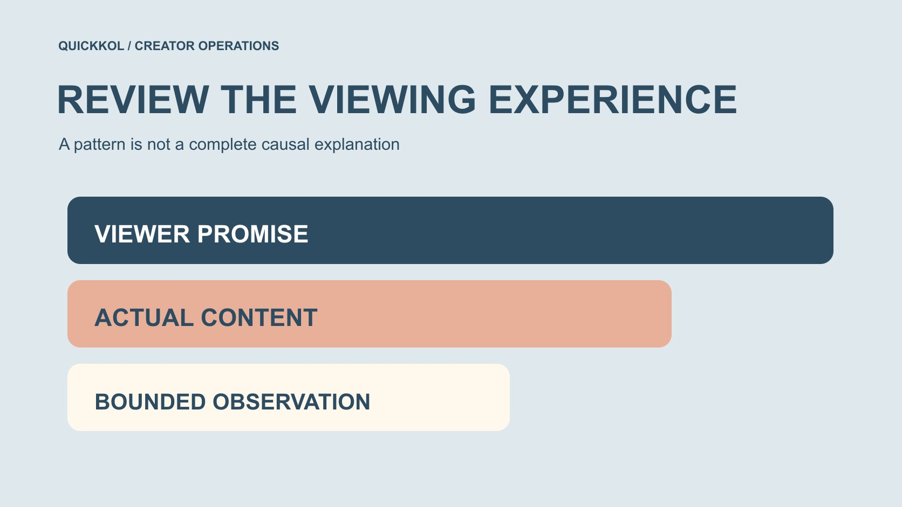

# YouTube 算法与赞助内容，怎样检查观众体验

状态：本地审阅稿；正式发布日期待确认。

品牌怎样与创作者检查赞助内容的观看体验，而不把算法当成单一公式或未经证实的责任解释。

QuickKOL 编辑图形；不呈现真实账号指标或平台界面。

YouTube algorithm 在品牌合作中不应被当成一个可以操纵的固定公式。更可执行的任务是检查标题与作品是否兑现观众预期，赞助部分是否与主题相关，必要条件是否清楚，以及可用观看证据支持什么。一次留存下降不能单独证明赞助造成，也不能证明平台惩罚了创作者。本文用官方推荐与留存资料解释观察边界，并提供达人内容复盘方法；它不承诺推荐、排名、观看或销售结果。

## 先把算法问题改写成观众问题

品牌说“这条算法不喜欢”，可能只是表达观看低于预期。先问观众被标题邀请来看什么、作品是否尽快交付相关内容，以及赞助加入后是否改变任务。没有观察依据时，不把拟人化说法当事实。

用[达人 Brief](https://www.quickkol.com/zh/blog/write-a-useful-campaign-brief/#answer) 保存原本观众问题与作品范围。复盘时比较实际版本，而不是品牌记忆中的提案。创作者可以说明为什么采用某种表达，品牌也应说明自己要求加入哪些信息。

清楚的问题可以指导改进；一个没有定义的算法标签通常只能让团队争论。

## 理解推荐背景，不寻找秘密公式

[YouTube 的推荐系统说明](https://blog.youtube/inside-youtube/on-youtubes-recommendation-system/)在 2021 年介绍个性化与观众价值，并说明系统并非固定配方。这是理解推荐的官方背景，不是今天每个信号的统一权重，也不能把当年数字当成当前行业比例。

品牌可以据此避免只用点击或时长概括全部体验。不能承诺只要某个开头、标签或赞助位置就一定获推荐；也不因为某条表现不同就断言创作者触发了隐藏规则。

把系统背景与本次数据分开。官方概念帮助提出问题，具体结论仍依赖实际作品与适当证据。

## 让标题与赞助后的实际内容一致

标题说演示一种操作，作品就应真实完成该操作并保留前提。赞助加入后若大部分变成无关介绍，观众得到的可能与原承诺不同。先检查这个可见差异，不需要先证明算法原因。

封面、开头、字幕和目的地也参与观众预期。品牌不能只批准产品卖点，却忽略剪辑后是否改变创作者原意。标题更吸引人不值得用未经支持的功能交换。

明确哪些信息必须准确、哪些是创作者的表达空间。这个检查服务内容质量，不保证任何具体表现。

## 商业说明与内容价值都要真实

[YouTube 的品牌内容政策](https://support.google.com/youtube/answer/17596007?hl=en)为品牌影响、价值交换及相应处理提供官方依据。品牌不应要求隐藏真实商业关系来追求观看，也不能把付款理解为购买不存在的体验或无条件好评。

赞助整合可以围绕真实观众问题设计，例如用产品解释某个步骤，而不是强行加入所有卖点。若产品不适合该任务，就讨论其他安排或不采用，不用创作者信任遮盖不适合。

商业说明、产品事实与素材许可分开确认。一个平台选项设置正确，不证明全部主张与使用都已经审核。

## 留存曲线提供观察，不唯一解释原因

[YouTube 的观众留存说明](https://support.google.com/youtube/answer/9314415?hl=en)解释某些时点的离开、跳过或重复观看。峰值可能与兴趣有关，也可能是内容不清而回看；在获授权报告实际提供分组时，保留可用比较。自然与付费流量、新观众与回访观众可能需要分别解释，不默认每个账号都有所有拆分。分发人群变化时，总曲线差异可能同时伴随各组不同表现。

编辑建议是列出可用组与缺失组，据此限定结论，不为填报告收集个人观看历史。汇总观察可以帮助提出新问题，却不能识别谁离开、为什么离开或后来是否购买。

下降位置值得研究，但不能单独证明原因。应按当前可用报告与定义读取。

记录视频版本、窗口、来源与实际可用分组。没有授权数据时，不从公开视频猜一条留存曲线。截图缺少上下文时，先补定义而非补结论。

评论也可提供问题线索，但少量回应不是全体观众满意度调查，更不是销售归因。

## 比较前检查条件是否相当

前一条非赞助片与后一条赞助片，可能题材、长度、受众来源和发布时间都不同。不能把所有差异归给商业关系。即使同一创作者，也不自动形成随机对照。

尽量保留本次研究问题相关条件，列出改变和无法控制项。比较窗口不同就先说明，无法对齐时按描述性观察解释，不强行得出因果。

品牌如果需要更强判断，提前设计适当研究，而不是结果出来后才追问一个原计划无法回答的问题。

## 用两分钟附近的下降做假设复盘

假设一条设备演示在两分钟附近出现下降，同时那里开始赞助说明。仅有时间重合，不能证明赞助导致。先检查该版本实际发生什么：是否停止演示、跳转题材、重复内容或漏掉前提。这里没有真实客户曲线。

如果品牌要求在此处加入较长介绍，记录这个制作决定；创作者也说明原结构。可以提出下一轮用更相关说明的建议，但不声称已经证明能提升某个比例。

同时保留来源、窗口与其他变化，说明哪些问题仍未知。复盘可以得出“需要重新设计比较”，而不必强行宣布获胜格式或找一个责任人。

## 将改进采购与原交付验收分开

作品是否符合原约定，按实际事实、版本和范围判断；下一轮如何更好，需要新的问题与工作。没有保证过的观看不应自动变成免费返工责任，真实错误则按适用安排纠正。

需要新拍摄、剪辑或许可时，明确负责人与条件。品牌提出算法要求之前，应能说明实际要改变什么，而不是让创作者“再优化一下”直到某数字变大。

将可控制作动作与不可保证的观众反应分开，有助于形成可持续的合作讨论。

## 报告保留观察与推断的标签

可以报告某时点变化、相关问题与建议，不能缩成“算法惩罚赞助”。对无法隔离的条件保持诚实，避免内部摘要比原研究更确定。业务事件另用相应来源核验，不从观看曲线推算收入。

用[社媒指标决策框架](https://www.quickkol.com/zh/blog/social-media-metrics-creator-decision-tree/#answer)区分作品验收、内容学习与商业结果。各项都有可能有价值，但证据不能互换。没有取得的数据明确未取得。

更新判断时保留日期、原因和实际影响，让下一位负责人能够复查。

## 把算法讨论接回真实创作者工作

完成时交出观众承诺、实际版本、必要商业说明、可用观察、比较限制与下一步。品牌和创作者都能知道应保留什么、需改变什么，以及谁确认。

YouTube 推荐背景能帮助理解为什么不能只追一个数字。对达人营销更有用的，是持续维护真实相关内容，并让每个结果结论保留适当证据。

下一份 Brief 应比“让算法喜欢”更具体：它要解决哪位观众的哪个问题，用什么真实方法，并怎样判断工作完成。

## 赞助作品观看体验复盘卡

| 层次 | 可记录 | 不能自动推断 |
| --- | --- | --- |
| 承诺 | 标题、封面与观众问题 | 点击等于满意 |
| 内容 | 实际演示、条件与整合 | 赞助必然受罚 |
| 观察 | 留存、窗口与具体事件 | 时间重合证明原因 |
| 决定 | 明确新问题与负责工作 | 保证未来增长 |

两分钟案例为假设；不提供隐藏算法权重或效果保证。

## 复盘赞助视频前

先看观众任务，再解释数字。

- [ ] 标题承诺与实际内容可核对。
- [ ] 商业关系与产品事实真实。
- [ ] 观看数据没有被凭空补齐。
- [ ] 观察、假设与因果分开。
- [ ] 下一轮改进有范围与接收人。

## 研究日期与使用边界

资料核验于 2026 年 11 月 12 日。文中方法、表格和决策规则为编辑建议，标为假设的示例不是实际客户结果或行业基准。外部资料的适用地区与时期按各段说明；本稿处于独立本地审阅阶段，正式发布日期待确认。

## 用清楚的任务开始达人研究

用 QuickKOL 理解 Brief、发现相关达人并研究作品与联系路径；数据、合作条件和结果仍需核验。

[了解 QuickKOL](https://www.quickkol.com/#capabilities)

## 来源

- [YouTube 的推荐系统说明](https://blog.youtube/inside-youtube/on-youtubes-recommendation-system/)
- [YouTube 的品牌内容政策](https://support.google.com/youtube/answer/17596007?hl=en)
- [YouTube 的观众留存说明](https://support.google.com/youtube/answer/9314415?hl=en)
