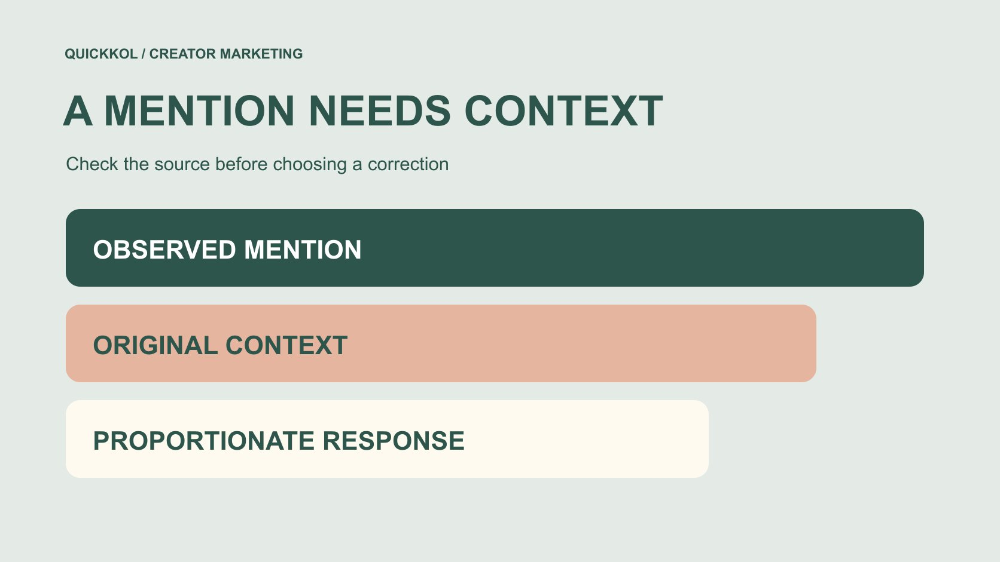

# Brand Monitoring: Correct Misattributed Creator Mentions

Status: local review draft; confirm the publication date before release.

When monitoring creator mentions, verify the original work, exact statement and product version before deciding whether and how to clarify.

QuickKOL editorial graphic; not actual account metrics or a platform interface.

Brand monitoring in creator marketing should not treat every unfavorable mention as something to suppress. Locate the original content, verify that it concerns the brand, identify the actual statement and relevant product or version, then distinguish checkable fact, personal experience, quotation and interpretation. A proportionate response may provide a source, clarify one detail, refer the matter to an appropriate owner or take no action. Match correction to evidence and consequence. A search hit or model label is not a finding against a creator, and the volume observed is not the whole market’s opinion. The useful outcome is a well-supported decision about a specific mention.

## Give monitoring a concrete question

Define what monitoring should find. After a product update, the team may need to identify references to an old feature. After an event launch, it may need to clarify descriptions confusing two locations. After a collaboration, it may need to check whether a retelling converted a personal experience into a brand promise.

The [social listening query-validation guide](https://www.quickkol.com/blog/social-listening-query-sample-validation/#answer) explains query design, coverage and manual sampling limitations. Brand monitoring then asks a further question: does this specific match require a response, and why? Keyword matching, sentiment classification and a business correction are not one automatically completed action.

State exclusions too. The task need not investigate unrelated private life or classify every category conversation as a brand mention. A precise question helps choose sources, interpret context and assign responsibility. If the objective is merely to make every mention positive, the team can start treating genuine opinions as mistakes and unnecessarily interrupt ordinary creator expression. A better objective identifies the factual or operational question that the brand can responsibly help resolve.

## Trace a repost back to its original context

Retain the matched URL, author or reposter, publication time and observation time, then locate the original work and surrounding context. A screenshot can omit captions, a correction or the question being answered. Multiple accounts sharing the same material are not automatically independent factual sources.

[Meta’s Instagram repost announcement](https://about.fb.com/news/2025/08/new-instagram-features-help-you-connect/) from August 2025 describes attribution to the original poster. For monitoring, the relevant distinction is original expression versus redistribution, not an assumption that every repost is a new endorsement, brand authorization or equivalent audience delivery.

If the original is deleted or inaccessible, preserve that limitation. Explain that only secondary material is currently available instead of pretending to have freshly checked the original. Finding its author also does not grant permission to reproduce all their work. Retain the necessary context and source for this decision rather than building an unnecessarily broad archive. This lets the next reviewer understand both how the item was encountered and how close the team actually came to the original statement.

## Separate the statement, interpretation and review state

Preserve the statement’s meaning and place the team’s interpretation in a separate field. Questions, conditions, negation and quotations can change the meaning. Does this version support the feature must not become the creator confirmed the product has no feature in a summary. Check model outputs against context as well.

Useful working states include subject unconfirmed, factual check pending, applicable source located and no correction needed. These describe progress rather than permanent labels attached to people. An issue marked misinformation without its sentence, version and basis gives a colleague little opportunity to determine whether a genuine problem exists.

Also distinguish public observation from direct confirmation. The brand may identify a checkable reason it believes a statement is inaccurate without claiming to have established malicious intent. Reliability comes from traceability and the ability to revise a finding, not forcing every match into a positive or negative verdict. A clear record should allow somebody else to disagree with the interpretation while still identifying the same underlying material.

## Match the product and version before judging accuracy

A brand name can overlap with a common word, another company or an older product. Establish the subject before comparing the statement with applicable documentation, event information or a product version. If no version is identified, record the clarification needed instead of assuming the creator describes the latest release.

Check the brand’s own source date and scope. Documentation published after an update may not contradict an experience recorded before it. A feature for one region or plan cannot be extended to every user. Where the documentation is itself ambiguous, arrange internal clarification before asking someone else to change their work.

The record should explain why a source applies to this sentence: it covers the product version and region discussed, for example, or the advertised address actually refers to another branch. Explicit connections turn a disputed mention into a solvable question. Otherwise the brand and creator can spend a long conversation comparing different products while each assumes the other has misunderstood the same facts.

## Distinguish experience from commercial context

A creator disliking a texture, finding an interface complicated or describing a problem they experienced is not necessarily a factual error that a specification sheet can refute. Supply relevant information where useful, but do not ask somebody to pretend their experience changed because a partnership exists. Evidence review should respect the actual scope of the expression.

[FTC’s influencer disclosure guide](https://www.ftc.gov/business-guidance/resources/disclosures-101-social-media-influencers) concerns clear commercial-relationship disclosure in US-relevant promotion. It supports checking the explanation of a paid or other material connection, not classifying every brand mention as sponsored or giving the brand control over all opinions.

A monitoring record can therefore identify experiential statements, checkable product facts and relationship context separately. If collaboration content lacks a relevant explanation, the appropriate owner should address the actual circumstances. If an independent author simply dislikes the product, no correction may be needed. This distinction lets the brand offer useful facts without turning an ordinary difference in opinion into an unnecessary confrontation or misrepresenting what the creator was actually asked to supply.

## Choose a response proportionate to evidence and consequence

Not every match needs a message to its author. Exclude unrelated subjects from this review, record an existing correction, ask an internal owner about unclear scope, or consider supplying a concise source for a specific factual misattribution. State the reason before choosing the action.

Where contact is appropriate, use a suitable public or business route and address the particular object and statement. Do not pressure every person mentioning the brand with an identical template. A disagreement also does not justify demanding private-account access or a complete dashboard. Refer unusual risk or complex disputes to the appropriate specialists and business owners rather than using a monitoring sheet to replace their judgment.

The responsible owner should also decide on a public response and consider whether it would amplify a small, unverified issue. This editorial method does not declare silence or public reply universally best. It requires a response to identify evidence, consequence, responsibility and remaining uncertainty. That creates a defensible operational choice without promising that one communication tactic will improve reputation or eliminate disagreement.

## Make a correction request specific and checkable

A request can identify the work, sentence, applicable source and the brand’s current understanding, then invite checking. For example: We saw the demonstration say this version exports images only; its version documentation also lists CSV. Could we check which version you used? This is an editorial example, not a finding about a real product or creator, and no message has been sent.

[FTC’s business information-security guide](https://www.ftc.gov/business-guidance/resources/protecting-personal-information-guide-business) recommends limiting unnecessary information and access. Here, share what the check requires rather than attaching customer records, private screenshots or login details to a correction request. If technical investigation is needed, the appropriate owner should arrange a controlled route instead of asking the creator to disclose sensitive information publicly.

The recipient may supply evidence showing that the brand misunderstood or its documentation is outdated. Leave room to revise the brand’s conclusion. A correction workflow is not a one-way channel for declaring final truth. Its useful result is a more accurate explanation with a traceable record of what each side actually checked.

## Rehearse a product-version mismatch

Suppose monitoring finds a retelling that says a software demonstration proves the product can never export a table. The original actually answered an image-export question about an older plan. The brand later added CSV export to a particular plan, without establishing equal capability across every version. This is a fictional exercise, not an actual platform or client result.

Preserve the relationship between retelling and original, then check the old plan, update date and current applicable documentation separately. The correction may concern never in the retelling rather than removal of the original author’s past experience. If the new feature applies only to some plans, the brand’s clarification must retain that condition too.

Record the decision: which item to address, which source to provide, who contacts the author and whether the original needs any change. If a clarification is already present, update the state rather than circulating an old screenshot as a live problem. The exercise shows how monitoring can repair a concrete misunderstanding instead of creating a permanent ranking of whose account is more trustworthy.

## Close the item with its reason and remaining limits

Close an item with the original question, applicable evidence, actual action, observed change and unresolved conditions. The [creator campaign status system](https://www.quickkol.com/blog/creator-campaign-status-system/#answer) can support ownership and next steps, but contacted, author replied and content corrected should remain different states. Sending a request does not establish resolution.

Keep coverage limitations beside the conclusion. A search that finds nothing does not prove no mention exists; several repeat shares are not the same number of independent experiences. Do not turn a convenience sample into platform-wide reputation or interpret fewer later mentions as a causal effect of the correction.

Revisit the relevant evidence, product or statement when it changes rather than tracking a person indefinitely. Completion means the next owner can understand why action was or was not taken, find its basis and revise the finding when new evidence arrives. In this form, brand monitoring supports more accurate creator partnerships and product communication without promising perfect coverage, agreement from every author or a guaranteed reputation outcome.

## Brand mention and correction record

| Field | Record | Boundary |
| --- | --- | --- |
| Source chain | Match, original work and retelling relationship | Redistribution is not automatically independent evidence |
| Specific statement | Meaning, subject, version and date | A question or experience is not automatically a factual allegation |
| Applicable evidence | Why the source applies to this check | New documentation may not refute an earlier experience |
| Action and closure | Reason, owner, change and unknowns | Contact is not correction or proof of causality |

An editorial worksheet, not a platform enforcement standard, legal judgment or complete reputation measure.

## Before acting on a creator mention

Confirm the subject and issue before choosing a proportionate next step.

- [ ] Preserve the source relationship and observation date.
- [ ] Separate the statement, team interpretation, direct confirmation and unknowns.
- [ ] Match product, version, region and documentation date.
- [ ] Distinguish checkable facts, personal experience and commercial context.
- [ ] Explain evidence and ownership for correction, referral or no action.
- [ ] Record actual changes without merging request, reply and resolution.

## Research date and limitations

Sources reviewed November 13, 2026. Methods, tables and decision rules are editorial recommendations. Hypothetical examples are not actual client results or industry benchmarks. Source geography and periods are specified where relevant. This draft is in independent local review; confirm its publication date before release.

## Start creator research with a clear task

Use QuickKOL to interpret a brief, discover relevant creators and research their work and contact routes. Verify data, commercial terms and outcomes at their source.

[Explore QuickKOL](https://www.quickkol.com/#capabilities)

## Sources

- [Meta: Instagram reposts and connection features (2025)](https://about.fb.com/news/2025/08/new-instagram-features-help-you-connect/)
- [FTC: Disclosures 101 for social media influencers](https://www.ftc.gov/business-guidance/resources/disclosures-101-social-media-influencers)
- [FTC: Protecting personal information, a guide for business](https://www.ftc.gov/business-guidance/resources/protecting-personal-information-guide-business)
