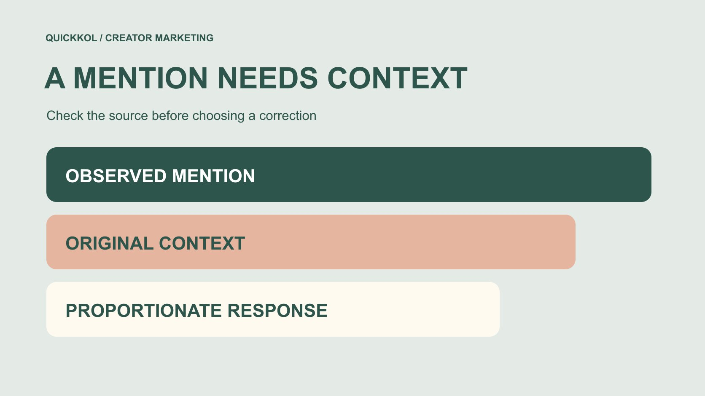

# 品牌监测怎样处理达人内容中的错认与误引

状态：本地审阅稿；正式发布日期待确认。

监测达人提及品牌时，先核对原始作品、具体说法与产品版本，再决定是否需要澄清，以及由谁处理。

QuickKOL 编辑图形；不呈现真实账号指标或平台界面。

达人营销中的 brand monitoring 不应把每条负面提及都当成需要压下去的问题。品牌先找到原始内容，核对它是否确实指向自己、实际说了什么、描述的是哪个产品或版本，再区分可验证事实、个人体验、引用与编辑推断。处理可以是补充来源、澄清一个具体细节、转交适当人员，或不采取动作。纠正应对应证据与影响，不因搜索命中或模型标签就指控创作者，也不把监测到的讨论数量当作完整市场意见。

## 把监测目的写成具体问题

先说明本次要发现什么。产品更新后，团队可能需要了解创作者是否仍在引用旧功能；活动上线后，可能需要找出把两个地点混在一起的说明；合作结束后，也可能需要核对某条二次转述是否误把个人体验写成品牌承诺。

[社交聆听查询验证指南](https://www.quickkol.com/zh/blog/social-listening-query-sample-validation/#answer)帮助团队理解搜索表达、覆盖和人工抽样的限制。品牌监测在此基础上进一步问：这一条命中是否需要处理，为什么。不要把关键词匹配、情绪分类与业务纠正当作一个自动完成的步骤。

把不处理的部分也说明白，例如并不研究无关私人生活，也不把所有行业讨论算作品牌提及。一个范围清楚的问题能够帮助选择来源、判断上下文和安排责任。若目的只是让所有提及变正面，团队很容易把真实意见当成错误，并在没有必要时打断正常的创作者表达。

## 从转发回到能核对的原始内容

保存当前命中地址、实际作者或转发者、发布时间和观察时间，再寻找原始作品及前后文。一个截图可能没有完整字幕、修订说明或作者正在回应的问题；多个账号转发同一内容，也不自动构成多个独立事实来源。

[Meta 的 Instagram 转发公告](https://about.fb.com/news/2025/08/new-instagram-features-help-you-connect/)在 2025 年 8 月描述了给原始发布者署名的转发功能。对监测而言，重要的是区分原始表达与传播路径，而不是推断每次转发都代表创作者新的推荐、品牌授权或相同的观众覆盖。

如果原始内容已删除或不可访问，就保留这个限制。可以说明当前只能看到二次材料，但不应假装已经重新核对原文。找到原作者并不意味着可以复制其全部素材；本次记录只需保留理解该提及与决定下一步所必需的内容和出处。

## 把原话、解释与状态放在不同位置

记录中保留足够准确的原意，并把团队解释放在另一个字段。疑问句、条件、否定和引用可能改变意思。“这个版本是否支持某功能”不能被摘要成“创作者确认产品没有功能”。模型输出也要回到上下文核对。

工作状态可写为对象待确认、事实待核对、已找到适用来源或无需纠正。状态描述的是当前工作进展，不给个人贴永久标签。若只写“错误信息”而没有具体句子、版本和依据，接手人难以判断问题是否真实存在。

同样区分公开观察和直接确认。品牌内部认为某项表述不准确，可以提出可检查的原因，但不应因此声称已经证明作者恶意。监测结果的可靠性来自可追溯与可修改，而不是把每条命中都强行归入肯定或否定的二元结论。

## 先匹配产品和版本，再谈是否说错

品牌名称可能与普通词、其他公司或旧产品相同。先确认内容中的对象，再对照适用的产品说明、活动信息或实际版本。没有提及具体版本时，提出需要澄清的问题，不默认作者描述的是品牌最新一版。

品牌自己的资料也要检查日期与范围。发布于更新之后的说明，不一定能反驳创作者在更新前的使用体验。面向某地区或某套餐的功能，也不能自动推广为每位用户均可使用。资料如果自身有歧义，应先安排内部确认，而不是立即要求别人删改。

可核对的记录应说明这条来源为什么适用于这句话。例如，某项说明对应所讨论的产品版本和地区；或活动地址确实指向另一分店。把这些关联写清，可以让一次有争议的提及变成可以解决的具体问题，避免品牌与创作者各自拿着不同对象讨论谁对谁错。

## 分清个人体验与商业关系

创作者不喜欢某种手感、认为界面复杂，或描述自己遇到的问题，未必属于品牌可以用一份规格表推翻的事实错误。可以补充相关信息，但不能要求对方因为合作而假装体验不同。证据核验也应尊重表达对象的实际范围。

[FTC 的达人披露指南](https://www.ftc.gov/business-guidance/resources/disclosures-101-social-media-influencers)关注美国相关推广中商业关系的清楚说明。它帮助团队检查付费或其他价值关系是否被适当说明，不把每条品牌提及自动变成付费推广，也不赋予品牌控制所有评价的权利。

监测记录因此可以同时写明体验陈述、可核对产品事实与关系说明。若合作内容缺少某项必要说明，由适当负责人按实际情况处理；若只是独立作者表达不喜欢，则可能无需纠正。把问题区分清楚，能够让品牌在提供有用事实时，避免把正常的意见差异升级为不必要的冲突。

## 选择与证据和影响相称的处理

不是每条命中都需要联系作者。无关对象可以从本次问题集中排除；已经更正的内容可记录状态；适用范围不清可以先向内部负责人求证；有具体事实依据的误引则可以考虑提供简短来源。选择处理方式前说明理由。

需要联系时，使用适当商业或公开联系路径，只针对具体对象和说法提出问题。不要用相同模板向所有提及者施压，也不要因一次数据分歧就要求访问私人账号或完整后台。涉及特殊风险或复杂争议时，由适当专业与业务人员接手，不让一般监测表代替他们的判断。

公开回应也应由实际负责人决定，并注意是否会把本来很小、尚未证实的问题进一步扩散。这个编辑方法不预设沉默或公开回复永远最好；它要求每次处理能说明证据、影响、责任，以及还有哪些不知道。

## 让纠正请求保持具体且可复核

一条请求可以说明相关作品、需要核对的句子、适用来源和品牌当前理解，再邀请对方检查。比如：“我们看到这条演示提到某版本只能导出图片；对应版本说明还列有 CSV。能否一起核对你当时使用的版本？”这是编辑示例，不是对真实产品或创作者的判断，也不是已发送消息。

[FTC 的企业信息保护指南](https://www.ftc.gov/business-guidance/resources/protecting-personal-information-guide-business)建议缩减不必要的信息和访问。应用到这里，就是只分享完成核对所需的材料，不把客户记录、私人截图或登录信息附在纠正请求中。若需技术复核，由适当人员安排受控方式，不要求创作者把敏感资料直接公开。

对方可能提供新证据，说明品牌理解有误或资料本身过时。保留修正自己结论的空间。纠正流程不是一条品牌单向输出最终真相的渠道；它的有效结果是相关说法得到更准确说明，并能追溯双方各自核对了什么。

## 用一个版本误读练习走完流程

假设品牌监测到一段软件演示，二次转述说它“永远不能导出表格”。原始作品其实是在回答旧套餐的图片导出问题。品牌后来新增了某个套餐的 CSV 导出，但并没有证明所有版本都具备相同能力。这是虚构练习，不是实际平台或客户结果。

先保存二次材料与原始作品的关系，再分别核对旧套餐、更新日期与当前适用说明。可能需要纠正的是二次转述的“永远”，而不是要求原作者把过去的体验删掉。若新功能只适用于部分计划，品牌自己的补充也必须保留这个条件。

最后把决定写出来：处理哪条内容、提供哪项来源、由谁联系，以及原始作品是否需要任何改变。如果后来确认作者已经作了说明，就更新状态，而不是继续把旧截图作为当前问题传播。这个练习说明品牌监测更适合修复具体误解，而不是制造一个谁更可信的永久排名。

## 结项时保留理由与未知

结项记录包括原始问题、适用证据、实际处理、观察到的变化和未解决事项。[达人活动状态管理方法](https://www.quickkol.com/zh/blog/creator-campaign-status-system/#answer)可帮助交接负责人和下一步，但“已联系”“作者已回复”“内容已更正”仍应是不同状态，不因为发出请求就宣布问题已解决。

监测覆盖也应留在结论旁。某次搜索没有找到相关提及，不等于网络上没有；看见几条重复转发，不等于发现同样数量的独立体验。不要将便利样本包装成全平台品牌声誉，或把后续提及减少自动解释成纠正产生了因果效果。

下一次复核可以围绕真正发生变化的资料、产品或说法展开，不必无限期跟踪个人。好的完成标准是接手者能理解为什么采取或未采取动作，找到依据，并在新证据出现时更新判断。这样，brand monitoring 才会服务于更准确的达人合作和产品沟通。

## 品牌提及与纠正记录

| 字段 | 记录内容 | 判断边界 |
| --- | --- | --- |
| 来源链 | 命中、原始作品与转述关系 | 转载不自动成为独立证据 |
| 具体说法 | 原意、对象、版本与日期 | 问题或体验不自动成为事实指控 |
| 适用依据 | 说明来源为何支持本次核对 | 品牌新资料不一定推翻过去体验 |
| 处理与结项 | 理由、负责人、变化与未知 | 已联系不等于已纠正或证明因果 |

编辑工作表，不是平台执法标准、法律判断或完整品牌声誉测量。

## 处理达人提及前

先确认对象和具体问题，再决定相称的下一步。

- [ ] 保存命中与原始作品的来源关系和观察日期。
- [ ] 区分原话、团队解释、直接确认和未知。
- [ ] 匹配产品、版本、地区和资料日期。
- [ ] 区分可核对事实、个人体验与商业关系说明。
- [ ] 为纠正、转交或不处理说明证据和责任。
- [ ] 记录实际变化，避免把请求、回复和解决混成同一状态。

## 研究日期与使用边界

资料核验于 2026 年 11 月 13 日。文中方法、表格和决策规则为编辑建议，标为假设的示例不是实际客户结果或行业基准。外部资料的适用地区与时期按各段说明；本稿处于独立本地审阅阶段，正式发布日期待确认。

## 从任务开始达人研究

用 QuickKOL 理解 Brief、发现相关达人并研究作品与联系路径；数据、合作条件和结果仍需核验。

[了解 QuickKOL](https://www.quickkol.com/#capabilities)

## 来源

- [Meta：Instagram 转发与连接功能（2025）](https://about.fb.com/news/2025/08/new-instagram-features-help-you-connect/)
- [FTC：社交媒体达人披露指南](https://www.ftc.gov/business-guidance/resources/disclosures-101-social-media-influencers)
- [FTC：企业个人信息保护指南](https://www.ftc.gov/business-guidance/resources/protecting-personal-information-guide-business)
