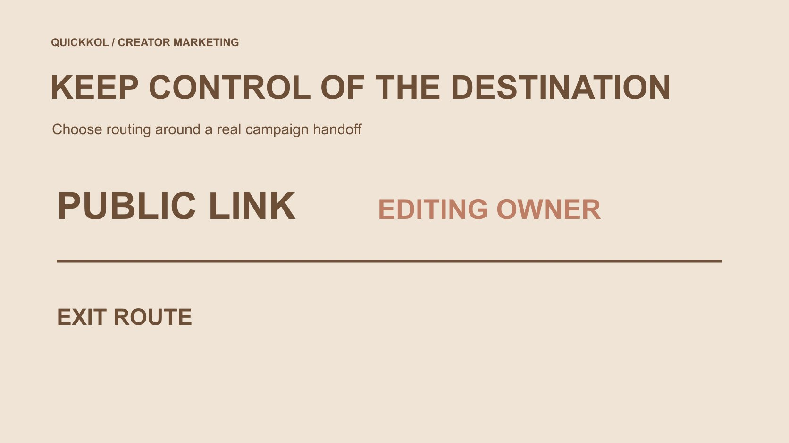

# Link in Bio Tools: Keep Control of the Campaign Destination

Status: local review draft; confirm the publication date before release.

Choose a bio-link tool beyond appearance: know who edits the entry, how destinations change and what happens to old traffic when a campaign ends or a tool changes.

QuickKOL editorial graphic; not actual account metrics or a platform interface.

When choosing link in bio tools, first decide where creator content should take the audience and who maintains that route when the offer changes. Separate the profile address, hosted link page and final brand destination. Check editing access, address limitations, link controls, record retention and exit arrangements. Official Linktree and Later documentation can inform specific capability checks, but tools, plans and current conditions are not interchangeable. A page loading does not mean viewers found the right material, and a click is not an order. Choose around the collaboration task rather than button count alone.

## Map the path the viewer actually follows

The route from creator content to profile, link page and final product or event information can contain several steps. Give each a necessary purpose instead of filling the current entry with every historical project because the tool supports more links.

The [creator brief](https://www.quickkol.com/blog/write-a-useful-campaign-brief/#answer) should connect the spoken or written action prompt to the destination. A viewer told to check conditions for a specific model still has work to do if they arrive at a generic brand homepage. A link existing does not establish completion of the task.

Define the final question and appropriate next step before choosing page organization. A tool should reduce the work of understanding. More buttons, themes or charts do not automatically improve campaign reception. The correct route often deserves priority over decoration, especially when a creator has made a specific promise about what a viewer will find after leaving the post.

## Separate address, hosted page and final destination

The address displayed in a profile, the tool-hosted page and final brand information may have different operators. Control here means practical maintenance responsibility and editing capability, not a legal ownership determination.

[Linktree’s domain guidance](https://linktr.ee/help/articles/6571689-about-custom-domains) says its native address uses linktr.ee and cannot simply be replaced with a custom domain. It also describes a redirect feature for specified plans. Redirecting is different from turning the native hosted address into a personally controlled domain.

Ask precisely how an address is maintained and what a change affects instead of relying on a broad supports-links label. No domain, redirect or paid plan was configured for this article. An appropriate owner should check actual current options rather than infer identical capability across products from one provider’s explanation. Separating the layers also makes a future change easier to discuss: the team can identify which entry stays the same and which destination is being replaced.

## Compare tools through specific tasks

[Later’s Link in Bio guide](https://help.later.com/hc/en-us/articles/4409203074967-What-is-Link-in-Bio) describes a landing page with profile information, buttons and linked posts, and distinguishes it from Instagram’s native product tagging. That difference affects how the brand describes the viewer’s next step; the terms should not be interchangeable.

Compare the page, link organization and suitable reporting needed for the assignment instead of scoring every product with one overall number. Check whether an advanced capability is available on the actual plan rather than infer that every account includes it from a public overview.

This article offers no untested winner ranking. The fit of Linktree, Later or another actual tool depends on entry, maintenance, use and exit requirements. An existing maintained destination may also perform the task. There is no need to add a service and ongoing responsibility for every collaboration merely because a separate link page is a common industry pattern.

## Assign editing responsibility to actual roles

Decide who can replace links, confirm product conditions and handle the end of the activity. A creator’s profile may serve several projects. A brand should not assume permanent control or ask for a personal login secret.

If collaborative editing is needed, check current roles and plan conditions and assign access according to the actual task. Editing a page does not establish authority to change an offer or confirm another party’s commercial relationship. Responsibility and technical permission both need clarity.

Use an appropriate change-notification route. If the brand destination changes, tell the creator whether the action prompt in their work is affected. A background target change should not leave old content promising information that no longer exists. Maintenance is not automatically resolved by completing the initial setup. The arrangement should remain workable when staff, campaigns or tools change, without requiring either party to surrender unrelated account control.

## Make labels describe the actual destination

A button label should help viewers identify the current task: a model’s information, event conditions or an appropriate inquiry. Do not label a data-collection page claim now or disguise a commercial collaboration as an unrelated personal recommendation.

Check that the short label preserves material limitations. Language versions should reach suitable information rather than merely translate the button and send viewers to conditions they cannot understand or that describe a different offer.

Order links around the task without implying unsupported priority or urgency. Simplicity makes accuracy more important, not less. One clear entry can receive an explanation more effectively than several similarly named buttons leading to unrelated old projects. The test is whether the viewer can recognize the promised information, not whether the page contains the maximum number of links or appears busy enough to suggest a large partnership program.

## Check each layer on mobile

Start from the actual profile entry and inspect the hosted page, button, final target and return path. Record accessibility and unexpected login, geographic or other conditions as observed. Your editing preview is not necessarily what every viewer sees.

Offer conditions, product model and time should match the creator’s piece. If redirects are involved, record the final destination instead of declaring success from the first URL alone. A stable address may also lead to material that has since changed.

Retain test time and environment without promising permanent availability. If a critical route fails, correct it or adopt an explicit alternative before publication. An attractive style cannot compensate for viewers being unable to find the promised information. This is a practical arrival-path check, not evidence that the page will produce a particular conversion rate or remain available under every future device and account condition.

## Distinguish hiding, archiving and deleting

[Linktree’s archive-and-delete guide](https://linktr.ee/help/articles/5434146-how-to-hide-archive-or-delete-your-links) distinguishes removing a link from the public page while retaining its Insights through archiving from permanently deleting the link and Insights. These are current provider conditions, not shared rules for every tool.

When an activity ends, decide how to preserve appropriate history, handle old entries and stop expired promises before deleting everything for tidiness. No hiding, archiving or deletion was performed for this article; actual changes belong to an appropriate owner.

If records must be handed over, confirm retention scope and available exports first rather than assume deletion remains reversible. Page cleanup and information retention are different tasks requiring coordinated decisions. A brand may retain an appropriate aggregate without preserving every viewer’s personal behavior indefinitely. The practical objective is a current public page and sufficient authorized history, not the maximum possible collection of data or the appearance that the collaboration never existed.

## Give click records their own interpretation limits

Link-page visits, button clicks, brand-site sessions and orders are different events. Sources may also differ in window, duplication and coverage. Simple subtraction or division cannot establish genuine purchases caused by the creator.

The [metrics decision guide](https://www.quickkol.com/blog/social-media-metrics-creator-decision-tree/#answer) starts with the behavior to assess. State what an entry recorded and retain what it cannot answer. A tool providing analytics does not prove all incrementality or profit.

[FTC’s business information-security guide](https://www.ftc.gov/business-guidance/resources/protecting-personal-information-guide-business) emphasizes limiting business information collection and access. If the page includes forms or other information routes, arrange them around an actual need rather than collect unrelated private material for a link comparison. The brand should understand where information originates and who receives it, not merely whether a chart rises. This keeps destination management connected to responsible collaboration instead of turning a convenient landing page into an undefined audience-data collection project.

## Rehearse an exit when a campaign ends

Suppose a creator links to an accessory workshop and viewers continue arriving from old content after the event. This is not a client case. Decide whether to display an ended notice, provide still-accurate product information or direct people to a suitable follow-up instead of accepting applications for an activity that no longer exists.

If the tool changes, identify editable public addresses and old posts or printed material that retain the earlier entry. Do not assume every old link migrates automatically or alter unrelated creator projects.

Test the new route, confirm maintenance and handle the old page under an authorized arrangement. An exit plan is more than account deletion. It needs an accurate explanation of old promises, an appropriate place for retained records and an owner for remaining questions. This rehearsal makes continuity assessable before the campaign creates long-lived links that neither party has planned to maintain.

## Choose around maintenance capability

Compare actual required capabilities, confirmed conditions and items still needing verification. Prices, plans and roles may change; do not assert fixed conclusions without current support. A simple arrangement the team can maintain may fit better than a complex one without an owner.

Retain entry, final target, editor, review time and exit plan. A creator need not convert their entire profile into an exclusive brand asset, and the brand should not silently assign indefinite destination maintenance to them.

A useful link-in-bio choice helps viewers find accurate information, tells the team how to update it and leaves a clear route after the project ends. It serves the actual creator-marketing task rather than substitute button, template or analytics counts for collaboration quality. Nor does it promise that every click becomes a business result. That is a practical basis for selecting a tool without declaring an untested universal winner.

## Compare bio-link tools by task

| Check | Confirm | Do not assume |
| --- | --- | --- |
| Address | Native address, target and change effects | Redirect means custom-domain hosting |
| Editing | Actual roles and maintenance | One collaboration grants permanent control |
| Records | Windows, definitions and retention | Clicks equal orders |
| Exit | Old entries, alternatives and history | Everything is recoverable after deletion |

An editorial comparison method informed by public provider documentation. No account or paid plan was tested and no links, domains or records were changed.

## Before choosing the bio-link tool

Check the audience path, maintenance and exit.

- [ ] Define what viewers ultimately need to find.
- [ ] Separate profile address, hosted page and target.
- [ ] Check actual editors and current capabilities.
- [ ] Test the final mobile arrival path.
- [ ] Retain metric definitions and limit information scope.
- [ ] Plan the event ending and tool-change route.

## Research date and limitations

Sources reviewed November 13, 2026. Methods, tables and decision rules are editorial recommendations. Hypothetical examples are not actual client results or industry benchmarks. Source geography and periods are specified where relevant. This draft is in independent local review; confirm its publication date before release.

## Start creator research with a clear task

Use QuickKOL to interpret a brief, discover relevant creators and research their work and contact routes. Verify data, commercial terms and outcomes at their source.

[Explore QuickKOL](https://www.quickkol.com/#capabilities)

## Sources

- [Linktree: custom domains](https://linktr.ee/help/articles/6571689-about-custom-domains)
- [Later: what Link in Bio does](https://help.later.com/hc/en-us/articles/4409203074967-What-is-Link-in-Bio)
- [Linktree: archiving and deleting links](https://linktr.ee/help/articles/5434146-how-to-hide-archive-or-delete-your-links)
- [FTC: Protecting personal information, a guide for business](https://www.ftc.gov/business-guidance/resources/protecting-personal-information-guide-business)
