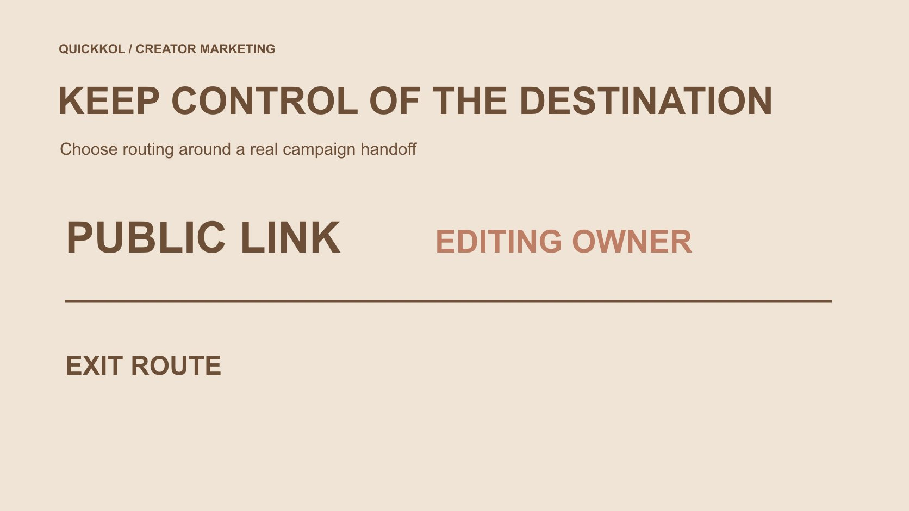

# Link in Bio 工具怎样保留合作落地页的控制权

状态：本地审阅稿；正式发布日期待确认。

简介链接工具的选择，不只看页面外观。达人合作更需要知道谁能改入口、目标改变后怎样更新，以及活动结束和换工具时如何承接旧流量。

QuickKOL 编辑图形；不呈现真实账号指标或平台界面。

选择 link in bio tools 时，先确认达人内容希望把观众带到哪里，以及谁能在活动变化后维护这条路径。把简介地址、工具托管页面和最终品牌目的地分开，检查编辑权限、地址限制、链接开关、记录保留与退出安排。Linktree 和 Later 的官方资料能帮助理解具体能力，但不同工具、计划与当前条件不能默认相同。页面能打开不等于观众找到正确内容，点击也不等于订单；选择应服务合作任务，而不是只比较按钮数量。

## 先画出观众实际走的路径

从创作者作品到简介，再到链接页和最终产品或活动信息，可能有多个步骤。每一步都应有必要用途；不要因为工具可以增加链接，就把全部历史项目塞进当前入口。

[达人 Brief](https://www.quickkol.com/zh/blog/write-a-useful-campaign-brief/#answer) 需要说明作品中的行动提示与目的地怎样对应。观众听到“查看这个型号的条件”，到达后却只看到泛品牌首页，就仍要自行寻找，链接存在并不说明任务完成。

先写清最终问题和适当下一步，再选择页面组织。工具应降低理解成本，不应该让品牌以为只要买到更多按钮、主题或统计图，就自然获得更好的达人合作承接。正确路径往往比页面装饰更值得优先确认。

## 分清地址、页面与最终目标

简介里显示的地址，工具提供的页面，以及品牌最终资料，不一定由同一人控制。这里的控制指实际维护责任与可编辑能力，不替代法律上的所有权判断。

[Linktree 的域名说明](https://linktr.ee/help/articles/6571689-about-custom-domains)写明其原生地址使用 linktr.ee，不能直接替换成自有域名。它还介绍特定计划的重定向功能；重定向与把原生托管地址变成自有域名不是同一能力。

因此品牌应具体询问地址如何维护、变更后什么会受影响，不只看“支持链接”四个字。本篇没有设置域名、执行跳转或测试付费计划。选择时由适当负责人核对当前实际选项，而不是从一个工具的说明推断所有产品相同。

## 用具体任务比较工具

[Later 的 Link in Bio 说明](https://help.later.com/hc/en-us/articles/4409203074967-What-is-Link-in-Bio)介绍了包含资料、按钮和关联帖子的落地页，也明确它不同于 Instagram 原生产品标记。这个区别会影响品牌如何描述观众下一步，不应混用名称。

比较时可要求查看当前任务所需的页面、链接组织与适当统计，而不是先给所有产品打一个总分。某项高级能力是否在当前计划可用，仍需核对，不从公开介绍推断全部账号都包含。

本篇不提供未经实测的赢家排名。Linktree、Later 或其他实际工具是否适合，取决于入口、维护、使用和退出要求。品牌也可以评估现有可维护页面能否完成任务，无需为了每次合作重新增加服务与长期责任。

## 把编辑责任落实到实际角色

谁能更换链接、谁确认产品条件、谁处理活动结束，需要在合作前明确。创作者的简介可能服务多个项目，品牌不能默认取得永久控制，也不宜要求对方共享个人登录秘密。

若需要合作编辑，核对工具当前角色与计划条件，并按实际任务分配。能编辑页面，不等于能改变报价或代表另一方确认商业关系。责任与技术权限都应清楚。

设定适当的变更通知方式。例如品牌目的地调整，应让创作者知道是否影响作品中的行动提示。不要在后台改了目标，却让旧内容继续承诺已经不存在的资料。维护安排不是一次性设置完成后就自动解决的事情。

## 让链接标签准确描述目标

按钮名称应帮助观众辨认当前任务，例如具体型号资料、活动条件或适当咨询。不要用“立即领取”指向只是收集信息的页面，也不要把广告合作伪装成不相关的个人推荐。

确认短标签没有删除关键限制。不同语言版本也应指向适合的资料，不能只翻译按钮，却把观众带到与其无法理解或不相符的条件页面。

链接排序可以根据当前任务调整，但不应暗示没有依据的优先性或限时承诺。页面越简单，越需要每个标签准确。一个明确入口通常比多个名称相似、指向不同旧项目的按钮，更适合承接创作者已经解释清楚的问题。

## 在手机上检查每一层跳转

从实际简介入口开始，逐项检查页面、按钮、最终目标和返回路径。是否可访问、是否出现不预期登录、地区或其他条件，都按实际情况记录，不假定自己的编辑预览等于所有观众所见。

活动条件、产品型号和时间应与创作者内容相同。若中间重定向改变，记录最终到达位置，避免只看最初 URL 就认定正确。长期链接也可能指向后来修改的内容。

测试记录保留时间与环境即可，不承诺永久可用。发现关键路径不成立时，先修正或采用明确替代，再让创作者继续发布。页面样式漂亮并不能弥补观众无法找到承诺资料的缺口。

## 把隐藏、归档与删除区分

[Linktree 的归档与删除说明](https://linktr.ee/help/articles/5434146-how-to-hide-archive-or-delete-your-links)区分暂时移出公开页并保留相关 Insights 的归档，与永久删除链接及其 Insights。这里引用当前供应方条件，不把它当作所有工具共同规则。

活动结束后先决定需要怎样保留历史、处理旧入口和停止过期承诺，不为了让页面干净直接删除一切。本篇未执行任何隐藏、归档或删除操作，实际变更由适当负责人处理。

如果记录需要交接，先确认保留范围和可用导出，不假设删除后仍能找回。页面清理与资料留存是不同任务，应同时考虑。品牌可保留适当汇总，而不是无限保存每个观众的个人行为记录。

## 点击资料要有自己的解释边界

链接页访问、按钮点击、品牌网站会话与订单不是同一个事件。不同来源还可能有窗口、重复计数和覆盖差异，不能简单相减或相除就宣称创作者带来真实购买。

[指标决策指南](https://www.quickkol.com/zh/blog/social-media-metrics-creator-decision-tree/#answer)帮助先说明要评估的行为。报告可说明某个入口记录了什么，不能回答的部分也应保留。工具提供统计，不等于已经证明全部增量或利润。

[FTC 的企业信息保护指南](https://www.ftc.gov/business-guidance/resources/protecting-personal-information-guide-business)强调限制企业信息收集与访问。若页面包含表单或其他资料路径，按实际需要安排，不为一项链接比较收集无关私人信息。品牌应该理解数据从哪里来、流向谁，而不仅是看图表有没有增长。

## 用一个活动结束场景检查退出计划

假设创作者为一次配件工作坊放置入口，活动结束后仍有观众从旧作品到达。例子不是实际客户。团队需要决定显示结束说明、提供仍准确的产品资料，或转到适当后续页面，而不是继续接受不存在的活动申请。

若更换工具，先核对哪些公开地址能更新、哪些旧作品或印刷资料仍会保留旧入口。不要假设所有旧链接自动迁移，也不要擅自改动创作者无关项目。

测试新路径、确认维护责任，再按获准安排处理旧页面。退出计划不是只有删除账号；它需要让旧承诺有准确解释、相关记录有适当去处，并让双方知道谁继续处理遗留问题。

## 按维护能力选择，而不是追逐功能数量

比较工具时，列出真实必需能力、当前已确认条件和仍需核验事项。价格、计划与角色可能改变，不在没有当前依据时写固定结论。一个团队能维护的简单方案，可能比无人负责的复杂方案更适合。

保留入口、最终目标、编辑人、复核时间与退出安排。创作者无需把全部简介变成品牌专属资产，品牌也不应把长期承接责任默认为对方承担。

好的 link in bio 工具选择，让观众找到准确内容，让团队知道怎样更新，并让项目结束后仍有清楚处理路径。它服务达人营销的真实任务，不以按钮、模板或统计数量代替合作质量，也不承诺点击一定转为商业结果。

## 简介链接工具的任务比较

| 检查项 | 要确认 | 不能默认 |
| --- | --- | --- |
| 地址 | 原生地址、目标与变更影响 | 重定向等于自有域名托管 |
| 编辑 | 实际角色与维护责任 | 一次合作授予永久控制 |
| 记录 | 窗口、定义与保留条件 | 点击等于订单 |
| 退出 | 旧入口、替代与历史安排 | 删除后全部可恢复 |

公开供应方资料支持的编辑比较方法；未实测账户或付费计划，未更改链接、域名或资料。

## 确定简介链接工具前

从观众路径到维护和退出逐项确认。

- [ ] 明确观众最终需要找到什么。
- [ ] 区分简介地址、托管页和目标。
- [ ] 核对实际编辑人和当前能力。
- [ ] 测试手机上的最终到达路径。
- [ ] 保留统计定义并限制资料范围。
- [ ] 安排活动结束及工具更换路径。

## 研究日期与使用边界

资料核验于 2026 年 11 月 13 日。文中方法、表格和决策规则为编辑建议，标为假设的示例不是实际客户结果或行业基准。外部资料的适用地区与时期按各段说明；本稿处于独立本地审阅阶段，正式发布日期待确认。

## 从任务开始达人研究

用 QuickKOL 理解 Brief、发现相关达人并研究作品与联系路径；数据、合作条件和结果仍需核验。

[了解 QuickKOL](https://www.quickkol.com/#capabilities)

## 来源

- [Linktree：自定义域名说明](https://linktr.ee/help/articles/6571689-about-custom-domains)
- [Later：Link in Bio 的用途](https://help.later.com/hc/en-us/articles/4409203074967-What-is-Link-in-Bio)
- [Linktree：归档与删除链接](https://linktr.ee/help/articles/5434146-how-to-hide-archive-or-delete-your-links)
- [FTC：企业个人信息保护指南](https://www.ftc.gov/business-guidance/resources/protecting-personal-information-guide-business)
