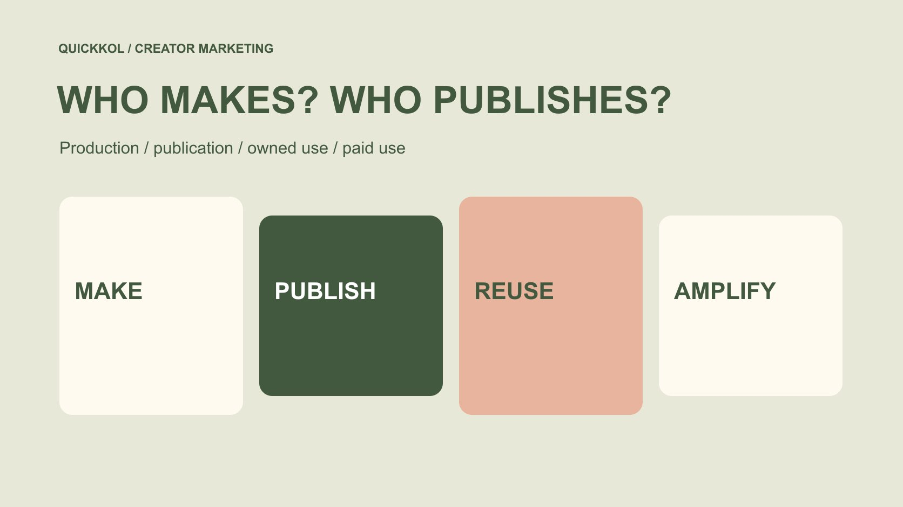

# Media Strategy: Assign Creator Content a Distribution Role

Status: local review draft; confirm the publication date before release.

Plan creator production, creator publication, owned distribution and paid use separately instead of making one quote carry four different promises.

QuickKOL editorial graphic; not actual account metrics or a platform interface.

A creator media strategy should explain who makes the content, where it is published, how the brand may reuse it and whether paid distribution is planned. Begin with the audience’s question, then assign assets, permission, budget and ownership to each distribution role. Delivery of a file is not a commitment to publish on the creator’s account, and publication does not automatically include advertising rights. Exposure across channels may overlap, so adding counts does not produce unique people. A useful strategy connects each investment to defined work and distinguishes observable outcomes from effects that have not been established.

## Start with a communication problem

A media strategy is not a page filled with platform names. Identify what the intended audience still needs to understand: whether software fits a workflow, whether a local event merits attending, how a home product works in a real space, or how a specialist method is applied. Different questions require different creator capabilities and distribution roles.

Keep a reviewable audience task in the [creator brief](https://www.quickkol.com/blog/write-a-useful-campaign-brief/#answer), together with a next step the brand can actually support. A piece might help a purchasing team understand a demonstration and invite a relevant question. That is different from guaranteeing qualified leads or sales. Being understandable, discoverable and commercially effective are different judgments.

Choosing the question first explains why a creator’s expression is needed, why an owned explanation page may also matter, and whether additional distribution is worth buying. A strategy that starts and ends with more exposure provides little basis for explaining why production, publication and advertising costs should all exist. It can also cause every channel owner to optimize an unrelated count while the audience’s actual information need remains unanswered.

## Buy production as a deliverable

Creator production pays for work such as concept development, filming, performance, explanation and file delivery. Specify the asset, language, versions, facts to explain and reasonable review arrangements. The purchase may be one demonstration or a set of explanatory assets; creator content is too broad to serve as the deliverable definition.

If later editing matters, establish the available files, crop room, captions, audio treatment and permitted modifications. Receiving a piece designed for the creator’s own account does not establish that every raw take, performance or future production service was purchased. Describe both what is delivered and how it may be used.

Acceptance should examine the agreed work: whether the product is understandable, statements are accurate, audio is usable and necessary qualifications remain. A later advertising purchase must not retroactively make the creator responsible for media results that were never part of the production scope. File receipt, creative approval and permission for a new use should retain their own statuses and versions. This makes a revision request about a concrete defect rather than an undefined demand for better performance.

## Separate creator publication from owned distribution

Creator publication requires a named account, format, release arrangement and any agreed maintenance. Owned distribution is published by the brand and usually needs its own use and version description. Both may draw on the same filming, but audience expectations, account control and follow-up responsibility differ.

An owned destination can carry specifications, event information or a demonstration inquiry, leaving the creator’s shorter piece focused on one useful explanation. Someone must maintain the destination’s facts, forms and contact routes. Sending people there does not establish that the receiving experience is ready to help them.

Do not describe a creator’s following as traffic the brand controls. Publication is an agreed content action, not delivery of every follower to the advertiser. Viewing on the original post and an owned channel may also come from the same people. List those sources separately unless a suitable deduplication method supports a combined people count. This prevents a media plan from quietly converting separate platform observations into a larger audience claim than its evidence can support.

## Assign responsibility for commercial context

[YouTube’s branded-content disclosure guide](https://support.google.com/youtube/answer/154235?hl=en) requires the relevant paid-promotion setting for commercial content. A YouTube publication plan should name who checks the applicable setting and final asset, rather than assuming the platform handles everything. Confirm the requirements for the actual platform, account and region at release.

[FTC’s influencer disclosure guide](https://www.ftc.gov/business-guidance/resources/disclosures-101-social-media-influencers) addresses clear material-connection disclosure in US-relevant promotion. Review platform labels alongside the content’s explanation of the relationship; products, services and other value can matter as well as cash. A profile biography, owned landing page or internal contract does not establish that every viewer has seen the disclosure.

Assign this work to an actual owner and leave time for the final-version check. Confirmation should refer to the publication object, not an earlier script that has since changed. The creator retains their genuine experience, the brand supplies accurate facts, and both clarify the responsibilities they can undertake. Treat the check as part of preparing the communication rather than a generic approval tick that can be copied from one channel to another.

## Check asset conditions before buying paid use

For paid distribution, specify the advertising party, account, version, territory, period and required platform authorization. Creator publication, a file-use license and advertising access are related arrangements, not interchangeable ones. A missing condition should change the current plan instead of leaving a media operator to guess at launch.

[TikTok’s Commercial Music Library guide](https://ads.tiktok.com/resources/help/article/commercial-music-library?lang=en) distinguishes commercial music use from its general library. A pleasing sound cannot simply be assumed usable across every creator post, brand advertisement and other platform. Define the intended route, have the appropriate person check permission where needed, and consider a useful music-free or clean-voice version.

Give the operator a retrievable record identifying the asset and scope rather than an isolated assurance that rights are covered. A technical upload or available authorization code does not establish that every commercial use has been agreed. Name an owner for stopping or replacing material when permission expires, is withdrawn or a product statement changes, so the advertising team and creator do not each assume the other has already acted.

## Separate work costs from distribution spending

List production, creator publication, agreed reuse, additional versions and media spending separately. This identifies the purchase, rather than prescribing an identical fee structure for every partnership. A bundled quote can be appropriate, provided the team can still explain its inclusions and the changes that would reopen a discussion.

Consider a hypothetical plan with $1,200 for production, $800 for creator publication, $600 for agreed reuse, $300 for extra editing and $2,000 in media spending. The total is $4,900. These are editorial assumptions, not market prices or a performance forecast. Calling the whole $4,900 platform advertising spend would misclassify the purchase; a platform spending report cannot establish the creator’s actual income either.

If the budget shrinks, decide which work or distribution role is removed and rewrite the deliverable accordingly. Reducing media spending does not automatically reduce production already completed. Removing an asset version likewise does not guarantee unchanged advertising performance. Describe the trade-off rather than hiding a changed scope inside a smaller all-inclusive number.

## Match the observation to the distribution role

Production acceptance asks whether the agreed work was delivered. Creator-publication observation describes a particular post within a stated window. An owned-destination check establishes whether information and the next step work. Paid reporting describes distribution under the relevant advertising account. These roles need not share one success metric, and their measures cannot substitute for each other.

Use the [social media metrics decision framework](https://www.quickkol.com/blog/social-media-metrics-creator-decision-tree/#answer) to retain source, window, unit and missingness. Interaction events are not unique people, clicks are not qualified inquiries, and attributed orders do not automatically establish incrementality. Where an owned system and a platform disagree, investigate definitions and measurement conditions before declaring the smaller number wrong.

State an unavailable outcome as a data gap. The team can still assess explanatory quality, operational readiness or the value of a better-designed follow-up test. A complete-looking media table is not a reason to replace unknowns with zero or convert unrelated channel estimates into a single invented unit of influence. This keeps learning useful without overstating what the campaign actually measured.

## Hand over the sequence to the people operating it

A collaboration might review the creator’s finished asset, publish the original, release an owned explanation and then activate paid distribution. That sequence is an example, not a universal workflow. For each step, identify required inputs, operator, completion evidence and response to failure.

If the creator’s original publication is delayed, can the brand independently release an already-permitted version? If an advertising code is unresolved, does paid activation wait or use another authorized asset? If the destination contains an incorrect specification, who pauses the entry point? Answer from the actual conditions, not by expecting operators to enlarge permission at the last moment.

Include the usable files and superseded versions in the handover. The media operator should not pick whichever attachment appears newest in a chat. Give late changes a contact and a clear decision point, allowing revisions to enter the agreed review instead of prompting simultaneous changes across channels with nobody able to reconstruct what was finally released. A media strategy becomes operational when these dependencies can be acted on by its actual users.

## Revise the part the evidence supports

Locate a review issue in its actual role: an unclear explanation, changed creator-publication conditions, a broken owned destination or paid delivery that did not follow the plan. Each calls for a different response. They should not all become claims that the creator failed or the algorithm changed.

Repeated questions about one specification may justify improving the explanation or destination. An advertisement that never ran provides no paid-test result, and a permitted-use problem that prevented distribution is not evidence that the creator’s content was ineffective. Keep the asset, observation window and handling record attached to the conclusion.

The revised strategy should explain which audience task stays, which distribution arrangement changes and who reconfirms the affected conditions. Its role map exists to make promises understandable, not to create additional administration. Both brand and creator should be able to identify their commitments, the input needed next and the outcomes that the present evidence still cannot guarantee. That is a more useful foundation for the next partnership than a single combined exposure total with no explanation of how the work reached anyone.

## Creator media roles and handoff

| Role | Confirm | Appropriate observation |
| --- | --- | --- |
| Production | Asset, versions, facts and review | Whether agreed work was delivered |
| Creator publication | Account, format, arrangement and context | Named post and observation window |
| Owned distribution | Use scope, destination and receiving owner | Whether information and next step work |
| Paid distribution | Account, permission, asset and media budget | Defined delivery measures, not automatic incrementality |

An editorial framework, not universal platform pricing, a performance benchmark or a standard license.

## Before the media strategy is released

Each role should identify concrete work, an owner and conditions.

- [ ] State an audience question and an available next step.
- [ ] Confirm production, account publication, owned reuse and paid distribution separately.
- [ ] Retain permission records for audio, editing and subsequent use.
- [ ] Distinguish creator fees, other production costs and media spending.
- [ ] Record each observation’s source, window, unit and unknowns.
- [ ] Assign owners for delays, incorrect destinations, expiry and replacement.

## Research date and limitations

Sources reviewed November 13, 2026. Methods, tables and decision rules are editorial recommendations. Hypothetical examples are not actual client results or industry benchmarks. Source geography and periods are specified where relevant. This draft is in independent local review; confirm its publication date before release.

## Start creator research with a clear task

Use QuickKOL to interpret a brief, discover relevant creators and research their work and contact routes. Verify data, commercial terms and outcomes at their source.

[Explore QuickKOL](https://www.quickkol.com/#capabilities)

## Sources

- [YouTube: Branded-content disclosure settings](https://support.google.com/youtube/answer/154235?hl=en)
- [FTC: Disclosures 101 for social media influencers](https://www.ftc.gov/business-guidance/resources/disclosures-101-social-media-influencers)
- [TikTok: Commercial Music Library](https://ads.tiktok.com/resources/help/article/commercial-music-library?lang=en)
