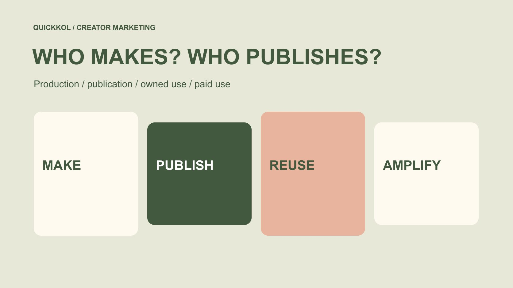

# 达人媒体策略：制作、发布与放大

状态：本地审阅稿；正式发布日期待确认。

把创作者制作、本人账号发布、品牌自有分发和付费使用分开规划，避免一份报价承载四种不同承诺。

QuickKOL 编辑图形；不呈现真实账号指标或平台界面。

达人营销中的 media strategy 应说明内容由谁制作、在哪里发布、品牌怎样复用，以及是否进行付费分发。先确定观众需要理解的问题，再给每种分发角色安排素材、许可、预算和负责人。创作者交付文件不等于承诺本人账号发布，账号发布也不自动包含品牌投放权。不同渠道的曝光可能重复，不能直接相加成独立受众。有效策略让每一笔投入对应一项明确工作，并说明哪些结果可以观察、哪些尚不能归因。

## 先明确媒体策略的问题

媒体策略不是把平台名称列满一页。先说明目标读者在合作前还不理解什么：软件是否适合其工作、门店活动是否值得到场、家居产品怎样放进实际空间，或某个专业方法怎样实施。需要解释的问题不同，适合的创作者和分发角色也会不同。

在[达人 Brief](https://www.quickkol.com/zh/blog/write-a-useful-campaign-brief/#answer) 中保留一个可以核对的观众任务，以及品牌能够承担的下一步。例如，作品让采购团队理解演示过程，下一步是查看说明或提出问题；这不同于直接保证有效线索或成交。内容可看懂、可找到与能够带来订单，是不同层次的判断。

先选择问题，才能说明为什么需要创作者的表达，为什么还要品牌自己的说明页面，以及是否值得购买额外分发。若策略仅以“增加曝光”开头，后续往往很难解释为什么一笔制作费用、一笔发布费用和一笔广告费用应当同时存在。

## 把制作列为可验收任务

创作者制作承担的是构思、拍摄、表演、解释和文件交付等工作。写清成片对象、语言、版本、需说明的事实和合理审阅安排。它可以是一条演示，也可以是一组说明素材，但不能用“达人内容”这个宽泛名字代替交付定义。

如果品牌需要后续剪辑，事先确认可用文件、裁切空间、字幕与声音安排，以及允许修改的范围。不能在收到一条用于创作者本人账号的作品后，默认已经买到所有原始片段、表演和二次制作服务。可交付内容与可使用内容需要同时说明。

验收围绕约定工作：产品是否展示清楚、事实是否准确、声音是否可理解、必要说明是否保留。不要因为品牌随后买了广告，就倒过来要求创作者对媒体投放效果承担未约定的制作责任。文件被接收、作品被批准和新用途被许可，也应保留各自的状态与版本。

## 把创作者发布与品牌自有渠道分开

创作者账号发布，需要确认具体账号、内容形式、上线安排和必要的后续维护。品牌自有渠道则由品牌安排发布，通常还需要独立的使用范围与版本说明。两种分发都可能使用同一段拍摄，但观众预期、管理权限和后续责任并不相同。

品牌可以安排自有页面承接详细规格、活动信息或演示请求，不要求创作者在一条短内容里塞进全部信息。与此同时，承接页面中的产品事实、表单和联系路径应有人维护。作品能把人带过去，不代表目的地已经准备好服务这些人。

不要把创作者的账号规模写成品牌自己的可支配流量。发布是约定的内容动作，不是把全部关注者交付给品牌。自有渠道与达人原帖的观看也可能来自同一批人；报告可以分别列出来源，不能未经去重就把它们命名为总独立受众。

## 让发布责任覆盖商业内容说明

[YouTube 的商业内容披露说明](https://support.google.com/youtube/answer/154235?hl=en)要求在相关商业内容的视频详情中使用付费推广设置。品牌在规划 YouTube 创作者发布时，应安排谁检查适用设置与最终内容，而不是只在项目表里写一句“平台会自动处理”。具体适用要求仍须按当时平台和地区确认。

[FTC 的达人披露指南](https://www.ftc.gov/business-guidance/resources/disclosures-101-social-media-influencers)从美国相关推广场景解释商业关系的清楚披露。平台标签与内容里的表达应当共同检查；创作者得到赠品、服务或其他价值，也可能影响需要说明的关系。不要把一条简介、品牌自有页面或一份内部合同当成所有观看者都已看到的披露。

媒体策略需要把这项工作交给真实负责人，并留出最终版本检查。确认应针对实际发布对象，而不是拍摄前一个后来已被修改的脚本。创作者保留真实体验，品牌提供准确事实，双方分别确认自己能够承担的部分。

## 付费使用先检查素材条件，再决定预算

计划付费分发时，明确广告使用的主体、账号、版本、地域、时间与需要的平台授权。创作者账号发布、文件许可和广告权限是相关但不同的安排。任何一项缺失，都应影响当前计划，而不是等投放人员临上线才去猜测。

[TikTok 的商用音乐库说明](https://ads.tiktok.com/resources/help/article/commercial-music-library?lang=en)将商业内容的音乐使用与一般音乐库区分。媒体策略因此不能只选一个好听的声音，再假定它可用于所有创作者帖、品牌广告和其他平台。先明确使用路径，必要时请合适人员核对许可，并准备有用的无音乐或独立清晰旁白版本。

给投放者的不是一句“有权用”，而是能够定位素材和范围的记录。技术上能上传或能取得代码，不说明商业约定已经覆盖所有用途。到期、撤回或素材事实发生变化时，应能找到停用和替换负责人，避免广告团队与创作者各自以为另一方已经处理。

## 把费用分成工作与分发，而非预测结果

预算表应把制作、账号发布、约定复用、额外版本与媒体花费分列。这是识别采购对象的方法，不是建议每份合作都收取相同费用项目。某些安排可以合并报价，但合并后仍需知道包含什么，哪些条件会产生额外讨论。

假设一个方案包含制作 1,200 美元、创作者发布 800 美元、约定复用 600 美元、额外剪辑 300 美元和媒体花费 2,000 美元，总额为 4,900 美元。这只是编辑算例，不是市场报价或效果预测。不能把 4,900 美元都称作广告平台花费，也不能以平台报表里的支出推断创作者实际收入。

若预算缩减，先决定删掉哪个工作或分发角色，再重写交付要求。减少媒体花费并不会自动减少已经完成的制作工作。反过来，少制作一个版本也不保证广告效果不变。清楚说明取舍，比用一个模糊的全包预算隐藏范围变化更有用。

## 给每个分发角色一个合适的观察口径

制作验收回答是否交付了约定内容；创作者发布观察回答该帖在指定窗口内有什么可见或授权数据；自有承接回答页面和下一步是否可用；付费报表描述指定广告账户下的分发。它们不必使用同一个成功指标，更不能互相代替。

用[社媒指标决策框架](https://www.quickkol.com/zh/blog/social-media-metrics-creator-decision-tree/#answer)保留字段来源、窗口、单位和缺失状态。互动事件不是独立人数，点击不等于有效咨询，归因订单也不自动证明增量。自有页面与平台口径不一致时，先找定义和测量条件差异，不凭一个较大的数字宣布另一方错误。

对于无法观察的结果，写出数据缺口。可以继续评估内容是否完成解释、流程是否可运行，或者是否值得设计更合适的后续测试；不要为了做一张完整媒体总表，把未知补成零，或者把不同渠道的估计强行换算成同一种影响力。

## 把分发顺序交接给实际操作者

一次合作可能先审阅创作者成片，再上线原帖，之后发布品牌解释页，最后启用付费素材。顺序只是项目安排的例子，不是所有合作的固定流程。把每一步需要的输入、负责人员、完成确认和失败后的处理写出来。

例如，创作者原帖迟到时，品牌是否仍能独立发布已经获许可的版本？广告代码尚未确认时，是延后投放还是改用不同的已授权素材？承接页面发现规格错误时，谁暂停入口？答案应来自真实条件，不靠运营人员临时扩大许可来填补。

交接还应包括当前可用文件和已作废版本。不要让投放人员从群聊里选择看起来最新的附件。为晚到的变化留一个明确联系人与截止判断，让修改能够进入既定审阅，而不是所有人同时更改不同渠道却无人知道最终发布了什么。

## 复盘时改变真正有证据的问题

复盘先确定问题发生在哪个角色：内容解释不清、创作者账号发布条件变化、品牌承接失效，还是付费分发没有满足原计划。每个问题需要不同的下一步，不应都归结为“这位达人不行”或“平台算法变化”。

如果观众反复问同一规格问题，可以改进解释或目的地；如果广告尚未运行，不能把原帖表现当作付费测试结果；如果素材因许可条件未使用，也不能把缺少分发写成创作者没有效果。为结论保留可检查的作品、窗口与处理记录。

最终策略应该能回答：保留哪个内容任务，调整哪项分发安排，由谁重新确认条件。媒体角色图不是为了增加表格，而是让品牌和创作者在同一份计划里知道自己承诺了什么、接下来需要什么，以及现有证据还不能保证什么。

## 达人媒体角色与交接表

| 角色 | 需确认对象 | 合适观察 |
| --- | --- | --- |
| 制作 | 成片、版本、事实与审阅 | 约定内容是否交付 |
| 创作者发布 | 账号、形式、安排与说明 | 指定帖子和窗口 |
| 品牌自有渠道 | 使用范围、页面与承接责任 | 信息与下一步是否可用 |
| 付费分发 | 账号、许可、素材、媒体预算 | 指定投放口径，不自动证明增量 |

编辑框架，不是平台统一报价、效果基准或通用许可条款。

## 媒体策略发出前

每种角色都要能指向具体工作、负责人和条件。

- [ ] 说明观众需要理解的一个问题及可用下一步。
- [ ] 分别确认制作、账号发布、自有复用与付费分发。
- [ ] 为声音、剪辑与后续用途保留适当许可记录。
- [ ] 区分创作者费用、其他制作费用与媒体支出。
- [ ] 记录每项观察的数据来源、窗口、单位与未知。
- [ ] 给延迟、错误目的地、到期素材与替换安排负责人。

## 研究日期与使用边界

资料核验于 2026 年 11 月 13 日。文中方法、表格和决策规则为编辑建议，标为假设的示例不是实际客户结果或行业基准。外部资料的适用地区与时期按各段说明；本稿处于独立本地审阅阶段，正式发布日期待确认。

## 从任务开始达人研究

用 QuickKOL 理解 Brief、发现相关达人并研究作品与联系路径；数据、合作条件和结果仍需核验。

[了解 QuickKOL](https://www.quickkol.com/#capabilities)

## 来源

- [YouTube：商业内容披露设置](https://support.google.com/youtube/answer/154235?hl=en)
- [FTC：社交媒体达人披露指南](https://www.ftc.gov/business-guidance/resources/disclosures-101-social-media-influencers)
- [TikTok：商用音乐库](https://ads.tiktok.com/resources/help/article/commercial-music-library?lang=en)
