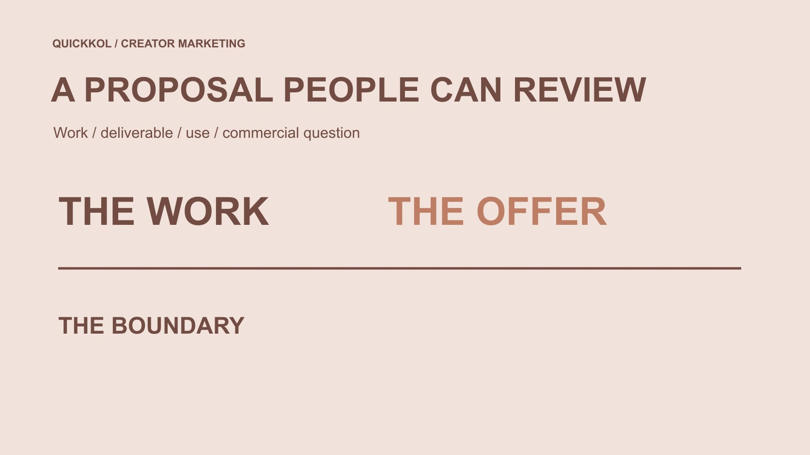

# Get Sponsored as an Influencer: Build a Reviewable Proposal

Status: local review draft; confirm the publication date before release.

Turn sponsorship interest into a proposal a brand can assess: relevant work, clear deliverables, discussable conditions and a checkable contact route.

QuickKOL editorial graphic; not actual account metrics or a platform interface.

To get sponsored as an influencer, prepare a proposal a brand can assess rather than wait for a universal follower threshold. Explain which audience task you can help with, demonstrate capability through relevant genuine work, and distinguish production, publication on your account and brand use. Retain source, date and limitations for data, base quotes on explicit conditions and guarantee no views, sales or income. A brand should assess the actual task, evidence and scope instead of treating an attractive media kit as completed fit verification. A reviewable proposal can open a discussion; it cannot guarantee acceptance.

## Choose an opportunity around the brand’s question

Begin with work you can actually perform. A technology product may need an operation explained, a home brand may need real placement, and an event may need hosting. Connect relevant capability and interest to the brand task rather than saying only my audience will love it.

The [creator brief](https://www.quickkol.com/blog/write-a-useful-campaign-brief/#answer) lets a brand identify who needs to understand what and the appropriate next step. A proposal responds with an approach to that task instead of sending every possible sponsor the same invitation. Relevance comes from work and assignment, not treating every large company as a suitable target.

Where no project is public, propose a bounded concept clearly marked for discussion. Do not claim knowledge of private budget, internal objectives or unannounced plans. A small concrete task is easier for an appropriate owner to evaluate than a promise of growth across every channel with no defined work object. It also allows the recipient to explain which condition is missing without rejecting an entire imagined strategy the brand never requested.

## Use genuine work to demonstrate capability

Choose work relevant to this assignment and explain your actual contribution, publication relationship and appropriate reference scope. Self-initiated practice can demonstrate capability if identified honestly; it should not impersonate a paid client case. For team work, do not present the whole team’s result as individual independent delivery.

The [portfolio contribution example](https://www.quickkol.com/blog/male-creator-brand-partnership-portfolio/#answer) helps organize samples and contribution. A proposal need not include the entire archive. Each example should answer a practical question about explanation, production or expression. If relevant evidence is missing, discuss a bounded test rather than substituting follower size for capability.

When supplying data, retain the piece, platform field, date, window and limitation. Plays, interactions, follows and orders are not interchangeable, and a previous result cannot guarantee the next partnership. Brands may ask suitable verification questions without demanding private audience records or complete account control as the price of sponsorship consideration. A concise evidence set makes a proposal easier to review while keeping its claims tied to work the creator can actually explain.

## State a deliverable that stands on its own

Describe the audience task, proposed content, your work and the conditions the brand supplies. Separate production, creator-account publication and subsequent brand use. File receipt does not establish every advertising use, and willingness to discuss does not accept unspecified exclusivity or repeated revision work.

Identify language, versions, product facts, review arrangement and reasonable timing dependencies. Keep undecided conditions explicit. The brand can then respond to a concrete offer or identify the part needing adjustment rather than guess what an all-inclusive collaboration contains.

Make options comparable. Discuss production-only and production-plus-publication separately, for example, instead of comparing a clearly limited offer with an undefined one in the same price table. Options should explain differences rather than make one appear cheaper by omitting work. Clear scope reduces misunderstandings and supports fair quote evaluation. It also prevents an early sponsorship conversation from expanding as different people imagine different deliverables under the same broad word, partnership.

## Explain quote assumptions rather than promise income

Tie a quote to the task, files, publication and use conditions. An estimate with explicit assumptions or a request for the brand’s needed options is more useful than pretending one standard rate applies to every creator. Follower size supplies account context, not an independent price for production or business value.

Do not turn hoped-for earnings, public rumors or somebody else’s screenshot into guaranteed income for this proposal. If a version, period or location changes, identify the affected work before discussing an adjustment. A fee record is not a promise to deliver views, sales or people.

The brand should explain its actual budget object and decision route too, rather than require a final unconditional price for undefined work. A suitable discussion identifies the missing condition without transferring every later unknown onto one party by fixing a number too early. The proposal can be commercially serious while retaining assumptions. Its usefulness lies in showing what the price concerns, not in claiming that the figure represents an industry benchmark or predicts the creator’s future earnings.

## Include actual platform publication duties

If the proposal includes YouTube publication, [YouTube’s branded-content disclosure guide](https://support.google.com/youtube/answer/154235?hl=en) requires the relevant paid-promotion setting for commercial content. Assign preparation and final-object checking, including platform conditions to confirm before release. A platform label does not replace every brand and creator responsibility.

Check other channels against their actual formats rather than copying settings and assumptions from an earlier partnership. Registering an account or uploading a file does not establish program eligibility or settle every commercial-use condition. An unconfirmed capability can remain an explicit proposal dependency.

Consider the receiving step too: who maintains the brand page, product information or appropriate inquiry route? The creator can supply agreed explanation and publication without guaranteeing the brand’s destination remains available indefinitely. Defining platform actions and receiving responsibility moves the proposal from an attractive concept into an executable project. It also helps the brand see which part belongs in creator scope and which part must be completed by its own team before a release can responsibly proceed.

## Prepare relationship context for the actual region and format

[ASA/CAP’s influencer advertising guide](https://www.asa.org.uk/resource/influencers-guide.html) released its fourth edition in October 2026 for creators, brands and related intermediaries, covering advertising recognition and commercial relationships. This current UK resource overview cannot be reduced to one label sufficient for every country and format.

A proposal can state that the parties will check applicable relationship explanation, platform settings and product facts in the final material, with appropriate owners handling the specific requirements. Do not offer to hide sponsorship as an unrelated discovery or ask a creator to express experience they have not had or cannot support.

Natural expression and clear context can coexist. A partnership need not require exaggerated praise or remove every limitation from a shorter version. Preparing these questions helps the brand assess fit before the edit, instead of discovering that both sides understood recommendation, trial and commercial context differently. The proposal therefore includes how the work can be prepared responsibly, without impersonating a complete legal clearance or guaranteeing that an initial outline satisfies every later publication condition.

## Make the contact route checkable for both parties

[FTC’s influencer job-scam guidance](https://consumer.ftc.gov/consumer-alerts/2024/03/influencers-spot-job-scam) recommends confirming unexpected opportunities through a known independent company route. A familiar brand name, polished document or large promise still needs provenance. Creators contacting brands should likewise identify themselves, relevant work and the specific proposal so the recipient can understand and verify the approach.

Do not send passwords, verification codes or unnecessary personal financial records in an initial proposal. A brand’s willingness to request them is not a professionalism test. If payment, samples or contracting later requires information, appropriate owners should use an accepted process rather than attach it to a widely forwarded portfolio.

Respect a brand’s explanation that the work does not fit or no relevant project exists. No reply does not establish misconduct or justify persistent pursuit through private routes. Use an appropriate business contact and a clear next step, so seeking sponsorship does not become an expanding exercise in personal-data collection or indiscriminate outreach. A checkable approach protects ordinary discussion without promising that every opportunity will result in a deal.

## Rehearse a bounded proposal

Suppose a creator has a self-initiated accessory-installation demonstration and proposes an explanation of a related brand’s new model. The old work is not a client case or falsely described as commissioned. The proposal identifies the relevant step, new explanation and accurate product information needed from the brand.

Start by discussing production, with account publication and brand use as separate open conditions. The brand checks whether the sample is relevant, facts and timing can be supplied, and somebody can evaluate subsequent use. Without a clear task, there is no need to add channels and long-term commitments merely to make the partnership larger.

The next step can establish whether the explanation is needed and gather scope information or a conditional estimate. It does not announce a completed sponsorship or promise that the new model will match the old piece’s viewing. The useful outcome is a specific reviewable collaboration question, not a document full of large numbers and commitments that nobody knows how to execute. A bounded proposal makes an informed refusal possible as well as an informed next discussion.

## Keep proposal progress distinct from sponsorship confirmation

Record proposal sent, open to discussion, scope pending, quote under review and specific conditions confirmed as different states. A polite positive response does not establish permission to announce brand representation or publicly use its identity as a partner. The relationship needs an appropriate basis.

Update materials around the unresolved question instead of continually adding follower screenshots. Both sides should be able to locate the current proposal, relevant work, scope assumptions and next owner. Identify material changes explicitly rather than silently inserting a new use into an older confirmed version.

No universal follower number, perfect DM or template guarantees sponsorship. The executable route is relevant genuine work, a clear task and accountable communication. For a brand, this proposal is also easier to assess because it does not require accepting an uncheckable outcome promise before understanding what the creator can actually do. That is a useful foundation for a commercial discussion even when the eventual decision is to wait, narrow the task or choose another fit.

## A sponsorship proposal a brand can review

| Proposal part | Supply | Does not establish |
| --- | --- | --- |
| Fit rationale | Task and relevant genuine work | Follower size guarantees fit |
| Deliverable and use | Separate production, publication and reuse conditions | One file includes every use |
| Quote | Scope, assumptions and adjustment conditions | An industry standard or earnings and viewing guarantee |
| Next step | Open question and appropriate owner | Willingness to discuss confirms sponsorship |

An editorial proposal framework, not a guaranteed sponsorship template, standard rate or universal agreement.

## Before sending the sponsorship proposal

Help the brand understand the work, evidence and next step.

- [ ] Identify one audience task relevant to the brand.
- [ ] Choose genuine samples and identify contribution and self-initiated work.
- [ ] Separate production, account publication and subsequent use.
- [ ] Base the quote on conditions without earnings or performance guarantees.
- [ ] Plan platform- and region-relevant relationship checks.
- [ ] Use a checkable business route and retain the open question.

## Research date and limitations

Sources reviewed November 13, 2026. Methods, tables and decision rules are editorial recommendations. Hypothetical examples are not actual client results or industry benchmarks. Source geography and periods are specified where relevant. This draft is in independent local review; confirm its publication date before release.

## Start creator research with a clear task

Use QuickKOL to interpret a brief, discover relevant creators and research their work and contact routes. Verify data, commercial terms and outcomes at their source.

[Explore QuickKOL](https://www.quickkol.com/#capabilities)

## Sources

- [YouTube: Branded-content disclosure settings](https://support.google.com/youtube/answer/154235?hl=en)
- [ASA/CAP: Influencers guide to clear ad disclosure (2026 fourth edition)](https://www.asa.org.uk/resource/influencers-guide.html)
- [FTC: Influencers, spot a job scam (2024)](https://consumer.ftc.gov/consumer-alerts/2024/03/influencers-spot-job-scam)
