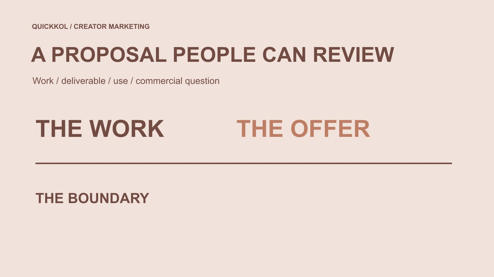

# 创作者怎样准备品牌可以评估的赞助提案

状态：本地审阅稿；正式发布日期待确认。

把赞助意向变成品牌能够评估的任务提案：相关作品、明确交付、可讨论条件和真实联系路径，比粉丝门槛或收益承诺更重要。

QuickKOL 编辑图形；不呈现真实账号指标或平台界面。

创作者希望获得赞助，最可执行的下一步是准备一份品牌能够判断的提案，而不是等待一个通用粉丝门槛。说明你能帮助哪类读者理解什么，用相关真实作品展示能力，并区分内容制作、本人账号发布和品牌使用。引用数据时保留来源、日期与限制，报价基于明确条件，不保证观看、销售或收入。品牌则应根据实际任务、证据和合作范围评估，而不是把一个漂亮媒体包当作全部适配已经确认。可靠的提案可以开启讨论，但不保证对方接受。

## 从品牌要解释的问题选择机会

先说明你能完成什么具体工作。科技产品可能需要解释一个操作，家居品牌可能需要展示真实摆放，活动项目可能需要现场主持。创作者的兴趣、相关能力和品牌任务应有可说明的连接，不只是一句“我的受众会喜欢”。

品牌可以用[达人 Brief](https://www.quickkol.com/zh/blog/write-a-useful-campaign-brief/#answer) 明确需要谁理解什么，以及合适下一步。创作者提案则回应这个问题，说明准备如何完成，而不是把所有潜在赞助方都放进一封完全相同的邀约。相关性来自作品和任务，不必把每个大品牌都当作适合对象。

没有公开明确项目时，可以提出一个有限概念，注明它只是可讨论方案。不要冒称已经知道品牌预算、内部目标或未公布计划。一个清楚的小任务，比一份承诺全渠道增长、却没有具体工作对象的宏大方案更容易被适当负责人评估。

## 用真实作品证明相关能力

挑选与本次任务相关的作品，说明你实际承担的部分、发布关系和可引用范围。自主练习可以展示能力，但应清楚标明，不把它伪装成已付费客户案例。参与团队作品时，也不应把整个团队的成果都写成个人独立交付。

[作品集贡献说明示例](https://www.quickkol.com/zh/blog/male-creator-brand-partnership-portfolio/#answer)帮助整理样本与贡献。提案不需要塞入全部历史内容，最好让每个例子回答一个实际问题：你能解释清楚吗、能完成这种制作吗、是否适合这种表达。缺少相关样本时，可以先讨论有限测试，而不是用粉丝规模替代能力证据。

如果提供数据，保留作品、平台字段、日期、窗口与限制。播放、互动、关注与订单不能互换；一个过去结果也不保证新合作相同。品牌可提出适当核对问题，但不应要求创作者为了获得赞助交出私人观众资料或完整账号控制。

## 说明提案的具体交付

把提案写成观众任务、拟议内容、你负责的工作与品牌需要提供的条件。内容制作、创作者账号发布和后续品牌使用分别说明。品牌收到文件，不等于已经获得所有广告用途；创作者愿意讨论，也不代表接受未说明的长期排他或反复修改。

说明语言、版本、产品事实、审阅安排和合理时间依赖。哪些条件尚未决定，就明确列出来。这样品牌可以回应一个具体方案，或指出需要调整的部分，而不必从“全包合作”四个字里猜测包含什么。

提供选项时保持可比较。例如，分别讨论仅制作与制作加发布，而不将一份带明确限制的方案和另一份没有范围的方案放在同一价格表中。选项应帮助双方理解差异，不制造一种看似更便宜、实际遗漏关键工作的比较。清楚范围可以减少误解，也有助于公平评估报价。

## 用报价解释范围与假设

报价应与具体任务、文件、发布和使用条件对应。可以先提供有明确假设的估价或询问品牌需要哪些选项，不必假装存在适用于所有创作者的标准价格。粉丝数可以提供账号规模背景，却不能独立决定本次制作成本或商业价值。

不要把期望收益、公开传闻或别人的截图当作本次可保证的收入。若某条件改变，如增加版本、延长使用或更换制作地点，应说明它影响哪个工作，再讨论适当调整。费用记录不等于观看、销售或受众交付承诺。

品牌也需要说清实际预算对象与决策流程，不要求创作者为一个尚未定义的范围提供最终无条件报价。适当讨论可以让双方知道下一步缺什么，而不是通过过早锁定一个数字，把后续所有未知都压给其中一方承担。

## 把平台发布工作纳入提案

如果提案包括 YouTube 账号发布，[YouTube 的商业内容披露说明](https://support.google.com/youtube/answer/154235?hl=en)要求相关商业内容采用适用的付费推广设置。提案应安排谁准备、谁核对最终对象，以及哪些平台条件需要在上线前确认，不把平台标签当成品牌和创作者所有责任的替代。

其他渠道也应按本次实际形式核对，而不是复制一项旧合作的设置和假设。能注册账号或上传文件，不说明已具备某个计划的资格，也不证明全部商业使用条件已经解决。若某项能力尚未确认，可以在提案中列为依赖。

同时考虑观众下一步：品牌页面、产品说明或适当咨询路径由谁维护。创作者可以完成约定解释和发布，但不应被要求保证品牌目的地永远可用。把平台动作与承接责任写清，能让提案从漂亮想法进入真正可以执行的项目。

## 按地区和形式准备关系说明

[ASA/CAP 的达人广告说明指南](https://www.asa.org.uk/resource/influencers-guide.html)于 2026 年 10 月发布第四版，面向创作者、品牌和相关机构解释广告标识与商业关系等问题。这是英国背景的当前资源概览，不能简化为所有国家、所有内容都使用同一个标签即可完成要求。

提案可以说明双方会在最终内容中检查适用的关系表达、平台设置与产品事实，并由适当负责人处理具体要求。不要承诺把赞助隐藏成无关联的个人发现，也不要要求创作者说出其未经历或无法支持的推荐。

自然表达与清楚说明可以同时存在。合作不必以夸张赞美为条件，也不应把所有必要限制从短版本中删掉。提前准备这些问题，能让品牌更准确地评估创作者是否适合这项任务，而不是到成片阶段才发现双方对推荐、试用和商业关系有完全不同的理解。

## 让真实联系路径保护双方

[FTC 的达人工作邀约提醒](https://consumer.ftc.gov/consumer-alerts/2024/03/influencers-spot-job-scam)建议通过已知真实、独立的公司渠道确认意外机会。收到熟悉品牌名称、漂亮文档或大额承诺时，仍应核对来源；反过来，创作者主动联系品牌，也应说明自己是谁、相关作品与本次具体提议，让对方容易理解和确认。

不要在初步提案中发送密码、验证码或不必要的个人财务资料，也不要把品牌是否接受索取这些资料当作专业与否的标准。后续确有付款、寄样或合同办理需要，由适当人员通过认可流程处理，不把它们混入一份广泛转发的作品介绍。

品牌明确不适合或没有相关项目时，应尊重回复。没有答复不证明对方有问题，也不意味着应该通过私人路径持续追逐。提案应使用适当商业联系，给出一个明确下一步，而不是让获得赞助变成不断扩大资料收集和联系范围的过程。

## 用一个有限提案练习品牌评估

假设创作者有一条自主制作的配件安装演示，准备向相关品牌提出新型号解释内容。它不是实际客户案例，旧作品也不冒称品牌委托。提案说明自己擅长哪个步骤、希望解释什么，以及需要品牌提供准确的新型号资料。

方案可以先讨论内容制作，再把账号发布和品牌使用列为单独待确认条件。品牌则检查样本是否真正相关，产品事实和时间能否提供，以及谁评估后续使用。若没有明确任务，不必为了有合作而立即加入更多渠道和长期承诺。

下一步可以是确认是否存在这个说明需求，并按范围补齐资料或估价。不是直接宣称双方已经达成赞助，也不是保证新型号会获得和旧作品相同观看。练习的有效结果是一项具体、可审阅的合作问题，而不是一份充满巨大数字、却无人知道怎样执行的承诺书。

## 把提案推进与赞助确认分开

记录提案已发送、对方愿意讨论、范围待确认、报价待评估和具体条件已确认等不同状态。收到礼貌肯定，不应自动公开品牌标识或声称自己已成为其合作代表；商业关系需要有适当依据。

继续讨论时，围绕真正未解决的问题更新材料，而不是不断增加粉丝截图。双方应能找到当前方案、相关作品、范围假设和下一步负责人。发生实质变化时，明确改变了哪个条件，不把新用途悄悄塞进一个已经确认的旧版本。

没有通用的粉丝数字、一次完美私信或某个模板能保证赞助。可执行的路径是持续提供相关真实作品、清楚任务和负责的沟通。对品牌而言，这样的提案也更值得评估，因为它没有要求品牌先相信一个不可核对的效果承诺，才有机会理解创作者实际能做什么。

## 品牌可审阅的赞助提案

| 提案部分 | 需要提供 | 不等于 |
| --- | --- | --- |
| 适配理由 | 具体任务与相关真实作品 | 粉丝数自动保证适配 |
| 交付与使用 | 制作、发布和复用的独立条件 | 一个文件包含全部用途 |
| 报价 | 范围、假设和影响调整的条件 | 行业标准或收入、观看保证 |
| 下一步 | 待确认问题与适当负责人 | 愿意讨论已经构成赞助确认 |

编辑提案框架，不是保证获赞助的模板、标准价格或通用合同。

## 发送赞助提案前

让品牌看懂具体工作、证据和下一步。

- [ ] 说明一个与品牌相关的观众任务。
- [ ] 选择真实样本，标明自己的贡献与自主练习。
- [ ] 区分制作、账号发布和后续使用。
- [ ] 报价基于条件，不保证收入或效果。
- [ ] 安排平台与地区相关的关系说明核对。
- [ ] 使用可核验商业路径，记录具体待确认问题。

## 研究日期与使用边界

资料核验于 2026 年 11 月 13 日。文中方法、表格和决策规则为编辑建议，标为假设的示例不是实际客户结果或行业基准。外部资料的适用地区与时期按各段说明；本稿处于独立本地审阅阶段，正式发布日期待确认。

## 从任务开始达人研究

用 QuickKOL 理解 Brief、发现相关达人并研究作品与联系路径；数据、合作条件和结果仍需核验。

[了解 QuickKOL](https://www.quickkol.com/#capabilities)

## 来源

- [YouTube：商业内容披露设置](https://support.google.com/youtube/answer/154235?hl=en)
- [ASA/CAP：达人广告明确标识指南（2026 第四版）](https://www.asa.org.uk/resource/influencers-guide.html)
- [FTC：达人工作邀约诈骗提醒（2024）](https://consumer.ftc.gov/consumer-alerts/2024/03/influencers-spot-job-scam)
