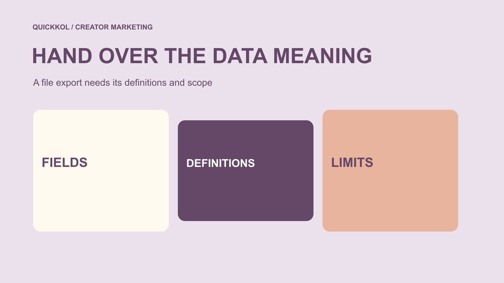

# CreatorIQ: Plan a Campaign Data Handoff

Status: local review draft; confirm the publication date before release.

A CreatorIQ export is only part of a handoff. Owners also need definitions, provenance, windows, filters and missing-value meanings to continue creator work.

QuickKOL editorial graphic; not actual account metrics or a platform interface.

A CreatorIQ campaign handoff needs more than a report. Confirm what the actual account can export and attach definitions, provenance, reporting windows, filters, identifier relationships and open issues. Official MeasureIQ material describes CSV, Excel and Parquet exports, but no account, plan capability or customer export was tested for this article. A file opening successfully does not establish completeness, comparability or validated impact. The next owner should be able to find original records, understand transformations and identify unsupported conclusions.

## Start with the work the next owner must continue

A handoff may support continued content review, unpublished-work follow-up, a closing report or fee reconciliation. Each task needs different objects. Do not export as much as possible first and leave the next person to discover a purpose.

The [creator campaign-status method](https://www.quickkol.com/blog/creator-campaign-status-system/#answer) helps identify current tasks, owners and unresolved items. Data should support those actions, such as the missing record for a particular piece, rather than merely display a complete-looking score.

State the campaigns, period, channels and working states covered. If another system manages part of the project, identify its connection and responsible owner. The recipient can then assess the file’s coverage instead of mistaking one bounded export for the entire program and every commercial condition. Defining the continuation task also gives the handoff a stopping point: it needs enough appropriate evidence for the next decision, not every field that happens to be available in a platform.

## Check the export capability actually available

[CreatorIQ’s MeasureIQ description](https://www.creatoriq.com/influencer-marketing-solution/measureiq) lists CSV, Excel and Parquet export for subsequent analysis or reporting environments. This is provider product information, not evidence that a particular customer’s current plan, permissions and historical material include every capability.

The relevant official search-indexed text was reviewed; direct access to the product page could not be fully retrieved, and no actual workspace was accessed. Before acting, an authorized user should inspect the available objects, fields and formats instead of assuming the whole program can be moved with one button.

For a bounded campaign handoff, confirm the minimum useful file and required connections first. More formats do not necessarily make the transfer better. Several files without definitions may simply reproduce the same uncertainty. A practical export is the one the receiving owner can interpret and use for the stated task, with unavailable scope clearly documented rather than guessed.

## Preserve campaign, creator and content relationships

Display names may change or resemble one another. Appropriate identifiers can connect campaigns, creators, publications and fee records, but explain what each represents. Numbers from different sources are not automatically interchangeable keys.

One creator may participate in several projects, and one piece may have several uses. Verify the actual relationship instead of merging records by handle, similar copy or a matching amount alone. Retain unmatched records for an appropriate owner to review.

The handoff should distinguish confirmed connections from possible matches. Do not force a pair merely to remove a blank cell. An incorrect connection can assign a fee to the wrong object or attribute one piece’s result to a different collaboration. A tidy appearance does not reduce that error. Keeping the unresolved relationship explicit is more useful than a fully populated sheet whose apparent completeness depends on assumptions nobody can later reconstruct.

## Keep definition versions as well as names

[CreatorIQ’s metric-definition update](https://www.creatoriq.com/whats-new-in-creatoriq/views-to-impressions) describes changes to labels such as views and engaged views and mentions retroactive alignment. It shows that a reporting system can change definitions. It does not make every platform, period and field inherently identical.

Retain retrieval time, the definition applicable then and any subsequent transformation. Similar labels are not enough to combine two periods into an unconditional trend. This article does not repeat all platform thresholds from that announcement as current universal rules.

If old and new files differ, inspect definitions, sources and filters before discussing performance change. A definition change is a recording condition to explain, not evidence that a creator suddenly improved or deteriorated. Retaining the explanation prevents the team from repeatedly investigating the same difference. It also lets a reader understand why a historical number may no longer match a later screen without assuming that either record was fabricated.

## Separate missing, zero and not applicable

A blank may mean unavailable data, inapplicable permission, pending synchronization or a field unsuitable for the object. Do not replace every blank with zero or interpret each as no performance. Use appropriate states for the reason and whether confirmation remains pending.

Manual entries, platform-sourced data and estimates likewise need distinct provenance. One consolidated provider field does not establish an identical retrieval route for every row. Readers need to understand the comparison limits.

A recipient seeing only a total may miss changing coverage. Preserve the included population and necessary exclusion notes so the aggregate corresponds to its actual objects. Retain uncertainty directly instead of hiding missing values behind a polished chart. Incomplete information should not automatically become a judgment that a creator is uncooperative or unreliable. The handoff concerns what the record can support, including gaps that may originate in the system or project design rather than in the person being reported on.

## Retain windows, time zones and filters

Interval and cumulative statistics are not interchangeable. Identify whether filtering uses publication time, event time or another rule, with date boundaries and applicable time zone. Matching start and end dates do not necessarily mean matching objects.

If one report includes published content while another includes assigned creators without posts, a row-count difference need not be data loss. Compare filters before reconciling objects. Do not delete unexplained rows merely to make totals equal.

Retain filters and export time so the recipient can attempt to reproduce the scope later. Reproduction may not yield permanently unchanged counts because data can update. The objective is to explain the original selection and why later results may differ, not promise that every system will always agree. This makes reconciliation a specific task rather than a contest to decide which attractive dashboard total must be the only correct one.

## Retain the original and transformation steps

Keep an appropriate original export and make a working copy for naming, formatting and relationship preparation. Document converted columns, excluded rows and team-added calculations. A derived field should not appear to have come directly from the platform.

Date normalization, splitting objects and merging fields can affect interpretation. The recipient should understand the steps without relying on the author to remember every manual action. A small nonsensitive example may help explain a transformation.

The original file is not absolute truth either; it is a record retrieved at a point in time. Retaining it supports traceability without removing the need to inspect provenance and definitions. After preparation, reconcile appropriate row counts, identifiers and key fields. If a difference remains unexplained, pause conclusions affected by it instead of using a final aggregate chart to conceal the gap. A reproducible preparation process is more valuable than a sheet only its original author knows how to repair.

## Hand off access and information scope

[FTC’s business information-security guide](https://www.ftc.gov/business-guidance/resources/protecting-personal-information-guide-business) emphasizes retaining needed information and limiting access. A receiving campaign owner may need relevant project data without requiring every private contact detail, financial record or account secret.

Before export, confirm fields appropriate for the purpose, the receiving location and permitted viewers. Working identifiers may connect objects without placing complete personal records in every report attachment. Copying all files is not a substitute for access review.

If platform access changes with roles, an authorized owner should handle current settings. No login, permission change or real-data movement was performed for this article. The handoff can identify system, role and open access tasks without passwords or keys. That lets the next person continue without a normal document forward inadvertently expanding the audience for sensitive material. Appropriate scope is part of a usable handoff, not an obstacle to producing one.

## Rehearse the handoff with a hypothetical file

Suppose an accessory campaign export contains 12 content records, with usable metrics for 10 and data still pending for two. These are practice figures, not customer data. Filling the blanks with zero cannot establish completed, comparable assessment of all 12.

Explain what the records represent, the definitions and windows for the 10, who owns the two gaps and whether production or fee states are managed elsewhere. Retain transformations in the working copy.

The recipient needs those answers to continue. Correct formatting is only part of that readiness. If a source remains unclear, list it explicitly rather than invent an explanation or rename uncertainty as verified. The hypothetical exercise is useful because it tests the meaning of completeness: every expected object can be accounted for even when every field is not yet available. A responsible handoff should make that distinction visible.

## Make the handoff support the next decision

The final note should answer what is covered, where data originated, how it was prepared, which definitions apply, what is missing and who continues. The [metrics decision guide](https://www.quickkol.com/blog/social-media-metrics-creator-decision-tree/#answer) helps avoid treating an export as a complete business conclusion.

Do not expand a provider description into a QuickKOL capability. QuickKOL can support brief interpretation and creator research; project export, integration and processing need verification in the system actually used. This article is not a CreatorIQ pricing or procurement comparison.

A good handoff allows the next owner to inspect sources, continue tasks and interpret results cautiously. It depends less on filling every cell than on giving facts, transformations and unknowns explicit places. If tools, roles or fields later change, the team can still understand what the earlier record meant. That continuity is the useful outcome, without implying that one export has proved all collaboration impact or eliminated the need for further review.

## Minimum explanation for a data handoff

| Item | Retain | Question addressed |
| --- | --- | --- |
| Scope | Campaigns, channels, objects and window | What the file covers |
| Definition | Source, field and version | What the number means |
| Preparation | Original and transformation record | What the team changed |
| Gap | Unknown, owner and next step | How work continues |

An editorial handoff framework. No CreatorIQ login, customer-plan test or real campaign export was performed.

## Before sending the campaign export

Give the file scope, definitions and a continuation path.

- [ ] Confirm the work the recipient must continue.
- [ ] Check actual fields and formats.
- [ ] Retain relationships, definitions and windows.
- [ ] Separate zero, missing and not applicable.
- [ ] Document transformations and limit information scope.
- [ ] Assign an owner to each gap.

## Research date and limitations

Sources reviewed November 13, 2026. Methods, tables and decision rules are editorial recommendations. Hypothetical examples are not actual client results or industry benchmarks. Source geography and periods are specified where relevant. This draft is in independent local review; confirm its publication date before release.

## Start creator research with a clear task

Use QuickKOL to interpret a brief, discover relevant creators and research their work and contact routes. Verify data, commercial terms and outcomes at their source.

[Explore QuickKOL](https://www.quickkol.com/#capabilities)

## Sources

- [CreatorIQ: reporting and exports](https://www.creatoriq.com/influencer-marketing-solution/measureiq)
- [CreatorIQ: metric-definition update](https://www.creatoriq.com/whats-new-in-creatoriq/views-to-impressions)
- [FTC: Protecting personal information, a guide for business](https://www.ftc.gov/business-guidance/resources/protecting-personal-information-guide-business)
