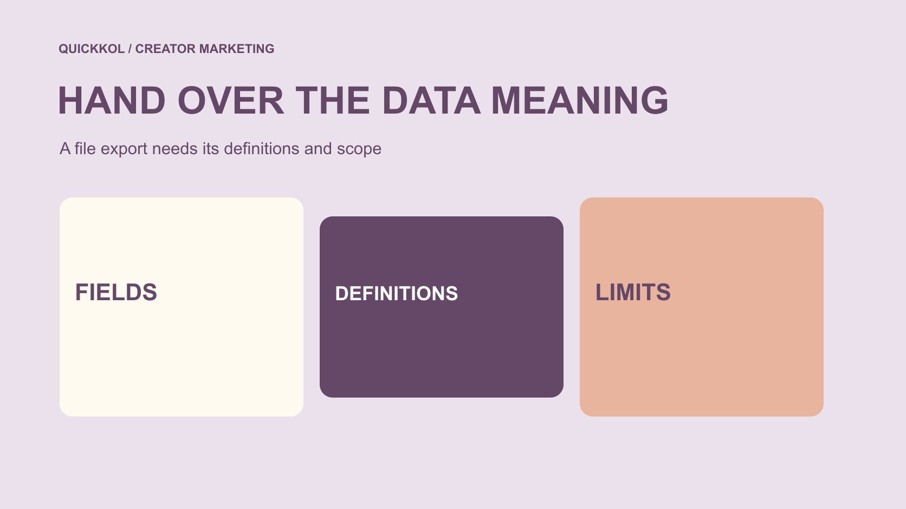

# CreatorIQ 数据导出与项目交接

状态：本地审阅稿；正式发布日期待确认。

CreatorIQ 导出文件只是交接的一部分。负责人还需要知道字段定义、数据来源、窗口、过滤条件和缺失值含义，才能继续达人项目。

QuickKOL 编辑图形；不呈现真实账号指标或平台界面。

把 CreatorIQ 项目交给下一位负责人时，不只交一张报表。确认当前账号可导出的对象与格式，再附上字段定义、来源、统计窗口、筛选条件、标识关系和未知事项。官方 MeasureIQ 资料描述了 CSV、Excel 与 Parquet 导出，但本篇未登录、实测计划能力或导出任何客户资料。可打开的文件不等于完整、可比较或已完成效果验证；接手者应能找到原始记录、理解整理步骤，并知道哪些结论仍不能支持。

## 先问接手者需要继续什么工作

交接可能为了继续内容审阅、跟进未发布作品、准备结案报告或核对费用。不同工作需要不同对象，不应先导出尽可能多的资料，再要求接手者自己找到用途。

[达人项目状态方法](https://www.quickkol.com/zh/blog/creator-campaign-status-system/#answer)可以帮助列出当前任务、负责人和待处理事项。数据应服务这些动作，例如某个作品还缺哪项记录，而不是只呈现一个看似完整的总分。

说明交接范围：哪批合作、哪个时间段、哪些渠道与工作状态。若部分内容由其他系统管理，也应指出连接方式和责任人。这样接手者能判断文件覆盖什么，不会把一次有限导出误认为整个项目和全部商业条件。

## 核对实际可用的导出能力

[CreatorIQ 的 MeasureIQ 说明](https://www.creatoriq.com/influencer-marketing-solution/measureiq)列出 CSV、Excel 与 Parquet 导出，用于后续分析或其他报告环境。这里是供应方产品资料，不证明某一客户当前计划、权限或历史资料都包含这些能力。

本次读取了官方检索可见的相关正文，产品页面直接访问未能完整获取，也没有登录真实工作区。实际操作前，应由有权限人员检查当前可导出对象、字段与格式，不根据宣传页想象所有内容都可一键迁出。

如果目标只是接手一批合作，先确认最小可用文件和必要关联。格式越多并不代表交接越好；没有定义的多个文件，可能只是把同一不确定复制了几份。

## 保留项目、创作者和内容之间的关联

显示名称可能改变，也可能多个对象相似。适当标识能帮助连接项目、创作者、发布内容和费用记录，但需要说明各自代表什么，不把不同来源的编号当作天然可互换。

例如同一创作者可以参与多个项目，同一作品也可能有多种用途。连接时应核对实际关系，不仅凭用户名、文案相似或金额接近就合并。保留无法匹配的记录，交给适当负责人复核。

交接说明应包括哪些关联已确认、哪些仅是可能匹配。不要为了让表格没有空白而强行配对。错误连接会让后续团队把费用算错对象，或把一条内容结果归到另一项合作，外观整齐并不能减少这种问题。

## 字段名称之外，还要保留定义版本

[CreatorIQ 的指标定义更新说明](https://www.creatoriq.com/whats-new-in-creatoriq/views-to-impressions)介绍了展示与观看等标签调整，并提到历史数据相应对齐。它说明同一个报表体系也可能随定义更新，不意味着所有平台、时期与字段从此天然一致。

因此交接应记录获取时间、当时适用定义，以及是否进行了后续整理。不要看到名称接近，就把两个时期的字段无条件拼在同一趋势线上。本篇不复述其中所有平台阈值为当前通用规则。

如果新旧文件有差异，先核对定义、来源和过滤条件，再讨论表现变化。定义变化是需要说明的记录条件，不应被误写成创作者忽然变好或变差。保留对应说明，能减少团队以后重复排查同一问题。

## 把缺失、零和不适用分开

空白可能是资料未取得、权限不适用、尚未同步或该字段不适合此对象。不能全部改成零，也不能都解释为没有表现。用适当状态说明缺失的原因与是否仍待确认。

同样，手动输入、平台来源和估计值应有各自来源标签。供应方整合后的一个字段，不代表所有行都经过相同取得路径。读者需要知道哪些比较存在限制。

如果接手者只看到一个汇总数，就容易忽略覆盖变化。保留纳入记录的范围和必要的排除说明，让总量与实际对象对应。无法确定的地方明确保留，不用漂亮图表隐藏缺失，也不要把资料不完整等同于某个创作者不配合或不可信。

## 记录窗口、时区与筛选

区间统计和累计统计不能直接互换。确认报告是按发布时间、统计事件时间还是其他规则筛选，并说明日期边界与适用时区。相同起止日期不一定表示两个文件包含相同对象。

如果一份报告只含已发布内容，另一份包含已分配但未发布创作者，行数差异不必然是丢失。先比较筛选，再核对对象。不要为了让总数相同删掉无法解释的行。

保留筛选说明和导出日期，接手者才能在之后尝试重现相同范围。重现不一定得到永久不变的计数，因为数据仍可能更新；关键是能够解释当时选择了什么，以及后续结果为何可能不同，而不是承诺所有系统显示始终一致。

## 保留原始文件与整理步骤

适当保留原始导出，再制作工作副本进行命名、格式与关联整理。记录哪些列被转换、哪些行被排除、哪些计算由团队添加，不把自己算出的字段伪装成平台直接提供。

例如把日期统一、拆分多个对象或合并字段，都可能改变后续解释。步骤要能被接手者理解，不依赖原作者记得每一次手动操作。必要时给出少量不含敏感信息的示例。

原始文件也不等于绝对事实，只是当时取得的记录。保留它是为了可追溯，而不是免除来源与定义检查。整理后应比较合理的行数、标识和关键字段，发现无法说明的差异时暂停相关结论，不急着用最终汇总图掩盖。

## 把访问和资料范围交接好

[FTC 的企业信息保护指南](https://www.ftc.gov/business-guidance/resources/protecting-personal-information-guide-business)强调按实际需要保留信息并限制访问。接手负责人需要相关项目数据，不代表需要全部私人联系方式、财务信息或账号秘密。

导出前确认哪些字段适合本次用途，接收位置和可见人员是否合适。可以用工作标识关联对象，不把完整个人资料放进每个报告附件。不能通过复制全部文件替代权限检查。

若平台访问随角色变动，应由有权限负责人处理当前设置。本篇没有登录、改权限或移动真实资料。交接文档可列系统、角色和未完成访问事项，而不包含密码与密钥。这样下一位负责人能继续工作，也不会因为文档被正常转发就意外扩大资料范围。

## 用假设文件检查交接

假设一个配件项目导出 12 条内容记录，其中 10 条有可用指标，2 条仍待取得。数字仅为练习，不是客户资料。不能把两条空白补零后，宣称 12 条已完成同口径效果评估。

交接应说明 12 条分别是什么、10 条数据的定义与窗口、2 条缺口由谁处理，以及其他制作或费用状态是否在另一位置管理。工作副本的调整保留记录。

接手者能回答这些问题，才算真正获得继续工作的条件。文件格式正确只是其中一部分。若某项来源还不清楚，可以在交接中明确列出，不必为了显示完成而编造解释或把不确定状态写成已核验。

## 让交接说明支持下一次判断

最终说明应回答：覆盖什么、数据从哪里来、怎样整理、哪些定义适用、还缺什么以及谁继续处理。[指标决策指南](https://www.quickkol.com/zh/blog/social-media-metrics-creator-decision-tree/#answer)帮助避免把一份导出表直接当作完整业务结论。

不要把供应方产品描述扩张为 QuickKOL 的功能。QuickKOL 可用于理解 Brief 和达人研究，具体项目导出、接入和数据处理仍按实际所用系统核对。本篇也不是 CreatorIQ 定价或采购比较。

一份好的交接让下一位负责人可以复查来源、继续任务并谨慎解释结果。它不依靠所有格子都填满，而依靠事实、整理动作和未知都有明确位置。如此即使工具、角色或字段之后变化，团队仍能知道原记录当时表达了什么。

## 数据交接的最小说明

| 内容 | 要保留 | 解决的问题 |
| --- | --- | --- |
| 范围 | 项目、渠道、对象与窗口 | 文件覆盖什么 |
| 定义 | 来源、字段与版本 | 数字表示什么 |
| 整理 | 原始文件和转换记录 | 团队改变了什么 |
| 缺口 | 未知、负责人和下一步 | 怎样继续工作 |

编辑交接框架；没有登录 CreatorIQ、验证客户计划或导出真实项目资料。

## 发送项目导出前

让文件有范围、定义和继续路径。

- [ ] 确认接手者需要继续的工作。
- [ ] 核对实际可用字段和格式。
- [ ] 保留对象关联、定义与窗口。
- [ ] 区分零、缺失与不适用。
- [ ] 记录整理步骤并限制资料范围。
- [ ] 给每个缺口明确后续负责人。

## 研究日期与使用边界

资料核验于 2026 年 11 月 13 日。文中方法、表格和决策规则为编辑建议，标为假设的示例不是实际客户结果或行业基准。外部资料的适用地区与时期按各段说明；本稿处于独立本地审阅阶段，正式发布日期待确认。

## 从任务开始达人研究

用 QuickKOL 理解 Brief、发现相关达人并研究作品与联系路径；数据、合作条件和结果仍需核验。

[了解 QuickKOL](https://www.quickkol.com/#capabilities)

## 来源

- [CreatorIQ：项目报告与导出](https://www.creatoriq.com/influencer-marketing-solution/measureiq)
- [CreatorIQ：指标定义更新](https://www.creatoriq.com/whats-new-in-creatoriq/views-to-impressions)
- [FTC：企业个人信息保护指南](https://www.ftc.gov/business-guidance/resources/protecting-personal-information-guide-business)
