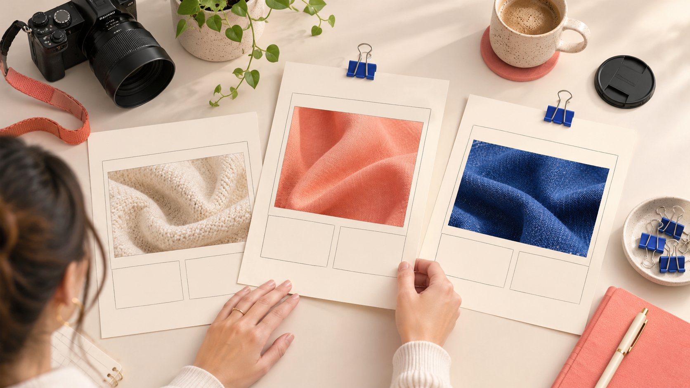

# Facebook Ads Library: Compare Sponsored Creative Versions

Status: local review draft; confirm the publication date before release.

Use the Ad Library to compare how creator assets explain a question. Retain versions and search conditions without inferring sales or creator value from ad counts or duration.

Facebook Ads Library helps brands observe public advertising creative; it does not replace campaign reporting. In creator-marketing research, compare demonstration order, product facts, commercial context and next steps around the same audience question. Record the ad object, search geography and viewing time. A visible ad does not independently establish creator permissions, audience fit or sales performance, and more versions or a longer run does not make it a winner. Translate observations into creative questions, then evaluate results with appropriately authorized evidence from your own project.

## Define an audience question before comparing

Define what the brand needs to explain before searching. Can viewers understand a desk accessory’s dimensions, follow installation or recognize a limitation? Comparing materials around one question is more useful than collecting many ads that simply look popular.

The [creator brief](https://www.quickkol.com/blog/write-a-useful-campaign-brief/#answer) makes that assignment explicit. You might compare two versions from one brand or different pieces addressing a similar question. Different products, purposes and markets, however, do not automatically constitute a fair performance comparison.

This article concerns expression, not creator rankings. Whether an ad offers a useful idea depends on the problem it addresses and your own conditions, rather than the creator’s fame or the number of ads displayed. Defining the question first identifies which differences deserve attention. It also stops a broad research session from ending with an attractive reference folder that nobody can connect to a practical revision, production choice or audience need.

## Separate the library’s purpose from historical scope

[Meta’s Ad Library history](https://about.fb.com/news/2019/03/a-better-way-to-learn-about-ads/) records the 2019 expansion that brought active ads from Pages into one place. That explains why the library is useful for observing public advertising. The historical article is not a complete present-day manual for every geography, category and interface.

No brand’s entire advertising activity or creator’s actual results have been audited for this article. The following is a repeatable research method, not a claim to have identified today’s best-performing ad. Use what is actually visible at the time, with the applicable platform explanation.

Record both available material and missing material. A search without results may reflect filters, time, names or coverage; it does not prove that a brand never advertised. An empty screenshot cannot establish that a creator has no commercial partnerships. Keeping the scope explicit makes the reference more reliable for a colleague who might otherwise mistake a narrow search for a complete account of a brand’s activity.

## Retain the conditions of each search

Retain the query, geography, category, filters, viewing time and visible ad identifier. Where names resemble one another, check whether the public Page and destination correspond to the intended research subject. An avatar or similar sentence is not enough to merge two publishers.

A public link and concise note are often sufficient. There is no need to download every video into a personal asset library. If a permitted working screenshot is retained, preserve context and time so another reviewer understands it as an observation, not a permanent state or platform certification.

An ad may have different displays, and related material may appear through multiple objects. Record distinguishable objects first and describe possible relationships separately. Do not treat each visible rendering as an independent creative experiment. This provenance reduces duplicate counting and mistaken attribution before either problem becomes embedded in a presentation or influences a commercial conversation with a creator.

## Compare the explanation, not only the opening

Observe how the opening frames a question, how the piece supports product facts, which usage conditions appear and what the viewer is asked to do. Creator expression may help through a practical demonstration, an honest limitation or a recognizable setting, rather than only an attention-grabbing first sentence.

Describe differences concretely: one version shows the result before the steps, while another begins with an installation question. Do not conclude that the first creator sells better. The visible material supplies insufficient evidence for that business claim. A hypothesis is useful when identified as such, not presented as an established answer.

Check whether captions, speech, image and destination communicate the same thing. A crop may remove a limitation, and a different action button may change the receiving route. These are design questions to verify in your own project. Copying an ad does not resolve them or establish that the observed structure is suitable for a different product and audience.

## Do not assume identical fields across regions

[Meta’s EU advertising-transparency explanation](https://about.fb.com/news/2023/08/new-features-and-additional-transparency-measures-as-the-digital-services-act-comes-into-effect/) announced expanded display and archiving in 2023, including relevant dates and targeting information. Consequently, saying that commercial ads never contain audience information is not a reliable worldwide rule either. Check the actual geography, category and field.

Even a record containing such parameters does not provide an advertiser’s entire strategy, final orders or the creator’s complete commercial conditions. A field’s existence and its ability to support a particular conclusion are separate issues requiring explanation.

Keep search conditions consistent where possible. Where they differ, record the difference rather than replace missing values with zero. Do not score brand professionalism or creator trustworthiness by how much regional transparency information appears. Platform conditions and applicable rules affect the available material. A careful comparison preserves that context instead of making a universal claim from the most detailed or least detailed record encountered during research.

## Separate creative observation from attribution

Longer visibility, repeated appearance or multiple versions does not independently prove profitability. Budget, scheduling, project objectives or other conditions may be unavailable. Public material can establish that a version was observed; it cannot replace your project’s outcome evidence.

The [UK Magenta Book evaluation guide](https://www.gov.uk/government/publications/the-magenta-book/magenta-book-central-government-guidance-on-evaluation-html) explains why evaluation needs an appropriate question, design and comparison. Two ads’ visual differences cannot automatically explain a sales difference or establish that one creator must be more effective.

If you want to examine a demonstration approach, define outcomes, conditions and comparison limitations within your own authorized project. Without a suitable design, record observational learning rather than call it a causal experiment. Research can improve the next brief while remaining honest about its boundary. This is particularly important when an attractive creative reference would otherwise become the sole justification for changing a creator budget or promising a commercial result.

## Public visibility does not grant reuse permission

Creator appearances in a library can still involve work, likeness, voice, music and commercial arrangements. Seeing the ad does not grant permission to download, re-edit or publish it yourself, nor establish that the creator authorized the new use you intend.

The [creator distribution-role method](https://www.quickkol.com/blog/creator-media-strategy-distribution-roles/#answer) distinguishes production, account publication, brand reuse and paid distribution. Borrow a question structure in research; handle actual material and use under the permissions and requirements that apply. Common industry behavior is not a permission record.

[FTC’s influencer disclosure guide](https://www.ftc.gov/business-guidance/resources/disclosures-101-social-media-influencers) emphasizes clear commercial context. Mimicking another ad does not complete your own project’s review. Its label, crop and wording are not a universal clearance for your piece. The distinction lets a team learn from public expression without treating somebody else’s published work as a freely available production resource or assuming that every underlying agreement is visible in the ad itself.

## Turn an observation into your own brief

Suppose a desk-accessory brand observes two explanation orders: introducing a size reference first or showing operation first. This is an editorial example, not a client-result claim. Ask whether your audience lacks an understanding of dimensions or needs help with the operation.

Invite a suitable creator to propose a relevant demonstration with facts, limitations and scoped work. Do not demand a copy of another person’s setting and expression. The brand supplies accurate product information while the creator contributes practical production and explanation.

The output is a question to examine and a clear task, such as making the footprint on a small desk understandable, rather than copying a competitor’s viral ad. Assess subsequent outcomes using evidence from this project and retain conditions that prevent comparison. That is how reference research becomes useful collaboration instead of remaining a collection of saved advertising. It also gives the creator room to solve the actual problem rather than imitate a result the brand has never verified.

## Keep a comparison another person can review

Add a what-would-change column to the comparison. If a difference cannot affect your own brief, shot plan or information request, expanding the sample may not improve the decision. One search cannot support a market-share claim, and a hand-picked advertising set is not a random industry sample. Explain why these references were selected, including any language or category limits. This helps the next owner understand why the comparison fits the present question instead of interpreting convenient examples as industry facts. It also gives the team a sensible stopping point when additional collection would add volume without changing the creative assignment.

A useful handoff contains the research question, public sources, search conditions, observed version differences, unsupported conclusions and proposed next action. Mark expired links or unavailable ads; do not present an old screenshot as evidence that an ad is still running.

Review adjectives for support. Claims such as clearly more profitable or more authentic audience should become concrete observations or be removed where evidence is missing. Creative preference can remain if identified as the reviewer’s judgment rather than a platform conclusion.

The library’s most useful role is to help brands and creators ask clearer questions. It can enrich creative discussion without replacing scope, permission checks or outcome evaluation. Preserving that boundary prevents a visible advertising sample from becoming an imagined complete market picture. The resulting brief can be more specific and practical precisely because it explains both what was learned and what the available public material could not establish.

## Ad-version comparison record

| Dimension | Record | Boundary |
| --- | --- | --- |
| Search | Object, geography, time and filters | Not a complete market census |
| Expression | Question, demonstration, limits and next step | Preference is not performance |
| Field | Visible definition and coverage | Regions need not be identical |
| Recommendation | Your own question to examine | Public visibility grants no reuse permission |

An editorial research framework; no actual ad account or delivery performance was audited.

## Before using an ad reference

Make observations reviewable and recommendations actionable.

- [ ] Define the same audience question.
- [ ] Retain source and search conditions.
- [ ] Describe version differences concretely.
- [ ] Do not infer profitability from count or duration.
- [ ] Confirm use scope for your own project.
- [ ] Translate the reference into your own creative task.

## Research date and limitations

Sources reviewed November 13, 2026. Methods, tables and decision rules are editorial recommendations. Hypothetical examples are not actual client results or industry benchmarks. Source geography and periods are specified where relevant. This draft is in independent local review; confirm its publication date before release.

## Start creator research with a clear task

Use QuickKOL to interpret a brief, discover relevant creators and research their work and contact routes. Verify data, commercial terms and outcomes at their source.

[Explore QuickKOL](https://www.quickkol.com/#capabilities)

## Sources

- [Meta: learning about ads (2019)](https://about.fb.com/news/2019/03/a-better-way-to-learn-about-ads/)
- [Meta: DSA transparency measures (2023)](https://about.fb.com/news/2023/08/new-features-and-additional-transparency-measures-as-the-digital-services-act-comes-into-effect/)
- [UK government: Magenta Book evaluation guidance](https://www.gov.uk/government/publications/the-magenta-book/magenta-book-central-government-guidance-on-evaluation-html)
- [FTC: Disclosures 101 for social media influencers](https://www.ftc.gov/business-guidance/resources/disclosures-101-social-media-influencers)
