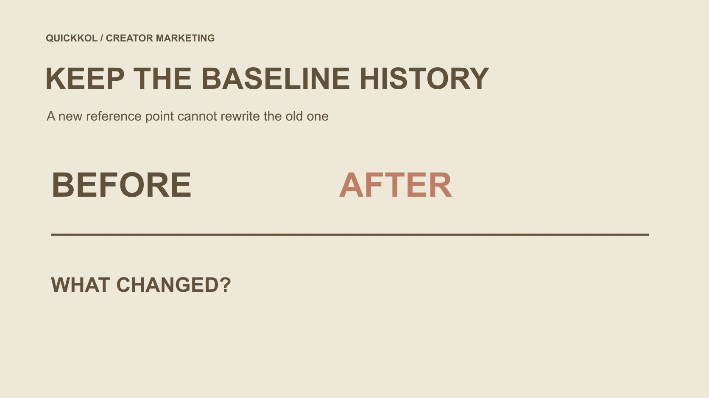

# Free IG Followers: Reframe a Campaign Baseline

Status: local review draft; confirm the publication date before release.

When free-follower claims overlap a campaign, preserve the original baseline and explain any new observation reference without certifying a clean audience.

QuickKOL editorial graphic; not actual account metrics or a platform interface.

When an Instagram free IG followers claim enters a creator campaign, do not rewrite the original follower baseline to improve the report. Preserve the old observation’s source, time and definition. If a new reference is genuinely needed, explain why, its window and how its conditions differ. The difference between two follower totals is a descriptive net change under those definitions, not a count of unique real people or proof that a campaign or service caused the change. Keep unknown provenance and possible anomalies open for review. Do not deduct followers, judge a person or claim complete removal of artificial engagement from one signal.

## Define the question the baseline answers

A baseline is the starting reference for a comparison, not certification of account quality. It can describe changes in public or authorized observations and support planning. Account size, content reach, interaction events and actual customers are different objects, even when all are expressed numerically.

Decide whether the question concerns an observed before-after change or the additional effect of the collaboration. The latter needs suitable design and evidence; choosing a more favorable date cannot supply it. Public figures visible to a creator and information available to a brand may also differ in scope, so retain the source.

If a free-follower advertisement was merely mentioned, with no established connection or delivery, do not automatically label the entire period proven contamination. Record the concern and limitation, then decide what review is needed. A clear question prevents one unconfirmed statement from turning every later count into an unsupported allegation. It also helps identify whether the proposed comparison is still useful for a limited descriptive purpose.

## Preserve the original observation

Retain the account object, field name, retrieval time, source, observation window and material limitations used at the time. The reference may be a public total or an appropriately authorized extract. If a field later proves incomparable, add the explanation instead of deleting the old record and implying it was never used.

Be accurate about the team’s original interpretation too. If someone called total followers unique audience, correct the statement and retain why. Quietly relabeling it cannot establish that every historical report was always correct. Improving definitions is a normal learning process; hiding the version history is not how to achieve it.

Copies of one screenshot are not new observations. Figures from different times, tools or accounts also should not become a source-free baseline. Let the next owner retrieve the old record, understand its original limits and identify what was learned later. That is more important than preserving a starting point that makes the campaign appear stronger. It also prevents future comparisons from inheriting an untraceable correction.

## Keep possible explanations open

[Meta’s fake-engagement enforcement announcement](https://about.fb.com/news/2020/10/taking-action-against-fake-engagement-and-ad-scams/) from 2020 describes services manufacturing likes and followers. It establishes historical platform action, not the same conduct on this account or a universal suspicious-percentage threshold.

A changed total may also involve ordinary follows and unfollows, other exposure, observation timing or data processing. Ask review questions based on available material without making a growth spike or low interaction rate the sole explanation. When evidence is missing, preserve the unknown instead of selecting the cause that best fits an initial suspicion.

A creator’s statement that they did not use a service should likewise retain its attribution. It must not become an independent investigation ruling out every possibility. Distinguish statements, observations and further confirmation so the business decision rests on the evidence the team actually has rather than an unverified causal story. The objective is a defensible description of the comparison, not a diagnosis that the available records cannot support.

## Do not treat moderation as a clean-audience certificate

[Meta’s creator-safety announcement](https://about.fb.com/news/2024/06/protecting-athletes-and-fans-on-our-apps-during-major-sporting-events-this-summer/) from 2024 describes tools for removing spam followers in bulk. This is dated platform-tool context, not identical present access for every account or independent brand proof that each identified or removed account is fake.

If an appropriate owner reports a moderation action, retain its object, time and confirmed scope. A falling total alone cannot establish the exact number of bots removed, and resumed growth cannot establish that every anomaly ended. Review the management action and data interpretation separately.

A new observation reference can follow a documented action if the reason and remaining unknowns are stated. It describes how the next period will be observed; it does not retrospectively certify every earlier follower. Avoid letting a cleaned label remove the evidence boundaries the report needs. A limited action record is useful precisely because it says what was checked without silently expanding into a finding about all previous activity.

## Give a new reference point an explicit reason

Before selecting a new reference, state the task, field, source, comparison window and differences from the original observation. An appropriate business owner should understand and adopt it, rather than an analyst selecting the most favorable pair after seeing the outcome.

A defensible reason might be beginning a new phase under a revised definition or an identified source becoming available from a particular time. That does not make the earlier period forgettable or eliminate other influences on the new window. Old and new references can coexist with distinct purposes and limitations.

If evidence is insufficient for another reference, retain the existing description, narrow the conclusion or wait for appropriate material. A reporting template is not a reason to invent an authentic-follower baseline. The reference is a management choice that another colleague should be able to understand and review, not hidden discretion behind the final growth percentage. Documenting the choice first also helps prevent a later stakeholder from interpreting the new window as an independent verification exercise.

## Rehearse a three-point comparison

Suppose one account has 12,000 followers at the original observation, 14,000 at an intermediate point and 14,600 later. A free-follower claim was discussed in between, but its cause remains unconfirmed. These are hypothetical figures, not creator data or an industry benchmark.

The net change from 14,000 to 14,600 is 600. Using the intermediate total as denominator gives a descriptive change rate of 600 ÷ 14,000 × 100%, approximately 4.29%. From 12,000 to 14,600, the net change is 2,600. They concern different windows, not competing answers from which to select the better-looking report. Neither amount is a verified count of newly acquired real people.

If the next phase references 14,000, retain 12,000 and the intervening conditions. Do not subtract an assumed 2,000 and certify the remainder authentic. The arithmetic can be checked while cause and composition remain unresolved. Those are different levels of certainty, and a responsible report should make that difference visible.

## Do not turn a before-after change into incremental effect

The [UK Magenta Book evaluation guide](https://www.gov.uk/government/publications/the-magenta-book/magenta-book-central-government-guidance-on-evaluation-html) bases impact evaluation on suitable comparison and counterfactual evidence among other conditions. Apply that methodological boundary here: an observed change does not establish what would have happened without the campaign, and choosing a new starting reference does not create causal evidence.

The hypothetical net increase of 600 should therefore not become incremental followers delivered by one asset, much less proof that a free service works. Other content, existing exposure, platform actions and observation conditions can change together. No impact evaluation was performed here, and the article does not recommend exposing other accounts to artificial engagement as an experiment.

If additional campaign impact is the business question, involve appropriate analysts in a proportionate research design with explicit assumptions and limits. Ordinary reporting can still describe change honestly. Acknowledging that causality is unproven does not make observations useless. It identifies the type of decision the current evidence can support without borrowing certainty from a different evaluation method.

## Keep unknowns visible instead of filling the formula

Use the [social media metrics decision framework](https://www.quickkol.com/blog/social-media-metrics-creator-decision-tree/#answer) to retain source, window, unit and missingness. An unavailable point is unavailable, not zero. An unknown cause is unknown, not a composition estimate guessed from avatars, countries or one interaction ratio.

Show the original observations, changed windows and new recording arrangement while identifying noncomparable parts. If the decision only concerns whether publication occurred, there is no need to add follower growth as a performance verdict. Different tasks require different evidence; not every report needs one combined success score.

Preserve attribution of the free-growth claim itself. An advertisement, creator self-description, brand observation and independent evidence are not interchangeable sources. Separating them lets an owner take risk seriously without expanding suspicion into an established conclusion of dishonesty about a particular person. The report can then explain what needs reviewing rather than manufacture a numerical answer to every concern. This is especially useful for colleagues who never saw the original discussion and might otherwise inherit an overconfident summary.

## Hand over a comparison another owner can review

Give the next owner the original baseline, reason for the new reference, window definition, arithmetic, limitations and open questions. Connect the change to a bounded business decision, such as describing net movement under one source in the next phase without claiming an undesigned incremental effect.

The [recovery handover guide](https://www.quickkol.com/blog/instagram-free-followers-access-recovery-handoff/#answer) can supply the separate account-safety action record. It cannot replace a data-source review. A team may complete a defined security task while still not knowing every cause of earlier follower changes. Both findings can coexist rather than becoming one total pass or failure for administrative tidiness.

Completion means a reader can reproduce the descriptive arithmetic, understand why the window was selected and identify what it does not establish. Offer no complete detection, artificial-growth recommendation, arbitrary deduction of a supposedly suspicious group or accusation from one change. A clear baseline explanation keeps creator work professional without manufacturing the reassurance of certified clean data. It remains useful because its conclusions match the evidence, not because it eliminates every uncertainty.

## Baseline-change explanation card

| Record | Explain | Does not mean |
| --- | --- | --- |
| Original reference | Source, field, time, window and limitations | Account or follower-quality certification |
| New reference | Selection reason, changed conditions and task | Old history can be deleted or new data is certified clean |
| Descriptive difference | Comparable points, arithmetic and denominator | Unique real people or causal incrementality |
| Open question | Specific unknown, appropriate source and next action | Follower deductions or accusations based on guesses |

An educational editorial framework; body figures are hypothetical, not actual account results or industry thresholds.

## Before adopting a new baseline

Make window choice, history and unknowns understandable to the next colleague.

- [ ] Define the comparison task and required field.
- [ ] Preserve the old reference and source without retrospective rewriting.
- [ ] State the new reference’s reason, time and noncomparability.
- [ ] Separate net change, unique people and causal effect.
- [ ] Do not treat moderation as clean-audience certification.
- [ ] Do not fill unknowns with zero or deduct and judge from one signal.

## Research date and limitations

Sources reviewed November 13, 2026. Methods, tables and decision rules are editorial recommendations. Hypothetical examples are not actual client results or industry benchmarks. Source geography and periods are specified where relevant. This draft is in independent local review; confirm its publication date before release.

## Continue learning about metrics and evidence

Understand sources, windows, permissions and unknowns without judging a person from one signal or promising complete detection.

[Read the metrics decision guide](https://www.quickkol.com/blog/social-media-metrics-creator-decision-tree/)

## Sources

- [Meta: Fake-engagement enforcement announcement (2020)](https://about.fb.com/news/2020/10/taking-action-against-fake-engagement-and-ad-scams/)
- [Meta: Creator and fan safety (2024)](https://about.fb.com/news/2024/06/protecting-athletes-and-fans-on-our-apps-during-major-sporting-events-this-summer/)
- [UK government: Magenta Book evaluation guidance](https://www.gov.uk/government/publications/the-magenta-book/magenta-book-central-government-guidance-on-evaluation-html)
