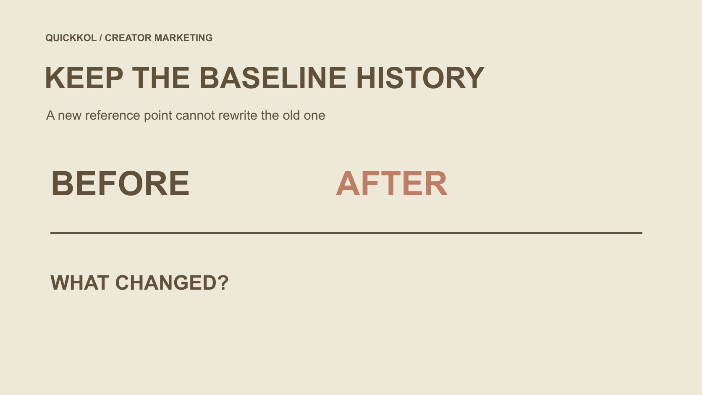

# 免费 IG 粉丝说法出现后，活动基线该怎样重新说明

状态：本地审阅稿；正式发布日期待确认。

当免费粉丝说法与活动时间线交织时，保留旧基线、解释新的观察起点，让报表继续可用而不伪装成受众清洁证明。

QuickKOL 编辑图形；不呈现真实账号指标或平台界面。

当 instagram free ig followers 的说法出现在达人合作中，不要为让报告好看而重写原始粉丝基线。保留旧观察的来源、时间和口径；如确实需要新起点，说明选择原因、适用窗口及与旧条件的差异。两个时点的粉丝总量之差，只是相应口径下的净变化，不是独立真人数量，也不能证明活动或某项服务造成了变化。未知来源与疑似异常应保留为待复核，不凭单一指标扣除粉丝、判定个人或承诺已经清除全部虚假互动。

## 先明确基线在回答什么

基线是一次比较采用的起点，不是对账号质量的认证。它可以帮助描述某段时间的公开或授权数据变化，也可能用于活动规划。但账号规模、作品触达、互动事件和实际客户是不同对象，不能只因它们都写成数字就采用同一个起点。

先说明你想知道的是合作前后的观察变化，还是希望估计活动产生的额外效果。后者需要更合适的设计与证据，不能通过换一个更有利的日期完成。创作者看到的公开数据和品牌掌握的资料也可能具有不同范围，必须保留来源。

如果免费粉丝广告只是被提到，还没有证据说明发生了接入或交付，就不要自动把整段数据称为已证实污染。可以说明担忧与限制，并决定需要复核什么。清楚的研究问题，能够避免一条未确认说法把后续每个数字都变成无依据的指控。

## 保留原始观察，不用新起点覆盖它

保存当时采用的账号对象、字段名称、获取时间、来源、观察窗口和必要限制。它可能是一项公开总量，也可能来自适当授权的提取。后续如发现某字段不可比，应补充说明，而不是删除原记录，假装团队从未使用过它。

对团队原先怎样理解数字也保持准确。有人当时把总粉丝写成独立受众，应更正这个表述并保留更正原因，不能悄悄换标签后声称所有历史报告一直正确。改正口径是正常的学习过程，不应通过隐藏版本来实现。

同一截图的复制不构成新的观察。来自不同时间、工具或账号的数字，也不应混成一个没有来源的基线。让下一位负责人能够找到旧记录，理解它当时能说明什么、后来发现了什么限制，是比保留一个漂亮起点更重要的交接要求。

## 为变化保留多种可能解释

[Meta 的虚假互动执法公告](https://about.fb.com/news/2020/10/taking-action-against-fake-engagement-and-ad-scams/)在 2020 年描述了人工制造点赞和粉丝的服务。它说明这些活动曾是平台处理的问题，不证明本次账号发生了同样行为，也没有提供一个可以套在每个人身上的可疑比例阈值。

一次总量变化还可能与自然关注和取消关注、其他传播、观察时间或数据处理有关。品牌可以根据实际材料提出待复核问题，但不能把一个增长峰值或低互动率当作唯一原因。资料缺失时写明未知，而不是选择最符合先入判断的解释。

同样，创作者说没有使用某项服务，是一项需要准确归属的陈述，不应被改写成独立调查已经排除了所有可能。记录说法、观察与进一步确认之间的差别，让当前业务决定基于它真正掌握的证据，而不靠一个未经验证的因果故事。

## 平台清理不是完整认证

[Meta 的创作者安全公告](https://about.fb.com/news/2024/06/protecting-athletes-and-fans-on-our-apps-during-major-sporting-events-this-summer/)在 2024 年介绍了帮助创作者批量移除垃圾粉丝的功能。这是有日期的平台工具说明，不保证今天所有账号都获得同样能力，也不说明每个被识别或移除的对象可以由品牌独立证明为假粉。

如果适当负责人报告做过某项管理行动，保留行动对象、时间和能够确认的范围。不能仅根据总数下降，就声称平台清除了某一准确数量的机器人；也不能根据总数恢复增长，就认为全部异常已经结束。管理行为与数据解释需要分别核对。

新的观察起点可以放在某个已经记录的管理行动之后，但必须说明为什么这样安排，以及还不知道什么。它代表接下来怎样观察，不是追溯证明过去的全部关注者真实。不要用一个“已清理”标签，把本来需要保留的证据边界从报告里删除。

## 说明采用新参考点的理由

选择新起点前，写明它服务哪个任务、采用何种字段与来源、比较窗口如何确定，以及与原始记录有什么不可比条件。应由合适的业务负责人理解并采用，而不是分析人员在结果出现后挑最有利的一对数字。

合理的理由可能是下一阶段按新定义开始记录，或某个可用来源从明确时点起恢复。但这不说明旧区间已经失效到可以完全忘记，也不代表新窗口就没有其他影响。原窗口与新窗口可以并列，分别说明用途与限制。

如果资料尚不足以建立新参考，可以继续保留已有描述，缩小比较结论，或等待适当材料。不要为了满足一张报表的固定格式，强行制造一个“真实粉丝基线”。参考点是一项管理选择，必须能被下一位同事理解和复核，而不是隐藏在最终增长率背后的自由裁量。

## 用三个时点算清比较到底变了什么

假设同一账号在原始观察时点为 12,000，某个中间时点为 14,000，后续时点为 14,600。中间发生过免费粉丝说法的讨论，但原因尚未确认。这三个数字是假设算例，不是实际创作者数据或行业基准。

从 14,000 到 14,600 的净变化为 600；若用中间值作分母，描述性变化率是 600 ÷ 14,000 × 100% ≈ 4.29%。从 12,000 到 14,600 则是 2,600 的净变化。它们回答不同窗口的问题，不能只选一个让汇报更好看的结果，也不能把 600 或 2,600 叫作已经核实的新真人。

若新阶段以 14,000 为参考，应保留原来的 12,000 及中间条件说明。不要擅自从总数扣除猜测出来的 2,000，再说剩余部分全部真实。算术可以复核，原因和组成仍需证据；两者的确定程度并不相同。

## 前后变化不能自动证明增量

[英国 Magenta Book 的评价方法指南](https://www.gov.uk/government/publications/the-magenta-book/magenta-book-central-government-guidance-on-evaluation-html)把影响评价建立在合适比较与反事实证据等条件上。本文借用的是一个方法边界：观察到前后变化，不等于已经知道没有这次活动时会发生什么；重新选定起点，也不会自动产生因果证据。

因此，不把上面的 600 粉丝净变化写成某条作品带来的增量，更不把它当作某项免费服务有效的证明。其他内容、已有传播、平台处理与观测条件可能同时变化。本文没有执行影响评价，也不建议为了验证刷量服务而让其他账号接受同样干预。

如果品牌确实需要判断合作带来的额外影响，应与适当分析人员设计与业务问题相称的研究，说明假设与限制。日常报表仍可以诚实报告描述性变化。承认不能证明因果，不意味着所有观察都无用；它让读者知道当前数字适合支持哪一种决定。

## 把未知放进报告，而不是补进公式

[社媒指标决策框架](https://www.quickkol.com/zh/blog/social-media-metrics-creator-decision-tree/#answer)可以帮助团队保留字段来源、窗口、单位和缺失状态。某一时点数据不可得时，写为不可得，不填零；某个增长原因不明确时，写为原因未知，不凭头像、国别猜测或互动单一比例补一个组成估计。

品牌可以展示原始观察、窗口变化和新的记录安排，同时说明不能比较的部分。若读者只需要知道某项发布是否完成，就不必强行加入粉丝增长率来制造效果结论。任务不同，适合证据也不同，不是每张报告都需要一个代表成功的综合分数。

免费增粉说法本身也应保留准确归属。广告承诺、创作者自述、品牌观察与独立证据不是同一种来源。把它们分开列出，可以让负责人既认真看待风险，又不会把怀疑扩展为对具体个人已经被证实的不诚信结论。

## 以可复核的比较说明完成交接

交接给下一位负责人时，同时提供原始基线、新参考点的理由、窗口定义、实际算式、限制和仍待确认事项。把资料变化与业务决定连接起来，例如下一阶段只描述同一来源下的净变化，不再声称某个未经设计的增量效果。

[恢复交接指南](https://www.quickkol.com/zh/blog/instagram-free-followers-access-recovery-handoff/#answer)可以补充账号安全与权限行动的记录；这些行动不应取代数据来源复核。一个团队可以在安全处理方面完成明确工作，同时仍不知道过去粉丝变化的全部原因。两个结论可以同时存在，不需要为报告整洁而把它们合并成全面通过或全面失败。

最终标准是读者能够复算描述性算术，理解为什么选择这个窗口，并知道它不能证明什么。不承诺百分百识别、不提供刷量建议、不擅自扣除所谓可疑群体，也不凭一次变化指控个人。这样的基线说明，能够让达人合作继续保持专业，而不靠清洁数据的虚假保证获得确定感。

## 基线变化说明卡

| 记录 | 说明内容 | 不代表 |
| --- | --- | --- |
| 原始参考 | 来源、字段、时间、窗口与限制 | 账号或全部粉丝质量认证 |
| 新参考 | 选择原因、条件变化与适用任务 | 旧历史可以删除或新数据全部清洁 |
| 描述性差值 | 同口径时点之间的算术与分母 | 独立真人或因果增量 |
| 未解决问题 | 具体未知、适当来源与下一步 | 用猜测扣除粉丝或指控个人 |

教育向编辑框架；正文数字均为假设，不是真实账号结果或行业阈值。

## 采用新基线前

让窗口选择、历史和未知都能被下一位同事理解。

- [ ] 先说明比较任务和需要的字段。
- [ ] 保留旧参考及其来源，不事后改写。
- [ ] 为新起点写明理由、时间和不可比条件。
- [ ] 把净变化、独立人数与因果效果分开。
- [ ] 不将管理行动当作粉丝清洁认证。
- [ ] 未知不补零，不根据单一信号扣粉或定性。

## 研究日期与使用边界

资料核验于 2026 年 11 月 13 日。文中方法、表格和决策规则为编辑建议，标为假设的示例不是实际客户结果或行业基准。外部资料的适用地区与时期按各段说明；本稿处于独立本地审阅阶段，正式发布日期待确认。

## 继续学习指标与证据

理解来源、窗口、权限与未知；不凭单一信号判断个人，也不承诺完整检测。

[阅读指标决策指南](https://www.quickkol.com/zh/blog/social-media-metrics-creator-decision-tree/)

## 来源

- [Meta：虚假互动执法公告（2020）](https://about.fb.com/news/2020/10/taking-action-against-fake-engagement-and-ad-scams/)
- [Meta：创作者与粉丝安全说明（2024）](https://about.fb.com/news/2024/06/protecting-athletes-and-fans-on-our-apps-during-major-sporting-events-this-summer/)
- [英国政府：Magenta Book 评价指南](https://www.gov.uk/government/publications/the-magenta-book/magenta-book-central-government-guidance-on-evaluation-html)
