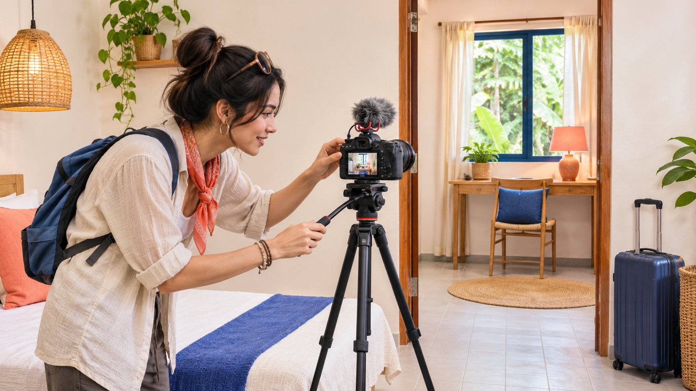
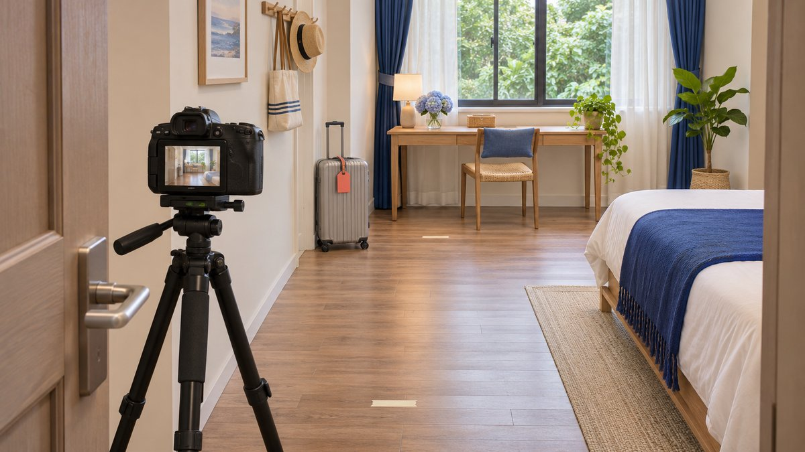

# Homestay Creator Videos: Show the Stay Before the Promise

Status: local review draft; confirm the publication date before release.

Brief a homestay creator video that shows the actual room and arrival experience, retains limitations, protects guests and explains the partnership.

Best practices for homestay videos on Meta platforms should help viewers decide whether a stay fits their needs, rather than merely make a room look attractive. Confirm the filmed room type, included facilities, arrival conditions and material limitations before planning a connected shot sequence, understandable sound and useful text. Address guest privacy, participation, gifted or paid relationships and subsequent use before filming. Check platform guidance against the actual account and asset instead of treating a camera move, duration or soundtrack as a universal formula for every homestay collaboration. A useful brief makes the experience more understandable without turning one filmed visit into a permanent guarantee.

## Choose the stay question the video should answer

Define the decision a viewer needs to make. A short weekend visit may raise arrival and layout questions, a work trip may raise desk and environment questions, and a group visit may require distinguishing room types. Do not turn audience labels into unverified promises such as suitable for every family, completely quiet or accessible.

The [travel collaboration feasibility guide](https://www.quickkol.com/blog/top-travel-influencers-itinerary-feasibility/#answer) helps assess the creator, location and execution conditions. This production brief goes further by defining what the viewer should understand from the finished piece. Review relevant explanatory work rather than assuming that a travel-category account or a large following guarantees suitable room coverage.

Put one main question at the center, such as the route from entrance to this particular room. An accurate destination can provide supporting information. Prices, availability, house rules and facilities can change; the video should not make promises it cannot maintain indefinitely. Assign someone to maintain that information before the creator invites viewers to consult it. This keeps the creative task focused and makes the handoff useful to the accommodation team as well as the audience.

## Attach each facility claim to the correct room

The shot list should identify room type, room or area, filming date and relevant inclusion conditions. A view, bathroom, kitchen or terrace may belong to a particular category or shared space. Editing several areas into a seamless scene can imply that all come with the same room.

Have the property verify supportable facts while the creator describes their actual observation. Trying a desk can support a description of how equipment fitted during the visit. A laptop appearing in frame does not establish internet performance without an appropriate measurement. A quiet recording session likewise cannot prove quiet at every hour.

Prepare natural qualifications where needed: the video features a particular room type, or the space shown is shared. Retain the information with its relevant shot rather than hiding it in a document the viewer never sees. If a facility cannot be confirmed, avoid promising it and direct viewers to the official source for current details. The practical aim is not to overload every frame with caveats, but to prevent the edit from making a materially different offer from the one the property can actually provide.

## Use connected shots to explain the space

Establish spatial relationships before adding atmosphere. A sequence can begin with entrance, passage, room door and principal usable area, then cover the desk, storage or bathroom relevant to the audience’s question. This is an editorial suggestion, not a Meta-mandated shot formula.

Test the camera from a safe position. Check whether the tripod obstructs passage, the lens distorts room proportions or a moving shot skips an important step or turn. A wide lens can explain a space without implying more usable area than exists. Where dimensions or access capability affect the decision, obtain appropriate confirmation; footage alone is not certification.

Keep enough context to connect a close-up with the area already shown. Attractive bedding, cups and window light can add texture, but should not replace the core explanation. A connected sequence helps viewers more than making every isolated shot look luxurious. It also lets the property reviewer identify precisely which facility the finished video presents, rather than guess whether an appealing detail belongs to the room being promoted.

Checking camera position and passage from the entrance helps explain the actual spatial relationship.

## Give sound and text practical jobs

Clear narration can explain shared facilities, arrival conditions or use details that the picture does not establish. Check ambient sound before recording and prevent a soundtrack from covering necessary explanation. If the brand intends subsequent reuse, discuss audio and other material permissions before completing an edit that cannot serve that purpose.

Keep on-screen wording short, accurate and unobstructed in the actual publication preview. Check captions, room names and qualifications against the audio. During this filmed visit must not become always through an abbreviated subtitle. For additional language versions, preserve the same facts rather than making a more fluent translation into a stronger promise.

Watching once without sound and listening once without relying on the image can reveal gaps. This is an editorial check, not certification that every viewer can access the content. Text and sound should complement one another so a viewer understands what is being shown and what still requires consulting the official destination. Decorative labels are less useful than an accurate room identifier or a clear explanation of a shared area.

## Plan around guests and staff before filming

[FTC’s business information-security guide](https://www.ftc.gov/business-guidance/resources/protecting-personal-information-guide-business) advises limiting unnecessary information and access. Apply that management principle by arranging suitable filming times, areas and participants, reducing incidental capture of guests, staff records and personal possessions. This does not replace a determination of applicable local participation requirements.

Check for visible booking lists, delivery details, vehicle identifiers, personal documents, access information and screen reflections. None needs to be collected merely to make a video feel authentic. Explain the intended shot and use to planned participants, and have the responsible person confirm suitable arrangements. Booking a stay or having an employment relationship is not automatically permission for every commercial appearance.

If an unsuitable subject enters the scene, change the position, wait or reshoot rather than publish first and hope nobody notices. Raw footage handed to the brand can also contain unnecessary information, so organize and restrict it around the actual task. Normal guest movement, safe access and property work should not be casually interrupted to obtain a more attractive frame.

## Explain the relationship without scripting an experience

[FTC’s influencer disclosure guide](https://www.ftc.gov/business-guidance/resources/disclosures-101-social-media-influencers) explains, for US-relevant promotion, that free or discounted services can create a material connection. Both a hosted stay and direct payment therefore warrant a disclosure check. The absence of cash does not turn an arranged visit into an unrelated accidental discovery.

Check the relationship explanation with the actual endorsement, final visual and text treatment, and applicable platform settings. An email between the parties or a profile biography is not sufficient evidence that viewers received the explanation. Responsible owners should confirm platform and regional requirements before release; this article offers no globally sufficient hashtag.

The property should also avoid asking creators to describe experiences they did not have. Filming a room does not establish an overnight stay, and trying one meal does not establish every dining option. Explain whether the piece reflects a visit, limited experience or actual stay. Relevant limitations do not make the partnership pointless. They help the viewer understand what the recommendation is based on and which questions still require a separate source.

## Review a room-specific example

Suppose a homestay commissions a video explaining one double-room category. The footage shows its desk, a shared kitchen and a terrace belonging to another category. The brand wants viewers to understand a short work stay. This is a hypothetical review exercise, not a real property or client case.

An edit that combines all three spaces under your private work suite goes beyond the evidence. Retain the actual room’s desk demonstration, identify the kitchen as shared, and remove or separately identify the terrace correctly. If current access to a shared facility cannot be confirmed, do not promise it.

Then check whether the destination describes the same room category and whether somebody maintains facility and booking conditions. The creator’s filming date differs from a viewer’s eventual stay, and the filmed experience is not a future inventory guarantee. Completion means a viewer understands this category and the questions still requiring confirmation. It does not mean preserving every beautiful shot inside one continuous impression of an accommodation product the property cannot actually offer.

## Check the actual Meta publication context

[Meta’s Instagram Best Practices announcement](https://about.fb.com/news/2024/10/best-practices-education-hub-creators-instagram/) introduced general and personalized professional-dashboard guidance in 2024. It supports consulting account-level education, not a permanent universal duration, frequency, posting time or growth formula for homestay videos. Check the actual account for available resources and advice.

Bring the [creator brief](https://www.quickkol.com/blog/write-a-useful-campaign-brief/#answer)’s important explanations into the real preview. Does the intended crop retain the room label? Does the cover imply a different category? Is essential text covered by interface elements? Can sound and contextual information be understood? Review different Meta publication objects and reuse versions separately rather than assuming one correct preview proves they are identical.

If the asset changes format, reconfirm information, permission and responsibility instead of merely exporting another size. Help the audience understand the stay; do not remove a material limitation to meet an unverified recommended duration. Professional release preparation means checking the particular work in its actual setting. That final review can catch a misleading thumbnail or cropped qualification that was absent from the editor’s clean master file.

## Connect the video to a maintained next step

Send viewers somewhere that identifies the relevant room category, current facility information and an appropriate inquiry route. An unattended page, obsolete price screenshot or private chat address is not a durable destination. The filming contact and accommodation inquiry owner may be different people; establish which questions each handles.

Distinguish delivery, audience understanding, inquiries and bookings in the review. A transport question in comments may reveal an arrival-information gap; it is not an order. More video viewing alone cannot establish incremental stays. Record sources and windows under confirmed definitions rather than adding platform events, inquiry counts and reservations together.

Assign review when seasons, facilities or rules change. The owner may update the destination, add a clear explanation or stop using a version that is no longer appropriate. Recording these duties in the handover is more workable than asking the creator to guarantee the same experience indefinitely. It also allows an informative room video to be managed responsibly after the circumstances captured during production have changed.

## Homestay creator-video shot card

| Shot task | Check | Avoid implying |
| --- | --- | --- |
| Arrival and entrance | Actual route and material limitations | Unverified access or transport guarantees |
| Room type and layout | Room category, area and filming date | Different categories form one private space |
| Facility demonstration | Actual trial, sharing and inclusion conditions | Footage proves performance or permanent availability |
| Context and destination | Relationship context, current page and inquiry owner | Views or questions equal bookings |

An editorial production framework, not a fixed Meta shot list, property certification or booking promise.

## Before a homestay video is released

Check the final asset against the current room category rather than only an early script.

- [ ] Confirm room type, filmed areas, date and facility inclusions.
- [ ] Explain actual spatial relationships and retain material limitations.
- [ ] Address guests, staff, personal records and access information.
- [ ] Check sound, captions, crop and intended reuse conditions.
- [ ] Explain applicable hosted or paid relationships without inventing a stay.
- [ ] Match the destination to the room category and assign maintenance and inquiry owners.

## Research date and limitations

Sources reviewed November 13, 2026. Methods, tables and decision rules are editorial recommendations. Hypothetical examples are not actual client results or industry benchmarks. Source geography and periods are specified where relevant. This draft is in independent local review; confirm its publication date before release.

## Start creator research with a clear task

Use QuickKOL to interpret a brief, discover relevant creators and research their work and contact routes. Verify data, commercial terms and outcomes at their source.

[Explore QuickKOL](https://www.quickkol.com/#capabilities)

## Sources

- [FTC: Protecting personal information, a guide for business](https://www.ftc.gov/business-guidance/resources/protecting-personal-information-guide-business)
- [FTC: Disclosures 101 for social media influencers](https://www.ftc.gov/business-guidance/resources/disclosures-101-social-media-influencers)
- [Meta: Instagram Best Practices education hub (2024)](https://about.fb.com/news/2024/10/best-practices-education-hub-creators-instagram/)
