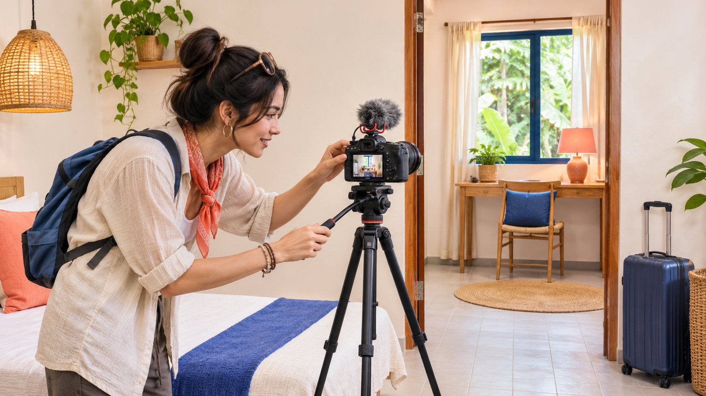
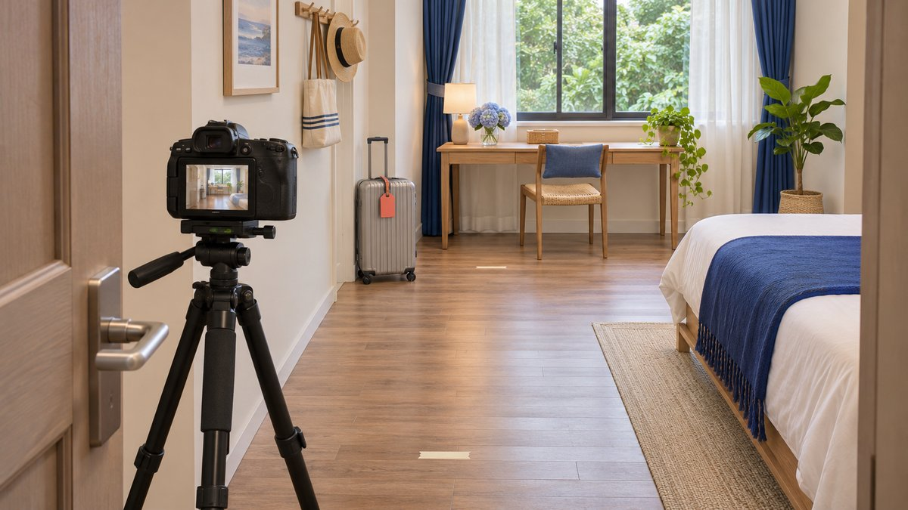

# 民宿达人视频：空间与入住条件

状态：本地审阅稿；正式发布日期待确认。

把民宿合作视频写成可执行的拍摄 Brief：展示真实房型和到达过程，保留限制，保护住客，并清楚说明合作关系。

面向 Meta 平台的民宿达人视频，好的做法是帮助观众判断这次入住是否适合，而不只是把空间拍得漂亮。先确认拍摄的房型、实际包含的设施、到达条件和需要说明的限制，再安排有连贯关系的镜头、清楚声音与可理解的文字。住客隐私、出镜安排、招待或付费关系及后续使用范围应在拍摄前说清。平台建议要结合当前账号和内容检查，不能把某种镜头、长度或音乐当成所有民宿合作的固定成功公式。

## 先选择需要回答的入住问题

先定义观众要做什么决定。周末短住可能关心到达和空间布局，工作出行可能关心实际桌面和环境，亲友同行可能需要理解不同房型。不要未经核验就根据人群标签加入“适合所有家庭”“完全安静”或“无障碍”等承诺。

[旅行合作可行性指南](https://www.quickkol.com/zh/blog/top-travel-influencers-itinerary-feasibility/#answer)帮助评估创作者、地点和执行条件；这份拍摄 Brief 进一步说明观众应从作品里看懂什么。让创作者提供相关作品和解释方式，而不是只根据旅行类账号或粉丝规模决定其能够完成具体房间展示。

把一个主要问题放在片子核心，例如“从入口到这间客房是什么路径”。其他信息可由准确的承接页面补充。房价、空房、入住规则和设施可能变化，视频不应承担它无法长期维护的承诺。品牌应安排负责维护这些信息的人，再让创作者邀请观众去查看。

## 给每个设施说法配上准确对象

拍摄清单应注明房型、房间或区域、拍摄日期及相关包含条件。窗景、浴室、厨房或露台可能属于特定房型或共享空间。把不同区域剪成一个流畅场景，容易使观众误以为它们都随同一间客房提供。

品牌先核对可说明的事实，创作者再用自己的观察表达。实际试用过桌面，可以说明这次如何摆放设备；没有完成速度测量，就不要把电脑画面当作网络质量证明。单次拍摄的安静环境，也不能证明每个时段都安静。

给需要限定的内容准备自然说法，例如拍摄的是某一房型，或者画面中的空间为共享区域。必要信息应与相应镜头一起保留，而不是只藏在一个没有出现在视频里的说明文件。无法确认某项设施时，可以不作承诺，并让观众通过正式页面查询当前情况。

## 用连续机位说明空间关系

先拍观众能够理解的空间关系，再补氛围细节。可以从入口、通道、房门、主要使用区域开始，之后展示与任务有关的桌面、储物或卫浴安排。这个顺序是编辑建议，不是 Meta 要求的固定镜头公式。

在安全位置试机，注意脚架是否挡路，镜头是否使房间比例失真，以及移动时是否漏掉重要台阶或转角。广角可以帮助交代空间，但不能借此暗示比实际更大的使用面积。尺寸和通行能力如影响决定，应由适当人员另行确认，不能只凭画面认证。

保留足够上下文，让近景能回到已说明的区域。漂亮的床品、杯子或窗边光线可以增加细节，却不应取代核心空间说明。镜头之间的逻辑，比每个单独镜头都显得豪华更能帮助观众理解；也更方便品牌核对成片到底展示了哪一处设施。

先在入口确认机位与通道，能帮助拍摄者交代真实空间关系。

## 让声音和文字帮助解释

清楚旁白可以解释画面里难以辨认的共享关系、到达条件或使用方式。录制前先检查环境声，避免一段背景音乐盖住必要说明。计划品牌后续复用时，提前讨论声音和其他素材的适用范围，而不是在剪辑完成后才发现版本无法使用。

文字应保持短而准确，放在实际发布预览中不被遮挡的位置。对照声音检查字幕、房型名称与限定语；不能把“本次拍摄期间”剪成“始终如此”。需要多语言版本时，确认每种语言保留相同事实，不把较自然的表达改成更强的承诺。

看完一遍不带声音的版本，再听一遍不依赖画面的解释，有助于发现信息缺口。这是编辑检查，不代表所有人都能无障碍使用内容。文字与声音应互相补充，让观众知道看到的是什么、哪些情况仍需查看正式页面，而不是仅仅增加装饰性标签。

## 提前处理住客与员工隐私

[FTC 的企业信息保护指南](https://www.ftc.gov/business-guidance/resources/protecting-personal-information-guide-business)建议缩减不必要的信息收集和访问。把这一管理原则用于民宿拍摄，可以先安排适当时段、区域和参与人员，避免临场把其他住客、员工资料或个人物品意外带入镜头。它不是对所有当地出镜许可要求的替代判断。

拍摄前检查预订名单、收件信息、车牌、个人证件、门锁信息和屏幕反射等是否可见。没必要为了让视频显得真实就记录它们。对计划出镜的人说明镜头用途与拟议使用，让负责人员确认适当安排；不要把入住同意或工作关系自动当作商业出镜许可。

拍摄中出现不合适对象时，调整机位、等待或重拍，而不是先发出去再指望没人注意。交接给品牌的原始片段也可能含有不需要的资料，应按实际必要范围整理和访问。安全路径、住客正常活动与物业工作不应为了一个镜头被随意打断。

## 把招待、付费与真实体验一起说清

[FTC 的达人披露指南](https://www.ftc.gov/business-guidance/resources/disclosures-101-social-media-influencers)在美国相关推广场景中说明，赠送或优惠的服务也可能构成需要清楚说明的关系。民宿招待与直接付款因此都值得在发布准备中检查。不要仅因没有现金费用，就把一次有商业安排的入住包装成完全无关联的偶然发现。

披露要跟实际推荐放在一起，并在最终画面、文字和平台适用设置中检查，不只存在于双方邮件或账号简介。具体地区和平台条件应在上线前由相关负责人核对；这篇文章不提供一条全球通用的标签保证。

同时，品牌不应要求创作者声称没有经历过的体验。拍了一段房间视频不代表实际过夜，尝试了某一餐也不代表所有餐食。清楚写出参观、体验或实际入住的范围，让表达仍然有信息价值。真实限制并不会让合作失去意义，反而可以帮助观众理解这种推荐适用于什么情况。

## 用一份房型案例检查成片

假设一家民宿邀请创作者制作某种双人房的解释视频。镜头拍到了房内书桌、共享厨房和另一房型的露台。品牌希望观众理解工作短住条件；这是假设练习，不是真实物业或客户案例。

如果成片把三个空间混剪并配上“你的私人工作套房”，就超出了当前证据。可以保留实际房型的桌面演示，明确厨房为共享区域，删除或单独准确标明露台所属对象。若品牌不能确认共享设施当前开放，就先不作可用承诺。

接着检查承接页面是否指向同一房型，是否有人维护设施和预订条件。创作者拍摄日期与观众实际入住日期不同，视频中的体验也不等于未来库存保证。完成标准是观众能理解该房型和需要进一步确认的问题，而不是品牌把所有漂亮镜头都留在同一条片子里。

## 检查 Meta 账号的实际发布

[Meta 的 Instagram Best Practices 公告](https://about.fb.com/news/2024/10/best-practices-education-hub-creators-instagram/)在 2024 年介绍了专业面板中的通用和个性化指导。它说明账号层面的教育资源值得查看，不是一个对所有民宿视频永久有效的长度、频率、发布时间或涨粉公式。具体可用入口和建议应以当时账号为准。

把[达人 Brief](https://www.quickkol.com/zh/blog/write-a-useful-campaign-brief/#answer) 中的关键说明带入实际预览：竖屏或其他目标裁切是否保留房型标签，封面是否误示另一种房间，文字是否被界面遮住，声音和说明能否正常播放。不同 Meta 发布对象和复用版本需要分别查看，不因一个预览正确就宣布所有版本相同。

如果某项内容需要临时改为另一种形式，重新确认信息、许可和职责，而不是仅导出不同尺寸。页面体验优先帮助观众理解，不为追赶一个未经核验的推荐长度删去关键限制。专业的发布准备，是把具体作品放入真实使用环境后再次检查。

## 安排到访后的问题接收人

让观众去一个能找到对应房型、当前设施说明和适当咨询路径的目的地。不要把一个没有人维护的页面、过期价格截图或私人聊天地址当作长期承接。拍摄合作负责人与入住咨询负责人可能不同，应提前说明谁处理什么问题。

复盘时区分作品完成、观众理解、咨询与预订。评论里出现一个交通问题，可以提示需要补充到达说明；它不是订单。视频观看增加，也不能单独证明增量入住。品牌可按已确认口径整理来源与窗口，不把平台事件、咨询人数和实际预订相加。

为季节、设施和规则变化安排复核。可以更新目的地、加清楚说明，或在必要时停止使用不再适当的版本。把这些责任写进项目交接，比要求创作者永远保证同一次入住体验更可执行，也让一条有用的房型视频在条件变化后仍能被负责任地管理。

## 民宿合作视频拍摄卡

| 镜头任务 | 核对内容 | 避免误示 |
| --- | --- | --- |
| 到达与入口 | 本次实际路径与必要限制 | 未确认的通行或交通保证 |
| 房型与布局 | 对应房型、区域和拍摄日期 | 不同房型属于同一空间 |
| 设施演示 | 实际试用与共享、包含条件 | 画面等于性能或永久可用证明 |
| 说明与承接 | 关系说明、当前页面与答疑责任 | 观看或咨询等于预订 |

编辑拍摄框架，不是 Meta 官方固定镜头清单、物业认证或预订承诺。

## 民宿视频上线前

按最终作品和当前房型逐项确认，而不是只审一份早期脚本。

- [ ] 确认房型、拍摄区域、日期和设施包含条件。
- [ ] 镜头说明实际空间关系，保留必要限制。
- [ ] 处理住客、工作人员、个人资料与安全信息。
- [ ] 核对声音、字幕、裁切与拟议复用条件。
- [ ] 说明适用的招待或付费关系，不虚构入住体验。
- [ ] 确认目的地对应房型，并安排后续维护与咨询负责人。

## 研究日期与使用边界

资料核验于 2026 年 11 月 13 日。文中方法、表格和决策规则为编辑建议，标为假设的示例不是实际客户结果或行业基准。外部资料的适用地区与时期按各段说明；本稿处于独立本地审阅阶段，正式发布日期待确认。

## 从任务开始达人研究

用 QuickKOL 理解 Brief、发现相关达人并研究作品与联系路径；数据、合作条件和结果仍需核验。

[了解 QuickKOL](https://www.quickkol.com/#capabilities)

## 来源

- [FTC：企业个人信息保护指南](https://www.ftc.gov/business-guidance/resources/protecting-personal-information-guide-business)
- [FTC：社交媒体达人披露指南](https://www.ftc.gov/business-guidance/resources/disclosures-101-social-media-influencers)
- [Meta：Instagram Best Practices 教育中心（2024）](https://about.fb.com/news/2024/10/best-practices-education-hub-creators-instagram/)
