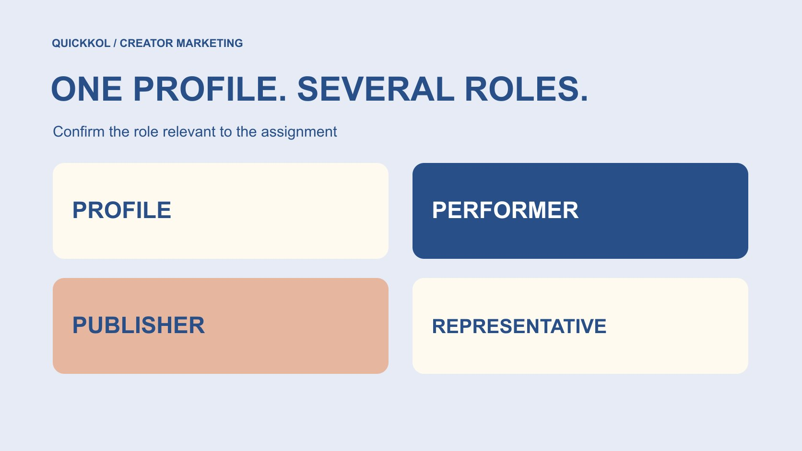

# Instagram Accounts: Map the People Behind a Collaboration

Status: local review draft; confirm the publication date before release.

Separate the Instagram profile, performer, publisher and representative so creator research can become a clear commercial conversation.

QuickKOL editorial graphic; not actual account metrics or a platform interface.

Instagram accounts are research entry points, not complete proof of a contracting party. One profile may be operated by several people, and one person may appear across several accounts. Performing, publishing, quoting and authorizing reuse can belong to different parties. Preserve the exact profile URL, work source, observation date and role description, then confirm who can answer the relevant collaboration question through an appropriate contact route. A credible-looking profile does not establish that a correspondent represents every performer or can license everything shown. Keep unresolved authority explicit instead of letting one account name stand in for an entire commercial scope.

## Start with the exact profile, not a remembered name

Record the full profile URL, displayed name, handle, observation date and the particular work that prompted interest. An avatar screenshot or remembered nickname is not a sufficiently retrievable research object. Similar names may belong to different people, and a reposting profile did not necessarily produce the original video.

Separate where the team encountered a piece from who created it. An advertisement credit, a brand repost and a creator’s original publication may require three connected records. Linking them preserves their relationship; merging them to make a spreadsheet tidier can destroy the source trail. If the original is no longer visible, record that state and identify any material retained earlier.

Dates change the interpretation as well. Names, biographies and contact routes can change. An old screenshot can document a past observation without becoming fresh confirmation of today’s representative. Establishing the research object first gives later questions about roles, work and permission something concrete to refer to. It also makes a mistaken profile selection correctable before outreach reaches an unrelated person.

## Give four roles their own fields

Give the account, on-screen performer, publication owner and commercial representative separate fields. These are editorial working categories, not legal identity classes certified by Instagram. An individual creator may hold several roles; a studio, ensemble or media program may divide them. Record known relationships rather than guessing who operates a profile behind the scenes.

The [creator identity deduplication guide](https://www.quickkol.com/blog/ai-creator-identity-deduplication/#answer) asks which accounts may belong to the same research subject. A role map then asks who should perform which task in this assignment. One person appearing on two accounts does not make their audiences or publication permissions interchangeable. A profile administrator also does not automatically represent every participant visible in its content.

Ask task-specific questions: who makes the demonstration, which account publishes it, who quotes, and who can confirm the intended use. An answer about one role settles that question only. A contact’s manager title must not silently become unlimited authority over production, participant appearances and every commercial term. This distinction is useful even when the relationship is friendly and nobody suspects wrongdoing.

## Treat platform context as context

The [Meta account-transparency announcement](https://about.fb.com/news/2020/04/page-and-account-transparency/) from 2020 discusses Instagram’s About this Account context and a US pilot. It documents historical platform context, not universal present availability or commercial authority.

When the interface actually shows useful account information, retain the field name, observation date and its stated meaning. Do not expand account-related geography into a creator’s residence, the location of every viewer or the jurisdiction of a contracting company. Platform context, production location and commercial party are different questions.

Mark a field that cannot be seen as unavailable rather than zero, concealed fraud or false identity. A familiar avatar, a verification appearance and a long publication history may guide further research, but none alone establishes a representative’s permission for the proposed assignment. The role map is not an authenticity score. Its purpose is to keep observations, interpretations and unresolved questions separate, so an internal reviewer can see why the team believes it has identified an appropriate conversation partner without pretending that every relevant fact has been independently certified.

## Verify unexpected contact through an independent route

[FTC’s influencer job-scam guidance](https://consumer.ftc.gov/consumer-alerts/2024/03/influencers-spot-job-scam) recommends verifying an unexpected offer through a known legitimate company channel rather than relying on contact details supplied by its sender. This US consumer guidance supports a verification step, not a finding about a particular representative.

Brands should make their own outreach equally checkable. State the organization, project purpose and official contact route. Do not ask a creator to provide passwords, verification codes or banking information merely to establish that an invitation is real. A request to verify the brand’s identity is a reasonable part of a commercial conversation, not evidence that the creator is difficult.

If an unfamiliar person claims to represent a creator, ask which responsibilities they handle and obtain necessary confirmation through the creator’s established public business route. Several descriptions copied from one message are not independent corroboration. Where confirmation remains unavailable, pause sensitive exchanges or commitments and record the missing step. That is a proportionate workflow decision; it does not require publishing a fraud allegation or collecting unrelated personal information to make the research file appear more complete.

## Translate interest in the work into a scoped question

A strong piece of work explains why a creator might fit; it does not establish what they are willing to supply. Put the relevant capability into the [creator brief](https://www.quickkol.com/blog/write-a-useful-campaign-brief/#answer): explaining a product, hosting on location, making an asset, presenting in a language or handling a specialist question. A profile category is not an agreement to perform every associated task.

Separate production, account publication and subsequent use. If the brand needs an advertising asset, asking whether collaboration is possible is insufficient. If it needs publication on the creator’s account, buying a file is not publication confirmation. Refer to an existing post to discuss the work without assuming permission to download, edit or transplant it into an advertisement.

Start with the appropriate person rather than a large speculative questionnaire. Then have the responsible owner address channels, duration, editing and participant permissions for the intended use. Tie each answer to an object and version. Otherwise a narrow, informal okay can expand as it passes between teams until nobody can identify what was actually approved.

## Keep the information the task requires

[FTC’s business information-security guide](https://www.ftc.gov/business-guidance/resources/protecting-personal-information-guide-business) recommends understanding information flows and limiting unnecessary data and access. Apply that management principle to creator research: preserve the business contact information and provenance required for the task instead of accumulating private biographical details.

Before a quote is even discussed, a researcher generally has no reason to collect identity documents, a home address, private contact details or complete financial records. If payment, sample delivery or contracting later requires particular information, the appropriate owner should handle it through an authorized process. The public-profile research sheet should not become the default storage location for those sensitive files.

A role-confirmation record is not a permanent personal dossier. Assign responsibility for contact changes, the end of the assignment and records that have become stale. Keep necessary decision evidence while removing information no longer required. Public visibility is not an unlimited mandate to compile and redistribute material. The team still needs its responsible staff to determine applicable local requirements and policy, especially when a relationship moves from initial research into administration.

## Rehearse a four-role collaboration

Suppose a software brand finds a demonstration published by a studio profile. Presenter A explains the feature, producer B makes the video, and contact C says they handle commercial discussions. The brand needs a new feature explanation with limited use on its own channels. This is a hypothetical exercise, not a client result.

Start by retaining the original post and studio profile. Record A as the observed presenter, while B’s and C’s responsibilities await confirmation. Update each relationship with its source and date when an appropriate answer arrives. Even if C can provide a quote, the team must still establish whose production is included, which account would publish and who confirms the proposed use.

If the studio subsequently offers another presenter, replacing the name in the sheet does not preserve the original fit rationale. Review that person’s explanatory work and the revised proposal. A role change need not imply an unreliable partner. It means a condition supporting the earlier decision changed, and both sides need to realign around the same description of the assignment.

## Keep exceptions visible rather than forcing a match

For an ensemble account, do not assume that every member independently brings the profile’s entire following. An agency representing several profiles also does not make those profiles equivalent in audience or role. Studio membership, publication identity and audience evidence can be related while still requiring separate records.

Shared names, renamed accounts, reposts and temporary guests are different exceptions. Describe the issue specifically, such as an original credit pointing to another profile, rather than writing identity problem. State what evidence could resolve the ambiguity and who could appropriately answer. Keeping two unresolved research records is preferable to merging them incorrectly and directing the commercial discussion at the wrong subject.

Do not automatically contact every person shown or collect their private social connections to finish the map. An established business route and necessary direct confirmation are usually more relevant. No reply can justify waiting or pausing; it does not establish that somebody is fake, lacks authority or refuses a collaboration. Preserve that distinction when handing the research to a person who did not see the original exchange.

## Hand over the map with the actual next question

Give the next owner a usable map: exact profiles, relevant work, roles, confirmation source, observation or response date, resolved points, unknowns and the next action. Research worthy of contact and permission ready for publication or reuse should remain different states.

The next step might be asking the confirmed commercial contact to clarify production and publication for one new demonstration. It should not be another context-free invitation that makes the creator repeat everything. Avoid repeatedly demanding proof of facts already established; recheck the affected fields when a contact, profile or proposed use actually changes.

The completion test is whether a colleague knows whom to approach, why, what to ask and what the evidence still does not establish. Account size and the number of completed spreadsheet cells cannot replace that test. As the collaboration progresses, bring the final scope and material changes back into the record so quoting, production and publication use the same explicit role relationships rather than reconstructing them from scattered messages.

## Instagram collaboration role map

| Field | Record | Does not establish |
| --- | --- | --- |
| Profile | Exact URL, name and observation date | Every participant or commercial authority |
| Performance and production | Relevant work and confirmed role | An account publication commitment |
| Commercial contact | Scope, confirmation route and date | Unlimited asset-use permission |
| Next action | Unresolved question and appropriate owner | No reply means false identity |

An editorial worksheet, not platform certification, legal identity screening or an authenticity score.

## Role checks before contact

Enable the next colleague to retrieve the work, understand the roles and ask a specific question.

- [ ] Retain exact profile and work URLs with dates.
- [ ] Separate performance, production, publication and commercial responsibilities.
- [ ] Distinguish direct confirmation, public self-description, interpretation and unknowns.
- [ ] Verify unexpected offers through an appropriate independent route without sharing passwords.
- [ ] Keep task-relevant information and assign a review owner.
- [ ] Tie the next step to specific work, a role and proposed scope.

## Research date and limitations

Sources reviewed November 13, 2026. Methods, tables and decision rules are editorial recommendations. Hypothetical examples are not actual client results or industry benchmarks. Source geography and periods are specified where relevant. This draft is in independent local review; confirm its publication date before release.

## Start creator research with a clear task

Use QuickKOL to interpret a brief, discover relevant creators and research their work and contact routes. Verify data, commercial terms and outcomes at their source.

[Explore QuickKOL](https://www.quickkol.com/#capabilities)

## Sources

- [Meta: Page and account transparency (2020)](https://about.fb.com/news/2020/04/page-and-account-transparency/)
- [FTC: Influencers, spot a job scam (2024)](https://consumer.ftc.gov/consumer-alerts/2024/03/influencers-spot-job-scam)
- [FTC: Protecting personal information, a guide for business](https://www.ftc.gov/business-guidance/resources/protecting-personal-information-guide-business)
