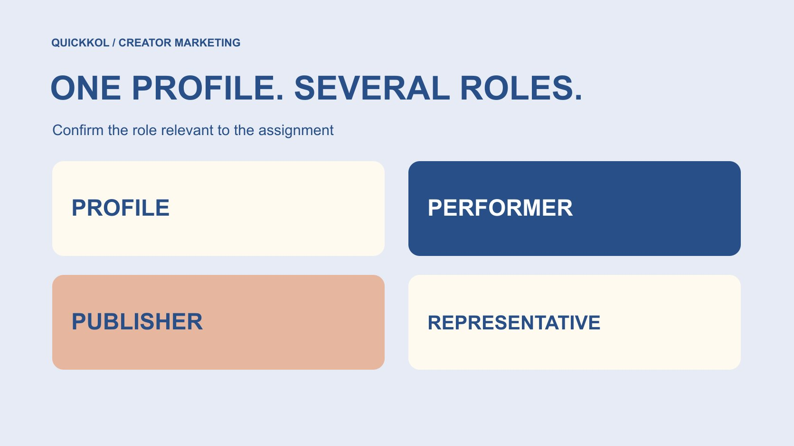

# 研究 Instagram 账号时，怎样确认合作中的各个角色

状态：本地审阅稿；正式发布日期待确认。

把 Instagram 主页、出镜者、发布方与商业代表分开确认，让达人研究能够进入清楚的合作讨论。

QuickKOL 编辑图形；不呈现真实账号指标或平台界面。

Instagram accounts 是达人研究的入口，不是完整的合作主体证明。一个主页可能由多人运营，一个人也可能参与多个账号；出镜、发布、报价和授予素材使用许可不一定由同一方负责。品牌应保留准确主页地址、作品出处、观察日期和角色说明，再通过适当联系路径确认谁能回答本次合作问题。账号看起来真实，不代表联系者能够代表所有出镜者或出售全部权利。把尚未确认的权限写成待确认，而不是用一个账号名称替代整份合作范围。

## 先保存账号指向的具体对象

记录完整主页地址、当时显示的名称、用户名、观察日期，以及引起兴趣的具体作品地址。不要只保存一张头像截图，或者在表格里写一个无法定位的昵称。昵称相似可能只是同名，作品被转发也不意味着转发账号制作了原片。

把“在哪看到”与“谁创作”放在不同字段。广告里的署名、品牌自己的转发和创作者原帖可能形成三个记录；可以相互关联，但不要为让表格整洁而合并成一个无法追溯的来源。若原帖已不可见，就注明当前状态和此前保存的材料。

日期也影响解释。账号名称、简介和合作联系入口可能改变。旧截图适合说明过去看到什么，不能充当今天重新确认的联系人证明。先获得稳定的研究对象，后续关于角色、作品和授权的问题才有可以对照的基础。

## 把四种角色放进不同栏位

至少区分账号、出镜者、发布负责人和商业代表。它们是本次编辑方法的工作字段，不是 Instagram 认证的法律身份分类。个人创作者可能同时承担几种角色；工作室、组合或媒体节目则可能把它们分开。先记录已知关系，不为了填满表格猜测后台运营者。

[创作者身份去重指南](https://www.quickkol.com/zh/blog/ai-creator-identity-deduplication/#answer)解决“哪些账号可能属于同一研究对象”；角色图进一步问“这次要找谁完成哪件事”。同一个人出现在两个账号，不代表两个账号具有相同受众或相同发布权限。一个主页负责人能安排发布，也不自动代表画面里每个参与者。

品牌应按任务发问：谁制作这条演示、哪个账号发布、谁给出报价、谁能确认指定使用范围。得到一个角色的答复，只完成这一项确认。不要把联系人职位里的 manager 翻译成对全部制作、肖像和商业条件的无限授权。

## 把平台提供的背景当作背景

[Meta 账号透明度说明](https://about.fb.com/news/2020/04/page-and-account-transparency/)在 2020 年回顾了 Instagram 的 About this Account，并描述当时面向部分账号的背景信息与美国试点。它说明平台曾提供帮助理解账号的上下文，不是对所有当前账号、所有地区和所有字段的可用性保证。

如果本次界面实际展示了账号背景，可以记录原字段名称、观察日期与含义。不要把账号相关地域信息扩写成创作者居住地、全部观众所在地或有权签约的公司所在地。平台背景、创作地点和合同主体需要分别理解。

某字段不可见时写为不可用，而不是零、隐藏欺诈或身份不实。认证外观、熟悉头像和长期更新都可成为进一步了解的线索，但不能单独完成代表权限确认。角色图的目的不是生成一个看起来权威的真实性分数，而是让已知、推断与仍需询问的部分保持分开。

## 通过独立路径确认意外联系

[FTC 的达人工作邀约提醒](https://consumer.ftc.gov/consumer-alerts/2024/03/influencers-spot-job-scam)建议通过已知真实的公司联系渠道核验意外邀约，而不是只使用来信者提供的联系方式。这是美国机构提供的风险教育，不是对某条具体私信或某位经纪人的调查结论。

品牌自己联系创作者时，也应让身份容易被复核：说明公司、项目目的与官方联系入口，不要求对方为了确认邀约而提供账号密码、验证码或银行资料。创作者询问身份是合理的合作步骤，不应被当作不配合。

如果陌生联系人自称代表某创作者，可请对方说明负责范围，并通过创作者已经公开的商业渠道作必要确认。不要把多个来自同一消息源的转述算成独立证据。无法确认时暂停敏感资料交换或商业承诺，记录缺少哪一步；这不等于公开指控联系人欺诈。

## 把作品兴趣改成可确认的合作问题

一条满意的作品先说明创作者为什么可能适合，不说明其愿意接什么工作。把你看中的具体能力写进[达人 Brief](https://www.quickkol.com/zh/blog/write-a-useful-campaign-brief/#answer)：解释产品、现场主持、实际制作、某语言表达，或对一个专业问题的处理方式。不要仅凭简介里的类别要求对方承担所有相关任务。

接着分别说明内容制作、账号发布与后续使用。需要品牌投放的素材，不应只问“能合作吗”；需要创作者自己的账号发布，也不能以采购文件代替发布确认。把原帖作为讨论作品风格的来源，不默认它可以被下载、剪辑或移植到广告里。

权限问题不必一上来堆成冗长问卷。先确认负责这项任务的人，再让适当负责人回答使用地点、时间、剪辑和参与者相关问题。每次答复都对照具体对象与版本，避免同一段模糊的“可以使用”在不同团队间被越传越大。

## 只保留完成任务需要的信息

[FTC 的企业信息保护指南](https://www.ftc.gov/business-guidance/resources/protecting-personal-information-guide-business)强调梳理个人信息并缩减不必要的收集和访问。在达人研究中，可以采用相同的管理思路：保存商业联系所需信息与来源，按实际任务限制内部访问，而不是把私人生活资料堆入候选名单。

报价讨论尚未开始时，研究者通常不需要身份证件、家庭地址、私人联系方式或完整财务资料。后续如确有付款、寄样或合同办理需要，应由适当人员通过授权流程处理；公共账号研究表不应成为这些敏感文件的默认存放处。

角色确认记录也不等于永久个人档案。为联系人变更、合作结束和失效资料设置复核与处理责任。保留必要的决策依据，同时移除不再需要的信息，不把“公开可见”理解成可以无限整理和传播的许可。当地要求与团队政策仍须由负责人员确认。

## 用一个四角色案例检查理解

假设一家软件品牌看到工作室账号发布的演示，画面由主持人 A 讲解，制作人 B 负责拍摄，联系人 C 自称负责商业沟通。品牌真正需要的是新功能解释视频，以及品牌自己渠道的有限使用；这不是一项真实客户案例。

研究记录先保存原帖与工作室主页，将 A 写为观察到的出镜者，将 B 和 C 的责任标成待确认。收到确认后分别更新来源和日期。即使 C 可以报价，也还要问清本次方案包含谁的制作、哪个账号发布，以及拟议使用由谁确认。

如果工作室后来提出换主持人，不能仅把姓名替换掉便沿用原先的适配理由。应复核新主持人的表达能力、示例与本次方案。角色变更未必意味着合作不可信；它说明先前判断依赖的条件改变了，需要让品牌与对方在同一份范围说明上重新对齐。

## 为多人、同名与转发保留例外

遇到组合账号时，不按主页粉丝数推断每位成员都能独立带来相同曝光。遇到代理机构代表多个账号时，也不把同一家机构当作账号之间的受众或角色等同关系。工作室成员、发布账号和受众证据可以有关联，却仍然需要各自记录。

同名、改名、转发和短期嘉宾是不同例外。给问题一个具体描述，例如“原帖署名指向另一账号”，而不是笼统写“身份有问题”。记录哪项证据能够解决歧义，以及谁适合回答。不清楚时保留两个候选记录，比误合并后整份合作讨论指向错误对象更稳妥。

不要为完成研究而自动联系每个出镜者或抓取私人社交关系。适当公开商业入口和必要的直接确认通常更贴近任务。没有答复可以成为等待或暂停的理由，但不是认定某个人虚假、无权代表或不愿合作的充分证据。

## 让角色图随合作交接，而非停在研究表

交接时给下一位负责人一份能继续使用的角色图：具体主页、关联作品、角色、确认来源、观察或答复日期、已解决事项、未知事项与下一步。把“研究上值得联系”与“已具备发布或使用许可”分成不同状态。

例如，下一步可以是请已确认的商业联系人说明一条新演示的制作与发布范围，而不是重新发一条毫无上下文的泛泛邀约。对已经明确的内容不反复索要证明；当联系人、账号或拟议使用变化时，再复核真正受影响的字段。

好的完成标准是接手者知道应找谁、为什么找、问什么，以及现有证据还不能说明什么。账号规模和表格完整度都不能替代这个标准。合作推进后，把最终范围与变化带回记录，让后续报价、制作与发布人员使用同一套已经说明白的角色关系。

## Instagram 合作角色确认表

| 字段 | 记录内容 | 不能自行推出 |
| --- | --- | --- |
| 账号 | 完整地址、名称与观察日期 | 所有参与者或代表权限 |
| 出镜与制作 | 本次相关作品与确认角色 | 账号发布承诺 |
| 商业联系 | 负责范围、确认路径与日期 | 全部素材使用许可 |
| 下一步 | 待确认问题与适当负责人 | 未答复等于身份不实 |

编辑工作表，不是平台认证、法律身份审查或个人真实性评分。

## 联系前的角色核对

让下一位同事能够定位原帖、理解角色并提出具体问题。

- [ ] 保存主页与相关作品的准确地址和日期。
- [ ] 分别记录出镜、制作、发布和商业联系责任。
- [ ] 注明直接确认、公开自述、编辑推断与未知。
- [ ] 通过适当独立路径核验意外邀约，不交换账号密码。
- [ ] 只保留本次合作需要的信息，并指定复核负责人。
- [ ] 把下一步绑定到具体作品、角色和拟议范围。

## 研究日期与使用边界

资料核验于 2026 年 11 月 13 日。文中方法、表格和决策规则为编辑建议，标为假设的示例不是实际客户结果或行业基准。外部资料的适用地区与时期按各段说明；本稿处于独立本地审阅阶段，正式发布日期待确认。

## 从任务开始达人研究

用 QuickKOL 理解 Brief、发现相关达人并研究作品与联系路径；数据、合作条件和结果仍需核验。

[了解 QuickKOL](https://www.quickkol.com/#capabilities)

## 来源

- [Meta：账号与主页透明度（2020）](https://about.fb.com/news/2020/04/page-and-account-transparency/)
- [FTC：达人工作邀约诈骗提醒（2024）](https://consumer.ftc.gov/consumer-alerts/2024/03/influencers-spot-job-scam)
- [FTC：企业个人信息保护指南](https://www.ftc.gov/business-guidance/resources/protecting-personal-information-guide-business)
