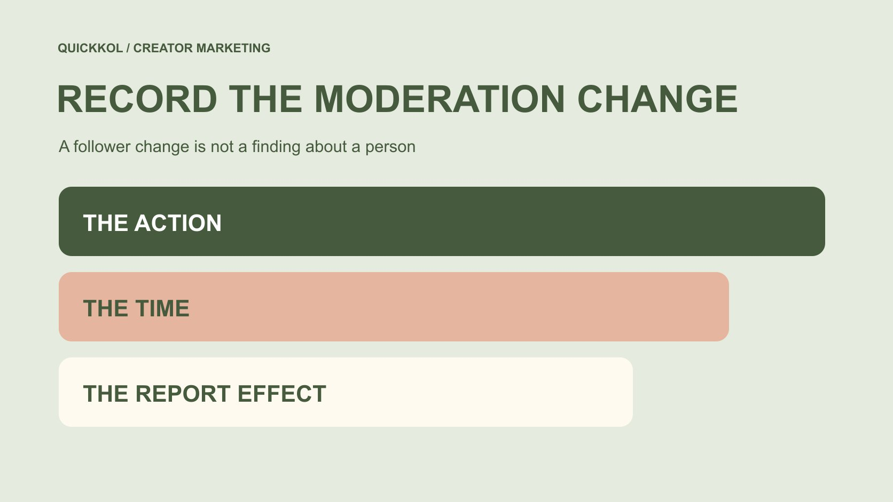

# Remove Instagram Followers Without Rewriting a Campaign

Status: local review draft; confirm the publication date before release.

Account owners can manage follower relationships, but campaign reporting needs the before-and-after context. A decline, rate increase or platform flag is not an authenticity verdict.

QuickKOL editorial graphic; not actual account metrics or a platform interface.

An authorized Instagram account owner should use current official controls to remove a follower after checking the object, purpose and effect. A third-party bulk-cleanup promise is not a necessary step. In creator collaboration, retain the time of the account-management event and its reporting context: a changed denominator can affect growth and follower-based engagement rates. Preserve history, do not call every removed account fake and do not equate a decline with content failure. The current help page was inaccessible in this review, so this guide does not invent fixed button instructions.

## Separate account management from brand evaluation

An account owner may remove followers for personal boundaries, community management or another appropriate reason. A brand should not require deletions merely to improve a report, and a follower list is not an asset the brand may freely manage.

The [metrics decision guide](https://www.quickkol.com/blog/social-media-metrics-creator-decision-tree/#answer) starts with the question being asked. Changing follower relationships may not explain whether a demonstration was understandable. If the question concerns growth, however, the reporting period needs account-management context.

This article addresses recording and interpretation. It performs no removals and recommends no cleanup service. Account actions belong to an authorized person. A brand generally needs the event context relevant to evaluation, not every removed person’s private identity and activity history. Keeping those responsibilities separate allows a creator to manage their community without turning an ordinary campaign review into control over unrelated personal relationships or a demand to prove the legitimacy of every follower.

## Confirm the object and intended effect first

The account owner should inspect applicable follower-management controls in Instagram’s current official interface. Confirm the intended account, the object being acted on and the effect explained there. Removing, blocking, restricting and reporting should not be treated as interchangeable actions.

The official removal help page was inaccessible during this review. Consequently, no menu location, notification behavior or ability to follow again has been verified here. Read the applicable in-account explanation before acting rather than race through an old tutorial.

A team assigned only to reporting should not obtain extra management control for this purpose. Record who owns the action without adding passwords, verification codes or unrestricted personal-account access to a handoff. Authorization and correct object matter more than the number of accounts processed. An operation can be intentional and appropriate while still requiring a separate explanation of how it affects the data used in a brand’s report.

## Keep platform flags within their limits

[Meta’s creator-safety announcement](https://about.fb.com/news/2024/06/protecting-athletes-and-fans-on-our-apps-during-major-sporting-events-this-summer/) described tools for dealing with potential spam followers in 2024. It provides historical feature and safety context. It neither guarantees identical current interfaces for every account nor supplies a complete authenticity determination for every flagged account.

A brand can record which applicable management function an owner used without merging platform prompt, manual removal and proven manipulation into one label. A prompt may have limitations, and a removal reason may be unrelated to campaign performance.

If the available record establishes only that a bulk action occurred, stop at that fact. Do not infer that all previous growth was invalid, that every remaining follower is genuine or that using a management tool amounts to admitting wrongdoing. Safety functionality is not a shortcut for labeling a person. This distinction protects the usefulness of the event record without giving it more evidential weight than the underlying material supports.

## Retain the event and surrounding records

Record an appropriate action time, the event type confirmed by the owner, relevant reporting windows and available counts. An ordinary collaboration review does not require retaining a complete list of people. Distinguish the event record from the scope of platform data too.

Two counts on the same day may not sit immediately before and after the action. New follows, voluntary departures or other platform adjustments may occur between them. Do not automatically call the difference the number removed or reconstruct individual behavior from a net change.

The [reporting-baseline method](https://www.quickkol.com/blog/free-ig-followers-campaign-baseline-reset/#answer) helps preserve the earlier window and a new reference point. A later correction should explain why it changed, which field is affected and what remains unknown. Do not merely replace the historical screenshot so the next owner believes the event never occurred. A consistent record can acknowledge both legitimate account management and its effect on the interpretation of campaign metrics.

## State the denominator before calculating

For a follower-based engagement rate, identify whether the denominator comes from publication, observation or another defined point. When that denominator changes, a rate may change even if interactions do not. That does not automatically mean better content or stronger approval.

Also specify the actions included in the numerator, whether they are cumulative and how the windows relate. Tools may use different definitions. Comparing only the number beside a percentage sign can conceal those differences. If the historical denominator is unavailable, mark that recalculation on the old basis cannot be performed.

If the team adopts a new reference point for subsequent work, retain its starting time and reason. It does not certify previous figures or justify removing inconvenient results. Calculation remains useful only when the reader can understand how it was produced. An apparently precise percentage should not hide a changed account condition that materially affects the comparison being presented to a brand.

## Check the interpretation with a hypothetical denominator

Suppose a piece has 300 defined interactions and a follower denominator of 10,000, while a later reference uses 9,000. The resulting calculations are 3% and approximately 3.33%. This illustrates arithmetic, not client data or an industry benchmark.

The same 300 actions have not gained additional approval because the denominator is smaller. Nor does the example prove that the 1,000 difference consists of fake accounts. Real count changes may contain other events, so this simplified example cannot replace actual records.

The appropriate conclusion is that the rates use different denominators and need a comparison limitation. A brand can continue assessing explanation or suitable subsequent behavior without presenting the higher percentage alone as proof that removal improved collaboration results. Showing both the count and basis makes the lesson clearer than a rate presented without context. It also prevents a routine reporting adjustment from becoming an unsupported success claim.

## Do not turn sequence into causation

A change in views or orders after removal does not establish that removal caused it. Content, paid distribution, offers, seasonality and other conditions may affect results, and some elements may remain unexplained.

The [UK Magenta Book evaluation guide](https://www.gov.uk/government/publications/the-magenta-book/magenta-book-central-government-guidance-on-evaluation-html) emphasizes evaluation design and comparison. No account experiment has been performed here, and this article does not recommend deleting audience members to test marketing effectiveness. The methodological boundary prevents an account-management action from being packaged as a causal result.

If a brand needs to understand campaign outcomes, define the actual question and appropriate evidence instead of asking for the account to be cleaned before declaring its data trustworthy. No single operation certifies the entire audience or removes the possibility of future anomalies. Treating causation cautiously is more helpful than producing a complete-looking story the records cannot support. It also keeps moderation decisions focused on their legitimate purpose rather than making them a speculative performance intervention.

## Share only what the collaboration needs

[FTC’s business information-security guide](https://www.ftc.gov/business-guidance/resources/protecting-personal-information-guide-business) recommends identifying needed information and limiting collection and access. Here, an event summary, time and statistical limitation are generally more appropriate for ordinary reporting than a list of removed people.

Do not share private details, unrelated messages or unrestricted login access simply to reassure a brand. If a necessary question can be viewed only by the account owner, that person can confirm suitable facts while retaining the limit on independent verification.

State who may see the record and why it is retained. External reporting can use an aggregate explanation instead of identifiable screenshots. Information management is part of collaboration, but expanding collection does not automatically strengthen an authenticity judgment. It should not become a reason to exert unrelated control over the creator. The appropriate evidence is the minimum material that can answer the reporting question responsibly, with the remaining uncertainty visible.

## Choose a next action suited to the question

If the issue is inconsistent field definitions, correct the explanation rather than require further follower deletions. If there is a concrete account-security concern, an authorized owner should use official routes; a brand report is not an account-recovery tool. If management effects cannot be separated from other changes, limit the comparison made with that window.

Different questions need different actions. Tell the collaboration team what the proposed step addresses, who performs it and which additional material could update the assessment. A broad risk label cannot replace these arrangements. An incomplete explanation is also no basis to dismiss every historical piece by the creator. The next action should improve the particular evidence gap without expanding the review into unrelated claims.

## Make the change understandable at handoff

Retain the original field, management event, later reference point and comparison limit. Writing only cleaned is insufficient: it says little about what happened and may make the next owner believe every issue has been certified resolved.

For a report calculated on the earlier denominator, state whether it is retained, recalculated or unsuitable for a particular comparison. Make the correction findable without reconstructing several chat histories. Separate affected fields from content observations that remain useful where appropriate.

A brand needs an accurate understanding of collaboration evidence. Account management can occur appropriately while history remains honestly preserved. A sound handoff distinguishes a change in recording conditions from assessable performance and from causes that remain unproven. That allows the next team to continue the project without either treating a normal account action as a scandal or claiming that the action has made all future data inherently reliable.

## Removal events and report interpretation

| Record | Use | Does not establish |
| --- | --- | --- |
| Owner-confirmed management event | Explain changed conditions | Every affected account was fake |
| Surrounding counts | Retain statistical context | The entire difference equals removals |
| New denominator | Calculate a defined later basis | Content performance improved because of it |
| Correction note | Make handoff reviewable | The whole audience is certified |

An educational recording framework. No account actions were performed, and no complete detection or personal finding is offered.

## Before reporting a removal event

Retain authorization, definitions and unknowns.

- [ ] Have an authorized owner check current official controls.
- [ ] Distinguish removal from other management actions.
- [ ] Record time and an appropriate event summary.
- [ ] State numerator, denominator and window.
- [ ] Avoid unrelated personal data and authenticity accusations.
- [ ] Preserve history and later comparison limits.

## Research date and limitations

Sources reviewed November 13, 2026. Methods, tables and decision rules are editorial recommendations. Hypothetical examples are not actual client results or industry benchmarks. Source geography and periods are specified where relevant. This draft is in independent local review; confirm its publication date before release.

## Start creator research with a clear task

Use QuickKOL to interpret a brief, discover relevant creators and research their work and contact routes. Verify data, commercial terms and outcomes at their source.

[Explore QuickKOL](https://www.quickkol.com/#capabilities)

## Sources

- [Meta: Creator and fan safety (2024)](https://about.fb.com/news/2024/06/protecting-athletes-and-fans-on-our-apps-during-major-sporting-events-this-summer/)
- [UK government: Magenta Book evaluation guidance](https://www.gov.uk/government/publications/the-magenta-book/magenta-book-central-government-guidance-on-evaluation-html)
- [FTC: Protecting personal information, a guide for business](https://www.ftc.gov/business-guidance/resources/protecting-personal-information-guide-business)
