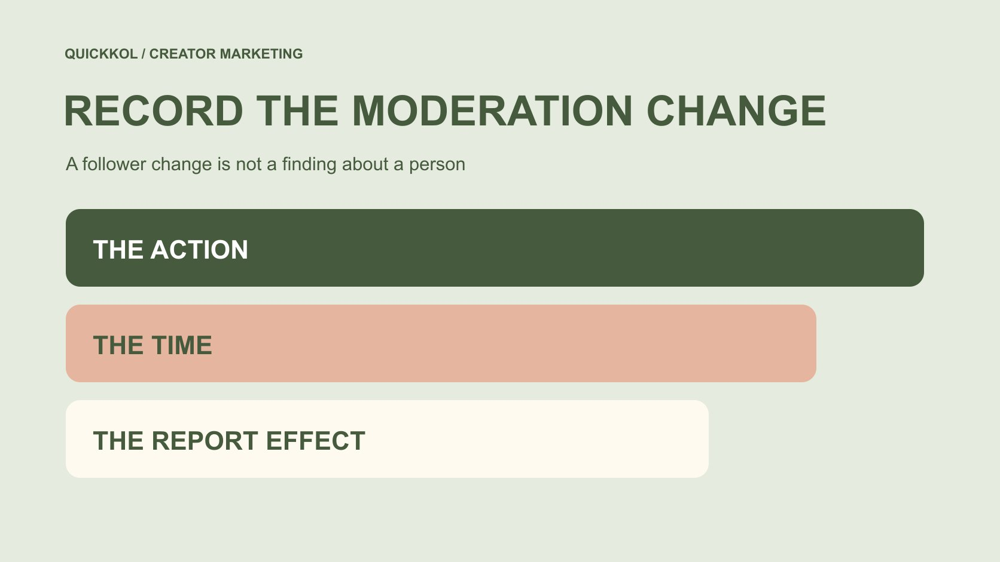

# 移除 Instagram 粉丝后，合作报表该怎样解释变化

状态：本地审阅稿；正式发布日期待确认。

账号负责人可以管理自己的粉丝关系，但品牌复盘需要保留移除前后口径。粉丝下降、互动率上升或平台标记，都不是单独的真实性结论。

QuickKOL 编辑图形；不呈现真实账号指标或平台界面。

想移除 Instagram 粉丝时，应由合法账号负责人使用当前官方功能，先确认对象、目的和操作影响；不要把第三方批量清理承诺当作必要步骤。对达人合作而言，更重要的是记录账号管理事件的时间与报表口径：移除后的分母变化，可能影响增长和按粉丝计算的互动率。保留历史，不把移除对象全部称为虚假账号，也不把计数下降解释为内容失败。当前帮助页本次未能读取，因此不提供未经核实的固定按钮步骤。

## 先区分账号管理与品牌评估

账号负责人可能因个人边界、社区管理或其他适当原因移除粉丝。品牌评估合作时，不应要求创作者为了让报表好看而删除特定观众，更不能把粉丝名单当作品牌可自由处理的资产。

[指标决策指南](https://www.quickkol.com/zh/blog/social-media-metrics-creator-decision-tree/#answer)帮助先确定要回答什么问题。如果项目关心内容是否解释清楚，修改粉丝关系未必能回答；如果关心增长，则必须解释期间是否有账号管理事件。

本篇讨论记录与解释，不执行任何移除，也不推荐清理服务。实际账号操作属于有权限的人，品牌需要的通常是与评估相关的事件背景，而不是每个被移除者的私人身份和完整活动历史。

## 在操作前确认对象和影响

由账号负责人从 Instagram 当前官方界面查看适用的粉丝管理功能，先确认操作针对哪个账号、是否为本来想处理的对象，以及平台当前说明的影响。移除、屏蔽、限制和举报不应当作同一动作。

本次无法读取官方移除帮助页，因此不声称确认了菜单位置、通知方式或移除后能否重新关注等细节。遇到不清楚的选项，先读取账号内适用说明，不为了跟随旧教程快速完成。

若团队只有查看报表的职责，不应借此获取额外管理权。记录谁负责实际操作即可，不把密码、验证码或完整个人账号访问写进项目交接。清楚授权和对象，比追求一次处理多少个账号更重要。

## 平台标记也需要保留边界

[Meta 的创作者安全公告](https://about.fb.com/news/2024/06/protecting-athletes-and-fans-on-our-apps-during-major-sporting-events-this-summer/)在 2024 年描述了协助处理潜在垃圾粉丝的工具。它是历史功能与安全背景，不保证当前所有账号界面相同，也不是对所有被标记账号的完整真实性鉴定。

品牌可以记录负责人使用了何种适用管理功能，但不要把“平台提示”“人工移除”和“证实操纵”合并成一个标签。工具提示可能有误差，账号移除原因也可能与营销效果无关。

若实际资料只说明某次批量处理发生，就停在这一事实。不要进一步推断移除前全部增长无效、移除后剩余全部真实，或把管理行为本身当成创作者承认问题。安全工具不是品牌能够用来给个人贴标签的捷径。

## 保留移除事件前后的记录

记录适当的操作时间、负责人确认的事件类型、相关统计窗口和可用计数。无需为普通合作复盘保留完整名单；事件记录与平台数据的范围也要区分。

同一天的两个计数未必正好对应操作前后，期间还可能有自然新增、主动取消关注或平台其他调整。不要把差值自动当作移除数量，也不要从净变化推回具体人员行为。

[报表口径修正方法](https://www.quickkol.com/zh/blog/free-ig-followers-campaign-baseline-reset/#answer)可以帮助保留旧窗口与新参考点。后续更正应说明为什么变化、哪个字段受影响和哪里仍不确定，而不是把历史截图换掉，使接手人误以为账号从未出现过这次管理事件。

## 计算前先说明分母取自哪里

按粉丝计算的互动率，需要说明粉丝数取自发布时、观察时还是其他已定义节点。分母变化时，即使互动数量不变，比率也可能变化；这不自动代表内容更好或观众更认可。

还需明确分子包括哪些动作、是否累计、是否与分母窗口一致。不同工具可能采用不同定义，不应只比较百分号后面的数字。不能取得历史分母时，标记无法按原口径重算。

如果团队决定之后使用新的参考点，保留其起始时间和理由。新的参考点不是对之前数字的认证，也不能用来删除不方便的旧结果。计算可以有用，但只有读者知道它怎样产生，才可能作出合适解释。

## 用一个假设分母检查误读

假设某作品记录 300 次已定义互动，粉丝分母原为 10,000，后来采用的分母为 9,000。按这两个不同节点计算分别为 3% 与约 3.33%。例子只说明算术，不是客户数据或行业基准。

同样的 300 次动作，并没有因为使用较小分母而新增认可，也不能证明被移除的 1,000 都是虚假账号。现实中的计数差值还可能包含其他事件，因此这个简化例子不能替代实际记录。

适当结论是比率使用了不同分母，需要解释比较限制。品牌可继续评估内容理解或合适后续动作，但不要把上升的百分比单独包装成清理操作提升合作效果的证明。

## 不要把时间先后写成因果

移除粉丝之后看到观看或订单变化，并不足以说明移除造成了变化。同期内容、投放、优惠、季节和其他条件，都可能影响结果，也可能存在目前无法解释的部分。

[英国 Magenta Book 的评价方法指南](https://www.gov.uk/government/publications/the-magenta-book/magenta-book-central-government-guidance-on-evaluation-html)强调评估设计与比较的重要性。这里没有对账号执行实验，也不建议通过删除观众来测试营销效果。引用方法边界，是为了避免把一次管理动作包装成因果结论。

如果品牌需要理解合作效果，先定义实际问题与适当资料，而不是要求把账号“清理干净”再宣布数据可信。没有单一操作能认证全部受众或消除未来异常。谨慎处理因果问题，比给出一个看似完整但无法支持的故事更有帮助。

## 只分享与合作问题有关的信息

[FTC 的企业信息保护指南](https://www.ftc.gov/business-guidance/resources/protecting-personal-information-guide-business)建议企业识别需要的信息、限制收集和访问。应用到此处，事件摘要、时间与统计限制通常比被移除者名单更适合普通报表。

不要为了让品牌放心就分享私人资料、无关私信或完整登录权限。若某个必要问题只能由账号负责人查看，可以由其确认适当事实，并说明无法独立核验的边界。

交接时明确谁能看到记录以及保留用途。外部报告可以使用概括说明，不必保留可识别个人的截图。数据管理是合作的一部分，但扩大收集范围并不会自动让真实性判断更可靠，也不应成为对创作者施加额外控制的理由。

## 选择与问题相符的后续动作

如果问题只是字段定义不一致，先修正说明，不要要求进一步删除粉丝。若存在具体账号安全疑问，交由合法负责人沿官方路径处理，不把品牌报表当作安全恢复工具。若无法分离管理事件与其他变化，就限制该窗口的比较用途。

不同问题需要不同动作。向合作团队报告时，写清建议解决什么、由谁执行，以及取得什么资料后可以更新判断。不要用一个笼统的风险标签代替这些安排，也不要因为暂时不能得到完整解释，就把所有历史作品一起否定。

## 让下一位负责人看懂变化

交接保留原字段、管理事件、后续参考点与比较限制。不要只写“已清理”三个字，因为它没有说明发生了什么，也容易让接手人误以为所有问题已被认证解决。

如果一份报表此前按旧分母计算，注明是否保留、重算或不再适合某项比较。更正后的说明应可找到，不必通过多个聊天记录拼接。必要时把受影响字段与不受影响的内容观察分开。

品牌最终需要的是对合作资料的准确理解。账号管理可以合适地发生，历史也应被诚实保留；两者并不冲突。一个好的交接会让读者知道哪些变化是记录条件，哪些表现仍可评估，哪些原因尚未证实。

## 移除事件与报表解释

| 记录 | 用途 | 不能推出 |
| --- | --- | --- |
| 负责人确认的管理事件 | 解释条件变化 | 所有对象都虚假 |
| 前后计数 | 保留统计背景 | 差值全部是移除数量 |
| 新的分母 | 计算后续明确口径 | 内容表现因此提升 |
| 更正说明 | 让交接可复查 | 全部受众已认证 |

教育与记录框架；没有执行账号操作，不提供完整检测，也不认定任何个人行为。

## 把移除事件写进报表前

保留授权、口径和未知。

- [ ] 由合法负责人核对当前官方功能。
- [ ] 分清移除与其他管理动作。
- [ ] 记录时间及适当事件摘要。
- [ ] 注明分子、分母与统计窗口。
- [ ] 不公开无关个人资料或真实性指控。
- [ ] 保留历史与后续比较限制。

## 研究日期与使用边界

资料核验于 2026 年 11 月 13 日。文中方法、表格和决策规则为编辑建议，标为假设的示例不是实际客户结果或行业基准。外部资料的适用地区与时期按各段说明；本稿处于独立本地审阅阶段，正式发布日期待确认。

## 从任务开始达人研究

用 QuickKOL 理解 Brief、发现相关达人并研究作品与联系路径；数据、合作条件和结果仍需核验。

[了解 QuickKOL](https://www.quickkol.com/#capabilities)

## 来源

- [Meta：创作者与粉丝安全说明（2024）](https://about.fb.com/news/2024/06/protecting-athletes-and-fans-on-our-apps-during-major-sporting-events-this-summer/)
- [英国政府：Magenta Book 评价指南](https://www.gov.uk/government/publications/the-magenta-book/magenta-book-central-government-guidance-on-evaluation-html)
- [FTC：企业个人信息保护指南](https://www.ftc.gov/business-guidance/resources/protecting-personal-information-guide-business)
