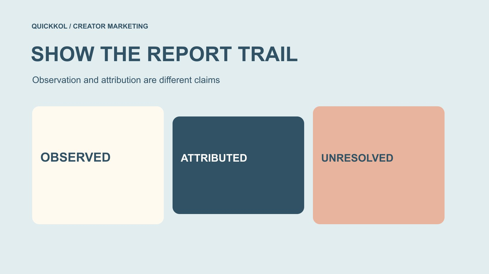

# Instagram Followers Free: Preserve the Growth Report Trail

Status: local review draft; confirm the publication date before release.

When free-follower claims enter campaign material, preserve who supplied each figure, what the team checked and which growth conclusions remain unresolved.

QuickKOL editorial graphic; not actual account metrics or a platform interface.

A growth report involving Instagram followers free claims should preserve provenance before issuing an authenticity verdict. Record who supplied a figure, when, its field and window, what the team actually checked and which interpretations entered the summary. Advertising promises, creator statements, tool outputs and direct observations must not impersonate one another. Net change does not automatically establish incrementality, and an account-access action does not certify clean historical data. This is an educational reporting method, not a free-follower recommendation, personal blacklist or promise that one metric identifies all artificial engagement. The report should remain useful because a reader can trace its statements and limits.

## Define the report’s audience and decision

An internal handover, management review and external partnership document need different detail and wording. Define the reader’s decision: continue a content task, obtain more evidence, plan another phase or explain an observed change. A follower column in a template should not automatically become the campaign’s success verdict.

If other teams will cite the report, its key sentence should stand alone with object, date, field and limitations. It should not depend on oral context known only to the original analyst. Growth looks good without those details is difficult to reuse responsibly.

When a free-follower claim appears, separate the report’s purpose from the risk review. A bounded record can identify insufficient evidence or recommend the next check. Delivering on time does not require inventing a conclusion that an account has been proven genuine or fake. A useful statement earns its citability through accurate scope rather than a tone that conceals uncertainty. This helps later users retain the meaning when the finding moves into a presentation or planning document.

## Identify who actually supplied each statement

Distinguish direct observation, creator or representative supply, tool output, service advertising and team interpretation. They can coexist in one project without all being renamed brand-verified data during aggregation. Retain an appropriate URL, file or record reference for important figures.

[Meta’s fake-engagement enforcement announcement](https://about.fb.com/news/2020/10/taking-action-against-fake-engagement-and-ad-scams/) from 2020 describes services manufacturing followers and likes. This supplies historical risk context, not proof that a present advertisement delivered its promise or that a creator used it. Record promotional wording as a promotional claim.

Preserve chains of retelling too. A creator forwarding a provider’s screenshot does not make it their direct platform data. Several documents reproducing that screenshot are not independent checks. Clear source levels help the team decide which limited observation it can use, what needs clarification and which statement should not enter external wording. The purpose is not to dismiss everything a partner supplies; it is to retain the difference between what a partner reported and what the team itself was able to establish.

## Keep summaries connected to the original field

Use the [social media metrics decision framework](https://www.quickkol.com/blog/social-media-metrics-creator-decision-tree/#answer) to retain field, object, unit, window and missingness. Total followers should not become people reached in the summary. A tool’s potential-reach estimate is not observed unique viewers. Similar marketing terms can answer different questions.

Appropriate normalization is possible, provided the transformation is explained. Standardizing a date, naming a source or calculating a defined difference is not the same as adding a causal interpretation. Do not fill unavailable fields with zero, describe inaccessible data as nonexistent or invent a denominator to make an incomplete ratio appear usable.

A reader should be able to move from the conclusion back to its record rather than find only a final chart with no retrievable origin. If the team cannot explain a transformation, retain the original field and limitation or leave the conclusion unused. A simple traceable description supports a partnership decision better than a complex combined metric without understandable provenance. It also helps a reviewer identify the precise point where a harmless wording change might have altered the original claim.

## Version baseline and window changes

The [campaign baseline guide](https://www.quickkol.com/blog/free-ig-followers-campaign-baseline-reset/#answer) helps retain the old reference and reason for a new one. If a report changes source, observation window or definition, identify the applicable version and results no longer directly comparable. Do not hide changed conditions inside a chart-style update.

Where an earlier report overstated a finding, explain what is corrected, why and whether the business decision changes. Newly obtained material did not exist in the old report merely because it is available today. Retain revision date, material date and observation date separately instead of organizing the timeline into a false continuity of certainty.

Repeatedly changing start or end points to improve appearance is not a defensible reporting method. Choose a window for the stated question and available records, with an appropriate owner understanding the choice. Keep necessary context for old results so a colleague does not stitch different versions into one uninterrupted growth story. Completeness includes changes in knowledge rather than erasing those changes from history.

## Separate description, attribution and causal effect

The [UK Magenta Book evaluation guide](https://www.gov.uk/government/publications/the-magenta-book/magenta-book-central-government-guidance-on-evaluation-html) connects impact assessment with suitable comparison and counterfactual evidence. For everyday creator reporting, preserve a clear boundary: different observations before and after do not establish what would have happened without the campaign. A system-assigned attribution result is not automatically incremental effect either.

Describe net movement under a named source and window while retaining an unconfirmed cause where appropriate. Do not progressively rename the same figure new real people, effective audience, customers and revenue contribution. Each conclusion requires evidence suited to its question; an increasingly ambitious summary cannot supply it.

If readers request an effect finding while the records support description only, state the gap and appropriate next step. There is no need to invent causality to make the report useful. This article did not test free-follower services and does not recommend buying or exchanging engagement to complete a research design. Its educational purpose is to keep conclusions proportionate to the evidence actually available.

## Share the evidence needed for the decision

[FTC’s business information-security guide](https://www.ftc.gov/business-guidance/resources/protecting-personal-information-guide-business) recommends limiting unnecessary retention and access. A provenance trail can use an appropriate index, bounded extract or authorized data provision without copying a creator’s entire dashboard, private chats or individual follower information to every reader.

Where evidence is captured, retain the context needed to understand its field and conditions while avoiding credentials, recovery material, customer records and unrelated personal details. An appropriate holder can retain full material, with the report identifying the source and review responsibility rather than embedding every sensitive file in a marketing deck.

An external version needs a separate check for unnecessary disclosure. An anonymous hypothetical can teach the method without turning an internal suspicion list into a public educational case. Traceability is not unlimited publication. It lets the people who need to review a conclusion understand its basis through an appropriate route, rather than giving every reader every underlying record. This supports professional scrutiny while keeping the report focused on its actual business question.

## Rehearse a summary from two different sources

Suppose the team directly observes a profile displaying 12,000 followers on a date while receiving service material claiming potential reach of 20,000. This is a hypothetical exercise, not an actual tool, account or client result. The two figures have not been established as the same object or definition.

A precise summary can list the public total and date separately, marking 20,000 as a provider claim with its definition unconfirmed. It must not select the larger figure and announce 20,000 brand-verified real followers. Nor can 12,000 alone prove dishonesty, because potential reach may describe another object.

Ask the appropriate source for field, window and method, then decide whether it serves this campaign. If unconfirmed, leave the claim unused instead of forcing both figures into a combined influence total. The exercise preserves lineage and unknowns so an attractive screenshot does not carry the summary beyond the evidence. A report can reject a number for insufficient relevance or definition without making a personal accusation against its sender.

## Give revisions to the people using the conclusion

If a report has informed pricing, budgeting or a partnership discussion, give material corrections to its actual users. Identify the original statement, revised wording, reason and consequence. Updating an original file that nobody reopens does not tell the people still using its conclusion. A handover record can identify related materials carrying the old version.

Not every wording improvement requires restarting the project. Focus on changes affecting judgment, such as reclassifying an observation as a provider estimate, removing unsupported incrementality or discovering that two figures are incomparable. Let the appropriate owner determine how related business material is updated.

Keep creator communication specific too. Identify the field and source needing clarification instead of questioning all of the creator’s performance. A partner may provide additional evidence or explain that the brand misunderstood the original material. The revision process should let the brand correct itself, making evidence review an ordinary part of professional collaboration rather than a one-sided demand for reassurance. That is a useful safeguard against uncertainty hardening into an inaccurate permanent summary.

## Finish with a conclusion that stands on its own

The key conclusion should identify object, source, date or window, observation and limitation. It might describe a change in a named field under a named source while leaving cause unconfirmed, then explain a new reference with the original retained. That is more responsibly reusable than follower growth verified.

The report should recommend no free boosting, promise no complete detection or removal, and treat no single model output as proof against a person. Take risk seriously while recognizing that available material may support only a limited finding. Transparency is not making suspicion sound more alarming. It is accurately describing what is and is not known.

Completion means another reader can retrieve the basis, review necessary transformations and understand which partnership decision the report supports. Every field need not have an answer, and platform events need not become one invented commercial value. Clear provenance lets a brand make bounded, revisable judgments even when evidence remains incomplete. That is a professional result because the conclusion remains accountable to its sources rather than dependent on confidence alone.

## Growth-report provenance trail

| Layer | Record | Do not upgrade into |
| --- | --- | --- |
| Supplied material | Supplier, date, original field and conditions | Independently brand-verified evidence |
| Direct observation | Object, source, window and visibility | All authentic people or the whole market |
| Transformation and interpretation | Arithmetic, changed definition, assumptions and unknowns | Causal effects without appropriate design |
| Final statement | Citable conclusion, limitation and version | Personal-authenticity verdicts or complete performance guarantees |

An educational editorial framework; figures in the body are hypothetical, not an actual tool or account assessment.

## Before sharing the growth report

Make each key statement traceable to its source and bounded finding.

- [ ] Define reader, decision and intended reuse.
- [ ] Separate advertising, partner statements, tool outputs, observations and interpretation.
- [ ] Preserve original field, time, window and necessary transformations.
- [ ] Version baseline and conclusion changes with reasons.
- [ ] Do not merge descriptive change, attribution and incrementality.
- [ ] Share necessary information and communicate material corrections to users.

## Research date and limitations

Sources reviewed November 13, 2026. Methods, tables and decision rules are editorial recommendations. Hypothetical examples are not actual client results or industry benchmarks. Source geography and periods are specified where relevant. This draft is in independent local review; confirm its publication date before release.

## Continue learning about metrics and evidence

Understand sources, windows, permissions and unknowns without judging a person from one signal or promising complete detection.

[Read the metrics decision guide](https://www.quickkol.com/blog/social-media-metrics-creator-decision-tree/)

## Sources

- [Meta: Fake-engagement enforcement announcement (2020)](https://about.fb.com/news/2020/10/taking-action-against-fake-engagement-and-ad-scams/)
- [UK government: Magenta Book evaluation guidance](https://www.gov.uk/government/publications/the-magenta-book/magenta-book-central-government-guidance-on-evaluation-html)
- [FTC: Protecting personal information, a guide for business](https://www.ftc.gov/business-guidance/resources/protecting-personal-information-guide-business)
