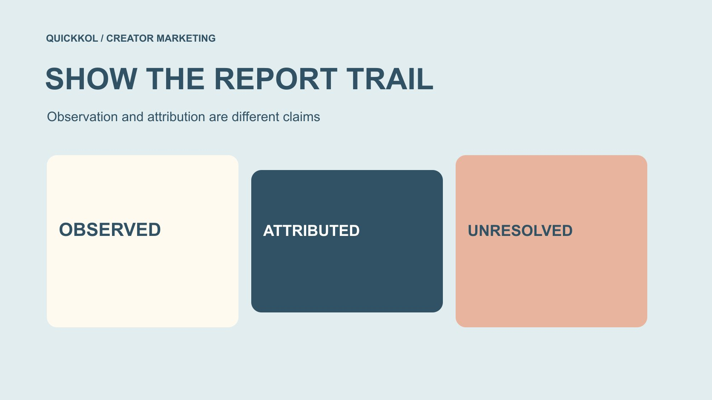

# 免费 Instagram 粉丝如何写进一份诚实的增长报告

状态：本地审阅稿；正式发布日期待确认。

当免费粉丝说法进入项目材料，报告怎样保留谁提供了什么、团队实际核对了什么，以及哪些增长结论仍然未知。

QuickKOL 编辑图形；不呈现真实账号指标或平台界面。

一份涉及 instagram followers free 说法的增长报告，应该先保留来源链，而不是先给出真假结论。记录数字由谁提供、何时获取、采用什么字段与窗口、团队实际做了哪项核对，以及摘要中加入了哪些解释。广告承诺、创作者自述、工具输出和直接观察不能互相冒充。两个时点的净变化不自动证明增量，账号访问处理也不认证历史数据清洁。本篇提供教育向报告方法，不推荐免费涨粉、不提供个人黑名单，也不承诺凭单一指标识别所有虚假互动。

## 先确定报告要帮助谁决定什么

内部项目交接、管理层复盘和对外合作材料需要不同的细节与表述。先说明读者要决定什么：是否继续某项内容任务、是否需要更多证据、怎样安排下一阶段，或怎样解释已经观察到的变化。不要因为表格有粉丝一栏，就自动把它变成项目成功结论。

如果报告会被其他团队引用，关键句应能独立读懂。它需要包含对象、日期、字段和限定条件，不能依赖只有原分析人员知道的口头背景。一个“增长良好”的标签没有这些信息，就很难负责任地复用。

免费粉丝说法出现时，更应把报告目的与风险复核分开。可以在限定材料下说明证据不足，或者建议下一步；不必为了按时交付报告，制造一个具体账号已经被证实真实或虚假的结论。可引用性来自准确和范围，而不是看起来没有疑问的语气。

## 记录每项说法的实际提供者

把来源至少分为直接观察、创作者或代表提供、工具输出、服务广告以及团队解释。它们可以一起出现在一个项目中，但不能在汇总时都改名为品牌已经验证的数据。给每项重要数字保留适当地址、文件或记录引用。

[Meta 的虚假互动执法公告](https://about.fb.com/news/2020/10/taking-action-against-fake-engagement-and-ad-scams/)在 2020 年描述过制造粉丝与点赞的服务。这说明相关风险有历史依据，不意味着任何今天出现的广告承诺已经兑现，也不证明被提到的创作者采用了该服务。广告话术应以广告说法的身份记录。

第三方转述也要保留链条。创作者转发一张供应方截图，仍不自动成为其后台直接数据；多个材料重复同一截图，也不是多个独立验证。来源层次越清楚，团队越容易决定该相信哪项有限观察、需要追问什么，以及不能把哪一项带入对外表述。

## 让摘要可以返回到原字段

用[社媒指标决策框架](https://www.quickkol.com/zh/blog/social-media-metrics-creator-decision-tree/#answer)保留字段定义、对象、单位、窗口和缺失。原始字段如果叫粉丝总量，不应在摘要里变成触达人数；工具估计的潜在覆盖，也不能改写成实际到达的独立观众。看起来相近的营销词，可能指向不同问题。

必要的整理可以进行，但要说明怎样变化。统一日期格式、补齐来源名称或计算已定义的差值，与创造新的因果解释不同。未知字段不补零，不能访问的数据不描述为不存在，缺少分母的比率也不应被补出一个看似合理的结果。

报告应让读者从一句结论回到对应记录，而不是只能看到一张无法定位的最终图表。若团队不能解释某个转换，就先保留原字段与限制，或暂时不使用该结论。可追溯的简单描述，比没有清楚来源的复杂综合指标更适合支持合作决定。

## 记录基线与窗口的变化

[活动基线说明指南](https://www.quickkol.com/zh/blog/free-ig-followers-campaign-baseline-reset/#answer)可以帮助保留旧参考与新起点的理由。报告如更换来源、观察窗口或口径，应说明从哪一版起采用，以及哪些结果不能与过去直接比较。不要把条件变化藏在图表样式更新里。

如果原报告曾过度表述，修订应明确更正哪项结论、为什么以及是否影响后续决定。补到一份新材料，不代表旧版报告在当时就拥有它。修订日期、材料日期和观察日期应分开保留，避免时间线被整理成不真实的连续确定性。

也不能为了提高报告表现，不断更换开始或结束点。选择窗口应服务预先说明的问题与可用资料，并让合适负责人理解。对旧结果保留必要上下文，可以减少下一位同事把不同版本拼接成一个没有缺口的增长故事。报告的完整性包含变化，不是把变化从历史里擦掉。

## 区分描述、归因与因果效果

[英国 Magenta Book 的评价方法指南](https://www.gov.uk/government/publications/the-magenta-book/magenta-book-central-government-guidance-on-evaluation-html)将影响判断与合适的比较、反事实等证据条件联系起来。对日常达人报告而言，应保留一个清楚边界：前后观察不同，不代表已经证明没有这次活动时会发生什么；一个系统分配的归因结果，也不是自动的增量证明。

因此，报告可以写某窗口内采用某来源观察到净变化，同时说明原因未确认。不要把同一数字依次改名为新增真人、有效受众、客户和收入贡献。每一层结论都需要适合其问题的依据，不能靠一个逐步升级的摘要完成。

如果读者要求效果结论，而当前材料只能支持描述，直接说明证据缺口和适当下一步。没有必要为了让报告显得有价值而发明因果。本文没有测试免费涨粉服务，也不建议用购买或交换互动来补足研究设计；教育目标是让结论与实际证据相称。

## 只分享完成判断需要的材料

[FTC 的企业信息保护指南](https://www.ftc.gov/business-guidance/resources/protecting-personal-information-guide-business)强调缩减不必要的信息保留和访问。报告来源链可以使用适当索引、有限摘录或授权提取，不必把创作者完整后台、私人聊天和个人粉丝资料复制给所有读者。

如需截取证据，保留理解字段和条件所需的上下文，同时避免传播账号凭证、恢复资料、客户记录或无关个人信息。适当持有人可保留详细材料，报告注明必要来源与可供核对的责任路径，而不是把敏感文件全部嵌入营销幻灯片。

对外版本还要检查它是否暴露了没有必要公开的对象。可以用匿名化假设练习解释方法，不把内部怀疑名单包装成公众教育案例。清楚的证据链不等于无限公开；它要求需要核对的人能够通过适当方式理解结论，而不是让任何人拿到所有原始资料。

## 用两个来源练习准确摘要

假设团队在某日直接观察到一个主页显示粉丝总量 12,000，同时收到服务材料声称“潜在覆盖 20,000”。这是假设练习，不是某个工具、账号或实际客户结果。两个数字的对象、来源和定义尚未证明相同。

准确摘要可以分别列出公开观察的总量及日期，并将 20,000 标为供应方说法、定义待确认。不能选择较大的数，改写成品牌已经验证了 20,000 个真实粉丝；也不能用 12,000 去断言对方一定撒谎，因为潜在覆盖可能描述另一对象。

下一步是请适当来源说明字段、窗口和方法，再决定它是否与本次项目有关。若不能确认，可以不用该说法，而不是强行把两个数换算成一个总影响力。这个练习的价值在于保留数据血缘和未知，让报告不因一张好看的截图就越过了可以支持的结论。

## 修订结论时同步实际使用者

报告被引用到询价、预算或合作讨论后，一项重要更正需要让实际使用者知道。说明原句、修改后说法、原因和影响，不只更新一份无人再打开的原文件。合适的交接记录可以帮助团队知道哪些材料仍采用旧结论。

这不意味着每个用词优化都要重启整个项目。重点是会改变判断的内容，例如把实际观察改为供应方估计、删去未经证明的增量说法，或确认两个数字根本不可比较。让适当负责人决定如何更新相关业务材料。

对创作者的沟通也应具体。指出当前需要澄清的字段和来源，而不是发一封笼统质疑其全部表现的消息。对方可能提供补充材料，也可能说明原报告理解有误。修订流程应允许品牌更正自己，让证据核对成为合作中的正常专业工作。

## 用能独立读懂的结论完成报告

最终关键句应说明对象、来源、日期或窗口、观察和限制。例如，按某来源看到某字段的变化，原因尚未确认；下一阶段采用明确的新参考，原记录保留。这比“粉丝增长已验证”更能帮助别人负责地引用。

报告不应推荐免费刷量，不承诺完全识别或清除虚假互动，也不把一次模型判断当作对个人的事实证明。可以认真处理风险，同时承认材料只能支持有限结论。透明不是把怀疑写得更吓人，而是把知道与不知道都说准确。

完成标准是下一位读者可以找到依据、复核必要转换，理解这份报告支持哪个合作决定。它不需要每个字段都有答案，也不需要把所有平台事件变成同一种商业价值。清楚的数据来源链，让品牌在证据不足时仍能做出边界明确、可以继续修正的专业判断。

## 增长报告的来源链

| 层次 | 记录内容 | 避免升级为 |
| --- | --- | --- |
| 提供的材料 | 提供者、日期、原字段与条件 | 品牌已独立验证 |
| 直接观察 | 对象、来源、窗口与可见范围 | 全部真实个体或完整市场 |
| 转换与解释 | 算式、定义变更、假设和未知 | 没有设计支持的因果效果 |
| 最终表述 | 可以引用的结论、限制与版本 | 个人真假结论或全面效果保证 |

教育向编辑记录框架；正文数字均为假设，不是实际工具或账号测评。

## 发出增长报告前

让关键句能够追溯到实际来源和有限结论。

- [ ] 说明读者、任务和报告将被怎样使用。
- [ ] 区分广告、伙伴说法、工具输出、观察与团队解释。
- [ ] 保留原字段、时间、窗口和必要转换。
- [ ] 基线或结论修订保留版本和原因。
- [ ] 不把描述性变化、归因与增量合并。
- [ ] 只分享必要信息，并同步实质更正给使用者。

## 研究日期与使用边界

资料核验于 2026 年 11 月 13 日。文中方法、表格和决策规则为编辑建议，标为假设的示例不是实际客户结果或行业基准。外部资料的适用地区与时期按各段说明；本稿处于独立本地审阅阶段，正式发布日期待确认。

## 继续学习指标与证据

理解来源、窗口、权限与未知；不凭单一信号判断个人，也不承诺完整检测。

[阅读指标决策指南](https://www.quickkol.com/zh/blog/social-media-metrics-creator-decision-tree/)

## 来源

- [Meta：虚假互动执法公告（2020）](https://about.fb.com/news/2020/10/taking-action-against-fake-engagement-and-ad-scams/)
- [英国政府：Magenta Book 评价指南](https://www.gov.uk/government/publications/the-magenta-book/magenta-book-central-government-guidance-on-evaluation-html)
- [FTC：企业个人信息保护指南](https://www.ftc.gov/business-guidance/resources/protecting-personal-information-guide-business)
