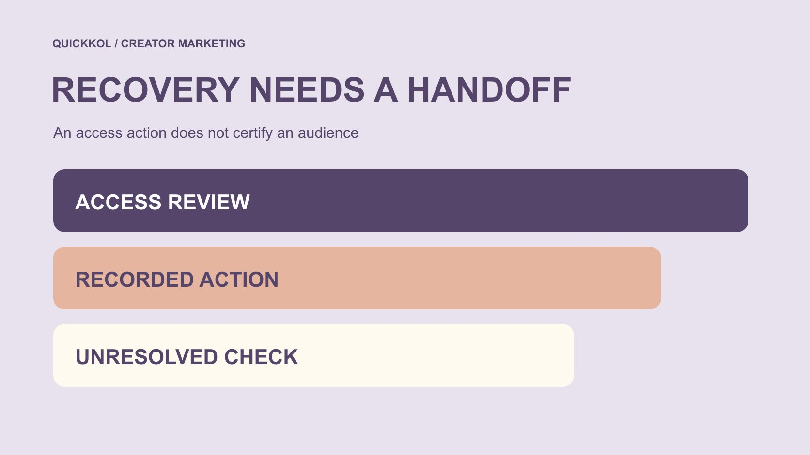

# Instagram Free Followers: Hand Over an Access Recovery

Status: local review draft; confirm the publication date before release.

After a possible free-follower connection, hand over access checks, safety actions and unknowns without presenting recovery as proof of audience authenticity.

QuickKOL editorial graphic; not actual account metrics or a platform interface.

If an Instagram free followers service may have been connected, separate account-access risk from audience authenticity. The appropriate account owner should use official routes to review access and security, recording the action, time, confirmed scope and remaining questions. A brand should not request the creator’s password, verification code or recovery secrets. Removing one connection, correcting a setting or regaining sign-in does not establish that historical data is clean or every follower authentic. This article offers risk education and a handover method, not free-follower recommendations, artificial-engagement instructions or a finding against a person based on one anomaly.

## Distinguish a reported claim from confirmed access

The team may encounter a free-follower advertisement, a creator’s concern, an unfamiliar connection or an actual sign-in problem. These carry different evidence and should not all be recorded as account hacked. Preserve the task-relevant description, time, source and currently confirmable state.

[Meta’s clone-site safety explanation](https://about.fb.com/news/2022/07/how-meta-safeguards-people-against-clone-sites/) from 2022 describes credential risk around promises of free likes or followers. This historical safety context supports careful treatment of access, not a finding that a current service or creator has experienced a particular incident.

If connection is unconfirmed, identify who can appropriately check it rather than asking a brand researcher to enter the creator’s account. Accurate description helps the owner prioritize an access problem without turning an advertisement screenshot into proof that the creator purchased artificial engagement. The first useful output is a question and an accountable route for checking it, not a confident incident label that later colleagues may repeat without its original limitations.

## Let the account owner handle access

Have someone authorized to manage the account use official applications, settings and support routes. The brand can explain the campaign impact and request an appropriate status summary for its business decision. It should not receive passwords, one-time verification codes, recovery codes or identity documents as a substitute for the owner’s actions.

The [unapproved-service exit guide](https://www.quickkol.com/blog/free-ig-followers-website-vendor-exit/#answer) helps map service access and cessation records. This article adds handover responsibility: who conducts this access review, who handles the campaign timeline and which limited information needs to pass between them. Security handling and content ownership may belong to different people.

If internal technical or security staff assist, keep that support within appropriate authorization. A release deadline is not a reason to give an unfamiliar recovery service control or pay for a guaranteed-return promise. State unknown capability and timing clearly so an existing concern does not produce another exposure. The collaboration needs a reliable decision route, not a broad collection of login secrets shared with everybody trying to help.

## Record the object, time and scope of each action

A useful record identifies what an appropriate person checked, what action occurred, when, its basis and what remains unresolved. Removing one connection is an access action. It does not establish that every other access route is gone or that previously obtained information has been retrieved.

Do not make all fixed the entire handover. An appropriate summary can avoid exposing sensitive configuration details while helping the business owner understand what is currently possible. Action in progress, result awaiting review and a limited scope confirmed should remain different states.

Date historical records as well. An earlier security check does not establish that every current connection remains the same. A clarification added today must not be presented as evidence that already existed at the original event. Reliable handover depends on accurate time and scope, rather than a formal-looking screenshot that nobody can explain. It should let a successor identify the exact condition supporting a campaign decision without implying access to every technical detail of the account.

## Separate restored sign-in from follower quality

Restoring sign-in answers whether a form of operational access returned. Follower provenance, historical interaction and reporting definitions are different questions. Successful sign-in does not establish that every metric is authentic; continued access difficulty does not establish that the followers are fake.

If campaign data needs discussion, identify public observation, platform fields, appropriately authorized creator extracts and editorial interpretation. Preserve time and missingness. One growth change, low interaction or unfamiliar avatar cannot establish that a person purchased followers or identify all inauthentic activity.

A handover can state that access was checked to a defined extent while the audience-related cause remains unknown. That is more useful than compressing both judgments into safe or unsafe. The brand can then identify appropriate evidence for its task without translating one access finding into a complete assurance of personal integrity or commercial performance. Keeping these judgments separate also prevents later reports from citing a security action as though it were an audience-quality audit.

## Read platform recovery figures within their scope

[Meta’s account-support update](https://about.fb.com/news/2025/12/making-it-easier-to-access-account-support-on-facebook-and-instagram/) originally reported on December 4, 2025 that the relative success rate of hacked-account recovery had increased by more than 30% that year in the US and Canada. The page later added 2026 support updates. This is a company-reported, scoped relative change, not an absolute success rate or a 30-percentage-point increase.

It documents a disclosed process improvement without predicting whether a particular creator will recover access, how long that will take or what caused this concern. A brand should not place the aggregate figure in a campaign sheet as a substitute for evidence about the present case.

Available support can also depend on account, region and issue. Have the appropriate owner inspect current options instead of promising identical human or automated support to everyone. Separate the source statistic from case status so useful official information does not become certainty it cannot support. A precise explanation of the number is more valuable than using it to reassure the team about an account the team has not reviewed.

## Share only the appropriate business handover

[FTC’s business information-security guide](https://www.ftc.gov/business-guidance/resources/protecting-personal-information-guide-business) emphasizes limiting unnecessary information and access. The brand may need to know whether publication can be arranged, whether the contact route is appropriate, which dependencies remain open and who provides the next update. It does not necessarily need the creator’s complete security record or private conversations.

Where evidence is needed, retain what supports the decision and limit unrelated personal information. Do not place screenshots containing verification codes, recovery information or other people’s DMs into a shared marketing sheet. An appropriate security record holder can retain the detail while the business record carries necessary conclusions and ownership.

Apply the same task-based approach internally: who can view it, where it is held and when temporary copies are reviewed or handled. This article prescribes no universal retention period and does not ask for more data simply to finish a handover. A concise, bounded status summary often serves the next stage of creator work better than duplicating a sensitive technical archive.

## Rehearse a campaign delay

Suppose a creator tells a brand they tried a service claiming free follower growth and are reviewing connection and sign-in status. A collaboration asset is planned but not public. This is an educational exercise, not an actual creator incident or investigation of a service.

Record the creator’s statement and open conditions. The appropriate account owner handles the security review, while the content owner checks release dependencies and any agreed work that does not require that account. A statement that the issue is being handled does not authorize publishing a privately reviewed draft or expanding brand use.

If an update confirms only that one connection was removed, update only that action. The cause of follower changes, complete historical access and eventual recovery timing may remain unknown. Appropriate parties should confirm affected conditions if the collaboration changes. A useful outcome gives safety handling and content execution clear owners without converting a limited update into total clearance or a completion guarantee merely to keep the original deadline.

## Retain breaks in the data and timeline when work resumes

Do not rewrite earlier records when normal operation resumes. A period of unavailable metrics, changed publication time or different source remains part of the history. The [social media metrics decision framework](https://www.quickkol.com/blog/social-media-metrics-creator-decision-tree/#answer) separates events, unique people and commercial outcomes; newly visible numbers should not be stitched into an apparently gap-free past.

If a new observation reference is needed, identify why, when, its source and how its conditions differ. A new reference point is not certification that every anomaly has been excluded. Without suitable evidence, narrow the conclusion, continue observation or use work evidence relevant to the assignment. There is no need to invent a suspicious-follower percentage to complete the report.

Separate access handling, content delivery, actual publication and later performance in the campaign review. Each can carry its own state and basis. Explaining discontinuities lets the next owner understand how the plan changed rather than assume that a recovery action made every earlier uncertainty disappear. It also prevents a well-intended administrative repair from overstating the quality of the historical data.

## Close with a bounded, traceable conclusion

The closing record should identify concern source, appropriate owner, review scope, actions, current business decision, unknowns and the condition for another check. It may support continuing under explicit conditions or explain why work cannot yet proceed. Neither requires a permanent genuine-or-fake label for a person.

Promise no complete detection, total removal of fake followers, retrieval of all information or guaranteed recovery. Not finding one anomaly does not establish that every risk is absent. Educational content should help brands understand what the evidence supports and which conclusions still lack a basis.

Ending an inappropriate service is one part of management. A durable partnership still depends on work, scope, genuine communication and checkable outcomes. Good recovery handover leaves security handling with appropriate people, tells marketers what they can do and does not require creators to surrender account control to demonstrate suitability. That boundary has more practical value than a broad reassurance that everything is safe now. It allows the team to continue responsibly while keeping uncertainty visible.

## Access recovery and campaign handover card

| Item | Appropriate record | Does not establish |
| --- | --- | --- |
| Concern | Statement, source, time and unresolved question | A claim alone proves compromise or follower purchasing |
| Access action | Authorized person, object, action and checked scope | Every access route is gone or historical data recovered |
| Audience and data | Source, window, missingness and unknown cause | Restored sign-in proves authentic followers |
| Campaign next step | Affected task, owner and review condition | Expanded permission or guaranteed original release |

An educational editorial worksheet, not security certification, a recovery service or a personal-authenticity judgment.

## Evidence boundaries for a recovery handover

Connect appropriate actions with the conclusions they can support.

- [ ] Distinguish an advertisement, concern, visible connection and actual access issue.
- [ ] Let the appropriate account owner use official routes without sharing secrets.
- [ ] Record action object, time, confirmed scope and remaining unknowns.
- [ ] Do not turn aggregate platform recovery figures into case guarantees.
- [ ] Keep necessary business information and limit sensitive-material sharing.
- [ ] Review audience data separately from safety actions without accusations from one signal.

## Research date and limitations

Sources reviewed November 13, 2026. Methods, tables and decision rules are editorial recommendations. Hypothetical examples are not actual client results or industry benchmarks. Source geography and periods are specified where relevant. This draft is in independent local review; confirm its publication date before release.

## Continue learning about metrics and evidence

Understand sources, windows, permissions and unknowns without judging a person from one signal or promising complete detection.

[Read the metrics decision guide](https://www.quickkol.com/blog/social-media-metrics-creator-decision-tree/)

## Sources

- [Meta: Clone sites and account safety (2022)](https://about.fb.com/news/2022/07/how-meta-safeguards-people-against-clone-sites/)
- [Meta: Account support and recovery (2025, updated 2026)](https://about.fb.com/news/2025/12/making-it-easier-to-access-account-support-on-facebook-and-instagram/)
- [FTC: Protecting personal information, a guide for business](https://www.ftc.gov/business-guidance/resources/protecting-personal-information-guide-business)
