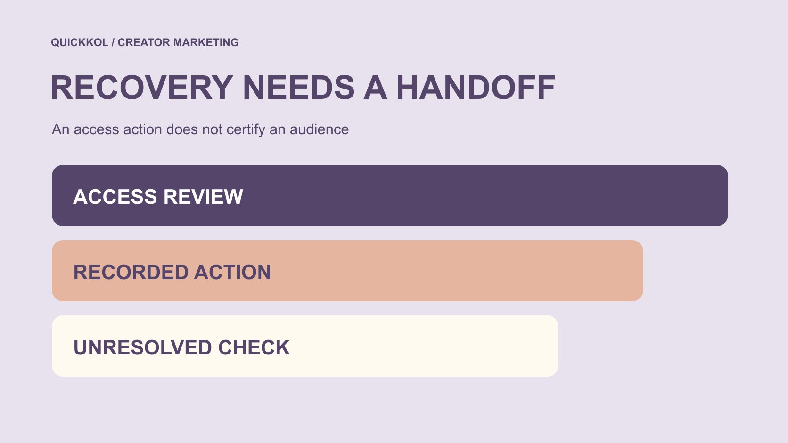

# 免费 Instagram 粉丝服务接入后，品牌怎样交接账号恢复

状态：本地审阅稿；正式发布日期待确认。

发现免费涨粉服务可能接入后，怎样把账号权限、安全行动和仍未知的事项交接清楚，而不把恢复动作当作粉丝真实证明。

QuickKOL 编辑图形；不呈现真实账号指标或平台界面。

遇到 instagram free followers 服务可能被接入的情况，品牌先把账号访问风险与受众真实性分开。由适当账号负责人通过官方路径检查访问与安全状况，记录实际行动、时间、确认范围和剩余问题；品牌不索取创作者的密码、验证码或恢复秘密。撤销一项访问、改正某项设置或重新获得登录，不证明历史数据已经清洁，也不能确认所有粉丝真实。本篇只做风险教育与交接方法，不推荐免费涨粉，不提供刷量操作，也不凭一次异常给个人定性。

## 先说清是听到说法，还是确认了访问

团队可能看到一条免费涨粉广告、收到创作者的担忧、发现陌生连接，或遇到实际登录问题。这些情况的证据不同，不能全部写成“账号已被入侵”。先保存与本次决定相关的描述、时间、来源和当前可确认状态。

[Meta 的仿冒站点安全说明](https://about.fb.com/news/2022/07/how-meta-safeguards-people-against-clone-sites/)在 2022 年解释了以免费点赞、粉丝等承诺换取登录资料的风险。这是历史平台安全教育，支持谨慎处理凭证，不构成对今天某个服务或某位创作者已经发生问题的证明。

如果尚不清楚某项服务是否真正连接，记录需要由谁通过适当方式核对，不要求品牌研究人员自行进入对方账号。把担忧描述准确，能让负责人优先处理真实访问问题，也避免把一个广告截图误当作创作者购买了虚假互动的事实。

## 让账号负责人处理访问，不交换登录秘密

由有权管理该账号的人使用官方应用、设置和支持路径检查情况。品牌可以说明合作受到什么影响，并索取完成业务判断所需的适当状态说明，但不应接收密码、一次性验证码、恢复码或私人证件来代替账号负责人操作。

[未经批准服务退出指南](https://www.quickkol.com/zh/blog/free-ig-followers-website-vendor-exit/#answer)可以帮助梳理服务、权限与停止使用的记录。本篇进一步关注交接：谁负责这次访问复核、谁处理合作时间线，以及两者之间需要交换什么有限信息。安全处理人员与内容负责人不一定是同一人。

若需要品牌内部技术或安全人员协助，仍应在适当授权范围内处理。不要因赶一个发布节点，就临时把账号交给不明恢复服务，也不以付费承诺换取所谓保证取回。对尚无法确认的能力和时间保持明确，避免让一个原有担忧再产生新的权限暴露。

## 记录动作的对象、时间和范围

一条有用记录应说明适当人员检查了什么对象、进行了什么行动、何时完成、依据是什么，以及还有哪些事项未确认。例如，某个连接被移除，是一项访问处理；它不等于确认所有其他访问都已消失，也不说明此前取得的资料被追回。

不要把模糊的“处理好了”当成唯一交接内容。可以采用适当概括，避免暴露敏感设置细节，同时让业务负责人理解当前可以做什么。行动尚在进行、结果等待核对与已经确认某个限定范围，应使用不同状态。

历史记录也应保留日期。一次过去的安全检查，不能充当今天所有访问仍然相同的证明；今天补充的说明，也不能写成当时已经存在的证据。交接依赖准确时间与范围，而不是一张看起来很正式、实际却无法解释结论的截图。

## 把恢复登录与粉丝质量分开

重新获得账号访问，回答的是某种操作能力是否恢复。粉丝来源、历史互动和报表口径是另一组问题。不能因为创作者重新登录成功，就宣布其所有数据真实；也不能因为仍有登录困难，就指控其粉丝是假的。

如需讨论合作数据，先说明使用的是公开观察、平台字段、创作者适当授权的提取，还是编辑推断。保留时间和缺失状态。一次增长变化、低互动或陌生头像都不足以证明某人购买了粉丝，也不足以识别全部非真实活动。

恢复交接中可以写“访问检查已完成到某个范围，受众原因仍未知”。这比把两种判断压成一个安全或不安全标签更有帮助。品牌根据自己的任务决定还需要哪些合适证据，不把安全人员的一个访问结论转译为对个人诚信或全部商业表现的全面担保。

## 正确理解平台的恢复数据

[Meta 的账号支持更新](https://about.fb.com/news/2025/12/making-it-easier-to-access-account-support-on-facebook-and-instagram/)在 2025 年 12 月 4 日的公司公告中称，当年美国和加拿大被盗账号恢复的相对成功率提高超过 30%；页面后来增加了 2026 年支持功能更新。这个数字是平台自述、特定地区和时期的相对变化，不是成功率达到某个绝对值，也不是提高了 30 个百分点。

它可以说明平台披露过恢复流程改进，却不能预测某位创作者能否取回账号、多久完成或本次到底发生了什么。品牌不应把一个总体数字放进项目表，作为当前恢复已经成功的替代证据。

平台支持能力和可用入口还会按账号、地区与具体问题变化。让适当负责人检查当前选项，不承诺所有人都能获得同一种人工或自动支持。把来源统计与当前个案状态分开，既能使用有价值的官方信息，也不制造它无法支持的确定性。

## 只交接业务需要的适当信息

[FTC 的企业信息保护指南](https://www.ftc.gov/business-guidance/resources/protecting-personal-information-guide-business)强调减少不必要的信息和访问。品牌需要知道的可能是当前能否安排发布、联系路径是否适当、哪些依赖仍未解决，以及下一次更新由谁提供，而不是创作者完整的安全记录或私人对话。

如需保存证明材料，保留完成判断所需的部分，并限制不必要的个人资料传播。不要把包含验证码、恢复信息或其他人私信的截图直接放进共享营销表。安全复核的适当持有人可以保管详细材料，业务记录只保存必要结论和联系责任。

这同样适用于团队内部：谁能查看、资料保存在哪里、何时复核或处理临时副本，都应按实际任务说明。本文不给出全球统一保留期限，也不要求为了完成交接收集更多信息。一个简洁、有边界的状态说明，往往比复制整套敏感文件更适合继续达人合作。

## 用一个合作延期案例检查交接

假设创作者告诉品牌，曾尝试一个声称免费增粉的服务，目前正在核对连接和登录状况。品牌有一条计划中的合作内容，尚未公开。这是风险教育练习，不是真实创作者事件或对任何服务的调查结果。

品牌先记录创作者提供的说法和待确认状态，由账号适当负责人处理安全复核；内容负责人则核对排期依赖和是否存在不依赖该账号的已约定工作。不能因对方表示正在处理，就自动公开私下审阅稿或扩大品牌使用范围。

随后收到的更新如果只确认某项连接已移除，就只更新这项行动。粉丝变化原因、全部历史访问和最终恢复时间仍可能未知。若合作需要调整，由适当双方确认受影响的条件。好的结果是安全处理和内容执行各有责任，品牌没有为了赶进度把一个有限状态说明变成全面清白或已经完成的保证。

## 恢复工作时保留数据与时间线的断点

恢复正常操作后，不重写之前记录。某一段指标不可得、某一发布时间改变或数据来源不同，都应继续保留。[社媒指标决策框架](https://www.quickkol.com/zh/blog/social-media-metrics-creator-decision-tree/#answer)帮助区分观察事件、独立人数与商业结果，不能把恢复后的可见数字自动拼回一个没有缺口的历史。

如果需要新的观察基点，应说明为什么、何时、采用什么来源，以及与原先条件有什么不同。新基点不是“已经排除所有异常”的认证。没有适合证据时，可以缩小结论、继续观察或使用与本次任务更相关的作品证据，不必制造一个可疑粉丝比例来让报告显得完整。

合作复盘也要区分账号访问处理、内容交付、实际发布和后续效果。每项都可以有自己的状态和依据。把这些断点讲清楚，能让下一位负责人理解计划如何变化，而不是误以为一次恢复动作让所有过去的问题都从未发生。

## 交接可追溯的有限结论

最终记录说明担忧来源、适当负责人、已核对范围、实际行动、当前业务决定、未知事项和下一次复核条件。它可以支持在明确条件下继续工作，也可以说明暂时不能推进；都不需要给某个人贴一个永久的真或假标签。

不要承诺百分百识别、完全清除假粉、取回全部资料或保证恢复。也不要因为没有发现某项异常就宣称所有风险已不存在。教育向内容应帮助品牌理解证据能说明什么，以及哪些判断还没有依据。

停止使用不适当服务只是管理流程的一部分，长期合作仍依赖作品、范围、真实沟通与可核对结果。一次好的恢复交接让安全问题由合适人员处理，让营销人员知道自己能做什么，并使创作者不必为了证明值得合作而交出账号控制。这个边界比一句“现在一切安全”更有实际价值。

## 账号恢复与合作交接卡

| 项目 | 适当记录 | 不能推出 |
| --- | --- | --- |
| 担忧 | 具体说法、来源、时间与待确认问题 | 仅凭说法认定入侵或买粉 |
| 访问行动 | 有权人员、对象、行动与核对范围 | 所有访问消失或历史资料追回 |
| 受众与数据 | 来源、窗口、缺失与原因未知 | 恢复登录证明粉丝真实 |
| 合作下一步 | 受影响任务、适当负责人和复核条件 | 自动扩大许可或保证按原时刻上线 |

教育向编辑工作表，不是账号安全认证、恢复服务或个人真实性判断。

## 恢复交接的证据边界

把适当行动和能够支持的结论一一对应。

- [ ] 区分广告、担忧、可见连接与实际访问问题。
- [ ] 由适当账号负责人使用官方路径处理，不交换密码或恢复秘密。
- [ ] 记录行动对象、时间、确认范围与仍未知事项。
- [ ] 不要把平台总体恢复数据当成个案保证。
- [ ] 业务交接只保留必要信息，限制敏感材料传播。
- [ ] 受众数据与安全行动分开复核，不凭单一信号指控个人。

## 研究日期与使用边界

资料核验于 2026 年 11 月 13 日。文中方法、表格和决策规则为编辑建议，标为假设的示例不是实际客户结果或行业基准。外部资料的适用地区与时期按各段说明；本稿处于独立本地审阅阶段，正式发布日期待确认。

## 继续学习指标与证据

理解来源、窗口、权限与未知；不凭单一信号判断个人，也不承诺完整检测。

[阅读指标决策指南](https://www.quickkol.com/zh/blog/social-media-metrics-creator-decision-tree/)

## 来源

- [Meta：仿冒站点与账号安全（2022）](https://about.fb.com/news/2022/07/how-meta-safeguards-people-against-clone-sites/)
- [Meta：账号支持与恢复更新（2025，2026 更新）](https://about.fb.com/news/2025/12/making-it-easier-to-access-account-support-on-facebook-and-instagram/)
- [FTC：企业个人信息保护指南](https://www.ftc.gov/business-guidance/resources/protecting-personal-information-guide-business)
