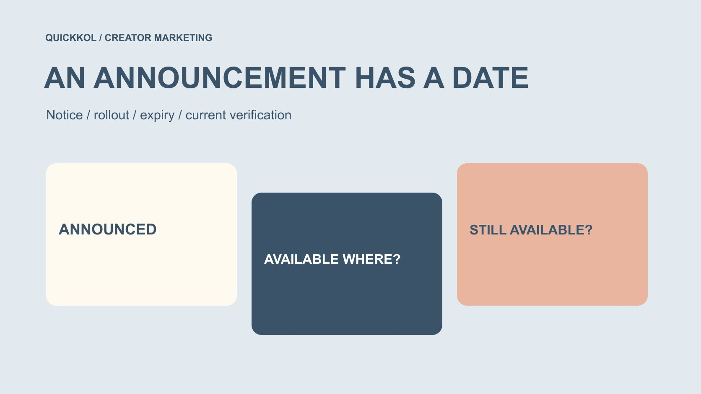

# Instagram Updates in October 2025: Read the Dates

Status: local review draft; confirm the publication date before release.

Review selected October 2025 Instagram-related announcements by publication, notice, effective, rollout and expiry dates rather than treating historical news as current campaign capability.

QuickKOL editorial graphic; not actual account metrics or a platform interface.

A search for instagram updates october 2025 should produce dated historical context, not old news disguised as current functionality. Selected official announcements show different patterns: an October notice can concern a later effective date, a feature can have defined languages and rollout scope, and a festive effect can expire within the month. When reviewing creator work, connect these dates to actual project availability. An announcement does not establish access for every account or independently explain changes in views or sales. This is a selected retrospective, not an exhaustive catalog of that month.

## Let historical updates serve a review question

A brand may need to understand why a brief selected a language, whether an effect existed during the project or whether a notice had taken effect. Start with that question and locate the original announcement instead of assembling unrelated headlines.

The [creator brief](https://www.quickkol.com/blog/write-a-useful-campaign-brief/#answer) should use information relevant to the work. A new-feature headline may prompt discussion, but it need not become a requirement unless it changes production, publication or the audience task.

This article uses three groups of official announcements to practice reading dates. It does not cover every product change that month. A historical article is not a current account-operation manual; present availability needs a separate check. Defining the purpose keeps a review focused on explaining a past decision instead of inventing a story about how a platform update caused the campaign result. It also makes the selected source set understandable to somebody who did not conduct the original research.

## Distinguish five kinds of date

An announcement date records when information was published. A notice date concerns when users start being informed. An effective date identifies when an arrangement applies. A rollout period may describe staged access, while an expiry date bounds a temporary feature.

A page may also display an update date. Do not replace the original event time with that date or rely only on relative ages in search results. Read the relevant body text and retain its source.

For creator work, the practical question is whether the actual account, geography and piece met the conditions at that time. A timeline supplies verification leads; it does not certify account history. If contemporaneous account records are unavailable, mark the limit rather than manufacture certainty from platform-wide news. The distinction remains useful even when every date in the presentation is technically correct, because different date types answer different operational questions.

## An October announcement need not take effect in October

[Meta’s October AI-recommendations announcement](https://about.fb.com/news/2025/10/improving-your-recommendations-apps-ai-meta/) was published on October 1, 2025, with notices starting October 7 and an effective date of December 16. It concerned personalization using relevant AI interactions. It should not be rewritten as a change already applied to every recommendation in early October.

This illustrates historical conditions, not a test of what a project’s viewers actually saw. No specific account status is inferred, and the article does not present the arrangement as an identical current rule in every region.

For an October creator retrospective, record that the announcement existed while keeping its later effective date explicit. A headline about AI recommendations is insufficient support for saying it caused a viewing change. Separating the date from the outcome preserves an accurate historical explanation and avoids making a news item answer a question that would require different project-level evidence.

## Read translation news with language and content scope

[Meta’s Reels translation announcement](https://about.fb.com/news/2025/10/translate-dub-and-lip-sync-your-reels-between-hindi-and-english-now-on-instagram-and-facebook/) on October 9, 2025 introduced Hindi and Portuguese alongside the existing English and Spanish capabilities described there. Cite it as a historical announcement, not a guarantee that every account currently supports every language.

A brand’s next question is whether facts, limitations and commercial context retain their meaning across versions. A translated output does not establish that the creator speaks the language, nor justify inferring identity, nationality or audience composition from the voice.

A retrospective can explain why a version was considered and what was actually used. Without project records, the announcement is not proof that a particular piece was translated. A feature offers a possible route; the work still needs its own version and review basis. This makes the history useful for creative planning without allowing a platform capability to substitute for evidence about the actual creator or publication.

## Do not treat temporary effects as permanent tools

[Instagram’s Diwali-update announcement](https://about.fb.com/news/2025/10/add-sparkle-to-your-diwali-content-with-instagrams-fresh-festive-updates/) on October 15, 2025 described festive effects for approximately two weeks, until October 29. A historical brief can discuss that window. Work prepared today should not assume those effects remain available.

The announcement concerned particular content formats and rollout locations. One interface example does not establish conditions for all channels, countries or accounts. This article gives no present-day instructions for the temporary feature and does not repackage it as a new 2026 tool.

If a brand wants to reuse older creator material, inspect the material, intended use and present context. Being able to produce an effect in the past does not mean a new version can still be recreated or will carry the same meaning today. A bounded feature window is therefore relevant both to explaining an old production choice and to deciding whether that choice can sensibly be requested again.

## Separate platform facts from account facts

A platform announcing a feature and a creator actually seeing, using or publishing with it are different factual levels. Retain the relevant sources rather than treat an announcement as an operation record for every account.

Account facts need appropriate work or owner records with time and scope. No customer account or historical feature switch was inspected for this article. If contemporaneous material does not exist, acknowledge that the history cannot be fully reconstructed.

The project can still yield useful learning. Examine whether the brief depended on an unconfirmed capability, whether a fallback existed or whether information was rechecked before publication. Historical analysis often improves the next workflow instead of supplying a definite explanation for every past unknown. That is an appropriate boundary for a brand review: a missing account-level record should remain missing, not be replaced by confidence borrowed from a broader announcement.

## Do not explain outcomes with a headline alone

Different views, interactions or orders before and after an update do not independently prove that the update caused the change. Content, paid distribution, offers, time and other conditions may differ. An announcement date is not automatically a valid experimental boundary.

The [metrics decision guide](https://www.quickkol.com/blog/social-media-metrics-creator-decision-tree/#answer) helps define the outcome that actually needs assessment. Check object, field, window and comparison conditions. With limited material, report an observed change rather than promote it into a claim of incremental impact from the update.

Not adopting a feature does not establish project failure either. A brand may reasonably choose a stable form better suited to the task. Evaluate the collaboration against its purpose and evidence, not by whether the team followed every headline. This keeps the retrospective useful to creator marketing rather than turning it into a contest over who appeared earliest in a product rollout or produced the most fashionable-looking brief.

## Make the historical reference reviewable

Retain the original title, link, announcement and applicable dates, geography or language conditions, project relevance and unverified items. A context-free screenshot is insufficient, and today’s retrieval date is not the historical event date.

If the page later changed, state when it was reviewed and which historical passage is being used. Resolve date conflicts through the body where possible; retain a limitation if they remain unresolved. An official source does not remove responsibility for interpreting its dates correctly.

At handoff, explain in one sentence why the announcement matters to the project. If that cannot be done, it may belong as background rather than a new deliverable requirement. This makes the material support work instead of leaving the next owner to infer which of many news links calls for an action. It also prevents historical reference collection from expanding the creator’s scope without an actual campaign reason.

## Rehearse date reading with a cross-month plan

Suppose a team prepares creator work on October 20, 2025 for a later release. This is a practice scenario, not an actual project. For each October headline, ask whether the arrangement is effective, whether the account can use it and whether a temporary effect covers the intended release date.

Three articles published in October should not become one simultaneous universal update. Prepare an alternative for an expiring effect, arrange review for a language version and preserve the correct period for a future effective date.

The task still determines adoption. If the capability does not help explain the product or next step, the team may choose not to use it. Record what was known, confirmed and decided at the time rather than rewrite a supposedly all-knowing strategy after seeing the result. The exercise makes historical literacy useful to production without pretending to reconstruct every account condition or predict every audience response.

## Turn historical learning into a current check

When using this material today, identify it as an October 2025 retrospective. Do not remove the year and make old dates look like this week’s news. A current brief needs current sources and actual account checks; the historical article supplies context.

Transfer the method: distinguish date types, confirm scope, check account conditions, prepare alternatives and retain unknowns. Do not transfer expired buttons, temporary effects or unsupported performance explanations.

For creator marketing, update research is most useful when it makes requirements more accurate and timing dependencies clearer. A brand need not follow every announcement. It needs to know whether the capability it chooses suits the current assignment and enables a creator to produce genuine, reviewable work under explicit conditions. That is a practical lesson from the historical record without claiming that any old feature automatically remains available or determines the outcome of a present-day campaign.

## Dates in selected October announcements

| Announcement | Stated timing | Review boundary |
| --- | --- | --- |
| AI-recommendation arrangement | Announced Oct 1; notices Oct 7; effective Dec 16, 2025 | Do not call it fully effective in October |
| Reels translation | October 9, 2025 announcement | Check languages and account conditions |
| Diwali effects | Announced Oct 15, approximately until Oct 29, 2025 | Not a current permanent tool |
| Project record | Actual production, publication and check dates | Announcements do not replace account facts |

Selected historical examples, not an exhaustive update catalog or verification of an account’s past or present capabilities.

## Before citing a historical update

Give dates and project facts distinct places.

- [ ] State the retrospective year and month.
- [ ] Retain the original official announcement.
- [ ] Separate announcement, notice, effective, rollout and expiry dates.
- [ ] Check geography, language and account conditions.
- [ ] Do not attribute outcomes from a headline.
- [ ] Recheck actual availability for the current project.

## Research date and limitations

Sources reviewed November 13, 2026. Methods, tables and decision rules are editorial recommendations. Hypothetical examples are not actual client results or industry benchmarks. Source geography and periods are specified where relevant. This draft is in independent local review; confirm its publication date before release.

## Start creator research with a clear task

Use QuickKOL to interpret a brief, discover relevant creators and research their work and contact routes. Verify data, commercial terms and outcomes at their source.

[Explore QuickKOL](https://www.quickkol.com/#capabilities)

## Sources

- [Meta: AI interactions and recommendations (2025)](https://about.fb.com/news/2025/10/improving-your-recommendations-apps-ai-meta/)
- [Meta: Reels multilingual translation update (October 2025)](https://about.fb.com/news/2025/10/translate-dub-and-lip-sync-your-reels-between-hindi-and-english-now-on-instagram-and-facebook/)
- [Meta: Diwali content updates (2025)](https://about.fb.com/news/2025/10/add-sparkle-to-your-diwali-content-with-instagrams-fresh-festive-updates/)
