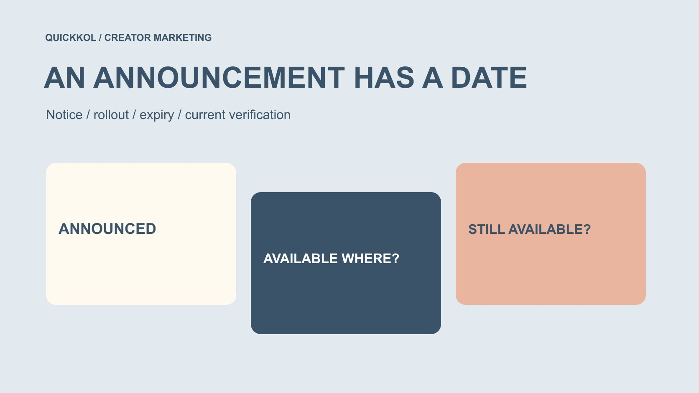

# 回看 2025 年 10 月 Instagram 更新，品牌能引用什么

状态：本地审阅稿；正式发布日期待确认。

回看 2025 年 10 月的 Instagram 相关公告，分清公告、通知、生效、推广与到期，避免把历史新闻写成当前达人合作能力或效果解释。

QuickKOL 编辑图形；不呈现真实账号指标或平台界面。

搜索 instagram updates october 2025，应该得到有日期与范围的历史解释，而不是一份伪装成当前功能的旧新闻清单。精选官方公告显示，有的十月通知对应之后生效，有的功能涉及特定语言与推广范围，有的节日效果当月就到期。品牌复盘达人合作时，需要把这些时间与自己项目实际可用条件对应，不从公告存在推断每个账号都已获得功能，更不能用更新标题独立解释观看或销售变化。本篇不是该月全部更新的完整目录。

## 历史更新先服务一个复盘问题

品牌可能需要理解当时 Brief 为什么选择某种语言、某项效果是否在项目期可用，或某条通知是否已经生效。先提出这个问题，再找原始公告，避免把无关新闻堆成更新总结。

[达人 Brief](https://www.quickkol.com/zh/blog/write-a-useful-campaign-brief/#answer) 应使用与项目相关的信息。一个新功能标题可能引发讨论，但如果没有改变制作、发布或观众任务，就不必为了显得跟进平台而加入工作要求。

这里以三组官方公告练习日期阅读，不宣称覆盖该月所有产品改动。历史文章也不是当前账号操作指南；今天是否可用，需要另行确认。清楚用途，可以防止复盘从解释当时决定，滑向编造平台更新如何造成了项目结果。

## 先建立五种不同的日期

公告日期说明平台何时发布信息；通知日期说明何时开始告知用户；生效日期涉及安排何时适用；推广期说明功能可能分阶段开放；到期日期则说明某项临时能力不再按原公告继续。

一个页面还可能显示修改日期。不要用修改时间替代最初事件时间，也不要只根据搜索结果中的相对时间判断。读取正文中对应说明，并保留原始链接。

对达人合作，真正的问题是当时那个账号、地区与作品是否具备适用条件。日期表提供核对线索，不认证具体账号的功能历史。缺少账号当时记录时，应标记未能验证，而不是从全平台新闻补出一个确定答案。

## 十月公告不一定十月生效

[Meta 的十月 AI 推荐公告](https://about.fb.com/news/2025/10/improving-your-recommendations-apps-ai-meta/)发布于 2025 年 10 月 1 日，写明 10 月 7 日开始通知，并在 12 月 16 日生效。它讨论利用相关 AI 互动个性化推荐，不应被改写为十月初所有推荐已经按新安排变化。

这是阅读历史条件的一个实例，不是对某个项目观众所见内容的实测。本篇不推断账号具体适用状态，也不复述为当前每个地区相同的规则。

若复盘十月达人作品，可以记录这项公告当时存在，但需要明确它的生效时间不同。标题中的“AI 推荐更新”不足以支持“这次观看变化由它造成”。把日期与结果分开，才能保持历史解释准确。

## 翻译公告需要语言与作品范围

[Meta 的 Reels 翻译公告](https://about.fb.com/news/2025/10/translate-dub-and-lip-sync-your-reels-between-hindi-and-english-now-on-instagram-and-facebook/)在 2025 年 10 月 9 日介绍印地语与葡萄牙语加入已有英语与西班牙语相关能力。引用时应说明它是当时公告，不由此保证当前所有账号都可使用全部语言。

对品牌而言，后续问题是产品事实、限制与关系说明在不同语言版本里是否保持意思一致。能够生成翻译，并不证明创作者本人使用该语言，也不能从配音推断其身份、国籍或受众组成。

复盘可记录当时为何考虑某种版本，以及实际采用了什么。若没有项目使用记录，就不要把公告当成该内容已翻译的证明。功能提供一种可能路径，具体作品仍需要其自己的版本和审阅依据。

## 识别节日效果的临时条件

[Instagram 的排灯节更新公告](https://about.fb.com/news/2025/10/add-sparkle-to-your-diwali-content-with-instagrams-fresh-festive-updates/)在 2025 年 10 月 15 日介绍节日效果，并说明约两周、至 10 月 29 日的时间范围。历史 Brief 可以据此讨论当时窗口，今天的工作却不应默认这些效果仍可使用。

公告涉及具体内容形式与推广地区，不能从一个界面示例推断所有渠道、国家或账号条件。本文不提供该临时功能今天的操作步骤，也不把当年效果包装为 2026 年新功能。

品牌若要复用过去创作者素材，应先确认素材本身、后续用途与当前表达是否合适。过去能制作某种效果，不代表后续新版本依然可重现，更不保证它对今天的受众仍有相同语境。

## 把平台事实与账号事实分开

平台宣布某功能，与创作者当时实际看见、试用或发布，是不同层级的事实。保留相关来源，不把一篇官方公告当作所有账号已经完成操作的记录。

账号事实应来自适当的作品或负责人记录，并保留时间与范围。本次没有查看任何客户账号，也没有验证历史功能开关。若当时资料不存在，复盘可以承认无法完整重建。

这并不妨碍理解项目。团队仍可判断 Brief 是否依赖未经确认的能力、是否准备了替代方案，或信息是否在发布前再次核对。历史分析的价值，常常是改进下次工作，而不是替过去每个未知补一个看似确定的解释。

## 不要用更新标题解释效果波动

某项作品在更新前后有不同观看、互动或订单，不足以单独证明更新造成变化。作品、投放、活动、时间和其他条件都可能不同，公告日期更不是一个自动有效的实验分界线。

[指标决策指南](https://www.quickkol.com/zh/blog/social-media-metrics-creator-decision-tree/#answer)帮助定义真正需要评估的结果。先确认对象、字段、窗口和比较条件；资料不足时可以报告观察变化，不应把它升级为平台更新带来增量的结论。

同样，更新没有被采用，也不证明项目失败。品牌可能合理选择更适合任务的稳定形式。评价应回到具体合作目的与证据，而不是用是否追上每个功能标题给团队或创作者打分。

## 把历史公告写入可复查的项目记录

记录原始标题、链接、公告与适用日期、地区或语言条件、项目关联和未验证事项。不要只转发一张缺少上下文的截图，也不要把现在读取页面的日期当作事件发生日期。

如果原页面后来更新，注明本次读取时间，以及引用的是哪段历史说明。日期冲突应回到正文核对，无法解决则说明限制。引用官方资料并不免除正确解释日期的责任。

交接给负责人时，最好能一句话说明“这条公告为什么影响本项目”。若无法回答，它可能只适合作为背景，不应成为新增交付要求。这样资料会帮助工作，而不是让下一位负责人在一堆新闻链接中猜测哪条需要执行。

## 用一个跨月排期练习日期阅读

假设团队在 2025 年 10 月 20 日准备一条之后上线的合作内容。这只是练习，不是实际项目。团队看到十月新闻时，应分别问：公告是否已生效、功能是否对当前账号可用、临时效果是否覆盖预定发布日。

不能因为三篇都属于十月，就把它们写成同一天全面生效的更新。涉及临时效果时准备替代，涉及语言时安排审阅，涉及未来生效安排时保留正确时期。

最后选择是否采用，仍由任务决定。如果新能力不能帮助解释产品或观众下一步，就可以不用。复盘应记录当时知道什么、确认什么与怎样决定，而不是根据后来结果倒写一份无所不知的策略。

## 把当年的经验转成今天的检查

今天重新使用这份资料时，先标明它是 2025 年 10 月回顾。不要去掉年份，让旧日期看起来像本周更新。当前 Brief 需要当前资料与实际账号核对，历史文章负责解释背景。

保留可迁移的方法：区分日期类型、确认适用范围、检查账号条件、准备替代并记录未知。不要迁移过期按钮、临时效果或未经证实的效果判断。

对达人营销而言，更新研究最有用的结果，是让合作要求更准确、时间依赖更清楚。品牌无需追随每项新闻；需要知道自己采用的能力是否适合当前任务，并让创作者在明确条件下完成真实、可审阅的作品。

## 精选十月公告的日期区别

| 公告 | 已说明的时间 | 复盘边界 |
| --- | --- | --- |
| AI 推荐安排 | 10 月 1 日公告；10 月 7 日通知；12 月 16 日生效（2025） | 不写成十月已经全面生效 |
| Reels 翻译 | 2025 年 10 月 9 日公告 | 语言与账号条件另核对 |
| 排灯节效果 | 2025 年 10 月 15 日公告，约至 10 月 29 日 | 不是当前常设工具 |
| 项目记录 | 实际制作、发布和核验日期 | 公告不代替账号事实 |

精选历史案例，不是完整更新目录，也不是对具体账号当时或当前能力的验证。

## 引用历史更新前

让日期与项目事实各有位置。

- [ ] 说明这是哪个年份与月份的回顾。
- [ ] 保留原始官方公告。
- [ ] 区分公告、通知、生效、推广与到期。
- [ ] 核对地区、语言与账号条件。
- [ ] 不凭更新标题归因结果。
- [ ] 当前项目重新核验实际可用能力。

## 研究日期与使用边界

资料核验于 2026 年 11 月 13 日。文中方法、表格和决策规则为编辑建议，标为假设的示例不是实际客户结果或行业基准。外部资料的适用地区与时期按各段说明；本稿处于独立本地审阅阶段，正式发布日期待确认。

## 从任务开始达人研究

用 QuickKOL 理解 Brief、发现相关达人并研究作品与联系路径；数据、合作条件和结果仍需核验。

[了解 QuickKOL](https://www.quickkol.com/#capabilities)

## 来源

- [Meta：AI 互动与推荐的日期（2025）](https://about.fb.com/news/2025/10/improving-your-recommendations-apps-ai-meta/)
- [Meta：Reels 多语言翻译更新（2025 年 10 月）](https://about.fb.com/news/2025/10/translate-dub-and-lip-sync-your-reels-between-hindi-and-english-now-on-instagram-and-facebook/)
- [Meta：排灯节内容更新（2025）](https://about.fb.com/news/2025/10/add-sparkle-to-your-diwali-content-with-instagrams-fresh-festive-updates/)
