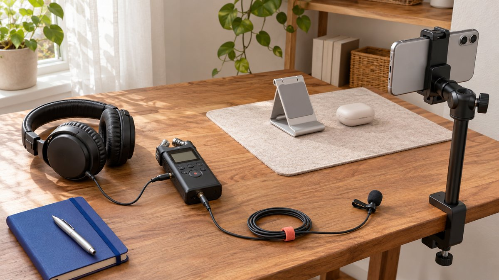

# Add Music to an Instagram Post With a Rights Plan

Status: local review draft; confirm the publication date before release.

Adding music to a sponsored Instagram post requires more than a track choice. Define publication and reuse, then check account capability, audio basis and handoff versions.

Before adding music to an Instagram creator post, decide whether it stays on the creator account or also serves brand reuse, advertising or another platform. Inspect applicable audio controls for the actual account and format, choose audio with a clear use basis, and check the excerpt, level, narration and final preview. A visible song or successful upload does not establish permission for every commercial use. Do not bypass restrictions through account-type changes, speed changes or extraction from somebody else’s video. Relevant help pages were not fully accessible in this review, so fixed buttons and track eligibility are not asserted.

## Define where this audio will be used

One piece may serve creator publication, brand-page reuse and advertising, with different audio conditions. Write down actual uses before filming rather than discover after completion that the brand needs another platform version.

The [creator distribution-role method](https://www.quickkol.com/blog/creator-media-strategy-distribution-roles/#answer) separates production, account publication, brand use and paid distribution. Check audio against those uses too. A playable original post does not resolve every later route.

A single defined use can have a simple plan. If future use is unknown, retain that unknown and prepare suitable versions instead of promising compatibility everywhere. Clear routing lets the creator assess delivery and tells the brand who handles subsequent production. It prevents a track choice from becoming an unrecognized dependency for the whole project. The aim is not to eliminate music from collaboration, but to know which use the team is preparing and which additional use would require another check.

## Treat platform capability and use basis as separate checks

[Meta’s photo-music announcement](https://about.fb.com/news/2023/08/music-and-collabs-on-instagram/amp/) introduced music for photo carousels in 2023. That is feature history, not evidence of identical present conditions across accounts, formats and regions or a grant of commercial use.

During this review, the music legal page redirected to login and related Instagram help could not be fully read. Start actual work with current account controls and applicable guidance. This article does not invent a fixed button sequence, promise access to the whole catalog or claim that a particular duration is always safe.

Capability does not establish every permission, and a permission does not guarantee the current tool supports the intended operation. Check both so the team knows whether the missing item is a technical route, a use condition or a production change. Neither should serve as evidence that the other is resolved merely because a draft can be previewed or a file can be uploaded.

## Use a track-selection process specific to the post

Select the actual image, carousel or video object and inspect what the account offers for that format. If an applicable music option exists, check source, conditions and intended excerpt. Listen to the opening, ending and relationship with narration.

Preview image, captions and sound together. Check for unsuitable lyrics or an implication conflicting with product facts. Keep an appropriate working version and record the final audio object and actual use rather than write only popular song.

If an option is absent or conditions remain unclear, do not disguise the problem through file manipulation. Use no music, choose another confirmed route or let the responsible owner investigate. An alternative should preserve accurate explanation rather than sacrifice intelligible narration merely to include a track. This is a conditional working process, not a claim that every post format has the same controls or that a song visible to one account is available to another.

## Recognize different works in recorded music

The [US Copyright Office’s composition-and-recording explanation](https://www.copyright.gov/register/pa-sr.html) distinguishes the musical work from a particular recording. This is an important concept in US copyright context, not a clearance of a track by this article or a replacement for other jurisdictions’ rules.

For collaboration management, check which material and uses the actual basis covers rather than ask only whether a song can be used. A creator performing it does not by itself settle every use of the underlying work.

Appropriate owners should review conditions for complex commercial uses. Attribution, a short excerpt or absence of a notice should not become a universal permission. The objective here is to identify questions needing review, not issue a legal conclusion for every project or guarantee that no rights dispute will occur. A useful production plan names the material, intended route and confirmation owner rather than rely on a vague statement that the audio is fine.

## Keep narration and music understandable

Music can establish rhythm without obscuring facts, steps or limitations. Check narration at an ordinary phone listening level and whether important conditions remain understandable through image and captions with sound off.

Where appropriate and within scope, retain clear narration, background audio and a final mix separately. The agreement determines files and work. Avoid discovering at final review that music and speech are inseparable when a later use needs adjustment.

The body photograph shows one recording-equipment arrangement to illustrate preparing narration separately. It is not a standard wiring diagram or a requirement to own every item shown. Equipment can be simple. What matters is intelligible actual sound, an owner for the versions and awareness that subsequent editing can change meaning. Separating production components is a practical option, not a claim that keeping stems automatically grants broader rights to any component included in them.

Planning narration separately from music helps retain clear versions for different uses. This shows equipment placement, not wiring instructions.

## Check audio state when the brand receives files

The receiving list should identify the version with music, the agreed clear-narration or other versions and their intended purposes. A filename containing final does not establish immediate suitability for every channel and advertisement.

If the brand adds music, assign that production and final review. A creator supplying music-free material does not clear the brand’s later track. Conversely, receiving a mixed piece does not automatically entitle the brand to every production file excluded from the agreed scope.

Retain version relationships during revision, especially when captions, speech or product facts change. Audio can alter pace and meaning. Final confirmation should concern the actual file rather than a replaced link or a visual-only screenshot. This keeps delivery practical: the next editor knows which object to use and which conditions still need checking, without either party assuming that the other has silently completed all remaining audio work.

## Do not treat silence as permission

[Meta’s Rights Manager explanation](https://about.fb.com/news/2023/01/helping-creators-and-publishers-manage-intellectual-property/) introduces intellectual-property education and related tools. It is not a music license and does not imply that every issue will be identified before upload. No matching or rights-dispute function was tested here.

Successful publication, temporary absence of muting or no warning cannot replace an applicable use basis. Conversely, when a notice appears, inspect the specific material and platform explanation before assuming deliberate creator misconduct.

Retain relevant files, use scope and appropriate records for an authorized owner to handle. Do not evade matching through speed changes, pitch changes or extraction from another account. Nor should temporary acceptance of a version become a claim that every later brand use is confirmed. A production review is stronger when its decision rests on the actual material and intended route rather than on whether an automated system happened to remain silent at a particular moment.

## Rehearse a piece with two intended uses

Suppose a creator prepares an accessory demonstration and the brand also wants a version for its own channel. This is not a client case. Define the two uses first and confirm each audio route instead of transferring the original post’s conditions automatically to the brand version.

If brand use remains unconfirmed, keep an appropriately agreed clear-narration version without adding music of unclear suitability. If the creator’s post uses a particular sound, record the route it was prepared for. Copying the file does not expand that scope.

Check facts, captions, sound and next step for each final object. Viewers need to understand the product demonstration, not the team’s clearance process. Internal records retain the basis and owner. Public expression can therefore remain natural and clear while production does not rely on a vague statement that music has been handled. The example concerns planning, not a finding that any specific track is or is not available for those uses.

## Check the actual publication after scheduling

Audio and format support may differ between scheduling tools and manual publication. Check the actual tool and account rather than infer that a music-bearing object works because an ordinary image was scheduled. The [Instagram scheduling-condition check](https://www.quickkol.com/blog/instagram-scheduling-format-capability-check/#answer) helps structure that review.

If manual completion is needed, assign the owner and dependencies early instead of treating an unsupported feature as a creator error at the last minute. After publication, inspect whether the actual object retains the expected sound, captions and explanation.

If publication evidence is unavailable, retain an unconfirmed state. A playable preview, a successful queue label and audience-visible publication are different stages. Naming the step actually checked is more useful than promising that every platform always supports the same audio operation. It also lets the team choose a suitable fallback while preserving the distinction between technical limitations and incomplete creator work.

## Let music support the explanation

Choose around the content task, intelligible narration, applicable route and maintenance owner. Popularity may inspire a choice without supplying permission or guaranteeing views and sales.

Keep the inaccessible-help limitation in the handoff and have an appropriate owner check current guidance before actual use. Do not rewrite this conditional process as clearance of a song or expand a US conceptual explanation into a worldwide legal conclusion.

A reliable creator audio plan identifies where each version goes, its basis and who handles the remaining work. Excellent explanation can still be delivered if the final choice is no music. The content’s value comes from accurate, useful expression rather than the assumption that a particular track must be present for the piece to work. That keeps audio a deliberate production choice within the collaboration instead of an unexamined condition controlling every later use.

## Audio versions and use routes

| Check | Record | Do not assume |
| --- | --- | --- |
| Creator post | Actual format, audio and conditions | A visible track covers every commercial use |
| Brand reuse | Separate use and audio basis | Copying expands permission |
| Clear-narration version | Agreed file and subsequent producer | Delivery includes every source file |
| Actual publication | Final sound, captions and explanation | A preview means publication |

A production-review framework, not a track license or universal legal conclusion. Relevant current help was not fully accessible; check applicable conditions before use.

## Before choosing music for the creator post

Define use before audio and versions.

- [ ] Separate creator publication, brand reuse and advertising.
- [ ] Inspect actual account and format controls.
- [ ] Check the material and use basis.
- [ ] Review narration, captions, excerpt and meaning.
- [ ] Retain agreed versions and the next owner.
- [ ] Inspect the actual publication; silence does not certify permission.

## Research date and limitations

Sources reviewed November 13, 2026. Methods, tables and decision rules are editorial recommendations. Hypothetical examples are not actual client results or industry benchmarks. Source geography and periods are specified where relevant. This draft is in independent local review; confirm its publication date before release.

## Start creator research with a clear task

Use QuickKOL to interpret a brief, discover relevant creators and research their work and contact routes. Verify data, commercial terms and outcomes at their source.

[Explore QuickKOL](https://www.quickkol.com/#capabilities)

## Sources

- [Meta: Instagram photos and music (2023)](https://about.fb.com/news/2023/08/music-and-collabs-on-instagram/amp/)
- [US Copyright Office: compositions and recordings](https://www.copyright.gov/register/pa-sr.html)
- [Meta: creator intellectual property (2023)](https://about.fb.com/news/2023/01/helping-creators-and-publishers-manage-intellectual-property/)
