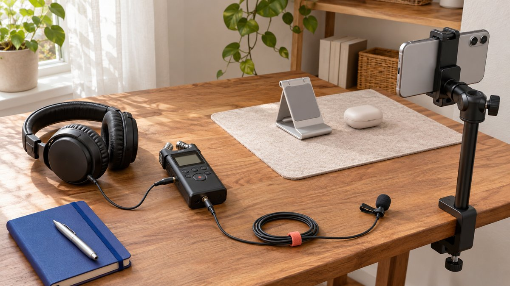

# 给 Instagram 合作帖加音乐前，要先确认哪条使用路径

状态：本地审阅稿；正式发布日期待确认。

Instagram 合作帖加音乐，不只是选择一首好听的歌。先确定发布与复用范围，再核对当前账号能力、音频依据和可交接版本。

给 Instagram 合作帖加音乐，先决定这条内容只在创作者账号发布，还是还会由品牌复用、投放广告或跨平台使用。然后在当前账号和具体格式中查看适用配乐功能，选择有明确使用依据的音频，检查片段、音量、口播与最终预览。看到一首歌或成功上传，不等于获得所有商业用途许可；不要用切换账号类型、改速或截取他人视频来绕过限制。本次相关帮助页无法完整读取，因此不提供未经验证的固定按钮和曲目资格承诺。

## 先定义这条声音要去哪里

同一个作品可能经历创作者发布、品牌页面复用和广告传播，声音条件不一定相同。拍摄前把实际用途写清，不要等成片后才发现品牌还需要一个新的平台版本。

[创作者传播分工方法](https://www.quickkol.com/zh/blog/creator-media-strategy-distribution-roles/#answer)区分制作、账号发布、品牌使用与付费传播。音频也按这些用途检查，不能因为原帖能播放，就把所有后续用法视为已经解决。

如果只有单一明确用途，方案可以简单；如果未来用途未知，就保留未知并准备适当版本，不承诺所有渠道通用。清楚路线能让创作者判断交付，品牌也知道后续制作由谁承担，避免把一首音乐的选择变成整个项目无法按计划使用的依赖。

## 分别核对平台功能与使用依据

[Meta 的照片配乐公告](https://about.fb.com/news/2023/08/music-and-collabs-on-instagram/amp/)在 2023 年介绍了为照片轮播加入音乐的能力。它是功能历史，不等于今天每个账号、格式和地区都相同，也不自动授予商业使用范围。

本次音乐法律页面跳转登录，相关 Instagram 帮助页也未能完整读取。因此实际操作应从当前账号可见功能和适用说明开始，不在这里提供固定按钮顺序、全部曲库可用或任何时长内必然安全的承诺。

有功能不代表有全部权限，有某项许可也不保证当前工具支持计划中的操作。把两件事分开核对，才能知道缺的是技术路径、使用条件，还是需要修改制作方案。它们不应互相代替。

## 把选曲写成适用于本帖的流程

先选择实际要发布的图片、轮播或视频对象，并核对当前账号对该格式提供什么。若有适用音乐选项，再检查来源、可用条件与拟用片段，听清开头、结尾与口播关系。

预览时同时检查画面、字幕与声音，确认没有引入不适当歌词或与产品事实冲突的含义。保存适当工作版本，并记录最终采用的音频对象和实际用途，不只写“热门歌”。

若选项不存在或条件无法确认，不通过改文件伪装解决。可以选择不加音乐、使用已确认适用的另一方案，或由负责人员进一步核对。替代应保留准确解释，不为了音乐存在而牺牲清楚口播或观众理解。

## 区分录音和音乐作品

[美国版权局的音乐作品与录音说明](https://www.copyright.gov/register/pa-sr.html)区分作品本身与特定录音。这是美国版权背景下的重要概念，不是本篇对某首曲目完成的授权判断，也不能直接代替其他地区规则。

应用到合作管理，团队应确认实际使用依据覆盖哪项素材和用途，而不是只问“这首歌能不能用”。创作者自己演唱，也不能仅凭演唱行为推断底层作品的一切使用都已解决。

遇到复杂商业用途，由适当负责人核对相应条件。不要把注明作者、使用很短片段或没有收到通知，当作通用许可。这里的目标是识别需要核对的问题，不提供适用于所有项目的法律结论或保证不会发生权利争议。

## 让口播与音乐保持可理解

音乐可以建立节奏，但不能盖住关键事实、步骤或限制。检查普通手机音量下是否能听清口播，关闭声音时关键条件是否仍能通过画面和字幕理解。

制作时可按适当范围分别保留清楚口播、背景音乐与最终混合版本，具体文件与工作由合作约定决定。不要等最终审阅时才发现音乐已经与声音完全混在一起，无法按新用途方便调整。

正文配图展示一种录音设备摆位，帮助说明口播可以单独准备；它不是标准布线图或所有项目必需设备。工具可以很简单，关键是实际声音清楚、版本知道由谁维护，以及后续改动不会悄悄改变内容含义。

把口播准备与配乐选择分开安排，有助于为不同用途保留清楚版本。此处展示设备摆位，不是布线教程。

## 品牌接收文件时确认音频状态

接收清单应说明哪个版本带音乐、哪个是清楚口播或其他约定版本，以及每个版本原本准备做什么。不要因为文件名含“final”，就认为所有渠道和广告都可直接使用。

若品牌自行加音乐，后续配乐与最终检查责任应明确。创作者交出无音乐素材，不等于替品牌完成后续曲目判断；品牌收到带音乐成片，也不能自然要求拆出原合同未包含的全部制作文件。

修订时保留版本关系，尤其是字幕、口播或产品事实有变化时。音频可改变节奏与意思，最终确认应针对实际文件，而不是针对一个已经被替换的旧链接或只有画面的审阅截图。

## 不要把没有通知当作已获授权

[Meta 的 Rights Manager 说明](https://about.fb.com/news/2023/01/helping-creators-and-publishers-manage-intellectual-property/)介绍了其知识产权管理教育和相关工具。它不是音乐许可，也不意味着所有问题都会在上传前被识别。本次没有测试任何素材识别或权利申诉功能。

成功发布、暂时没有静音或没有收到提示，都不能替代适用使用依据。反过来，出现提示时也应先核对具体素材和平台说明，不直接认定创作者故意违规。

保留与问题有关的文件、使用范围和适当记录，由有权限负责人处理。不要通过变速、变调或从其他账号取片来规避识别，也不要把平台暂时接受某个版本，包装成品牌所有后续用途都已获得确认。

## 用双用途作品练习版本计划

假设创作者准备一条配件演示，品牌还想在自己的渠道使用。例子不是实际客户。双方先说明两个用途，再分别确认音频路线，不把原帖使用条件自然带到品牌版本。

如果品牌用途尚未确认，可以保留获准的清楚口播版本，暂不加入未明确适用的音乐。若创作者原帖使用特定声音，也应记录它只为哪条路径准备，不能靠文件复制扩大范围。

最终检查每个对象的事实、字幕、声音与下一步。观众需要理解的是产品演示，不是团队如何解决版权；内部资料则保留依据和负责人。这样公开内容可以自然清楚，后台工作也不依赖一句模糊的“音乐已处理”。

## 排期后仍要检查实际发布对象

排期工具与手动发布对音频和格式的支持可能不同，应在当前工具与账号核对，不能从普通图片排期成功推断带音乐对象也一定相同。[Instagram 排期条件检查方法](https://www.quickkol.com/zh/blog/instagram-scheduling-format-capability-check/#answer)可以帮助逐项确认。

如果必须手动完成，提前安排负责人和依赖，不在最后一分钟才把无法支持的功能当作创作者失误。发布后检查实际对象是否保留了预期声音、字幕与说明。

不能取得实际发布记录时，就保留未确认状态。预览可播放、队列显示成功和观众实际可见，属于不同阶段。准确说出已检查哪一步，比承诺所有平台永远支持同一配乐操作更有价值。

## 让音乐服务解释，而不是决定全部方案

选择配乐时优先考虑内容任务、清楚口播、适用路线和维护责任。流行度可以提供灵感，却不替代使用依据，也不能保证观看和销售。

把当前帮助不可读取的限制保留在交接中，正式操作前由适当负责人核对最新说明。不要把本篇的条件式流程改写成已经替某首歌完成授权，或把美国概念说明扩展成全球法律结论。

可靠的达人合作音乐计划，应让每个版本知道用于哪里、依据是什么、谁继续处理。即使最终选择不用音乐，也可以完成出色解释。内容的价值来自准确、有用的表达，而不是必须加入某首曲目才能成立。

## 音频版本与使用路线

| 检查 | 记录 | 不能默认 |
| --- | --- | --- |
| 创作者原帖 | 实际格式、音频与条件 | 可见歌曲覆盖全部商业用途 |
| 品牌复用 | 独立的用途与音频依据 | 复制文件就扩大权限 |
| 清楚口播版本 | 约定文件与后续制作人 | 交付自动包含全部源文件 |
| 实际发布 | 最终声音、字幕与说明 | 预览成功等于已上线 |

制作与核验框架，不是曲目许可或通用法律结论。当前相关帮助未能完整读取，实际使用需核对适用条件。

## 为合作帖确定音乐前

先定用途，再定音频与版本。

- [ ] 区分创作者发布、品牌复用与广告。
- [ ] 查看当前账号和格式的实际功能。
- [ ] 核对具体素材与使用依据。
- [ ] 检查口播、字幕、片段与含义。
- [ ] 保留约定版本与后续负责人。
- [ ] 发布后核对实际对象，不靠静默认证权限。

## 研究日期与使用边界

资料核验于 2026 年 11 月 13 日。文中方法、表格和决策规则为编辑建议，标为假设的示例不是实际客户结果或行业基准。外部资料的适用地区与时期按各段说明；本稿处于独立本地审阅阶段，正式发布日期待确认。

## 从任务开始达人研究

用 QuickKOL 理解 Brief、发现相关达人并研究作品与联系路径；数据、合作条件和结果仍需核验。

[了解 QuickKOL](https://www.quickkol.com/#capabilities)

## 来源

- [Meta：Instagram 照片与配乐（2023）](https://about.fb.com/news/2023/08/music-and-collabs-on-instagram/amp/)
- [美国版权局：音乐作品与录音](https://www.copyright.gov/register/pa-sr.html)
- [Meta：创作者与知识产权（2023）](https://about.fb.com/news/2023/01/helping-creators-and-publishers-manage-intellectual-property/)
