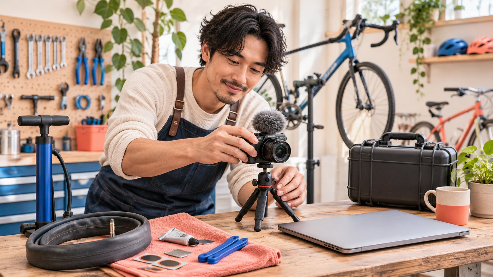

# Make a YouTube Channel With a Continuity Plan

Status: local review draft; confirm the publication date before release.

Create the collaboration channel with durable account responsibility, scoped production access and a plan for staff changes.

Before making a YouTube channel for a creator collaboration, decide who should retain long-term responsibility for the account and its content, then choose an appropriate personal or business-name route. Follow YouTube’s current creation guidance, verify the resulting channel, name and handle, grant access for actual tasks, and have the responsible owner check recovery and staff-change arrangements. A person who makes or uploads videos need not control the whole account, and shared passwords are not role management. Creation establishes a channel’s existence, not permission to reuse previous work, authority to enter commercial agreements or eligibility for a monetization program.

## Decide long-term responsibility before creation

A brand and creator may jointly produce a series while the durable publisher is the brand, creator or another identified organization. Establish that relationship before creation. Letting a temporary production operator create everything under their personal arrangements may be convenient now and difficult to hand over when the project or employment ends.

The [channel launch-readiness guide](https://www.quickkol.com/blog/create-youtube-channel-collaboration-launch-check/#answer) prepares the first publication. This article focuses on whether later owners can still locate the right channel, understand access and continue the work. Long-term responsibility, daily operation and production partnership can belong to different people. The record should describe their actual tasks instead of calling everybody an administrator.

Discuss what happens to content after the series, who answers use questions and who decides later changes. These are business conditions for the parties to establish, not consequences settled by registration. If responsibility is unresolved, production discussions can continue without rushing to create a public identity that may be difficult to manage later. This protects the collaboration from becoming dependent on an undocumented personal arrangement.

## Distinguish Google sign-in from the public channel

[YouTube’s channel-creation guide](https://support.google.com/youtube/answer/1646861?hl=en) distinguishes a Google Account from a public channel: some viewing activities use sign-in, while uploading, commenting or making playlists requires a channel. Being able to sign in does not establish the correct public publication object for this collaboration.

The documented personal-channel route on a computer or mobile site goes through profile settings, the account section and adding or managing channels, then creation with a name and handle. Check the official entry and actual account before acting because interfaces can change. This article does not register an account or upload on anybody’s behalf.

After creation, open the channel page, verify that it represents the intended subject and retain a retrievable address and observation date. Do not rely only on the sign-in avatar. A staff member managing several objects can switch incorrectly and send new material to the wrong channel. A checkable channel record is more suitable for handover than remembering which picture appeared at the top of a browser.

## Check the object in the business-name route

The official creation guidance also provides a business-or-other-name route involving a Brand Account. Distinguish creating something new from selecting an existing managed object: choosing a Brand Account that already has a channel switches to that channel rather than creating a second one.

Before acting, check whether the team already has a suitable publisher. Review its name, existing work and responsibility. Repeatedly creating similar names to make projects appear independent can scatter viewers, files and business contact routes. Where a new channel is justified, explain its assignment and relationship to the existing one.

A public name helps recognition but does not independently establish the commercial party or a creator representative’s authority. Appropriate people confirm the collaboration, while platform mechanisms govern account management. The two are related and cannot substitute for one another. Recording their relationship prevents a later colleague from treating similarly named channels as the same durable project or assuming that controlling a profile supplies every permission needed for the commissioned work.

## Grant access for work rather than sharing sign-in

[YouTube’s channel-permissions guide](https://support.google.com/youtube/answer/9481328?hl=en) describes assigning access without sharing Google sign-in details. Work backward from tasks: who views data, edits, publishes and handles permissions? Short-term collaborators do not all need the highest available access.

Pay attention to role limitations. The guidance distinguishes management, publication and deletion capabilities and notes limits concerning contracts and ownership transfer. Technical content control is not authority to confirm a commercial arrangement for both parties. If ownership changes, the responsible people must check the applicable process rather than treating one role change as a complete transfer.

An invitation being sent does not establish that the recipient accepted the correct scope or can perform the task. The appropriate account owner should check acceptance and usable capability, using a low-impact verification where suitable. Retain the role, responsibility and check result in the handover, not passwords or verification codes that let several people rotate through the same identity. A task-based access arrangement makes later review easier because the team can explain why each participant needs their particular control.

## Have the responsible owner check recovery readiness

[Google’s account-recovery options guide](https://support.google.com/accounts/answer/183723?hl=en) explains the purpose of recovery information and notes that options vary by region, account and device. Work, school or other managed accounts may require administrator assistance. A setting available to one personal account is not automatically an appropriate management arrangement for every organization.

During normal access, have the appropriate owner check responsibility and available recovery arrangements. The project record needs the responsible role, review date and relevant internal route, not recovery codes, identity documents or other sensitive information. A production partner should not have to surrender recovery material to demonstrate filming capability.

Recovery readiness is not a guarantee. Forgotten access, staff departures or security incidents may require platform and organizational procedures; no spreadsheet ensures immediate access under every condition. Separate advance review from incident responsibility so the team knows whom to approach if something goes wrong. That is more useful than discovering at launch that the only person who remembers registration has already left the project and no documented owner can explain the account arrangement.

## Rehearse a staff handover before it is urgent

Rehearse a task that does not require publishing or deleting: a new colleague locates the correct channel, identifies the active assignment and final asset location, and names who confirms the next release. If that information exists only in the previous operator’s memory, the handover still has a dependency.

Review shared files, the business contact route and current work to ensure they do not exist solely in a temporary participant’s personal space. Appropriate owners should arrange necessary access; the exercise is not a reason to request broader control. Describe the blocked action, such as locating the approved version, rather than recording only handover failed.

State what the rehearsal will not do. There is no need to delete old work, publish an unreviewed draft, revoke somebody still performing a task or change ownership merely to test documentation. Use low-impact locating and understanding first. Any actual change can then follow its normal responsibility route. This separates evidence that the handover is usable from avoidable operational disruption.

## Keep production terms separate from account control

The [creator brief](https://www.quickkol.com/blog/write-a-useful-campaign-brief/#answer) describes the work to make, explain or publish. The access record identifies who can perform platform actions. Delivering one video does not give the brand control of a creator’s whole channel, and joining a brand-owned series does not automatically permit a creator to alter historical content.

Suppose a repair workshop commissions an external educator for a tutorial series published on the workshop’s channel by its internal operator. This is a hypothetical arrangement. The educator can deliver files and participate in review under the agreed scope. Whether channel access is needed depends on the actual task; file delivery alone is not a reason to grant management rights.

If the internal operator leaves, an appropriate workshop owner should take over operations and pending publication records while retaining the agreed creator work and use conditions. Staff change neither expands the license nor automatically repurchases completed production. Confirm the affected condition separately so continuity preserves the collaboration rather than becoming an occasion to silently rewrite its entire scope.

## Keep context for existing and unpublished work

The handover should identify what is public, what remains under review and which file version corresponds to the next proposed release. Existing work can carry use conditions, product context and credits that remain relevant. A change of operator does not turn every historical file into unrestricted new material.

Have the appropriate owner assess outdated product information or content needing adjustment and preserve the reason. This article does not recommend bulk deletion to organize a channel or declare indefinite retention universally correct. The important feature is a decision tied to particular work, a changed condition and a responsible person.

Check the public business contact route as well. A channel’s existence cannot ensure that audience questions receive attention if inquiries still reach someone who left. Maintain an appropriate business entry and task ownership without distributing private contact details to every new participant. Content, access and the receiving workflow each need a continuing owner if the collaboration channel is to remain useful after its original production team changes.

## Finish when another owner can continue responsibly

Creation is complete when an appropriate owner can locate the channel, explain its durable purpose, identify who can perform current work, follow the recovery or staff-change route and retrieve the assets and confirmations needed for the next release. A screenshot of a new profile does not provide all of that.

For unresolved conditions, retain the question and next step. Inaccessible, invitation not accepted, commercial scope unclear and record awaiting retrieval are different states; they should not all disappear under account ready. Registration also establishes no audience, distribution guarantee or monetization eligibility.

Trigger later review from actual changes such as a departure, a new representative role, a revised series scope or expiring use conditions. Avoid repeatedly requesting sensitive proof from everyone without a task-related reason. A useful continuity arrangement lets brand and creator continue the agreed work while understanding the boundaries between account control, content use and commercial commitment. It remains a practical operating record, not a promise that staff changes or account problems can never interrupt the project.

## Collaboration channel continuity record

| Object | Record responsibility | Does not replace |
| --- | --- | --- |
| Public channel | Exact URL, name, task and durable owner | Commercial-party or complete content permission checks |
| Operational access | Actual role, task and acceptance state | Shared sign-in or unlimited control |
| Recovery and staff change | Appropriate internal route, review date and owner | Guaranteed immediate recovery or ownership transfer |
| Content handover | Published, under review, final version and use conditions | Permission automatically expanded by staff change |

An editorial handover framework, not account recovery, ownership-transfer execution or monetization approval.

## Handoff checks after channel creation

Use low-impact locating and responsibility checks to confirm an appropriate handover.

- [ ] Confirm the durable publisher and responsibility after the series.
- [ ] Verify the actual channel rather than only the sign-in avatar.
- [ ] Check task-based access, accepted invitations and role limitations.
- [ ] Have the appropriate owner check recovery arrangements without recording secrets.
- [ ] Retain public-content context, review versions and relevant use conditions.
- [ ] Confirm the next colleague can locate the next publication object, confirmation and owner.

## Research date and limitations

Sources reviewed November 13, 2026. Methods, tables and decision rules are editorial recommendations. Hypothetical examples are not actual client results or industry benchmarks. Source geography and periods are specified where relevant. This draft is in independent local review; confirm its publication date before release.

## Start creator research with a clear task

Use QuickKOL to interpret a brief, discover relevant creators and research their work and contact routes. Verify data, commercial terms and outcomes at their source.

[Explore QuickKOL](https://www.quickkol.com/#capabilities)

## Sources

- [YouTube: Create a channel](https://support.google.com/youtube/answer/1646861?hl=en)
- [YouTube: Channel permissions](https://support.google.com/youtube/answer/9481328?hl=en)
- [Google: Set up recovery options](https://support.google.com/accounts/answer/183723?hl=en)
