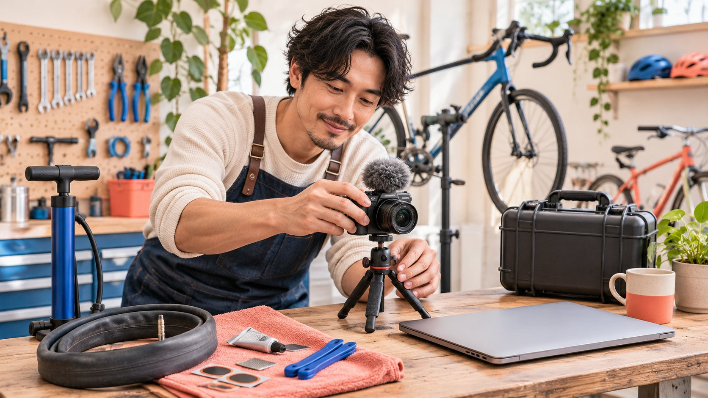

# 创建合作 YouTube 频道时，怎样避免人员变动后失去控制

状态：本地审阅稿；正式发布日期待确认。

创建合作频道时，把长期账号责任、制作人员权限和人员离开后的交接一起安排，避免频道只能由某个临时联系人控制。

在 YouTube 创建达人合作频道前，先确定谁应长期对账号和内容负责，再选择适当的个人或商业名称频道路径。按照当前 YouTube 官方说明完成创建后，核对频道对象、名称和 Handle，按实际任务授予频道权限，并让适当负责人检查账号恢复与人员变动安排。会制作或能上传视频的人，不一定应该保管整个账号；共享密码也不能替代角色管理。创建成功只说明频道存在，不等于已经取得旧作品的使用许可、商业签约资格或任何变现计划资格。

## 创建之前先确定长期责任

品牌与创作者可能共同制作一个系列，但长期发布主体可以是品牌、创作者或另一个已明确的组织。先说明这项关系，避免因为临时制作人员最方便登录，就让频道只依附于其个人安排。项目结束或人员离开时，这种方便可能变成交接障碍。

[频道首发检查指南](https://www.quickkol.com/zh/blog/create-youtube-channel-collaboration-launch-check/#answer)帮助准备第一条内容；本篇重点是让之后的负责人仍能找到正确频道、理解权限并继续执行。长期责任人、日常操作人和制作伙伴可以不同，记录应反映真实职责，而不是把每个人都叫作管理员。

说明系列结束后内容怎样处理，谁能够回答品牌或创作者的使用问题，以及后续变更由谁决定。这些是双方需要清楚约定的业务条件，不能由一个注册动作代替。如果长期责任还没有确定，可以先完成制作讨论，不急于创建一个日后难以接手的公开身份。

## 理解 Google 登录与 YouTube 频道的区别

[YouTube 的频道创建说明](https://support.google.com/youtube/answer/1646861?hl=en)区分 Google 账号与公开频道：登录可以进行部分观看相关活动，上传、评论或创建播放列表则需要频道。不要因为已经能登录 YouTube，就假定本次合作已经有正确的公开发布对象。

按当前桌面或移动网页说明，个人频道创建路径从头像进入设置，在账号部分选择添加或管理频道，再创建频道、填写名称和 Handle 并确认。实际界面可能变化，操作前应对照官方入口和当前账号；本次写作不代替用户执行注册或上传。

创建后立即打开频道主页，核对它是否对应预定主体，并保存可定位的地址和观察日期。不要只看浏览器右上角显示的登录头像。若工作人员同时管理多个对象，错误切换可能使新文件进入错误频道；一个可核对的频道记录比记住头像更适合团队交接。

## 核对商业名称下的已有对象

官方创建说明还提供商业或其他名称的频道路径，并介绍与 Brand Account 的关系。操作时需要区分创建新频道与选择已经管理的对象：如果已有 Brand Account 已经关联频道，选择它会切换到该频道，不意味着创建了第二个新频道。

因此，创建前先看团队是否已有适合的发布对象，确认名称、当前内容和相关责任。不要为了让新项目看起来独立，重复建立相似名称，再把观众、文件和品牌联系路径分散到不同地方。确实需要新频道时，说明它承担的任务与旧对象的关系。

公开名称可以帮助识别，但不能单独证明商业主体或创作者代表权限。合作由适当人员确认，账号管理按平台机制处理；两个过程有关联，却不能互相代替。把这些关系记录下来，能避免后续同事把名称相似的频道当成同一个长期项目。

## 按工作授予权限，不交出整个登录

[YouTube 的频道权限说明](https://support.google.com/youtube/answer/9481328?hl=en)介绍了不共享 Google 登录资料、按角色授予访问的方式。品牌应从任务出发，确认谁查看数据、谁编辑、谁发布、谁处理权限，而不是给每位短期合作人员最高级别访问。

特别注意平台角色的限制。该说明区分管理、发布、删除等能力，并指出某些角色不能处理合同或转移所有权。技术上可以管理内容，不等于业务上有权替双方确认商业安排。若涉及所有权变更，应由负责人员核对适用流程，不能把改一个频道角色当成完整移交。

邀请发出也不等于对方已经获得正确范围并能完成任务。由适当账号负责人检查接受状态和可用能力，必要时用低影响方式确认操作对象。交接记录保存角色、责任和核对结果，不保存密码或验证码来让多人轮流使用同一个身份。

## 提前安排账号恢复检查

[Google 的账号恢复选项说明](https://support.google.com/accounts/answer/183723?hl=en)介绍了恢复信息的作用，也提示不同地区、账号和设备的选项可能不同；工作或学校等组织账号可能需要管理员协助。不能把个人账号中的某个设置直接当成所有组织都适用的管理方式。

在正常可访问期间，由合适负责人确认管理责任和可用恢复安排。项目记录只需表明负责角色、核对日期和需要联系的内部路径，不收集恢复码、私人证件或其他敏感信息。制作伙伴不应为了证明可以拍片，就提交整个账号的恢复资料。

恢复能力也不能被写成保证。遗忘登录、人员离开或安全事件可能需要平台和组织流程处理，不存在一张表格可以确保任何情况下立即取回账号。把提前检查和紧急处理责任分开，能够让团队知道出了问题先找谁，而不是在临上线时到处寻找曾经负责注册的个人。

## 用一次人员交接演练找出依赖

可以用一个不涉及发布或删除的工作场景演练：新同事根据记录找到正确频道、识别当前项目和最终素材位置，并指出谁确认下一次发布。若这些信息只能靠原操作人的口头记忆，就说明交接还存在依赖。

检查共享文件、品牌联系入口与当前任务，确认它们没有只存在于某位临时人员的个人空间。需要访问时，由适当负责人安排授权，不把演练变成索要更多控制权的理由。发现问题后说明哪个业务动作受阻，例如无法定位批准版本，而不是笼统写“交接失败”。

演练也应说明不做什么。无需为了验证移交而真的删除旧内容、公开未审稿件、撤销仍有工作的人员，或改变所有权。先用低影响的定位和理解任务确认记录是否可用，再让真正需要的变更走其正常责任路径。

## 把制作合作与账号控制写进不同条件

[达人 Brief](https://www.quickkol.com/zh/blog/write-a-useful-campaign-brief/#answer) 说明这次要制作、解释或发布什么，账号管理记录说明谁能执行相关平台动作。创作者交付一条视频，不意味着品牌可以取得其整个频道；品牌邀请创作者参与自有系列，也不自动意味着创作者可以改动历史内容。

假设一个维修工作室邀请外部创作者制作教学系列，由工作室频道发布，内部运营人员负责上线。这是假设安排。外部创作者可按约定交付文件与参与审阅，是否需要频道权限取决于实际任务，不应为了方便传文件而直接给予管理权限。

如果内部操作人离开，工作室应让适当负责人接手操作与待发布记录，保留创作者已经明确的工作和使用条件。人员变更不自动扩大素材许可，也不自动重新购买一项已完成制作。把变更涉及的条件单独确认，能让交接延续合作，而不是借机重写全部关系。

## 为历史内容与未发布内容保留上下文

交接清单应说明哪些内容已经公开，哪些仍是待审稿件，哪个文件版本对应下一次拟议发布。历史作品的使用条件、产品事实和署名可能需要继续保留，不能因为换了操作人就把所有文件当成新的可自由使用素材。

已经失效的产品信息或需要调整的内容，由适当负责人评估处理方式并记录理由。本文不建议为整理账号而批量删除历史文章或视频，也不把保留所有内容当作永远正确。重要的是让决定能够指向具体作品、变化和负责人员。

公开联系路径也需要检查。若项目咨询仍指向已经离开的同事，频道存在并不能保证观众问题有人回应。更新适当业务入口与任务责任时，保留必要交接，不把私人联系方式复制给所有新参与者。内容、账号与承接都需要持续有人负责，才能让一个合作频道真正延续。

## 以可接手为完成标准

创建后的完成标准，不只是一张新频道截图。适当负责人应能定位频道、解释其长期任务，知道谁可以完成当前工作，理解恢复或人员变动时的联系路径，并找到下一次发布所需的作品与确认。

对于仍未知的条件，记录具体问题和下一步。无法访问、邀请未接受、商业范围未明确和资料待查不是同一状态，不要全部压缩成“账号已准备好”。同样，注册成功不代表有受众、保证分发或已经满足变现要求。

定期复核应由真正的变动触发，例如人员离开、新的代理角色、系列范围变化或使用条件到期。不要无理由向所有人反复索取敏感证明。一个好的频道连续性安排，让品牌和创作者能够继续完成约定工作，同时清楚知道账号控制、内容使用与商业承诺各自的边界。

## 合作频道连续性记录

| 对象 | 记录责任 | 不能替代 |
| --- | --- | --- |
| 公开频道 | 准确地址、名称、任务与长期负责人 | 商业主体或全部内容许可 |
| 日常权限 | 实际角色、任务与接受状态 | 共享密码或无限控制 |
| 恢复与人员变化 | 适当内部路径、核对日期与负责人 | 立即恢复或所有权转移保证 |
| 内容交接 | 已发布、待审、最终版本和使用条件 | 因换人而自动扩大的许可 |

编辑交接框架，不是账号恢复服务、所有权转移操作或变现资格确认。

## 频道创建后的交接检查

用低影响的定位与责任核对，确认频道可以被适当接手。

- [ ] 确认长期发布主体和系列结束后的处理责任。
- [ ] 核对实际频道对象，不只依赖登录头像。
- [ ] 按实际任务检查权限、邀请接受与角色限制。
- [ ] 由适当负责人核对恢复安排，不记录恢复秘密。
- [ ] 保留公开内容、待审版本和相关使用条件。
- [ ] 确认新同事能找到下一次发布对象、确认与负责人。

## 研究日期与使用边界

资料核验于 2026 年 11 月 13 日。文中方法、表格和决策规则为编辑建议，标为假设的示例不是实际客户结果或行业基准。外部资料的适用地区与时期按各段说明；本稿处于独立本地审阅阶段，正式发布日期待确认。

## 从任务开始达人研究

用 QuickKOL 理解 Brief、发现相关达人并研究作品与联系路径；数据、合作条件和结果仍需核验。

[了解 QuickKOL](https://www.quickkol.com/#capabilities)

## 来源

- [YouTube：创建频道](https://support.google.com/youtube/answer/1646861?hl=en)
- [YouTube：频道权限](https://support.google.com/youtube/answer/9481328?hl=en)
- [Google：设置账号恢复选项](https://support.google.com/accounts/answer/183723?hl=en)
