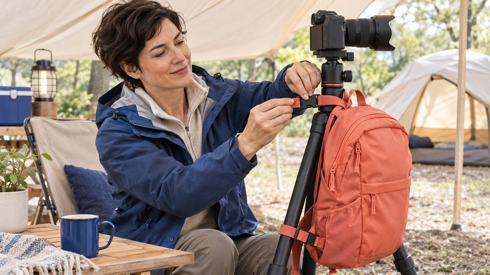

# TikTok Creator Strategies: Improve One Demonstration

Status: local review draft; confirm the publication date before release.

Bring TikTok creator strategy back to an explanation task: define one demonstration question, preserve product facts and improve understanding through bounded versions.

A useful TikTok creator strategy solves an actual audience question before selecting a format or distribution plan. The brand supplies product facts; the creator proposes a demonstration suited to their expression, with limitations and commercial context intact. Each revision should identify what changes and what the team hopes to learn. Evaluate with compatible evidence rather than treating one fluctuation as an algorithm answer. Best practices are working recommendations to examine, not universal durations, posting frequencies, sounds or performance guarantees.

## Write the strategy as an action to understand

Complete a sentence first: after watching, which action or condition should the audience understand? Examples include how a stand folds, how much installation space an accessory needs or when a function applies. This guides production more directly than an instruction to increase engagement.

The [creator brief](https://www.quickkol.com/blog/write-a-useful-campaign-brief/#answer) can define the audience task, accurate facts and next step without scripting every expression and gesture. The brand supplies product support; the creator contributes explanation, setting and relevant experience. These are different responsibilities.

If one piece is expected to explain the brand, five features, an offer and purchase conditions, prioritize. Strategy does not mean compressing everything into a short video. It means deciding which part this work can realistically complete and where the remaining information belongs. That decision helps a creator propose a coherent demonstration instead of assembling unrelated claims around a fashionable opening.

## Use platform advice as a starting point

[TikTok’s advertising-creative guide](https://ads.tiktok.com/business/en/guides/what-is-ad-creative-guide) recommends relevant problem-solution storytelling, captions and iterative improvement. Treat this as platform creative advice that can inform a brief. Promotional language about impact does not establish the outcome of your project.

This article claims no knowledge of fixed current recommendation weights and offers no universal ideal duration or posting frequency. Format should serve the fact and audience task rather than remove necessary conditions to imitate a popular structure.

Natural expression also need not mean hidden commercial context or no preparation. Accurate facts, planned shots and a clear relationship explanation can coexist with the creator’s own language. A natural feel should come from a suitable explanation, not from making sponsorship appear absent. The practical question is whether the chosen structure helps somebody understand the product honestly. It is not whether every visual choice resembles the most widely shared reference in a research folder.

## Check whether the fact can actually be demonstrated

Separate a desired claim into visible actions, facts requiring documentation and conclusions the shoot cannot establish. A demonstration can show installation without proving long-term durability, suitability in every environment or superiority to all competitors.

Confirm the sample model, accessories, environment and conditions before filming. A different model or an extra accessory not included in the offer may change what the image explains. Do not ask the creator to conceal that difference through editing.

If the material cannot support an advantage, replace it with an accurate operation explanation or retain it as pending verification. That does not make the piece valueless. It prevents a useful demonstration from expanding into a promise requiring a different evidence base. The brand can still communicate a practical benefit while stating the relevant condition, and the creator can build a coherent scene around what the product actually does in that setting.

## Keep the action connected across shots

A viewer needs to see where an action starts, which steps connect it and how it ends. Excessive cutting can make an ordinary operation appear magical while hiding the part that needs explanation. Rehearse once and check hand obstruction, reference objects and continuity between angles.

There is no need to impose one camera position on every creator. The important issue is whether viewers can distinguish object location, movement direction and result. The brand defines the explanation requirement; the creator chooses a suitable angle and pace.

For a difficult step, add a closer view or repeat the action rather than simply call it easy. Show preparation where it affects the result. A demonstration should not hide necessary setup and imply that everybody will achieve the same outcome under unrelated conditions. Continuity is an explanation choice, not a requirement to make every finished video one unbroken take or to remove the creator’s individual style.

## Give captions and sound useful roles

Captions can retain the step, model and limitation while speech explains reasoning and experience. They should not contradict one another. Check whether important conditions remain understandable without sound and whether the audio introduces an unsupported promise absent from the image.

For branded material, [TikTok’s Commercial Music Library guide](https://ads.tiktok.com/resources/help/article/commercial-music-library?lang=en) provides an official route for applicable commercial content on that platform. A sound being audible in somebody else’s video does not establish permission for this collaboration, brand reuse or cross-platform advertising.

Whether to supply clear narration and an appropriate music-free version depends on the agreed deliverables. Avoid discovering at final review that background sound obscures the operation or that the chosen track prevents the intended use. Audio is a production and permission issue, not merely decoration selected for popularity. Establishing its role early lets a creator use pacing and sound deliberately without making the whole explanation dependent on a track whose scope has not been checked.

## Give a revision one principal learning question

If two versions are needed, identify the principal difference. You might compare a size reference before installation with installation before the reference. Do not also change the creator, product, offer, destination and entire pace, then attribute any outcome to the opening.

A creator may explain that one order better follows actual use. Record this as a judgment worth examining rather than demand a guarantee that it will win. Both versions still require accurate facts and appropriate commercial context.

Where conditions prevent a fair comparison, use an editorial review or observational learning. Name the work accurately instead of calling an ordinary revision a controlled experiment. One specific lesson can be more useful than changing everything and being unable to explain the result. A bounded revision also makes feedback fairer: the creator knows which explanation needs attention and is not asked to chase an undefined sense that the piece should somehow perform better.

## Keep result definitions comparable

Retain the content object, publication conditions, reporting window and available fields. Likes, viewing time, visits and orders answer different questions. An improvement in whichever number is convenient does not establish success for the entire strategy. The [metrics decision guide](https://www.quickkol.com/blog/social-media-metrics-creator-decision-tree/#answer) helps select evidence relevant to the task.

The [UK Magenta Book evaluation guide](https://www.gov.uk/government/publications/the-magenta-book/magenta-book-central-government-guidance-on-evaluation-html) explains why attribution requires a suitable design and comparison. A before-and-after change may also involve paid distribution, an offer, timing or other factors. It cannot independently show that an editing choice caused a business outcome.

Where data is incomplete, specify which part cannot be assessed. You can report whether the demonstration is understandable, which questions remain and how to improve evidence next time. Do not treat production completion or subjective preference as sales proof. A useful outcome record supports the next decision instead of selecting one attractive number after the work has already finished.

## Turn creator feedback into specific changes

A creator may know which word viewers misunderstand, which step is difficult to film or which phrase sounds like an exaggerated guarantee. Discuss this input seriously and distinguish product corrections, expression suggestions and requests for additional work.

If reshooting is needed, identify the explanation gap rather than ask only for something more native. When the brand adds a use or version, reconfirm scope instead of turning strategy iteration into unlimited revision duties.

Reviewers should also reconcile their feedback. One person asking for faster pacing while another removes the necessary explanation can leave the creator without an executable instruction. Assign a final decision owner and make the request specific. Collaboration quality often depends on this clarity as much as the original idea. The resulting revision should answer a recognizable issue, not accumulate contradictory preferences from everybody who happened to view a draft.

## Rehearse a bounded accessory demonstration

Suppose a folding-stand collaboration needs viewers to understand its footprint on a small desk. This example represents no actual client or industry result. The brand supplies accurate dimensions, and the creator selects a reference while retaining real placement conditions.

One version starts with folding; another starts with the desktop footprint. Both retain the same model, limitations and accurate destination. The team can discuss differences in understanding and, under suitable conditions, examine subsequent fields without declaring a guaranteed winner in advance.

If the footprint remains unclear, improve the reference instead of adding an unrelated popular gesture. The next strategic action comes from the unresolved question. This builds more usable experience than continually replacing the entire setting in the name of innovation. The exercise also keeps the collaboration specific: the brand is buying an explanation of a product condition, not a promise that any particular creative pattern will deliver a predetermined amount of attention.

## Carry the lesson into the next brief

Afterward, retain the original question, actual change, preserved conditions and evidence limitation. Write a specific lesson, such as needing to show an action’s starting point, rather than elevate it into a fixed formula for every TikTok video.

Some lessons apply only to this product, creator or shooting condition. Stating the scope strengthens their practical value and prevents mechanical copying by the next team. Recheck when an important condition changes.

A sustainable creator strategy comes from clear tasks, actual collaboration and cautious learning. Platform advice and trends can inspire a form without replacing accurate facts, suitable permissions and real evaluation. The brand should finish knowing how to explain the next question better, rather than possessing more unverified growth slogans. That is a realistic strategy even when a particular version does not produce a dramatic numerical improvement or the available evidence cannot isolate why a result changed.

## Keep a demonstration iteration interpretable

| Question | May change | Retain |
| --- | --- | --- |
| Footprint is unclear | Reference and angle | Accurate model and dimensions |
| Action is disconnected | Continuity and pace | Actual preparation conditions |
| Version comparison | An identified principal difference | Definitions and comparison limits |
| Next lesson | The next brief | Source, scope and unknowns |

An editorial method, not an algorithm formula; examples are not client results.

## Before the next demonstration

Use one iteration to address an explicit question.

- [ ] State the action the audience needs to understand.
- [ ] Check sample, facts and conditions.
- [ ] Preserve continuity of the action.
- [ ] Review captions, audio and applicable use route.
- [ ] Retain the main change and evaluation limits.
- [ ] Carry the bounded lesson into the next brief.

## Research date and limitations

Sources reviewed November 13, 2026. Methods, tables and decision rules are editorial recommendations. Hypothetical examples are not actual client results or industry benchmarks. Source geography and periods are specified where relevant. This draft is in independent local review; confirm its publication date before release.

## Start creator research with a clear task

Use QuickKOL to interpret a brief, discover relevant creators and research their work and contact routes. Verify data, commercial terms and outcomes at their source.

[Explore QuickKOL](https://www.quickkol.com/#capabilities)

## Sources

- [TikTok: defining ad creative](https://ads.tiktok.com/business/en/guides/what-is-ad-creative-guide)
- [TikTok: Commercial Music Library](https://ads.tiktok.com/resources/help/article/commercial-music-library?lang=en)
- [UK government: Magenta Book evaluation guidance](https://www.gov.uk/government/publications/the-magenta-book/magenta-book-central-government-guidance-on-evaluation-html)
