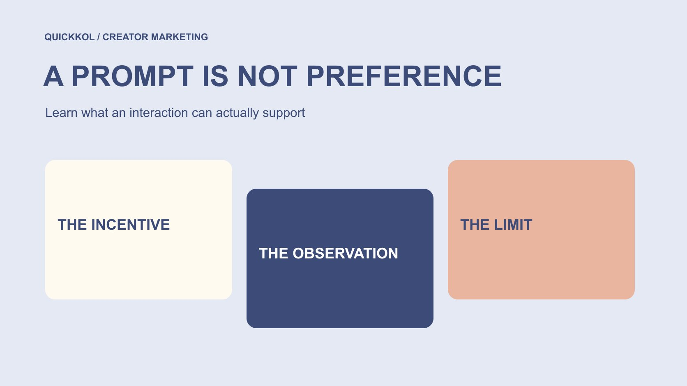

# TikTok Likes Free: Understand Incentives and Evidence

Status: local review draft; confirm the publication date before release.

A free-likes promise does not establish genuine approval. Understand incentives, evidence and access risks without treating an anomaly as a verdict about a creator.

QuickKOL editorial graphic; not actual account metrics or a platform interface.

When searching tiktok likes free, the useful question is what conditions produced the action, not how to obtain a batch of numbers. Likes prompted by tasks, rewards or deceptive promises cannot automatically establish spontaneous approval, purchases, unique people or creator-campaign success. Brands should check provenance, windows and related activity, separating observed counts, provider claims and unproven explanations. Stop when an unfamiliar offer requests account secrets or an upfront payment to release earnings, and verify through an independent official route. An anomaly starts a review; it does not justify labeling a person.

## Ask what action a like represents

A like is first a recorded platform action. It may express enjoyment, a saving habit, support for a friend, a task requirement or another motive. The count alone does not reveal why each action happened. Before evaluating creator work, decide whether the question concerns understanding, voluntary interest or subsequent behavior.

The [metrics decision guide](https://www.quickkol.com/blog/social-media-metrics-creator-decision-tree/#answer) helps connect a question to an appropriate field. A clear explanation without attributable orders is a different issue from a sudden increase in a counter. Calling both strong engagement obscures the distinction and makes a commercial discussion less useful.

This article offers no engagement service recommendations or inflation instructions. Its purpose is to interpret incentivized numbers and retain uncertainty where information is missing. Even a platform-sourced count does not independently explain why people acted, whether they understood a recommendation or whether they intended to buy. It is evidence of a defined recorded event, with a limited ability to answer a broader brand question.

## Distinguish production payment from purchasing audience actions

Paying a creator for production, publication or licensed use is different from purchasing audience likes. The former needs scoped work and clear commercial context; the latter raises a separate question about how a count was induced. Sponsorship does not make every interaction false, and absence of a direct fee does not make every action spontaneous.

[TikTok’s fake-engagement explanation](https://newsroom.tiktok.com/how-tiktok-counters-deceptive-behaviour?lang=en-150), published in 2024, identifies services that artificially increase likes and other engagement as prohibited behavior. That historical explanation is not an enforcement finding about an account under review, nor a promise that the platform detects every instance.

A review can ask whether rewards, tasks or related activity affected the action and whether the conditions are retained. Ask about an explainable process rather than demand proof of each viewer’s private intention. Likewise, the existence of a commercial collaboration cannot by itself establish manipulation. Keeping these distinctions clear avoids confusing legitimate compensation for creator work with the interpretation of audience response.

## Recognize the risk path in task offers

[Meta’s cross-platform task-scam report](https://about.fb.com/news/2025/08/new-whatsapp-tools-tips-beat-messaging-scams/) describes a specific case in 2025 in which people were assigned TikTok liking tasks and subsequently asked to deposit money into a crypto account. It illustrates how a task promise can build trust before requesting funds. It does not establish that every reward activity is the same scheme.

A page saying free, earned or available does not prove that the displayed money belongs to the recipient. Pressure to move between messaging services, provide account secrets or pay to unlock supposed earnings warrants a pause and independent verification. A small trial payment is not a reliable way to establish legitimacy.

Brand teams can receive similar partnership or promotion approaches. Route unusual requests to the appropriate internal owner and retain only necessary information; do not continue the task merely to complete a report. A protective decision does not require first determining whether every individual like was authentic. It addresses the concrete request and its risk, without turning uncertainty about engagement into an allegation about unrelated creators.

## Separate the count from its explanation

Record the content object, field, retrieval time, reporting window and visible source before adding a separate interpretation. A page displaying a like increase is an observation. A supplier saying it came from recommendations is a claim. Concluding that it proves purchase intent is a further inference requiring support.

Repeated copies of the same promotional screenshot are not independent sources. Platform, activity and order records may also concern different objects. Similar numbers do not make them corroborate one another until definitions and coverage have been checked.

Where a source is unavailable, mark it unverified rather than enter zero or select the most persuasive-looking value. Retaining an unknown supports a more precise next action: request the correct window, clarify the activity conditions or exclude the field from a consequential conclusion. A report becomes more useful when readers can distinguish what was recorded from what somebody believes caused it. This also makes later correction possible without pretending the earlier uncertainty never existed.

## Review anomalies with specific questions

When a count changes abruptly, check reporting time, cumulative versus interval fields, paid distribution, incentives and other relevant public events. A change can deserve explanation without those contextual factors automatically proving everything normal. The objective is to reduce uncertainty, not defend a predetermined conclusion.

The [UK Magenta Book evaluation guide](https://www.gov.uk/government/publications/the-magenta-book/magenta-book-central-government-guidance-on-evaluation-html) explains why attributing effects requires a suitable evaluation design and comparison. In a brand review, a like increase alone cannot prove that the collaboration caused sales growth or that a particular creator purchased engagement. No experiment or personal investigation has been performed here.

Questions such as whether a window contains another activity or whether two reports use the same field can produce more useful evidence than a demand to prove innocence. Review may remain inconclusive. Report that limit instead of assigning a cause merely to make the document look complete. A decision can be proportionate to the available evidence without pretending that an unresolved explanation has been established as fact.

## Limit access and personal information

Understanding a like field does not require sending a third party passwords, verification codes or unrestricted management access. An authorized account owner can use official routes to inspect applicable data and share the minimum relevant material instead of transferring complete control.

[FTC’s business information-security guide](https://www.ftc.gov/business-guidance/resources/protecting-personal-information-guide-business) emphasizes identifying, limiting and protecting information actually needed. An ordinary campaign review does not justify collecting likers’ private identities, contact details or unrelated messages, or forwarding raw screenshots indefinitely.

If access or data is genuinely necessary, explain purpose, owner and retention scope. If it cannot be obtained, record the limitation and choose an appropriate alternative. Refusal of excessive collection is not evidence of wrongdoing. More information does not automatically make evidence stronger; irrelevant sensitive records can instead create another management problem. The review should remain about the campaign question and the source field, not expand into unnecessary investigation of the people behind a counter.

## Practice the boundary with a hypothetical count

Suppose a sponsored video gains 800 likes within a reporting window while a reward activity also occurs. This is not client data. The team can record the field and overlap without concluding that all 800 came from the reward, all came from real people or all lacked value.

Even 200 recorded task actions cannot simply be subtracted from the total to certify the remainder as natural approval. Duplicate events, mismatched windows or unconnected sources may prevent that interpretation. First establish whether the records actually describe the same object and counting basis.

A more supportable conclusion is that the window has a known activity context and the available material cannot separate source contributions. Limit how the count is used in the outcome report, and retain other suitable evidence of understanding or subsequent behavior. Do not manufacture a precise-looking real-like percentage. The hypothetical exercise shows why arithmetic can be correct while its meaning remains unsupported, particularly when the underlying records do not connect.

## Write an exception record that can be updated

Retain the initial observation, source limitation, requested material and current assessment. If a different window or fuller record becomes available, explain which part changed rather than silently replacing the old conclusion. The [reporting-baseline method](https://www.quickkol.com/blog/free-ig-followers-campaign-baseline-reset/#answer) helps separate a field change from a performance change.

Use precise states in communication: change observed, explanation needed, insufficient evidence or a specific fact confirmed. Only the supported part should become a confirmed statement. Do not expand an unknown into a judgment about the creator’s entire body of work or character.

An educational review aims to reduce misunderstanding and risk, not produce a public list of suspects. A suitable record tells the next owner what remains missing, who will follow up and which conclusions the count cannot support. That is more useful for brand decisions than a dramatic confidence score with no reproducible basis. It also leaves room for correction when the ordinary limitations of a reporting system explain part of the apparent exception.

## Match the brand decision to the evidence

When evidence is insufficient, pause use of a field, request clarification or revise the next evaluation method. The choices are not limited to continuing everything unchanged or making a public accusation. Where account or payment risk exists, let an appropriate owner address the concrete risk first.

Base future work on a genuine content task, clear scope and suitable outcome questions rather than a compulsory like total. This reduces pressure to chase counters and makes review closer to what the brand actually needs to learn.

A free promise does not remove access, information or interpretation costs. Distinguishing action, motive, source and unknowns creates a basis for responsible learning. No single metric guarantees complete identification of false engagement or independently proves that a person deliberately deceived a brand. The useful outcome is a decision proportionate to what can be supported, with a clear path to improve evidence instead of a claim to know every cause behind a social counter.

## What like evidence can establish

| Material | Can establish | Cannot independently establish |
| --- | --- | --- |
| Platform field | Recorded value for its window | Every action’s motive |
| Incentive conditions | Known activity context | All engagement came from the incentive |
| Growth anomaly | A change needs explanation | A person purchased engagement |
| Task-earnings page | A promise was displayed | Earnings are real or payment is safe |

An educational framework, not complete detection or a finding about a person or service.

## Before reviewing a likes promise

Address provenance and risk before interpreting the count.

- [ ] Record object, window, field and source.
- [ ] Separate creator compensation from incentives for audience actions.
- [ ] Do not disclose account secrets or trial-pay to unlock earnings.
- [ ] Separate observation, supplier claim and inference.
- [ ] Review suitable evidence without collecting unrelated personal data.
- [ ] Make a bounded decision and retain unknowns and a correction route.

## Research date and limitations

Sources reviewed November 13, 2026. Methods, tables and decision rules are editorial recommendations. Hypothetical examples are not actual client results or industry benchmarks. Source geography and periods are specified where relevant. This draft is in independent local review; confirm its publication date before release.

## Continue learning about metrics and evidence

Understand sources, windows, permissions and unknowns without judging a person from one signal or promising complete detection.

[Read the metrics decision guide](https://www.quickkol.com/blog/social-media-metrics-creator-decision-tree/)

## Sources

- [TikTok: countering deceptive behaviour (2024)](https://newsroom.tiktok.com/how-tiktok-counters-deceptive-behaviour?lang=en-150)
- [Meta: messaging-scam report (2025)](https://about.fb.com/news/2025/08/new-whatsapp-tools-tips-beat-messaging-scams/)
- [UK government: Magenta Book evaluation guidance](https://www.gov.uk/government/publications/the-magenta-book/magenta-book-central-government-guidance-on-evaluation-html)
- [FTC: Protecting personal information, a guide for business](https://www.ftc.gov/business-guidance/resources/protecting-personal-information-guide-business)
