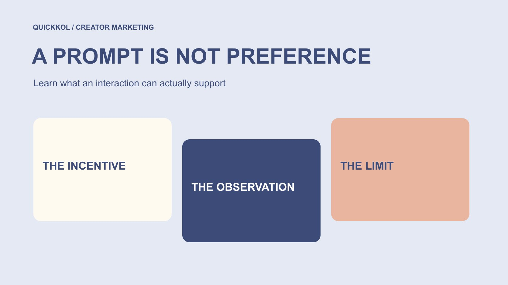

# 免费 TikTok 点赞为什么不能证明观众认可

状态：本地审阅稿；正式发布日期待确认。

免费点赞承诺不能证明真实认可。品牌需要理解动作的激励、资料来源和风险，把异常留作待核验问题，而不是直接指控创作者。

QuickKOL 编辑图形；不呈现真实账号指标或平台界面。

搜索 tiktok likes free 时，最值得了解的不是怎样获得一批数字，而是这些动作由什么条件产生。被任务、奖励或虚假承诺推动的点赞，不能直接解释为观众自发认可，更不能等同购买、真实人数或达人合作效果。品牌应核对来源、窗口和相关活动，区分已观察数字、供应方说法与尚未证实的解释。陌生页面索要账号秘密或要求先付款才能领取收益时，应停止并通过官方渠道核验。异常是复核起点，不是给个人贴标签的证据。

## 先问点赞代表了什么动作

点赞首先是一个平台记录的动作。它可能表达喜欢，也可能是收藏习惯、朋友支持、任务要求或其他动机；只看到数量，无法知道每次动作的原因。品牌评估合作时，应先说明自己想了解的是内容理解、主动兴趣还是后续行为。

[指标决策指南](https://www.quickkol.com/zh/blog/social-media-metrics-creator-decision-tree/#answer)可以帮助把问题与字段对应。一个达人解释得很清楚，却没有带来可追踪订单，与一个计数突然变高，属于不同问题。不要用同一个“互动好”把它们混在一起。

本篇不提供点赞服务推荐或刷量方法。重点是如何阅读带有激励的数字，以及在信息不足时保留未知。即使数量来自平台，也不意味着它已经回答了观众为什么行动、是否理解推荐或是否准备购买。

## 区分创作报酬与购买观众动作

品牌为创作者的制作、发布或使用许可支付费用，并不等于购买观众点赞。前者应有明确交付和商业关系说明；后者涉及计数如何被推动，需要单独评估。不能因为存在赞助，就认定全部互动虚假，也不能因为没有直接收费就认定动作自发。

[TikTok 的虚假互动说明](https://newsroom.tiktok.com/how-tiktok-counters-deceptive-behaviour?lang=en-150)在 2024 年的官方文章中，把人为增加点赞等互动的服务列为不允许的行为。这里引用其历史说明，不把它当作对本次账号的实际执法结论，也不声称平台能完整识别所有情况。

审阅时可询问是否有奖励、任务或其他活动影响动作，以及活动条件是否保留。问题应针对可说明的流程，不要求创作者证明每位观众内心真实，更不凭一次商业合作就推断其操纵数据。

## 认识任务骗局的风险路径

[Meta 的跨平台任务骗局报告](https://about.fb.com/news/2025/08/new-whatsapp-tools-tips-beat-messaging-scams/)描述了 2025 年的一项具体案例：目标先被安排给 TikTok 视频点赞，随后被要求向加密账户存钱，才继续所谓任务。报告说明某些任务承诺可能用于建立信任、再索取资金，而不是证明所有奖励活动都属于这个案例。

看到“免费”“已赚取”或看似完整的收益页面时，不应把页面显示当成钱已经属于自己。陌生人催促转移聊天平台、提交账号秘密或先付钱解锁收益，都值得暂停并独立核验。不要通过小额试付来证明对方可靠。

品牌团队也可能接到类似合作或推广邀请。把异常请求交给适当内部负责人，保留必要信息即可，不为写报告继续参与任务。这里的安全决定不依赖先查清每个点赞是真是假。

## 把数据和对数据的解释分栏

记录内容对象、字段、获取时间、统计窗口和可见来源，再单列“解释”。例如“页面显示点赞增加”属于观察，“供应方称来自自然推荐”属于对方说法，“因此一定有真实购买意愿”则是尚未支持的推断。

不要把同一份服务宣传截图转存多次当作多个独立来源。平台记录、活动记录和订单记录也可能涉及不同对象，不能只因为数字接近就当作互相验证。先确认各自定义与覆盖范围。

若来源无法取得，就标记无法核验，而不是填写零或选择看起来更有说服力的值。保留未知会让下一步更准确：请求正确窗口、确认活动条件，或暂不把这项字段用于关键结论。

## 用具体问题复核异常

计数突然变化时，先核对统计时间、累计与区间字段、内容是否有付费传播、奖励活动或其他公开事件。可疑变化值得解释，但这些背景也不能自动证明一切正常。目标是减少不确定，不是为预定结论找理由。

[英国 Magenta Book 的评价方法指南](https://www.gov.uk/government/publications/the-magenta-book/magenta-book-central-government-guidance-on-evaluation-html)解释了为什么效果归因需要适当的评估设计与比较。应用到品牌复盘时，点赞增加本身不能证明合作造成了销售变化，也不能证明某个创作者购买互动。这里没有进行实验或个人调查。

把问题写成“这段窗口是否包含其他活动”“两个报表是否同字段”，比写成“请证明你没有问题”更容易得到有用材料。复核结果可能仍然有限，报告应如实说明，而不是为了给出结论强行确定原因。

## 限制权限与个人信息的收集

没有必要为了理解一项点赞字段，就向第三方提供密码、验证码或完整管理权限。由合法账号负责人通过官方路径查看适用数据，分享与问题有关的最小范围资料，通常比把全部控制权交出去更合适。

[FTC 的企业信息保护指南](https://www.ftc.gov/business-guidance/resources/protecting-personal-information-guide-business)强调识别、限制与保护实际需要的个人信息。品牌不应索取点赞者私人身份、联系方式或无关私信来完成普通合作复盘，也不应把原始截图无限转发。

如果某项权限或数据确有必要，说明用途、负责人和保留范围。不能取得时，记录限制并选择适当替代，不把对方拒绝过度收集解释为有罪。资料越多不自动意味着证据越强；不相关的敏感资料反而会增加管理问题。

## 用一个假设数字练习边界

假设某合作视频窗口内新增 800 个点赞，同期另有一次奖励活动。这个例子不是客户数据。团队能记录字段和活动重叠，却不能仅凭重叠认定 800 次全部来自奖励、全部来自真人或全部没有价值。

即使知道有 200 次任务记录，也不能直接从总数减去 200，宣布剩余都是自然认可；可能存在重复、窗口不一致或来源未连接。需要先确认它们是否真的描述同一对象和计数口径。

更适当的结论是：该窗口存在已知活动背景，当前资料不能分离各来源贡献。团队可以限制这项数字在效果汇报中的用途，并保留内容理解或适当后续行为的其他证据，而不是制造一个看似精确的“真实点赞率”。

## 把异常说明写成可更新的记录

保留最初观察、来源限制、已请求资料与当前判断。如果后来取得不同窗口或更完整记录，补充说明哪一部分改变，不悄悄覆盖旧结论。[报表口径修正方法](https://www.quickkol.com/zh/blog/free-ig-followers-campaign-baseline-reset/#answer)有助于把字段变化与表现变化分开。

对外表达时使用准确状态：观察到变化、需要解释、证据不足或某项事实已确认。只有相关可靠证据支持的部分，才可以写成已确认。避免把未知扩大成对创作者全部作品与人格的判断。

教育向处理的目标是帮助团队减少误读和风险，不是建立公开可疑名单。适当的记录应让下一位负责人知道还缺什么、谁负责跟进，以及本次数字不能承担哪些结论。

## 让品牌决策与证据强度匹配

证据不足时，可以暂停采用某项指标、请求补充说明或调整后续评估方式，不必在继续全部合作与公开指控之间二选一。若存在账号或资金风险，由适当负责人优先处理具体风险。

未来合作应以真实内容任务、清楚范围和适合的效果问题为基础，不把一个点赞数字设为必须完成的结果。这样能减少追逐计数的压力，也让复盘更接近品牌真正需要了解的事。

免费承诺不会消除权限、信息和解释成本。认真区分动作、动机、来源和未知，才可能形成可靠学习。任何单一指标都不能保证完整识别虚假互动，也不能独立证明某个人故意欺骗。

## 点赞证据能说明什么

| 资料 | 可说明 | 不能直接说明 |
| --- | --- | --- |
| 平台字段 | 所示窗口的记录值 | 每次动作的动机 |
| 奖励条件 | 已知活动背景 | 全部互动来自奖励 |
| 增长异常 | 存在需要解释的变化 | 某个人购买互动 |
| 任务收益页面 | 页面显示了一个承诺 | 收益真实或付款安全 |

教育框架；不是完整检测工具，不构成对任何个人或服务的事实认定。

## 审阅点赞承诺前

先处理来源与风险，再解释数字。

- [ ] 记录对象、窗口、字段与来源。
- [ ] 区分创作报酬和观众动作激励。
- [ ] 不要交出账号秘密或试付解锁收益。
- [ ] 把观察、对方说法和推断分栏。
- [ ] 通过适当资料复核，不收集无关个人信息。
- [ ] 按证据作有限决定，保留未知与修正路径。

## 研究日期与使用边界

资料核验于 2026 年 11 月 13 日。文中方法、表格和决策规则为编辑建议，标为假设的示例不是实际客户结果或行业基准。外部资料的适用地区与时期按各段说明；本稿处于独立本地审阅阶段，正式发布日期待确认。

## 继续学习指标与证据

理解来源、窗口、权限与未知；不凭单一信号判断个人，也不承诺完整检测。

[阅读指标决策指南](https://www.quickkol.com/zh/blog/social-media-metrics-creator-decision-tree/)

## 来源

- [TikTok：如何应对欺骗行为（2024）](https://newsroom.tiktok.com/how-tiktok-counters-deceptive-behaviour?lang=en-150)
- [Meta：识别消息骗局（2025）](https://about.fb.com/news/2025/08/new-whatsapp-tools-tips-beat-messaging-scams/)
- [英国政府：Magenta Book 评价指南](https://www.gov.uk/government/publications/the-magenta-book/magenta-book-central-government-guidance-on-evaluation-html)
- [FTC：企业个人信息保护指南](https://www.ftc.gov/business-guidance/resources/protecting-personal-information-guide-business)
