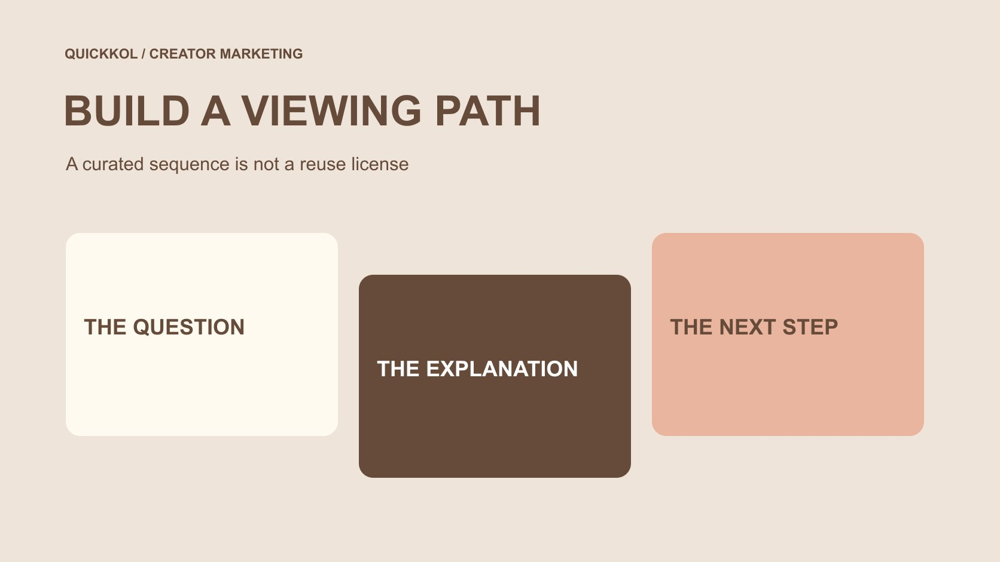

# Make a YouTube Playlist for a Creator-Led Learning Path

Status: local review draft; confirm the publication date before release.

Organize creator videos into a viewing path, choose the appropriate visibility and check whether collaboration and ordering fit the assignment.

QuickKOL editorial graphic; not actual account metrics or a platform interface.

To make a YouTube playlist for a creator collaboration, first decide what viewers should understand across the sequence and select relevant videos. YouTube’s current desktop guidance uses the video watch page, More, Save and Create new playlist, followed by a name, privacy choice and creation. Manage the contents and description afterward. Public, private and unlisted are different sharing states, and inviting collaborators can affect ordering. Saving a video to a playlist does not establish permission to download, edit or reuse it in advertising. Check the actual viewing path and assign responsibility for unavailable work, product changes and later updates.

## Define why a sequence helps the audience

A playlist should do more than collect every collaboration video. Ask why consecutive viewing helps: moving from unboxing to real use, from one question to a fuller explanation, or between approaches to the same task. If the pieces have little relationship, one focused video may be more useful than a large collection.

The [creator brief](https://www.quickkol.com/blog/write-a-useful-campaign-brief/#answer) can assign each piece a job and explain its connection to preceding or following work. Each video should still be understandable without hiding essential information in another installment. A playlist offers an additional route; it does not mean every viewer will complete a curriculum in the brand’s preferred order.

Use an accurate name and concise description. Labels such as officially certified or complete solution should not manufacture authority beyond the material. When a brand curates independent creators, explain the collection without implying that all authors partner with, endorse or share identical terms with the brand. A useful sequence can connect relevant work while preserving the distinction between curation and an agreed collaboration.

## Confirm the channel and video sources

[YouTube’s channel-creation guide](https://support.google.com/youtube/answer/1646861?hl=en) states that making playlists requires a channel. Verify the appropriate channel is selected after sign-in rather than relying only on the avatar. A colleague may manage both personal and work objects; a correct playlist name cannot fix creation under the wrong publisher.

Retain the exact video URL, title, author or publishing channel, date and relationship to the viewing task. Record brand-owned work, creator originals and third-party explanation separately. Reposts, similar titles and older versions should not enter a learning path solely because a keyword matched.

Identify who maintains the playlist, not just who clicks create today. If the list forms part of a collaboration deliverable, align it with the actual creator and brand responsibilities. Collecting videos does not replace acceptance, publication confirmation or commercial-use conditions. Those records can be linked to the playlist while retaining their own meaning. This gives a later editor a reason to keep or replace each item instead of treating the collection as an unexplained archive. Use the [channel launch-readiness guide](https://www.quickkol.com/blog/create-youtube-channel-collaboration-launch-check/#answer) for the separate checks before the first public release.

## Use the documented desktop creation route

[YouTube’s playlist-creation guide](https://support.google.com/youtube/answer/57792?co=GENIE.Platform%3DDesktop&hl=en) describes creating from a video or Short watch page through More, Save and Create new playlist, then entering a name, choosing privacy and confirming. It also explains saving to an existing list. This article checks the desktop documentation rather than assuming every mobile control occupies the same location.

Confirm the selected video and active channel before acting. After naming the collection and choosing visibility, open the result and check that it exists with the intended first item. One confirmation message does not establish that all later videos were included correctly. Managing items individually reduces errors involving similar titles or wrong versions.

If the account or interface lacks the relevant control, consult the applicable official guidance instead of guessing a fixed menu or giving an unfamiliar tool account access. The documentation also notes public-playlist creation limits; this article invents no universal daily quota. Organize around real viewing needs rather than creating large numbers of collections as artificial search entry points.

## Choose privacy for the actual sharing task

[YouTube’s playlist-privacy guide](https://support.google.com/youtube/answer/3127309?hl=en) distinguishes public, private and unlisted. Public collections can be watched and shared. An unlisted link can also be passed onward, so it is not confidential access control. A private playlist does not provide the same public-sharing route; sending its URL internally does not establish that an outside reviewer can view it.

Decide whether the collection is a public destination, material for a limited discussion or an organizer’s not-yet-shareable working list. Sensitive project discussion should not depend on nobody knowing the link. Nor should a brand inadvertently release unapproved content merely to make creator review easier.

Check individual video availability separately from the list setting. Correct playlist privacy does not establish that every included video works for the intended viewer. Verify actual visibility through an appropriate method before release without enlarging access to private information just to test. Have the responsible owner select the sharing scope and retain which object that decision concerns.

## Check collaboration and voting against the intended order

[YouTube’s playlist-collaboration guide](https://support.google.com/youtube/answer/6109639?hl=en) describes inviting others to add videos and notes that collaborative playlists enable ranked voting by default. Voting can influence order, so a brand’s intended learning sequence cannot exist only on an internal planning sheet.

If the collection needs a stable explanatory order, inspect the actual voting setting and displayed result. Decide whether collaboration serves the task. Inviting collaborators requires shareable visibility; adding-video access should not be confused with whole-channel management or commercial rights to every work. Confirm these separately.

Collaboration can help a collection receiving relevant contributions, but enabling features merely to appear interactive adds no clear value. Explain who adds items, checks irrelevant additions and handles ordering changes. Current account conditions and safety restrictions can affect available controls. The final test is the viewer’s actual route, not the number of invitations sent. This prevents a seemingly small participation setting from quietly changing the sequence on which the explanatory brief depends.

## Keep curation separate from asset permission

Saving a public video into a playlist organizes a viewing entry. It is not complete confirmation covering source files, editing, music, participant appearances or advertising use. If the brand needs a clip in its own advertisement or a revised edit, establish the intended conditions with the appropriate owner rather than relying on its presence in our playlist.

A creator agreeing to one series likewise does not make all their older work available for new brand uses. Link the original and current collaboration records without turning the collection into an unexplained asset library. File delivery, creator publication and playlist curation may have different owners.

For third-party explanatory material, preserve author and publication context rather than presenting it as a brand-verified client result. If an item supplies background understanding, describe that purpose accurately without implying its author accepted an invitation or represents the company. A clearly stated curation role gives the list educational value without manufacturing a commercial relationship that was never established.

## Rehearse a three-video viewing path

Suppose a tool brand and creator make three videos covering preparation, actual use and common questions. This is a hypothetical exercise, not an executed client project. The brand wants viewers to understand conditions before a demonstration and find supporting answers afterward.

Map exact video URLs to their jobs and check that each piece remains understandable alone. Give the collection a task-specific name instead of claiming it solves every question. Then inspect actual order, visibility and collaboration settings so ranked voting does not place a context-dependent demonstration first without explanation.

If a specification in the question video changes, the owner should consider replacing the item, adding explanation or adjusting the route. Low viewing on the third item does not establish that the audience has no questions, and not everybody enters through the first. The collection offers a useful choice. It does not prove that viewers followed that route, understood the whole sequence or completed a purchase because of it.

## Check the destination as viewers will encounter it

Before linking the playlist from a brand page, creator description or another appropriate entry, check that the URL opens the right object, its name is understandable and the needed videos play. If an entry points to only one video, make sure the related collection is understandable rather than relying on an employee’s knowledge of the planned sequence.

Review the intended device presentation and avoid naming that makes an older version appear current. Language, captions and source dates can affect understanding. A title in one language does not establish equivalent language support across every video. Explain missing or unresolved material accurately.

A check establishes availability under its observed conditions, not permanent playback. Changes involving the author, platform or content can require another review. The brand should be able to locate the maintenance owner and selection rationale instead of copying an unattended old collection into every new partnership proposal as though it remained a verified destination. This is a modest but important part of keeping a creator-led explanation usable after its initial launch.

## Maintain a useful route rather than a playlist count

Assign checks for additions, unavailable work, product changes and collaboration settings, and retain the reasons for important edits. Distinguish removing an item from a collection from deleting the original video. The latter is not a decision supplied by this curation method and should remain with the appropriate content owner.

Begin review with whether the explanatory task is clear, links work and viewers raise specific questions. If viewing data is available, preserve its actual source, definition and window. Do not add video plays into unique people or treat the existence of a playlist as completion of every creator commitment.

The completion test is whether the next colleague understands why the list exists, the job of each item, how it can be shared and which changes require another check. A playlist can make creator work more useful without replacing topic choice, production quality or an appropriate collaboration scope. One clear maintained route is more valuable than continually creating collections with slightly different names and no identified audience task.

## Collaboration playlist decision card

| Decision | Confirm | Does not establish |
| --- | --- | --- |
| Content selection | Each item’s relationship to the viewing question | Every author is a partner |
| Visibility | Actual public, private or unlisted setting | An unlisted link is confidential access |
| Collaboration and order | Contributors, voting setting and displayed order | The planned sequence never changes |
| Maintenance | Availability, versions, context and ownership | Creation proves permanent availability or performance |

An editorial curation framework, not an identical menu for all devices, a reuse license or a viewing-completion guarantee.

## Before sharing the playlist

Check the actual playlist rather than only the planning sheet.

- [ ] Define the viewer question, collection task and maintenance owner.
- [ ] Verify the active channel and exact video sources.
- [ ] Open the created playlist and check its name and contents.
- [ ] Check visibility for the sharing task without treating unlisted as confidential.
- [ ] Review collaboration, voting and actual order.
- [ ] Establish relevant use conditions separately and plan review after changes.

## Research date and limitations

Sources reviewed November 13, 2026. Methods, tables and decision rules are editorial recommendations. Hypothetical examples are not actual client results or industry benchmarks. Source geography and periods are specified where relevant. This draft is in independent local review; confirm its publication date before release.

## Start creator research with a clear task

Use QuickKOL to interpret a brief, discover relevant creators and research their work and contact routes. Verify data, commercial terms and outcomes at their source.

[Explore QuickKOL](https://www.quickkol.com/#capabilities)

## Sources

- [YouTube: Create a channel](https://support.google.com/youtube/answer/1646861?hl=en)
- [YouTube: Create and manage playlists](https://support.google.com/youtube/answer/57792?co=GENIE.Platform%3DDesktop&hl=en)
- [YouTube: Playlist privacy](https://support.google.com/youtube/answer/3127309?hl=en)
- [YouTube: Collaborate on playlists](https://support.google.com/youtube/answer/6109639?hl=en)
