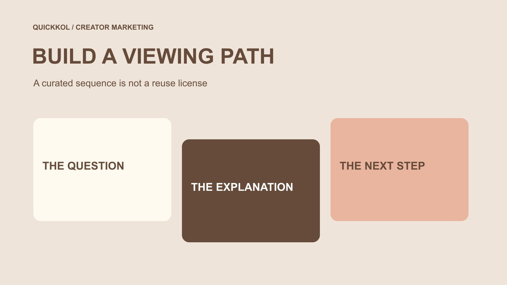

# 怎样把合作 YouTube 视频整理成有用的播放列表

状态：本地审阅稿；正式发布日期待确认。

把合作视频整理成能够回答观众问题的观看路径，正确选择公开范围，并检查协作与排序是否符合实际任务。

QuickKOL 编辑图形；不呈现真实账号指标或平台界面。

为达人合作创建 YouTube 播放列表，先决定它要帮助观众连续理解什么，再选择相关视频。按当前桌面官方说明，可在视频观看页通过更多、保存与创建新播放列表，填写名称、选择隐私并创建；之后在列表中管理内容和说明。公开、私享和不公开不是同一分享范围，邀请协作者也可能改变排序安排。保存视频进入列表不等于获得下载、剪辑或广告复用许可。完成后检查实际观看路径，并安排作品失效、产品变化和下一次更新的负责人。

## 先确定连续观看有什么价值

一份播放列表不应只是把所有合作视频放在一起。先问观众为什么需要连续看：从开箱进入实际使用，从一个问题进入完整解释，或比较同一任务的不同方法。若作品彼此没有关系，一个主题明确的单条视频可能比庞大列表更有用。

[达人 Brief](https://www.quickkol.com/zh/blog/write-a-useful-campaign-brief/#answer) 可以提前说明每条内容的任务，以及它怎样接到前后作品。创作者仍应把单条内容讲清楚，不把必要信息全部留给下一集。列表提供额外路径，而不是要求所有观众按品牌设想完成一整套课程。

给列表一个准确名字和简短说明，让观众知道范围。不要以“官方认证”“完整解决方案”等超出内容的名称制造权威。特别是品牌整理独立创作者作品时，清楚说明自己在做什么，不让集合名称暗示所有作者都与品牌合作、认可品牌或同意同样的商业条件。

## 确认列表频道和素材来源

[YouTube 的频道创建说明](https://support.google.com/youtube/answer/1646861?hl=en)指出，创建播放列表需要频道。使用前确认当前登录后选中的是适当频道，不要只看头像。品牌同事可能同时管理个人和工作对象，列表名称正确并不能弥补它实际建立在错误主体下的问题。

为候选视频保留准确地址、标题、作者或发布频道、日期及与观看任务的关系。品牌拥有的成片、创作者原帖和第三方解释可以分别记录。转载、相似标题或旧版本不应仅因关键词命中就进入同一学习路径。

还要明确谁维护列表，而不是只指定谁今天点击创建。若列表会作为合作交付的一部分，应与实际创作者和品牌责任对齐。将视频整理在一起，并不能替代制作验收、发布确认或商业使用条件；这些记录可与列表关联，但应保持各自含义。[频道首发检查指南](https://www.quickkol.com/zh/blog/create-youtube-channel-collaboration-launch-check/#answer)可以补充首次公开前的责任核对。

## 按照当前桌面路径创建列表

[YouTube 的播放列表创建指南](https://support.google.com/youtube/answer/57792?co=GENIE.Platform%3DDesktop&hl=en)说明，可以在视频或 Short 的观看页，经更多、保存与创建新播放列表进入创建流程，填写名称、选择隐私，再确认创建。页面还说明了向已有列表保存内容的方式。本文核验的是桌面官方说明，不把移动端所有控件位置当成完全相同。

操作时先确认所选视频和当前频道。给列表准确名称，完成隐私选择后，再打开列表核对它是否存在以及第一项是否正确。不要只因看到一次提示就假定后续所有内容已加入；逐项管理可以减少把同名作品或错误版本放进去的情况。

如果当前账号或界面没有相应控件，回到适用官方说明核对条件，不猜测固定菜单或通过不明工具索要账号权限。官方也提示公共列表创建存在数量限制；本篇不虚构一个所有账号通用的每日配额。品牌应围绕真实内容需要组织列表，不靠批量创建制造搜索入口。

## 按真实分享需要选择隐私

[YouTube 的播放列表隐私说明](https://support.google.com/youtube/answer/3127309?hl=en)区分公开、私享与不公开。公开可以被观看和分享；不公开的链接也可以被持有者继续分享，不能当作保密访问控制。私享列表则不提供同样的公开分享方式，不能因为内部发出了地址就假定外部审核者能看到。

品牌可以先决定此列表是公开观看入口、有限范围的讨论材料，还是尚未准备分享的个人整理。不要把含敏感项目资料的讨论建立在“没人知道链接”的假设上，也不要为方便创作者预览就无意公开尚未允许发布的内容。

列表隐私与单条视频状态还要分别检查。一个列表设置正确，不证明其中每条视频在目标观众条件下都可用。发布前用适当方式检查实际可见性，同时避免为了测试而扩大私人资料访问。让适当负责人决定分享范围，并记录这次决定针对哪个对象。

## 协作和投票可能改变观看顺序

[YouTube 的播放列表协作说明](https://support.google.com/youtube/answer/6109639?hl=en)介绍了邀请他人添加视频的方式，并提示协作列表会默认启用排序投票。投票可以影响内容排列；因此，品牌设计的教学顺序不能只停留在一张内部纸面流程里。

如果列表需要固定的解释顺序，检查实际投票设置与呈现结果，按适当责任决定是否需要协作。邀请协作者需要列表处于可分享范围；不要把添加视频的邀请理解成授予整个频道管理或全部作品商业权限。不同操作要分别确认。

协作适合有人持续贡献相关作品的任务，但不应为了显得互动而打开所有功能。说明谁负责收录、谁检查不相关内容、谁处理排序变化。实际功能和安全限制可能影响可用选项，应以当前账号为准。最终要验证的是观众看到的路径，而不是团队发出了多少邀请。

## 把整理视频与取得素材使用权分开

将一条公开视频保存到列表，是组织一个观看入口；它不是对原始文件、剪辑、配乐、出镜或广告使用范围的完整确认。如果品牌需要把片段移到自己的广告或重新编辑，应与适当负责人另行明确使用条件，不能以“已经在我们的列表里”为依据。

同样，创作者同意参与一个系列，不代表其全部旧作品都可用于品牌新用途。列表里可以关联原帖与本次合作记录，但不要把它们混成一份没有范围说明的素材库。文件交付、账号发布与列表整理可有不同负责人。

对于第三方解释内容，保留作者和原始发布关系，不改写成品牌亲自验证的客户结果。若某作品只是帮助读者理解背景，可在列表说明中准确介绍其用途，不暗示作者接受了邀请或成为品牌代表。清楚的整理角色，让列表有知识价值而不制造不存在的商业关系。

## 用三集内容检查列表逻辑

假设一家工具品牌与创作者制作三条内容，分别讲准备、实际使用和常见问题。它们构成一个假设练习，不是已经执行的客户项目。品牌想让读者先理解条件，再看演示，最后找到补充答案。

先用准确作品地址建立对应关系，并检查每条内容单独播放时是否仍然清楚。列表名称描述同一任务，不写“所有问题一次解决”。接着检查实际呈现顺序、隐私和协作设置，避免排序投票把需要背景的演示放在最前面而没有上下文。

如果常见问题一集中的某项规格已经变化，负责人应评估替换、补充或调整这条路径。不要只因为第三条播放少就认定观众没有问题，也不假设每个人都从第一集进入。列表提供一种有用选择，不证明观众实际按照这条路线理解或完成购买。

## 检查链接、呈现和可用性

在品牌页面、创作者说明或其他适当入口放置列表地址前，检查它是否打开正确对象、名称是否清楚，以及所需视频是否可播放。若使用的入口实际只指向一条视频，也应确认观看者是否能理解还有一个相关列表，不靠内部人员的记忆补充上下文。

查看目标设备中的显示，确认标题和说明不会把旧版本伪装成最新资料。语言、字幕和资料时间可能影响理解；列表标题使用某种语言，不等于其中所有视频都提供同样语言支持。对缺失或待确认内容保留准确说明。

检查看到的是本次条件下的可用状态，不是永久播放保证。原作者、平台或内容条件变化后，可能需要复核。品牌应能够找到维护负责人和当前选择依据，而不是让一个多年无人检查的列表继续被所有新合作方案复制为可靠入口。

## 维护观看路径，而不是追求列表数量

安排谁检查新增内容、失效作品、产品变化和协作状态，并记录重要调整的理由。需要移除一个列表条目时，区分从集合移除与删除原始视频；后者不应由这份整理方法擅自决定。变化应由适当内容负责人处理。

复盘可从解释任务是否清楚、链接是否可用和观众出现什么具体问题开始。获得观看数据时，保留实际来源、口径与窗口；不要把不同视频播放相加成独立人数，也不把播放列表存在解释成创作者已经完成全部商业承诺。

完成标准是下一位同事知道列表为什么存在、每条作品承担什么任务、怎样分享，以及什么变化需要复核。它可以帮助品牌把达人内容组织得更有用，但不能替代选题、制作质量或恰当合作范围。先把一条路径做清楚，比不断建立相似名字的列表更有价值。

## 合作播放列表的决策卡

| 决定 | 需要确认 | 不能推断 |
| --- | --- | --- |
| 内容选择 | 每条作品与观看问题的关系 | 所有作者都是合作方 |
| 分享范围 | 实际公开、私享或不公开设置 | 不公开链接等于保密访问 |
| 协作与顺序 | 添加人员、投票设置与实际顺序 | 内部纸面顺序永远不变 |
| 维护 | 失效、版本、说明与责任 | 创建成功等于永久可用或效果证明 |

编辑整理框架，不是所有设备的固定菜单、内容复用许可或观看完成保证。

## 分享播放列表前

按实际列表对象检查，而不只查看内部策划表。

- [ ] 确定观众问题、列表任务和维护负责人。
- [ ] 核对当前频道与每条视频的准确来源。
- [ ] 创建后打开实际列表，检查名称和内容。
- [ ] 按分享需要核对公开范围，不把不公开当作保密。
- [ ] 检查协作、投票与实际观看顺序。
- [ ] 单独确认需要的内容使用条件，并安排变化后的复核。

## 研究日期与使用边界

资料核验于 2026 年 11 月 13 日。文中方法、表格和决策规则为编辑建议，标为假设的示例不是实际客户结果或行业基准。外部资料的适用地区与时期按各段说明；本稿处于独立本地审阅阶段，正式发布日期待确认。

## 从任务开始达人研究

用 QuickKOL 理解 Brief、发现相关达人并研究作品与联系路径；数据、合作条件和结果仍需核验。

[了解 QuickKOL](https://www.quickkol.com/#capabilities)

## 来源

- [YouTube：创建频道](https://support.google.com/youtube/answer/1646861?hl=en)
- [YouTube：创建和管理播放列表](https://support.google.com/youtube/answer/57792?co=GENIE.Platform%3DDesktop&hl=en)
- [YouTube：播放列表隐私](https://support.google.com/youtube/answer/3127309?hl=en)
- [YouTube：协作播放列表](https://support.google.com/youtube/answer/6109639?hl=en)
