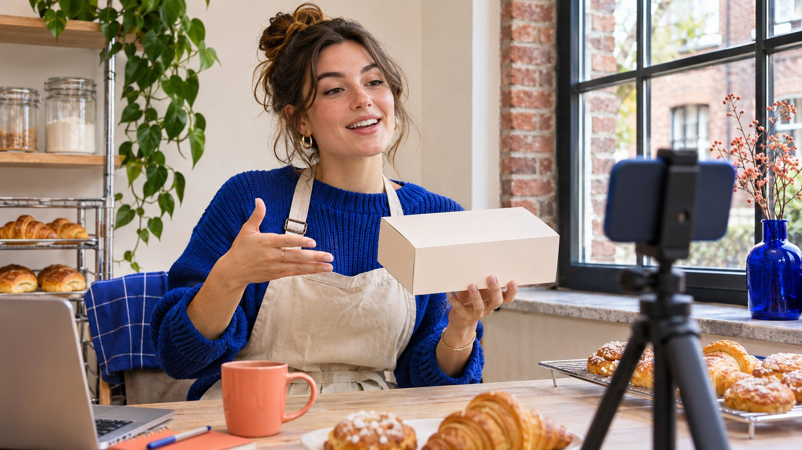
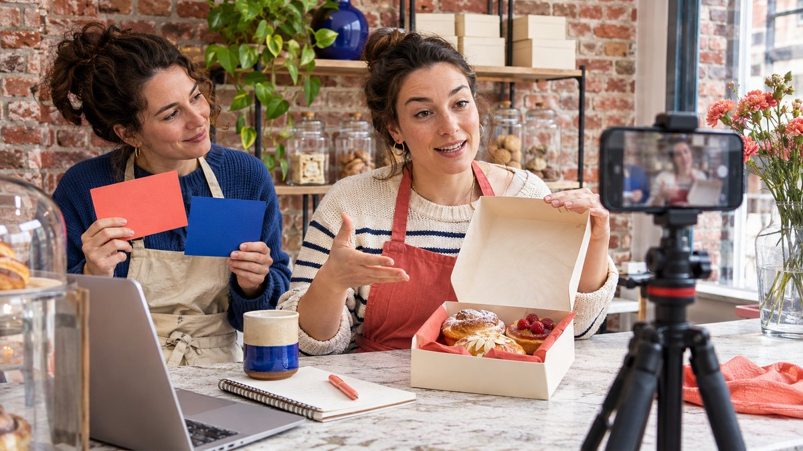

# Influenceuse Belge: Brief Language, Market and Disclosure

Status: local review draft; confirm the publication date before release.

A Belgian creator brief needs an actual market, communication language and commercial context. Research adult creators through work and tasks rather than infer identity from a French query.

“Influenceuse belge” is a French search lead for a Belgian woman creator, not complete proof of a person’s identity or audience. Define the market, local product access, language and assignment before reviewing public work and appropriate business contacts. Advertising recognition, consent for people in the scene and ownership of later inquiries also belong in the brief. This article invents no ranking and infers no private identity from names, appearance or accents. It turns a search into a collaboration that the brand and creator can discuss concretely.

## Define the market this collaboration serves

Begin by distinguishing the local assignment from a general visibility campaign.

A request for a Belgian collaboration still needs an actual business scope. Stock, shipping and whether an event concerns one particular shop affect the invitation a creator can make to viewers.

A location descriptor in search results is a research lead. A connection to one city does not mean every viewer can visit, and one local shoot does not establish residence. Check public work and appropriately volunteered information relevant to the assignment.

The [creator-shortlist method](https://www.quickkol.com/blog/creator-shortlist-workflow/#answer) can retain market conditions and work evidence. Define what viewers are being invited to do before deciding which local experience is useful, rather than find someone who appears to match a regional label and then improvise an activity the brand has not prepared to deliver. For a hypothetical bakery collaboration, distinguish an in-store demonstration from a nationwide product launch. They need different information and can justify different creator contributions even when both proposals use the same country name.

## Do not treat a country lead as one language

[Belgium’s official language overview](https://www.belgium.be/en/about_belgium/government/federale_staat) lists Dutch, French and German as its official languages. That does not mean each creator works in all three or establish an account’s audience distribution. The French keyword is only a starting point.

Discuss expression against the actual audience and assignment. Review relevant original work and the person’s contribution, then ask the creator to confirm versions they can undertake. Subtitles do not automatically establish hosting capability in that language, and brand-supplied translation still needs review.

This article does not prescribe one language for every region. Confirm actual product and commercial requirements appropriately. Separate brand needs, observed work and questions in the research record so language becomes a production condition rather than a capability filled in from a country label. If one version needs another speaker or specialist review, make that dependency visible before the brand assumes a multilingual package is included in a single appearance fee.

## Use local detail for the product task

Local experience matters when it helps viewers understand this collaboration. Shop access, actual product names or participation times may matter more than a generic city backdrop. Landmark imagery cannot replace product and event facts.

For a hypothetical bakery introducing a weekly product, a creator might show real packaging and collection arrangements, while the brand confirms stock, availability and conditions. Earlier experience should not become a promise that every shop currently carries it.

Keep the factual record beside shot tasks and assign its updates. If filming and publication are separated, recheck important conditions before release. The brand supplies accurate information, the creator communicates clearly and the site team enables appropriate images. These depend on one another rather than collapse into a local creator should know. Give the presenter an identified contact for changes so an outdated availability statement can be corrected before it becomes the invitation viewers rely on after watching the sponsored content.

## Rehearse language and action together

The photograph shows adult creators preparing a shop scene and cue cards. It illustrates a concrete rehearsal rather than identifying the people as a nationality or presenting an actual client collaboration.

Where names, actions and captions must align, rehearse a short passage to check that hands do not obscure information, the sentence fits the real duration and location sound remains understandable. Rehearsal should not pressure a creator to change an accent to satisfy a stereotype.

Language versions can preserve the same facts without mechanically keeping identical length. If another version changes filming or editing, include it in scope. Have someone with relevant capability review the actual finished version, including commercial context and on-screen text, rather than only approve a translation document separated from the images. A phrase that works on paper may become unclear when shortened for a shot, and a cue about which product is being shown may disappear when the camera angle changes during production.

Rehearse language, product actions and location arrangements together without inferring identity from appearance.

## Make advertising recognizable under local guidance

[Belgium SPF Economie’s influencer-advertising guidance](https://economie.fgov.be/fr/themes/ventes/publicite/vous-etes-createur-de-contenu) says commercial content should be recognizable and discusses benefits including gifts and affiliate links. It recommends explicit advertising wording in the content’s language rather than ambiguous partnership terms. This is local official guidance, not a universal legal conclusion.

The brand should describe the real relationship in the brief and have the specific campaign reviewed appropriately. A creator should not be asked to hide necessary context in an obscure location for a supposedly natural effect.

Review the version viewers actually encounter. Changes to audio, text, subtitles or crops can make a previously clear explanation disappear. Treat advertising recognition as production work rather than a last-second tag, giving both sides time to discuss format, space and expression. For a multilingual assignment, confirm that the relevant context survives in each version instead of assuming the label attached to the first upload is sufficient for every later adaptation or placement.

## Confirm people in the scene and later use

[SPF Economie’s image-rights explanation](https://economie.fgov.be/fr/themes/propriete-intellectuelle/droits-de-pi/droits-dauteur-et-droits/droits-dauteur/droit-limage) distinguishes consent concerning taking and publishing images and cautions about interpreting its scope. This cites a general principle, not a legal determination for this shoot, and fame does not establish advertising permission.

Where staff, customers or other participants enter a scene, an appropriate owner should arrange relevant consent and location conditions. A creator’s willingness to film does not mean she can consent for every passerby; site approval does not resolve every third-party right.

Later advertising, crops or new product pages need to match the actual permission. Give editors the relevant record so they know which material is available for which purpose. One local filming file is not a permanent cross-market promotional library. If a proposed use is still unconfirmed, keep it pending explicitly rather than leave the next team to infer permission from the fact that the video is already stored in a shared brand folder.

## Assign a suitable route for later inquiries

Content can lead to questions about price, visits, shipping or the product. Decide who can receive and answer in the actual language rather than assume an on-camera creator also provides ongoing customer service.

The [collaboration-language guide](https://www.quickkol.com/blog/instagram-followers-language-context-brief/#answer) distinguishes work language from response capability. A local assignment also needs a business able to fulfill the invitation viewers receive. If inquiries in one language have no owner, adapt the task or clarify the route instead of improvising after publication.

Collect information needed for the business purpose without circulating personal messages and data to every partner. The creator can direct viewers to an appropriate contact while the brand answers business questions. Including receipt and handoff in the proposal helps turn attention into accountable communication. It also prevents a successful post from leaving the creator responsible for stock, delivery or eligibility answers that only the business can accurately provide under the current conditions.

## Discuss resources through versions and roles

Hosting, shop filming, translation, captions, extra publication and later advertising are different work. The label Belgian creator does not include every stage automatically, and audience size does not establish team capacity.

Ask who actually handled language, filming and editing in relevant work. Include local site collaboration or another speaker in scope and schedule when needed. Do not discover on shoot day that everyone interpreted two versions differently.

Retain assumptions and unanswered matters in the proposal. If product availability or site conditions change, identify the affected shot and invitation. Both sides can then discuss an adjustment instead of demanding unlimited additions because someone originally agreed to a local collaboration. For example, two language versions may share product-detail footage while needing separate narration, captions and commercial context. List shared and added work so copying a file is not mistaken for localization, and the team does not schedule unnecessary repeated filming for a shot that already meets the confirmed purpose. Resources should serve the actual assignment without sacrificing accurate expression for more versions. A concrete scope also lets a creator propose an alternative format that communicates the same facts more clearly within the confirmed language, location and production capability.

## Finish the proposal with task evidence

The final selection should explain why this adult creator suits the market and content task, which work supports the judgment, who confirms language and site matters, and how advertising context and later inquiries are handled. A French keyword is not a complete proposal.

Local experience can be valuable when connected to real product conditions and viewer tasks rather than inferred identity or stereotypes. Unconfirmed audiences and capabilities remain questions instead of invented percentages or rankings.

Using influenceuse belge within influencer marketing should produce a collaboration both sides can understand, make and review. The brand knows the contribution needed, the creator knows the responsibilities and later teams know which versions and uses are confirmed and which remain open. That is a practical outcome of creator research: a reasoned invitation with identifiable dependencies, rather than a country label attached to a name and an expectation that language, logistics and commercial requirements will resolve themselves.

## Four confirmations for a Belgian collaboration brief

| Item | Needed support | Do not infer |
| --- | --- | --- |
| Actual market | Availability, activity and viewer invitation | Location label equals the whole audience |
| Communication language | Work contribution and creator confirmation | Country equals personal language capability |
| Commercial context | Actual relationship and applicable local requirements | Natural style removes advertising context |
| Later execution | Permission, recipient and specific use | One version includes all work |

An editorial proposal framework, not nationality verification or a legal determination.

## Before inviting a local collaboration

Connect a regional lead to a real assignment.

- [ ] State the market and product conditions.
- [ ] Review work relevant to the task.
- [ ] Confirm language versions and actual contribution.
- [ ] Review advertising context and participant consent.
- [ ] Assign inquiry receipt and business answers.
- [ ] Confirm extra versions and uses separately.

## Research date and limitations

Sources reviewed November 16, 2026. Methods, tables and decision rules are editorial recommendations. Hypothetical examples are not actual client results or industry benchmarks. Source geography and periods are specified where relevant.

## Start creator research with a clear task

Use QuickKOL to interpret a brief, discover relevant creators and research their work and contact routes. Verify data, commercial terms and outcomes at their source.

[Explore QuickKOL](https://www.quickkol.com/#capabilities)

## Sources

- [Belgium’s official language overview](https://www.belgium.be/en/about_belgium/government/federale_staat)
- [Belgium SPF Economie’s influencer-advertising guidance](https://economie.fgov.be/fr/themes/ventes/publicite/vous-etes-createur-de-contenu)
- [SPF Economie’s image-rights explanation](https://economie.fgov.be/fr/themes/propriete-intellectuelle/droits-de-pi/droits-dauteur-et-droits/droits-dauteur/droit-limage)
