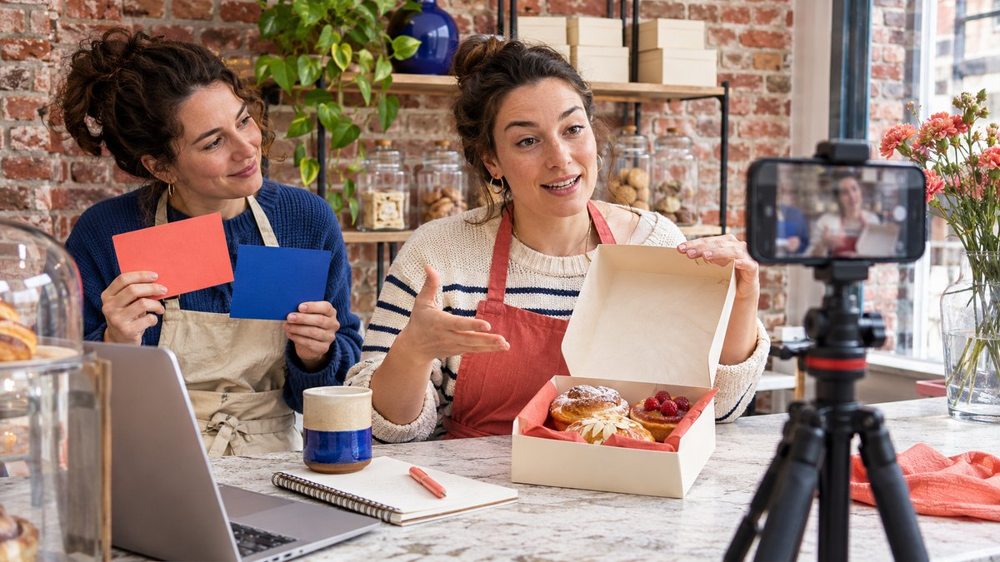

# 比利时达人怎样核对市场与语言

状态：本地审阅稿；正式发布日期待确认。

比利时达人合作需要明确实际市场、表达语言与商业背景。用作品与具体任务研究成年创作者，不从法语搜索词推断国籍或所有受众。

“influenceuse belge”是寻找比利时女性创作者的法语线索，不是某个人身份或受众的完整证明。品牌应先说明合作服务哪个市场、产品在当地如何获得、需要什么语言与任务，再研究公开作品和合适商业联系。当地广告识别要求、现场参与同意与后续咨询安排，也应进入 Brief。本文不列虚构排名，不根据姓名、外貌或口音推断私人身份，而是把搜索变成可以讨论的达人合作。

## 先确定本次合作服务哪个市场

先将本地任务与一般曝光活动分开。

品牌说希望做比利时合作，还需要解释实际业务范围。产品是否在相关地点有货、能否寄送、活动是否只在某家门店进行，都会影响创作者可以向观众提出什么邀请。

搜索结果中的地点描述只是研究线索。不要把创作者与某座城市有关，直接写成其所有观众都能到店；也不把一次当地拍摄当作长期居住证明。需要核对的是与任务有关的公开作品与适当自愿提供的信息。

[达人候选清单方法](https://www.quickkol.com/zh/blog/creator-shortlist-workflow/#answer)可以记录市场条件与作品依据。先确定观众被邀请做什么，团队才知道哪种本地经验有用，而不是先找到一个看似符合地区标签的人，再临时给她安排一项品牌自己也没有准备好的活动。

## 不要把国家线索当作单一语言

[比利时官方的语言说明](https://www.belgium.be/en/about_belgium/government/federale_staat)列出荷兰语、法语与德语三种官方语言。这不表示每位创作者都使用三种语言，也不证明某个账号观众分布。法语关键词只是搜索起点。

需要什么表达，应按实际受众与任务讨论。查看相关作品中的原始表达与本人贡献，再由创作者确认可承担的版本。字幕存在，不自动说明她能主持那个语言版本；品牌提供翻译，也不代表无需审阅。

本篇不替所有地区规定必须使用哪种语言。实际产品与商业要求需要适当确认。研究记录应将品牌需要、已看到的作品和仍需询问的部分分开，让语言成为具体制作条件，而不是根据国家标签自动填入的能力。

## 让本地细节服务产品任务

本地经验有价值的地方，是能否帮助观众理解这次合作。门店动线、实际产品名称或可参与时间，可能比泛泛的城市背景更重要。不要用地标画面代替产品与活动事实。

假设烘焙店希望介绍一款当周产品，创作者可以展示真实包装与领取方式，但库存、供应时段和条件应由品牌确认。不能让她只凭以往体验承诺当前所有门店都有货。

把事实表与镜头任务放在一起，注明由谁更新。若拍摄与发布相隔较久，发布前再确认关键条件。品牌提供准确信息，创作者提供清楚表达，现场团队提供合适画面；三者互相依赖，不该全部压成“本地达人应该知道”。

## 试拍同时检查语言与动作

配图中的成年创作者在店内准备场景与提示卡，说明本地内容需要具体排练，不表示图中人物代表某种国籍或实际合作案例。

如果产品名称、动作与字幕需要配合，可以先做短段排练，确认手部没有挡住关键信息，语句能在实际时长说清，现场声音不会让观众听不明白。排练不是要求创作者改变口音来符合刻板印象。

不同语言版本可以保持同一事实，而不必机械保留完全相同长度。若额外版本影响拍摄与剪辑，单独写入范围。让具有相关能力的人审阅实际成片，包括关系说明与屏幕文字，而不是只审批一份与最终画面分离的翻译文档。

把语言、产品动作与现场安排一起排练；不从人物外观推断身份。

## 按当地指导让广告可辨认

[比利时 SPF Economie 的达人广告指导](https://economie.fgov.be/fr/themes/ventes/publicite/vous-etes-createur-de-contenu)说明商业内容应清楚可辨，并讨论免费产品、联盟连接等利益关系；它建议用与内容语言一致的明确广告词，而不是模糊合作用语。这是当地官方指导，不是所有市场统一法律结论。

品牌应在 Brief 中说明实际关系，并由适当人员检查具体项目。创作者不应被要求把必要背景藏进难见位置，以获得看似自然的效果。

审核要看观众实际遇到的版本。声音、文字、字幕与裁切改变后，原来清楚的说明可能不再可见。把广告识别作为制作任务，而不是发布前最后一秒补一段标签，也能让双方提前讨论形式、空间与表达。

## 拍到人物与后续使用分别确认

[SPF Economie 的肖像使用说明](https://economie.fgov.be/fr/themes/propriete-intellectuelle/droits-de-pi/droits-dauteur-et-droits/droits-dauteur/droit-limage)区分拍摄与公开使用等同意，并强调同意范围需要谨慎理解。这里仅引用一般原则，不替本次拍摄决定具体法律结论，也不因人物有知名度就推断广告使用权。

店员、顾客或其他参与者进入镜头时，应由适当负责人安排相关同意与现场条件。创作者愿意拍摄，不等于她能替每一位路人同意；场地方同意，也不自动解决全部第三方素材权利。

后续品牌广告、裁切或新产品页面需要与实际许可范围对应。把相关记录交给编辑，让她知道哪部分可以用于哪种用途。不能因为有一个当地拍摄文件，就当作长期跨市场的所有宣传素材。

## 让咨询有合适的语言接收人

内容可能带来关于价格、到店、寄送或产品的咨询。品牌需要确定谁能在实际语言下接收与回答，不能只因为创作者愿意出镜，就默认她还承担长期客服。

[语言选择指南](https://www.quickkol.com/zh/blog/instagram-followers-language-context-brief/#answer)进一步区分作品语言与回应能力。本地合作还要检查业务能否兑现观众邀请。若某种语言的咨询暂时没有接收安排，就调整任务或清楚说明路径，而不是等发布后再临时处理。

只收集业务所需信息，不把用户私信和个人资料无范围地交给所有合作方。创作者可以引导适当联系渠道，品牌负责相应业务回答。让接收与转交成为提案的一部分，有助于把一次关注转成有人负责的真实沟通。

## 按版本与角色讨论资源

需要本人讲解、店内拍摄、翻译、字幕、额外发布或后续广告，是不同工作。不要用比利时达人这个标签默认所有环节都包括，也不要从关注人数推定团队规模。

作品研究可以问实际由谁完成语言、拍摄和剪辑。若需要当地场地协作或另一位表达者，把它写入范围与排期。不能等拍摄当天才发现所有人对“两个版本”的理解不同。

报价中保留明确假设与待确认事项。产品供应或现场条件变化时，说明它影响哪个镜头与邀请。这样双方能讨论具体调整，而不只是以“原来答应做本地合作”为由要求无限补充。例如两段不同语言的片子，可以共用产品近景，但需要分别确认讲解、字幕与商业说明。把共用和新增部分列出来，避免以为复制文件就完成本地化，也避免为同一已确认镜头重复安排不必要拍摄。合理安排应服务真实任务，不为追求更多版本而丢失准确表达。

## 用任务证据完成提案

最终选择应说明为何这位成年创作者适合市场与内容任务，哪些作品支持判断，语言与现场事项由谁确认，广告背景与后续回应如何处理。不要把法语关键词当作整份提案。

本地经验可以成为优势，但要连接实际产品条件与观众任务，而不是猜测身份或刻板形象。未确认的受众与能力，就留作待核对，不填入虚构比例或排名。

围绕达人营销使用 influenceuse belge，应该形成一项双方能理解、能制作、能审阅的合作。品牌知道自己需要什么贡献，创作者知道实际职责，后续团队也知道哪些版本与用途已确认，哪些仍需要进一步讨论。

## 比利时合作 Brief 的四项确认

| 项目 | 需要依据 | 不能推定 |
| --- | --- | --- |
| 实际市场 | 供应、活动与观众邀请 | 地点标签等于所有受众 |
| 表达语言 | 作品贡献与本人确认 | 国家等于个人语言能力 |
| 商业背景 | 实际关系与当地适用要求 | 自然风格免除广告识别 |
| 后续执行 | 许可、接收人与具体用途 | 一个版本包括所有工作 |

编辑提案框架，不是个人国籍认证或具体法律结论。

## 发出本地合作邀请之前

让地区线索连接真实任务。

- [ ] 写明市场与产品条件。
- [ ] 核对与任务相关的作品。
- [ ] 确认语言版本与实际贡献。
- [ ] 检查广告背景与人物同意。
- [ ] 安排咨询接收与业务回答。
- [ ] 把额外版本与用途另行确认。

## 研究日期与使用边界

资料核验于 2026 年 11 月 16 日。文中方法、表格和决策规则为编辑建议，标为假设的示例不是实际客户结果或行业基准。外部资料的适用地区与时期按各段说明。

## 从任务开始达人研究

用 QuickKOL 理解 Brief、发现相关达人并研究作品与联系路径；数据、合作条件和结果仍需核验。

[了解 QuickKOL](https://www.quickkol.com/#capabilities)

## 来源

- [比利时官方的语言说明](https://www.belgium.be/en/about_belgium/government/federale_staat)
- [比利时 SPF Economie 的达人广告指导](https://economie.fgov.be/fr/themes/ventes/publicite/vous-etes-createur-de-contenu)
- [SPF Economie 的肖像使用说明](https://economie.fgov.be/fr/themes/propriete-intellectuelle/droits-de-pi/droits-dauteur-et-droits/droits-dauteur/droit-limage)
