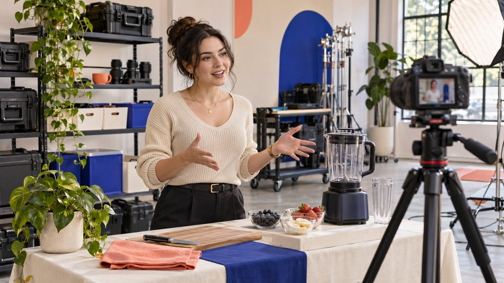
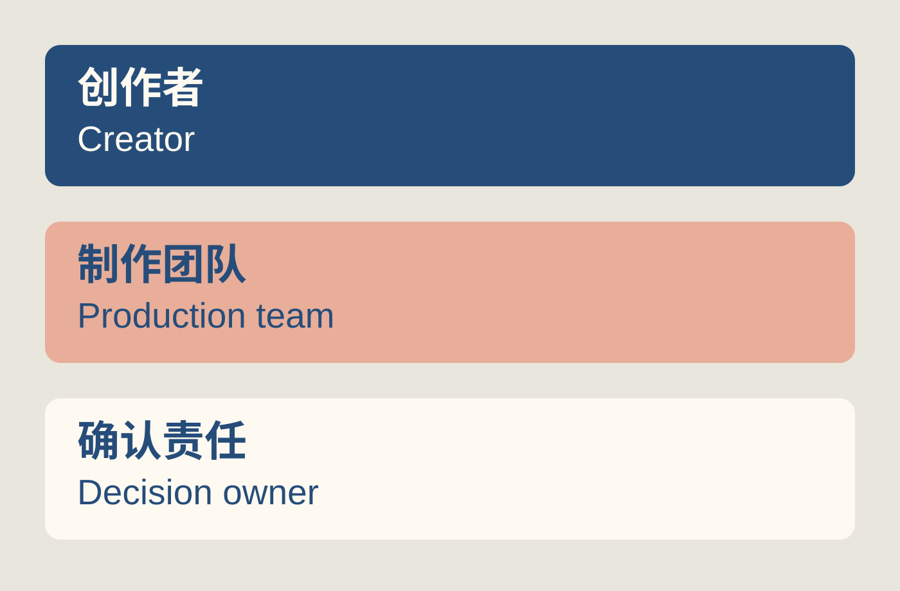

# Biggest YouTuber: Scope a Team-Run Partnership

Status: local review draft; confirm the publication date before release.

A largest-YouTuber subscriber record cannot confirm a partnership team. Preserve the record date, then align appearance, production, fact review and release responsibilities.

For a dated public subscriber record, Guinness lists MrBeast at 449 million subscribers on October 31, 2025. This is not a verified live ranking for November 2026. For a brand, the practical questions are who appears, who produces, who confirms product facts and who can approve release. Large channels may involve teams, but size does not establish particular personnel or availability. This article provides a proposal framework, not MrBeast’s internal organization or a guarantee that any named creator accepts the assignment.

## Define what biggest means

[Guinness’s YouTube subscriber record](https://www.guinnessworldrecords.com/world-records/most-subscribers-on-youtube) provides the figure and date above and notes that records can change without immediate publication. Retain the date when citing it rather than turn an older record into a complete ranking for today.

Subscribers, views on one upload, income and category scale answer different questions. This article uses a subscriber record only to explain the search context, not estimate private earnings or equate subscribers with guaranteed sponsor viewers.

If current information is needed, check appropriate sources and timing separately. More importantly, a scale record does not identify purchased work, team responsiveness or actual participants. Proposal research must continue beyond the name rather than assume all associated resources are already included in budget and schedule. A dated record can establish why a creator attracts attention, while a collaboration still needs its own evidence about the assignment. Keeping those purposes separate prevents a memorable number from silently becoming the commercial justification for every later production assumption.

## Treat team relationships as matters to confirm

A famous creator, channel brand, production company and business contact may hold different responsibilities. Verify through appropriate public business routes rather than infer full representation from a forwarded email or social portrait.

Ask who handles this proposal, which people may participate and which commitments still need confirmation. This does not require disclosure of the entire internal organization or private employee information unrelated to the job.

The [large-channel purchase-unit guide](https://www.quickkol.com/blog/biggest-youtube-channels-purchase-unit/#answer) discusses purchasable programs and publication scope. Here the focus extends to teamwork: who receives materials, confirms arrangements and answers changes. Only clear responsibility explains whether no problem confirms the concept, resources, personal participation or merely receipt of an email. A useful proposal can identify these questions without pretending the brand already knows the creator’s internal reporting structure. Let the counterpart confirm a workable route, then record the agreed responsibility rather than replace it with assumptions about how every large channel must operate.

## Separate appearance from production confirmation

Discussing a program does not confirm a particular person’s appearance. A production team’s ability to make a format does not automatically include the channel’s main host. Specify roles instead of making a channel name contain every meaning.

For a hypothetical assignment with hosting, detail shots and editing, confirm the presenter, filming arrangement and postproduction responsibility separately. If a team member hosting is proposed as an alternative, assess the actual task rather than continue describing it internally as the principal creator’s endorsement.

These are general production questions, not a description of MrBeast’s team. Each collaboration needs its own confirmation. Defined roles also let both parties assess a schedule or format change before discovering in the final video that they understood partnership with the channel differently. This can preserve a useful opportunity: a different arrangement may still explain the product well, provided it is evaluated and named accurately rather than accepted under a mistaken expectation about personal participation.

## Assign an owner able to confirm product facts

The brand should supply product version, supported statements and current business conditions, naming someone able to confirm them. Creator influence does not replace facts, and a production owner may not have authority to answer technical brand questions.

The diagram separates creator, production and decision responsibilities. Teamwork does not mean everyone can approve everything. Someone confirming that a shot is feasible may not have confirmed that its product statement is suitable for publication.

Version factual materials and explain changes between filming and release. Direct a concrete question to the relevant role instead of asking the entire team to confirm everything. Clear ownership reduces repeated feedback and prevents a presenter being asked to guess an unresolved performance or availability condition live on set. If the factual owner cannot yet confirm a statement, keep it pending rather than let production momentum turn an unfinished answer into a public claim simply because a camera and host are ready.

Team size is not approval evidence; each confirmation needs an actual owner.

## Platform permissions differ from commercial approval

[YouTube’s channel-permission guide](https://support.google.com/youtube/answer/9481328?hl=en) describes role-based channel capabilities without sharing a Google Account password. It explains platform access, not whether an actual contact can represent a company, approve fees or guarantee personal participation.

A brand generally does not need channel management access merely to review a proposal. Publishing should be performed by actually authorized people through an appropriate process rather than confuse material review with taking over an account.

Record who approves facts, who approves creative and who arranges release. Technical ability to upload does not establish that commercial and content conditions are satisfied. Make these checks before release instead of using a successful upload as retrospective proof that everyone agreed. This also reduces the risk of using an unfinished version. A producer can be ready with the file while a separate factual question remains open; the record should make that dependency visible instead of treating production readiness as permission to publish.

## Keep commercial context with each version

[YouTube’s branded-content labeling guide](https://support.google.com/youtube/answer/154235?hl=en) calls for applicable paid-promotion disclosure, with local requirements still relevant. Fame does not make viewers automatically aware of this collaboration’s context.

Creative work can retain the creator’s style while making the relationship clear. The brand and production team should inspect the finished version, not merely a script that once included a disclosure line. For short versions or another platform, review whether context survives.

Handle commercial context, claim support and asset permission separately. One label does not resolve every fact or use boundary. A large team especially needs ownership for each check so everyone does not assume another department completed it, leaving only an unsourced all approved. The record should show what was approved in which version, enabling a later editor to understand why a surrounding phrase or visual needs retaining rather than treating it as disposable material when shortening the piece.

## Schedule feedback around real dependencies

Unsettled facts, unconfirmed locations or pending personal participation affect production. Put dependencies into the schedule instead of supplying only a final publication date and expecting every role to fill the gaps automatically.

Classify feedback as factual, creative, technical or added scope and direct it appropriately. When approvers disagree, identify who coordinates rather than send contradictory instructions to the creator simultaneously.

Suppose a host needs the final product before preparation. Delayed delivery can change that time. Discuss the real impact instead of assuming a large team can absorb every change because it has resources. For a hypothetical device demonstration, the brand confirms the applicable model, production confirms detail filming, the presenter confirms preparation and the release owner checks the approved version. If the model remains unsettled, other preparation can be discussed without marking the whole partnership approved. List these dependencies individually so the next meeting identifies whose answer is needed, rather than repeat a general request for everyone to approve a package containing different unresolved questions. Defined feedback windows and versions make work more executable without guaranteeing availability. Reconfirm important changes under actual conditions. A clear dependency record also helps the brand understand whether an apparent delay concerns production work, a missing product decision or an unconfirmed participation request, so the next action reaches the person who can actually resolve it.

## Make unconfirmed matters visible in handoff

The [collaboration identity-map guide](https://www.quickkol.com/blog/instagram-accounts-collaboration-identity-map/#answer) separates people, accounts and business contacts. A large-team proposal should likewise preserve unconfirmed matters rather than turn internal hopes into external commitments.

The handoff identifies current version, factual owner, production scope, appearance arrangements and release conditions. Record an initial reply as an initial reply. If an alternative is agreed, update its accurate name rather than retain wording that now misleads.

Scale information is background, not a substitute for confirming work. A recipient should know whom to ask next, which information is missing and which decisions cannot yet be executed. Accurate records prevent an unfinished contact from becoming a confirmed top-creator partnership in another proposal. They also make a changed arrangement reviewable: someone can compare the confirmed role with the original need and decide whether it still serves the campaign, instead of being guided by the familiar creator name alone.

## Bring a major partnership back to defined contribution

Researching the biggest YouTuber should not stop at a subscriber record. Keep its date, while the collaboration needs its own roles, facts and decision support. Both can coexist without turning scale into a guarantee of every task.

A suitable proposal might involve the principal creator, a team presenter or another explicit arrangement. Accurate names, responsibilities and permissions let the brand assess actual work rather than infer every outcome from fame.

The result is a collaboration that can be discussed, produced and reviewed, with owners and unconfirmed dependencies. It describes no named team’s unpublished internal organization and guarantees no successful contact. It helps a brand know what to confirm when approaching a large creative organization. That makes the proposal useful even before acceptance: the next conversation can resolve a specific role or dependency instead of repeating a scale figure that never answered the production question in the first place.

## Who confirms a large-creator collaboration

| Matter | Confirmation | Cannot replace |
| --- | --- | --- |
| Personal participation | Actual role and version | Channel name or scale |
| Production | People, resources and dependencies | Factual and commercial approval |
| Product facts | Version and support scope | Fame and visual impact |
| Release | Authorized version and executor | Upload capability alone |

A general proposal framework, not MrBeast’s internal organization, availability or partnership commitment.

## Before approaching a major channel

Confirm scale and the assignment separately.

- [ ] Retain the record date and definition.
- [ ] Verify appropriate business contact and responsibility.
- [ ] Separate appearance, production and fact confirmation.
- [ ] Do not treat platform access as commercial approval.
- [ ] Arrange version, feedback and release dependencies.
- [ ] Keep unconfirmed matters visible in handoff.

## Research date and limitations

Sources reviewed November 16, 2026. Methods, tables and decision rules are editorial recommendations. Hypothetical examples are not actual client results or industry benchmarks. Source geography and periods are specified where relevant.

## Start creator research with a clear task

Use QuickKOL to interpret a brief, discover relevant creators and research their work and contact routes. Verify data, commercial terms and outcomes at their source.

[Explore QuickKOL](https://www.quickkol.com/#capabilities)

## Sources

- [Guinness’s YouTube subscriber record](https://www.guinnessworldrecords.com/world-records/most-subscribers-on-youtube)
- [YouTube’s channel-permission guide](https://support.google.com/youtube/answer/9481328?hl=en)
- [YouTube’s branded-content labeling guide](https://support.google.com/youtube/answer/154235?hl=en)
