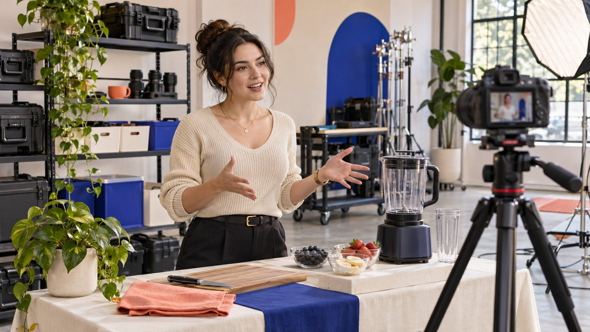
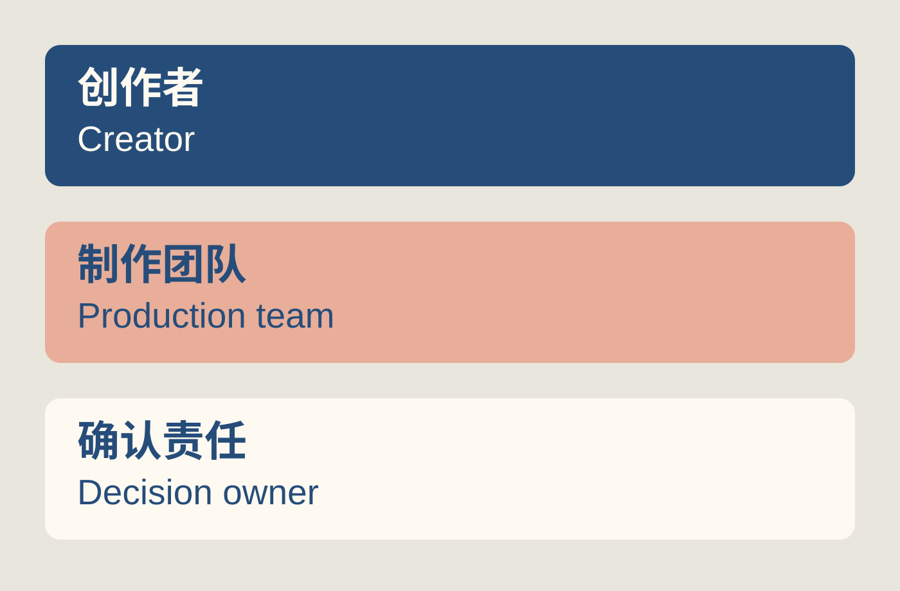

# 头部 YouTuber 怎样对齐团队任务

状态：本地审阅稿；正式发布日期待确认。

最大 YouTuber 的订阅纪录不能替品牌确认合作团队。先保留规模资料的日期，再对齐出镜、制作、事实审核与发布责任。

如果按吉尼斯公开的有日期订阅纪录看，MrBeast 在 2025 年 10 月 31 日为 4.49 亿订阅；这不是本篇对 2026 年 11 月实时排名的核验。对品牌更实际的问题，是合作中谁出镜、谁制作、谁确认产品事实与谁有权批准发布。大型频道可能由多人协作，但不能从规模推断具体团队与档期。本文提供提案框架，不描述 MrBeast 的内部组织，也不保证任何具名创作者可接受合作。

## 先给最大这个词明确口径

[吉尼斯的 YouTube 订阅纪录](https://www.guinnessworldrecords.com/world-records/most-subscribers-on-youtube)列明 MrBeast 的上述数量与日期，也提醒纪录可能变化且不会立即更新。品牌引用时应保留该日期，不把旧纪录排成今天完整排行榜。

订阅、单条观看、收入或某个品类的规模，是不同问题。本篇只用订阅纪录说明搜索词背景，不估计私人收入，也不把订阅人数等同于一条赞助的必达观众。

如果需要当前资料，应另核对适当来源与时间。更重要的是，规模记录无法说明品牌购买的工作、团队回应能力或实际参与人。提案研究要从这一点继续，而不是在找到一个名字后就假定其全部资源已经进入预算和排期。

## 把团队关系当作待确认事项

知名创作者、频道品牌、制作公司与商务联系人可能承担不同职责。研究应沿适当公开业务路径核对，不从一个邮箱转发或社交头像推断全部代表权限。

品牌可以先问谁负责这项提案、哪些人可能参与、哪些承诺仍需确认。它不是要求对方公开全部内部组织，也不必收集与工作无关的员工私人资料。

[大型频道采购单元指南](https://www.quickkol.com/zh/blog/biggest-youtube-channels-purchase-unit/#answer)讨论可购买的节目与发布范围。本篇进一步把讨论放到团队协作：谁能接收资料、谁能确认安排、谁能对改动回答。只有关系与责任明确，品牌才知道一句“没问题”究竟确认了概念、资源、本人参与，还是只是收到了邮件。

## 出镜确认与制作确认分开

同意讨论一个节目，不等于确认某位本人会出镜。制作团队能完成某种形式，也不自动代表频道主要主持人参与。提案应具体写角色，而不是用频道名包含全部含义。

例如假设合作需要主持演示、产品近景与剪辑。可以分别确认出镜者、摄影安排与后期责任。若创作者提出团队成员主持的替代，品牌应按实际任务评估，而不是把它在内部继续写成本人代言。

这些是通用制作框架，不是对 MrBeast 团队的描述。每项实际合作都需要自己的确认。把角色写清，也方便双方在档期或形式变化时讨论具体影响，而不是等成片出现才发现对“和某频道合作”的理解不同。

## 明确产品事实负责人

品牌应提供产品版本、可支持陈述与当前业务条件，指定能确认的人。创作者的影响力不替代这些事实，制作负责人也不一定有权回答品牌技术问题。

配图把创作者、制作与决定责任分开，提醒多人合作不是所有人都能批准所有事。一个人确认画面可拍，可能还没有确认某句产品陈述适合公开使用。

给事实资料标注版本，拍摄与发布之间有变化时说明影响。需要更改表达，就向对应角色提出具体问题，不向整个团队发模糊的“请全部确认”。明确责任可以减少重复反馈，也避免主持人在现场被要求替品牌猜测一个仍未确定的性能或供应条件。

团队规模不是审批依据；每项确认都需要实际负责人。

## 平台权限与商业批准不是同一件事

[YouTube 的频道权限说明](https://support.google.com/youtube/answer/9481328?hl=en)支持按角色分配频道能力，不需要共享 Google 账号密码。它说明平台访问机制，不证明某个实际联系人有权代表公司、批准费用或保证本人参与。

品牌通常不必取得创作者频道管理权限才能审阅方案。需要发布时，应由实际获准人员在合适流程执行，不把合作资料审阅混成账号接管。

内部确认可以注明谁批准事实、谁批准创意与谁安排上线。技术上能上传，并不等于商业与内容条件已经满足。把这些检查放在发布前，而不是用一次成功上传回头证明所有人都已经同意，也能减少误用未定稿版本的风险。

## 让商业说明跟着每个版本

[YouTube 的商业内容标识说明](https://support.google.com/youtube/answer/154235?hl=en)要求适用的付费推广关系使用相应披露，实际当地要求仍需考虑。频道有名并不会让观众自动知道本次合作背景。

创意可以保留创作者风格，同时让关系清楚。品牌与制作团队应在实际成片检查，不只看脚本文档曾写过一行说明。若后续做短版或跨平台素材，再确认背景是否保留。

商业说明与产品支持、素材许可分别处理。一个标签不自动解决全部事实与使用范围。大型团队尤其需要知道由谁检查哪一项，避免每个人都以为另一个部门已经完成，最终只剩一个来源不明的“全部通过”。

## 按依赖安排反馈与排期

产品事实未定、场地未确认或本人参与待定，都会影响制作。把依赖写进排期，不要只给一个最终发布日期，再要求所有角色自动填补缺口。

反馈按事实、创意、技术与新增范围分类，交给能处理的人。两位审批人意见冲突时，需要明确谁协调，不把所有相反意见同时丢给创作者执行。

假设主持人需要先看最终产品，寄送延迟就可能改变准备时间。应讨论实际影响，而不是假设大型团队资源多就能吸收所有变化。例如一项假设设备演示，品牌先确认适用型号，制作负责人确认近景安排，主持人确认讲解准备，发布人再确认获准版本。若型号仍待定，其他准备可以讨论，但不能把整项合作标为完全通过。把依赖逐项列出，下一次会议才知道需要谁的答案。明确反馈窗口与版本可以提高合作可执行性，但不等于保证档期；每次重要改动仍需按真实条件确认。

## 交接时写明哪些仍未确认

[合作身份地图指南](https://www.quickkol.com/zh/blog/instagram-accounts-collaboration-identity-map/#answer)帮助区分人、账号与商业联系。大型团队提案也应保留待确认事项，不把内部希望写成对外承诺。

交接材料说明当前版本、事实负责人、制作范围、出镜安排与发布条件。若只是获得初步回复，就如实记录；若某项替代已同意，则用准确名称更新，不沿用原来可能误导的说法。

规模记录在这里属于背景，不能覆盖实际工作确认。负责人接手后应能知道下一步问谁、缺什么资料与哪些决定还不能执行。资料越准确，越能避免品牌在另一个提案里，把一次尚未成形的联系写成已确定头部达人合作。

## 让头部合作回到明确贡献

品牌研究 biggest YouTuber，不应止于一个订阅纪录。纪录保留日期，合作则需要自己的角色、事实与决定依据。两者可以同时存在，不必把规模改写成一切工作的保证。

合适提案可能由创作者本人、团队主持或其他明确安排完成。只要名称、职责与许可准确，品牌就能按真实任务评价，不从知名度推断所有结果。

最后交付的是一项可讨论、可制作与可审核的合作，附有负责人与未确认依赖。它既不描述任何具名团队未公开的内部情况，也不承诺联系一定成功，而是让品牌在面对大型创作组织时知道自己真正需要确认什么。

## 大型创作者合作需要谁确认

| 事项 | 确认内容 | 不能替代 |
| --- | --- | --- |
| 本人参与 | 实际角色与版本 | 频道名或规模 |
| 制作 | 人员、资源与依赖 | 事实与商业批准 |
| 产品事实 | 版本与支持范围 | 知名度与视觉效果 |
| 发布 | 获准版本与执行人 | 仅有上传能力 |

通用提案框架，不是 MrBeast 内部组织图、档期或合作承诺。

## 联系头部频道之前

把规模与实际任务分别确认。

- [ ] 给纪录保留日期与口径。
- [ ] 核对适当业务联系与责任。
- [ ] 分开出镜、制作与事实确认。
- [ ] 不把平台权限当作商业批准。
- [ ] 安排版本、反馈与发布依赖。
- [ ] 在交接中保留未确认事项。

## 研究日期与使用边界

资料核验于 2026 年 11 月 16 日。文中方法、表格和决策规则为编辑建议，标为假设的示例不是实际客户结果或行业基准。外部资料的适用地区与时期按各段说明。

## 从任务开始达人研究

用 QuickKOL 理解 Brief、发现相关达人并研究作品与联系路径；数据、合作条件和结果仍需核验。

[了解 QuickKOL](https://www.quickkol.com/#capabilities)

## 来源

- [吉尼斯的 YouTube 订阅纪录](https://www.guinnessworldrecords.com/world-records/most-subscribers-on-youtube)
- [YouTube 的频道权限说明](https://support.google.com/youtube/answer/9481328?hl=en)
- [YouTube 的商业内容标识说明](https://support.google.com/youtube/answer/154235?hl=en)
