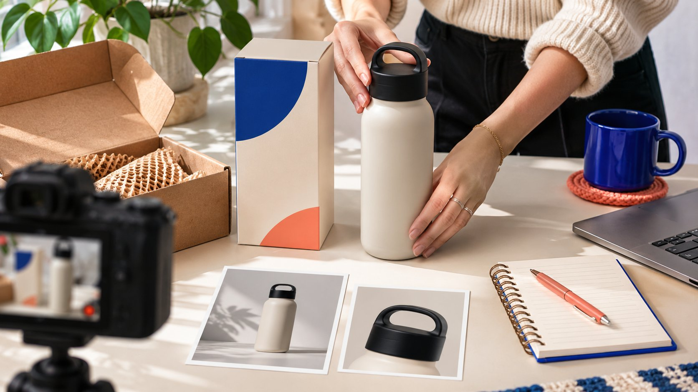
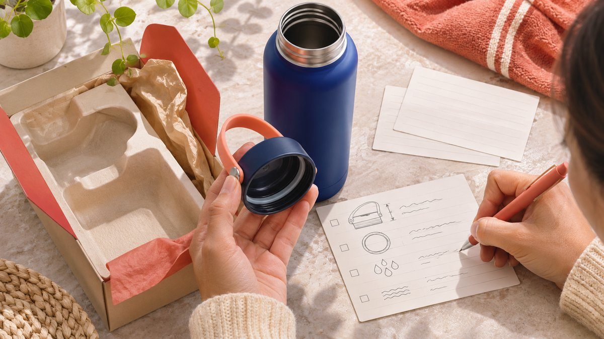

# Butterly: Plan a Product Trial

Status: local review draft; confirm the publication date before release.

Understand Butterly within product experience and creator collaboration: shipping, honest reviews, social publication and paid reuse need separate decisions.

Here, Butterly means the product-trial and consumer-content platform. Its connection to influencer marketing is relevant participants creating content from actual experience, rather than a shipped product purchasing praise. Separate trial, review, social publication and later paid use, then confirm the task, conditions and permission for each. This article reviews public platform information; it does not claim to have run a campaign, audited results or guaranteed selection. Genuine opinions, clear commercial context and accurate use scope should remain central throughout the collaboration.

## Identify the platform and collaboration type

[Butterly’s community overview](https://butterly.com/) lists product trials, brand social programs and surveys as different opportunities, and relates points to future selection chances. This should not become a promise of fixed cash income, automatic selection or identical tasks across activities.

Start by describing the participant’s actual contribution. To learn about everyday experience, the task can focus on observation and feedback. To commission social content, specify format, publication location and relevant conditions. Different purposes should not disappear into one product-experience label.

Creators likewise need to know whether they are applying for a trial, accepting production work or agreeing to publication. Similar entry points do not establish identical obligations. At research stage, retain public descriptions and questions, then check this assignment’s terms before execution rather than infer an arrangement from another campaign. A clear distinction helps both sides judge whether the invitation fits their expectations before a parcel, deadline or planned media placement makes an assumption harder to correct.

## Make the experience question specific

A hypothetical bottle trial might ask about opening, carrying situations and details worth showing. It should not prescribe liking the product or turn one use into proof of durability or health effects.

Supply necessary product information and reasonable experience conditions while allowing participants to record what did not suit them, cannot be judged or has not yet been experienced. If a question needs time, do not demand a settled conclusion immediately after delivery.

The [UGC contribution-intake guide](https://www.quickkol.com/blog/ugc-content-customer-contribution-intake/#answer) expands the original context of experience content. For this assignment, retain conditions, observation dates and specific statements so the brand can distinguish facts from preferences. Specific questions make feedback useful; requiring identical praise removes meaningful variation and improvement information. A participant who cannot answer a question yet should have a way to say so without inventing a result merely to make the submission look complete. That is an editorial design choice the brand can make before recruiting anyone.

## Agree on review and production separately

A review expresses the participant’s actual experience. Social production also involves images, language, editing and publication. A brand can set clear technical requirements without using acceptance to turn an honest opinion into predetermined praise.

Unclear audio and insufficient enthusiasm are different issues. The former can be corrected under the agreed task; the latter should preserve actual experience rather than require every reservation removed. If a fact is wrong, identify the specific error and support for its correction.

List required and optional tasks. Receiving a product does not automatically mean providing raw footage, extra cuts or continuing appearances. Knowing the contribution under discussion makes time and fees assessable and prevents an experience assignment quietly expanding into an advertising package midway through delivery. A useful review comment should therefore identify whether it concerns factual accuracy, technical usability or a new request, so the recipient has a fair way to respond instead of guessing what approval actually depends on.

## Keep observation conditions with the content

The container, packaging and notebook in the photograph illustrate preparation for observation, not a completed product assessment. Production should record experience that actually happened rather than convert filming props into test results.

Suppose a participant says an opening was convenient during this use. Retain the relevant conditions. A later cut leaving only very convenient may imply a broader conclusion. Editors need to know which statements limit scope and which images merely illustrate.

When a product, version or situation changes, review whether older material still fits. Do not move experience with another accessory or earlier model onto a new product page without appropriate context. Save basic background and permission with the file so later teams can assess it accurately instead of deciding meaning from an attractive image alone. A short internal note about the actual version and observation is more useful than a folder label saying approved, which cannot explain why the content was suitable for one original use.

Record conditions and specific observations without treating production preparation as a completed review result.

## Make the gifted relationship clear

[Canada’s Competition Bureau influencer guidance](https://competition-bureau.canada.ca/en/deceptive-marketing-practices/types-deceptive-marketing-practices/influencer-marketing-and-competition-act) identifies free products as a potentially material connection and says reviews should reflect actual experience. This is Canadian official guidance, not a determination that a particular campaign is lawful in every market.

The brand should explain the arrangement to participants and review what audiences can actually understand rather than describe gifting only internally. Commercial context and honest opinion can coexist: receiving a product does not require enthusiasm or substantiate every performance claim.

For another platform or format, check whether that context remains clear. Handling one version does not remove review of all later crops. Confirm the real market and campaign conditions appropriately; this article supplies a research and editorial framework rather than professional review of a specific agreement. Assign someone to inspect the final public version so a statement drafted for one placement is not assumed to remain understandable after the content is shortened, embedded or presented beside different surrounding copy.

## Organic reposting differs from paid use

[Butterly’s brand FAQ](https://butterly.com/faq-for-brands) describes credited organic reposting and says paid amplification needs the advocate’s explicit permission. This reports the provider’s public scope; it does not confirm authorization for any particular asset.

For execution, describe the intended account, format, time, market, edits and raw-material needs. Check whether music, other people or third-party elements require separate handling. One permission action does not resolve every right.

If a review later becomes an advertisement, discuss scope and conditions again. A file on the brand’s computer, or a participant’s willingness to share, does not mean every future use is included. Permission should follow the actual use and remain understandable to later editors. Record the relevant decision beside the material rather than leave it in a private conversation that the person preparing a new placement cannot access. Where permission is missing, keep that proposed use pending instead of treating the absence of an objection as an agreement.

## Use metrics for separate questions

Completion can concern delivery, finished tasks or usable content. Audience response concerns a platform and observation window. Commercial outcomes need appropriate sources and attribution conditions. They should not all become sales lift.

A count of favorable reviews is not representative consumer research. Selecting only people who liked a product does not establish unanimous opinion. Record participation conditions, missing feedback and the statistical scope to understand the question answered.

Suppose ten submissions arrive but two participants have not completed the experience. Do not describe all ten as confirmed positive reviewers. Report received, reviewable and awaiting-information counts accurately. That helps the brand plan its next action instead of merging different states into an attractive completion percentage. This is a hypothetical recording example, not a platform result. Keep the denominator next to any proportion so someone reading the report later can distinguish participants invited, products delivered and actual completed observations without trying to reconstruct the campaign from a single headline number.

## Connect budget to added work

Discuss budget through research purpose, participation, fulfillment, format and use. Confirm actual quotations, campaign fit and participant conditions with the provider rather than infer fixed pricing or guaranteed return from an introduction.

The [JoinBrands content-and-publication acceptance guide](https://www.quickkol.com/blog/joinbrands-content-posting-acceptance-brief/#answer) discusses receiving different deliverables. Here too, define the current task before adding publication or advertising use. A new use is not an automatic extension of a review and may need further agreement and resources.

Allow time to handle feedback. Delivery, actual experience, production and review do not automatically finish on the same day. A plan reflecting those dependencies is more reliable than one deadline that pressures participants to describe experience that has not happened. When conditions change, identify the affected work so both parties can make a concrete choice. For example, a delayed parcel should lead to a schedule discussion about the observation task, not an instruction to produce the same conclusion before the participant has had the product.

## Turn platform research into a concrete proposal

The final proposal should state why the brand needs participant content, what people will actually do, where uncertainty or reservations remain acceptable, who handles commercial context and how later use will be confirmed. The platform name does not answer these questions.

The appropriate collaboration may gather experience, produce social content or add advertising after separate permission. These can connect while retaining distinct conditions. For the hypothetical bottle project, first decide whether the need is an opening observation or a public short video, then confirm delivery and use separately. Do not present trials as stable income or provider descriptions as independently verified performance.

Butterly’s useful connection to influencer marketing is how real participants contribute content with context and boundaries. Research is complete when both sides can understand and discuss a defined task while preserving honest opinions and accurate use, rather than when the proposal accumulates more promotional phrases. The working document should make the next decision visible, including any unanswered permission or experience question, so a future team does not mistake an appealing concept for an arrangement that has already been confirmed.

## Four separate product-experience decisions

| Stage | Confirm | Do not assume |
| --- | --- | --- |
| Product trial | Actual conditions and observation questions | Guaranteed enthusiasm |
| Honest review | Experience, reservations and commercial context | Review equals an advertising script |
| Social content | Format, technical task and publication | Shipping includes extra production |
| Later use | Use, permission and related rights | Organic sharing covers all advertising |

An editorial research framework, not a platform guarantee, quotation or obtained permission.

## Before sending a trial invitation

Define the task without prescribing the opinion.

- [ ] Confirm the activity and participation conditions.
- [ ] Ask experience questions that can genuinely be answered.
- [ ] Separate review, production and publication.
- [ ] Preserve genuine views and unanswered questions.
- [ ] Review commercial context and specific permission.
- [ ] Report sources, windows and task states.

## Research date and limitations

Sources reviewed November 16, 2026. Methods, tables and decision rules are editorial recommendations. Hypothetical examples are not actual client results or industry benchmarks. Source geography and periods are specified where relevant.

## Start creator research with a clear task

Use QuickKOL to interpret a brief, discover relevant creators and research their work and contact routes. Verify data, commercial terms and outcomes at their source.

[Explore QuickKOL](https://www.quickkol.com/#capabilities)

## Sources

- [Butterly’s community overview](https://butterly.com/)
- [Canada’s Competition Bureau influencer guidance](https://competition-bureau.canada.ca/en/deceptive-marketing-practices/types-deceptive-marketing-practices/influencer-marketing-and-competition-act)
- [Butterly’s brand FAQ](https://butterly.com/faq-for-brands)
