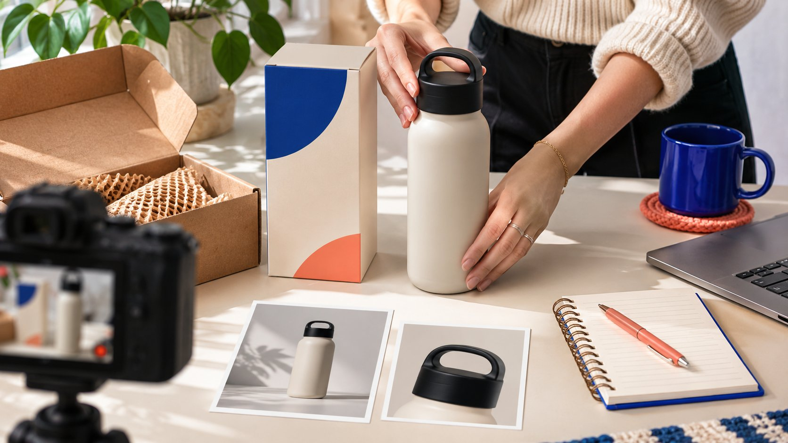
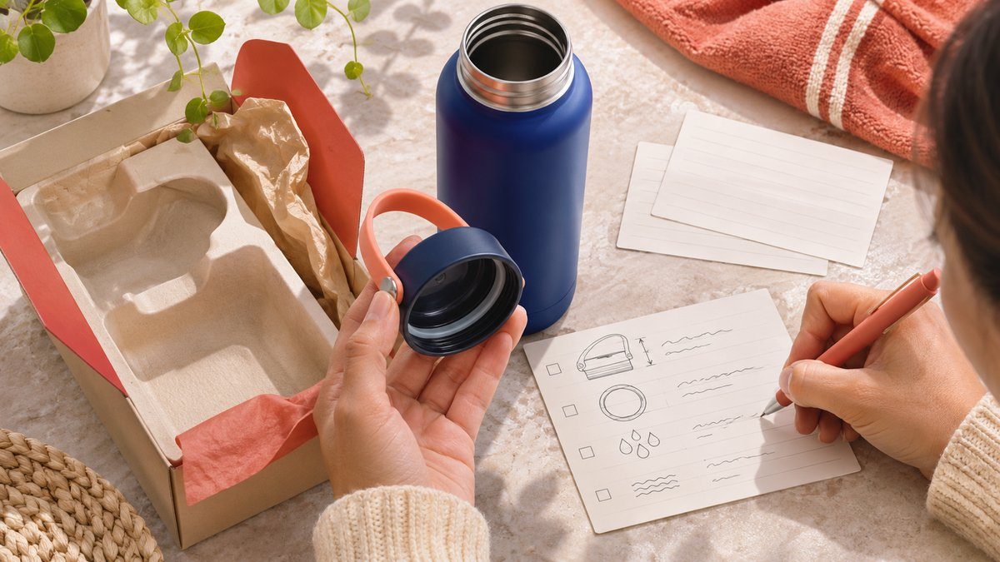

# Butterly 合作怎样保留真实意见

状态：本地审阅稿；正式发布日期待确认。

将 Butterly 放在品牌体验与创作者合作框架里理解：产品寄送、真实评价、社交发布和付费复用需要分别确定。

这里的 Butterly 指产品体验与消费者内容平台。对品牌而言，它与达人营销的连接是让适合的参与者基于实际体验创作内容，而不是把寄出产品等同于购买好评。先区分试用、评价、社交发布与后续付费使用，再确认各自任务、条件和许可。本文按公开平台说明研究，不代表实际运行过项目、核验过效果或保证任何申请被选中。真实意见、清楚商业背景与准确使用范围，应贯穿合作。

## 先确认平台与合作类型

[Butterly 的社区说明](https://butterly.com/)把产品试用、品牌社交合作与调查列为不同机会，并说明积分与未来被选中机会有关。不要把这理解成固定现金收入、自动入选或所有活动都提供相同任务。

品牌先写需要参与者实际贡献什么。如果要了解日常体验，任务可以围绕观察与反馈；如果要一段可制作的社交内容，就要说明形式、发布位置与相关条件。不同目的不该靠一个“体验合作”名称全部合并。

创作者也需要知道自己是在申请试用、接受制作任务，还是同意某种发布。入口相似不代表义务相同。研究阶段保留公开描述与待确认问题，实际执行前再核对本次条款，不从其他活动推断自己的安排。

## 把体验问题写具体

一项假设水杯体验可以问开合是否方便、在什么场景携带、哪些细节值得展示。它不应预先规定必须喜欢，也不把一次使用扩展成耐久或健康效果证明。

给参与者必要产品信息与合理体验条件，同时允许记录不适合、无法判断或尚未体验的部分。如果必须使用一段时间才能回答某个问题，就不要在产品刚到时要求确定结论。

[UGC 用户贡献接收指南](https://www.quickkol.com/zh/blog/ugc-content-customer-contribution-intake/#answer)进一步讨论体验内容的原始语境。本次任务可以保留使用条件、观察日期与具体表述，让品牌区分产品事实和个人偏好。问题越具体，反馈越容易有价值；强迫每个人说同一句赞美，反而让真实差异与可改进信息消失。

## 评价与内容制作分别约定

评价是参与者对真实体验的表达；社交内容还涉及画面、语言、剪辑与发布任务。品牌可以提出清晰技术要求，却不能用“验收”把真实意见改成预设好评。

例如视频声音不清与评价不够积极，是不同问题。前者可以按约定讨论补充或修正；后者需要保留实际体验，而不是要求删去所有保留意见。内容事实有误，也应指出具体事实与依据。

把必需任务和可选任务列清。收到产品不自动表示同意提供原始素材、额外短版或长期出镜。双方知道正在讨论哪项贡献，才能合理安排时间与费用，也能避免原本的体验反馈在中途被悄悄扩大成一套广告制作交付。

## 让观察条件跟着素材走

本页配图中的容器、包装与笔记展示一种准备观察的工作场景，不代表某产品已经得到评价。内容制作应记录真正发生的体验，而不是把拍摄道具自动写成测试结果。

假设参与者说明某个开口在这次使用中方便，应保留相应条件。如果后续剪辑只留下“非常方便”，观众可能理解成更广泛结论。编辑需要知道哪些语句限定了范围，哪些镜头只是展示。

产品、版本或使用场景发生变化时，重新检查旧素材是否仍适合。不能把不同配件或旧款体验无说明地移到新产品页面。保存文件时连同基本背景与许可记录，才有助于后续团队准确判断，而不是仅凭一张漂亮图片决定它可以表达什么。

把体验条件与具体观察记录下来，避免把拍摄准备当成已证实的评价结果。

## 把赠品关系说清楚

[加拿大竞争局的达人指导](https://competition-bureau.canada.ca/en/deceptive-marketing-practices/types-deceptive-marketing-practices/influencer-marketing-and-competition-act)把免费产品列为可能影响观众判断的重要关系，并要求评价基于实际体验。这是加拿大官方指导，不等于本篇替所有市场判断具体项目是否合法。

品牌要让参与者知道本次连接关系，审阅时看观众实际能否理解，而不是只在内部资料说明赠品。商业背景与真实意见可以同时存在；说明收到产品不意味着评价必须积极，也不自动支持所有性能陈述。

若内容跨平台或改成不同形式，应重新检查背景是否仍清楚。不能认为某一版已经处理，后续所有裁切就不需要看。实际地区和项目条件仍需适当确认；本篇提供研究与编辑框架，不代替具体合作的专业审查。

## 自然转发不等于付费使用

[Butterly 的品牌常见问题](https://butterly.com/faq-for-brands)称，品牌自然转发应注明参与者账号；付费放大需要另取得参与者明确许可。这里是在转述提供方公开范围，并非本篇替某段素材确认已获得许可。

执行时把想做的用途说具体：哪个账号、哪种形式、什么时间与地区，是否剪辑、是否使用原始素材。还要检查音乐、其他人物或第三方元素是否需要另外处理。一个许可动作不能自动替代所有权利确认。

如果后来想把评价改成广告，重新讨论范围与条件。不要因为文件已在品牌电脑，或参与者愿意分享，就认为任何未来使用都已包含。许可应跟着实际用途走，并让后续编辑知道边界在哪里。

## 指标分别回答不同问题

项目完成度可以看产品是否送达、任务是否完成、内容是否可用；观众反应可以看对应平台与窗口下的互动；商业结果则需要适当来源与归因条件。它们不应都被写成销售提升。

正面评价数量不等于代表性消费者研究，也不能只保留喜欢产品的人再宣称所有人意见一致。记录参与条件、缺失反馈和统计范围，才知道数字回答什么问题。

假设收到十份内容，其中两份尚未完成体验，就不要把十人都写成确认喜欢。报告可以准确说明已收到、可审阅、待补充的数量。这样的信息有助于品牌安排下一步，而不是通过合并不同状态制造一个好看的完成率。本例仅用于解释记录方法，不是平台实际结果。

## 把预算与新增任务对应

预算可以按研究目的、参与安排、寄送、内容形式与使用范围讨论。平台具体报价、活动是否适合品牌，以及参与条件，需要向提供方确认，不从一篇介绍推断固定价格或保证回报。

[JoinBrands 内容与发布验收指南](https://www.quickkol.com/zh/blog/joinbrands-content-posting-acceptance-brief/#answer)讨论不同交付的接收。本篇同样建议先定义当前任务，再讨论追加社交发布或广告使用。新增用途不是原评价的自然延伸，可能需要额外协商与资源。

品牌也应保留反馈处理时间。产品到达、实际体验、内容制作与审稿不是同一天自动完成。让计划反映真实依赖，比用统一截止时间逼参与者写尚未发生的体验更可靠。条件改变时，说明改动影响哪项任务，双方才能作出具体选择。

## 把平台研究转成具体提案

最终提案应写清品牌为什么需要体验者内容，参与者将实际做什么，哪些反馈可以未知或保留意见，谁处理商业背景，以及后续使用如何确认。平台名称本身不是这些问题的答案。

适合的合作可能是收集体验，也可能是制作社交内容，或在另行许可后进行广告使用。它们可以连接，但每一步都有独立条件。不要以假设水瓶项目为例，先确定需要开合观察还是公开短片，再分别确认交付与使用。不要把产品试用写成稳定收入机会，也不把品牌自述当作独立验证效果。

Butterly 与达人营销的合理连接，在于真实参与者如何贡献有背景、有边界的内容。完成研究的标志不是找到更多宣传语，而是双方能看懂并讨论一项明确任务，同时保留真实意见与准确使用的空间。

## 体验合作的四项独立决定

| 环节 | 确认事项 | 不能默认 |
| --- | --- | --- |
| 产品试用 | 实际条件与观察问题 | 必定喜欢 |
| 真实评价 | 经历、保留意见与商业背景 | 评价等于广告脚本 |
| 社交内容 | 形式、技术任务与发布 | 寄送即包含额外制作 |
| 后续使用 | 用途、许可与相关权利 | 自然分享包括所有广告 |

编辑研究框架，不代表平台保证、具体报价或已取得许可。

## 发出体验邀请之前

把任务与意见分开约定。

- [ ] 确认具体活动与参与条件。
- [ ] 提出可真实回答的体验问题。
- [ ] 区分评价、制作与发布。
- [ ] 保留真实意见与未判断部分。
- [ ] 检查商业背景与具体许可。
- [ ] 报告来源、窗口与任务状态。

## 研究日期与使用边界

资料核验于 2026 年 11 月 16 日。文中方法、表格和决策规则为编辑建议，标为假设的示例不是实际客户结果或行业基准。外部资料的适用地区与时期按各段说明。

## 从任务开始达人研究

用 QuickKOL 理解 Brief、发现相关达人并研究作品与联系路径；数据、合作条件和结果仍需核验。

[了解 QuickKOL](https://www.quickkol.com/#capabilities)

## 来源

- [Butterly 的社区说明](https://butterly.com/)
- [加拿大竞争局的达人指导](https://competition-bureau.canada.ca/en/deceptive-marketing-practices/types-deceptive-marketing-practices/influencer-marketing-and-competition-act)
- [Butterly 的品牌常见问题](https://butterly.com/faq-for-brands)
