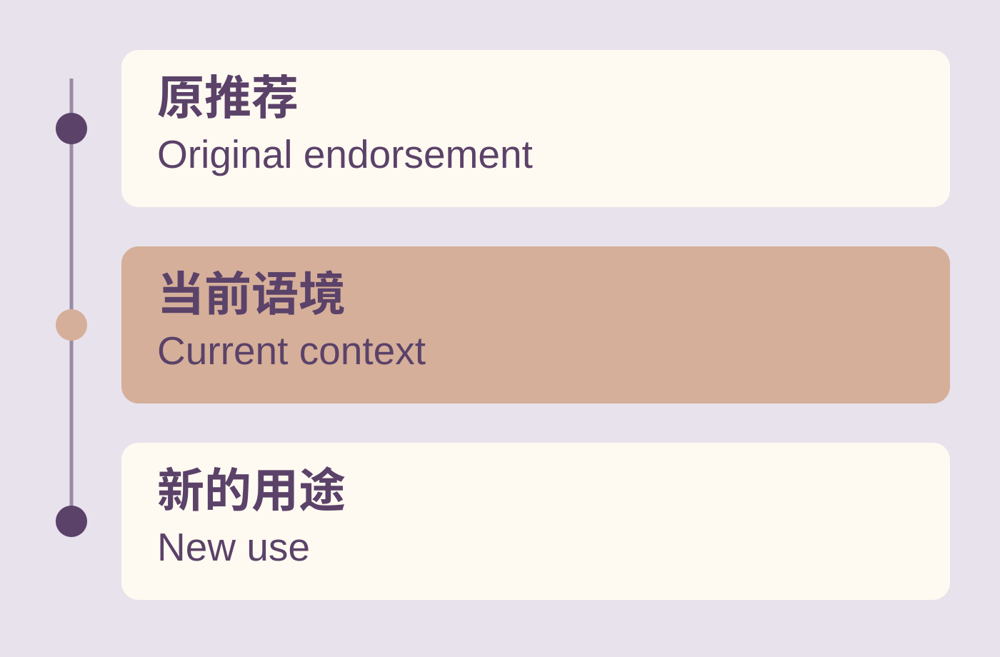

# Famous YouTuber: Preserve an Endorsement’s Context

Status: local review draft; confirm the publication date before release.

A famous YouTuber mentioning a product does not establish a current endorsement or unrestricted brand reuse. Check the original expression, current product and proposed new use separately.

For a brand, researching a famous YouTuber should not turn a remembered expression of liking into a current endorsement. Find the complete original work, identify the product, conditions, relationship and actual opinion, then confirm permission and current suitability for the proposed use. Public viewing is not advertising permission, and an accurate excerpt does not itself secure rights. This article connects fame to actual work and collaboration without inventing rankings or inferring a named creator’s present private opinion.

## Move from memory to a specific work

A colleague may remember a presenter recommending the brand, but memory is not a publishable source record. Locate the original work and date, identify the actual passage and avoid inferring its complete meaning from compilations or retellings.

If the original cannot be found, retain a research lead rather than a confirmed recommendation. Similar products, different versions or another presenter’s statement may have merged in retelling. Fame makes a name recognizable without replacing provenance.

The [popular-creator identity guide](https://www.quickkol.com/blog/popular-youtuber-identity-program-verification/#answer) separates people, programs and accounts. This article continues after locating the work: determine which expression is relevant to the assignment instead of borrowing a familiar face to strengthen a proposal. Accurate facts support a reasonable contact and permission discussion. They also prevent the brand from approaching a creator with a claim about what they supposedly said that the original work does not support, an avoidable misunderstanding that can weaken an otherwise relevant collaboration invitation.

## Review the complete expression and its limits

A compliment may concern one detail and be followed by a limitation for another situation. Preserve surrounding context, actual product and experience conditions rather than turn a limited opinion into an unconditional recommendation.

[US endorsement-guidance context provisions](https://www.ecfr.gov/current/title-16/chapter-I/subchapter-B/part-255/section-255.1) emphasize honest opinions and avoiding distortion through decontextualized presentation or rewording in the US. They supply general context, not a legal determination for this use.

Place the proposed excerpt beside the original passage and ask whether it still communicates the same opinion. If fitting an advertising duration requires removing a crucial qualification, change the format or seek suitable new expression instead of using length as a reason to alter the view. Accuracy is not merely correct spelling; it includes the question the statement actually answered. A sentence that praised portability, for example, should not be placed beside copy implying a separate performance guarantee that the creator never assessed in the original work.

## An existing video does not establish a current relationship

An older recommendation may come from independent content, an earlier collaboration or one experience. Its continued public availability does not establish an ongoing commercial relationship or justify calling the person our ambassador today.

Distinguish historical expression from this invitation. A brand can accurately mention research into a public work and ask about current terms. It should not describe unmade contact as a confirmed project or extend an earlier agreement to every future product.

If a page describes past collaboration, retain appropriate date and context and have its actual wording reviewed. New advertising distribution, changed products and new endorsement meanings need confirmation. An old link remaining accessible does not resolve every current-use question. The proposal should therefore distinguish what is known about the earlier work from what the brand is requesting now, allowing the creator to respond to a genuine new opportunity rather than to an assumed continuing obligation.

## Reassess the endorsement when the product changes

The diagram separates original endorsement, current context and new use. A changed model, formulation, function or important condition may no longer match the earlier experience. Do not merely place new packaging beside old footage.

Suppose a creator discussed a portable device’s connection method and the new version has another interface. The earlier opinion can remain a historical statement, while the brand actively reusing it to promote the revision creates a different meaning requiring review.

Check more than visual consistency: ask whether the opinion can still be represented accurately. Without suitable confirmation, do not make the old passage an endorsement of the new version. Use accurate product explanation or discuss a new assignment rather than borrow fame to fill an experience that never occurred. This does not mean every older work must disappear; it means the brand’s proposed new use needs its own assessment rather than inheriting suitability from the original publication date.

A genuine original expression does not make every new use accurate or authorized.

## Handle accurate excerpts and permission separately

[YouTube’s copyright explanation](https://support.google.com/youtube/answer/2797466?hl=en) discusses rightsholders and routes such as permission, applicable licenses or exceptions. Public upload is not unrestricted advertising permission, and an exception does not automatically apply because an excerpt is short.

Even a faithful excerpt needs review of actual use and related rights. Creator agreement, music, photography and other people can require different handling. A contact acknowledging receipt does not establish every right.

Specify account, platform, format, duration, market and editing scope for appropriate review of the real circumstances. This article declares no asset cleared and supplies no fixed workaround for permission. Keep meaning and rights as separate review tracks so accurate material is not placed into an unconfirmed use. The asset record should point to the relevant authorization rather than simply say approved, because a later team needs to know what was approved and whether the new placement falls within that actual scope.

## Review commercial context when republishing

[FTC’s endorsement-guidance FAQ](https://www.ftc.gov/business-guidance/resources/ftcs-endorsement-guides-what-people-are-asking) discusses honest, nonmisleading recommendations and material commercial relationships in the US. A brand reusing content should not assume the original platform’s context automatically follows it into a new advertisement or page.

A disclosed video can become only a product compliment after cropping. An independent review may also appear to be a current commissioned endorsement under a brand’s new presentation. Review the actual relationship and likely meaning together.

Inspect text, audio, images and surrounding page in the finished format rather than only whether the source was public. Commercial disclosure does not substantiate product efficacy or replace permission. Keep those checks separate instead of treating one disclosure action as the answer to everything. A practical review identifies the relevant relationship for the proposed placement and asks whether viewers can understand it there, not whether someone could discover the original context after searching for a different upload.

## Track whether editing changes the opinion

Editing can change order, captions, translation or image pairing. Check whether each change expands, narrows or alters the original opinion rather than compare file length alone.

The [product-claims review guide](https://www.quickkol.com/blog/creator-product-claims-review/#answer) connects statements to support. Here also examine whether the creator’s view became another evaluation the brand preferred. Fluent translation does not establish equivalent meaning, and a new headline can turn limited experience into a broad promise.

Have capable people review the actual language and finished version, retaining unconfirmed matters. If the creator needs to reconfirm, supply the proposed version and use rather than ask may we keep using it while hiding changes. Add a version comparison to the hypothetical project: the original passage describes convenient opening during that use, while a new headline claims all-weather durability. Return that conflict to the content discussion instead of having an editor quietly remove words. If the brand changes the assignment, identify which older opinions no longer support it and explain what needs reassessment to the creator. A precise question is easier to review than a general request to approve all future reuse. Concrete material reduces misunderstanding and lets the person respond to the actual expression. A versioned approval should remain connected to that material so later edits are not assumed covered simply because someone agreed to a different cut in an earlier conversation.

## Rehearse the boundaries with a hypothetical reuse

Suppose a brand finds a public video of an adult presenter discussing an older bottle. The original statement concerns opening it, while the brand wants a cut for a new durability advertisement. Confirm the source and original conditions rather than treat a recognizable face as current evidence.

First consider opinion: opening experience does not establish durability. Then product: does the revision still match that experience? Next, use: are the new advertising permission and related rights confirmed? Finally, relationship: what will viewers understand from this presentation?

If a necessary question remains unresolved, keep the clip unused and discuss new content. The original opinion need not be called wrong, and the creator should not be required to reshoot unconditionally. This is a hypothetical example, not an actual partnership. It shows how a true expression can remain unsuitable for a new brand purpose. A brief can retain the useful observation that the presenter explains product details clearly, while the proposal separately requests a fresh task instead of claiming the old footage already completes it.

## Connect fame to a real collaboration

The final research record should identify the original work, opinion scope, changes in product and use, and confirmed permissions and relationships. A famous name in a proposal does not automatically transfer audience trust.

A brand can make a specific invitation based on relevant work and let the creator decide whether to undertake the current task. Fresh expression may match present facts more directly than an unconfirmed older passage, while still needing scope and review.

Within influencer marketing, a famous YouTuber’s value should connect to actual contribution, accurate opinion and appropriate permission. The deliverable is not an invented fame ranking, but a content arrangement both sides understand and a record later teams can use correctly. That record should remain useful when someone proposes another crop, product page or market, because it explains the reasons and boundaries behind approval rather than simply preserving a familiar face in a shared folder.

## Four separate checks for endorsement reuse

| Question | Check | Do not assume |
| --- | --- | --- |
| Original opinion | Complete work and qualifications | An excerpt preserves all meaning |
| Current product | Version and changed conditions | Old experience covers a revision |
| Use rights | Specific use and relevant permissions | Public viewing means advertising permission |
| Relationship context | Actual relationship and final presentation | Historical recommendation means current endorsement |

An editorial research framework, not copyright clearance or a legal determination.

## Before reusing an endorsement

Connect fame to a specific work and use.

- [ ] Locate the original work and date.
- [ ] Preserve the opinion and experience conditions.
- [ ] Check whether the product changed.
- [ ] Confirm permission and relevant third-party rights.
- [ ] Review commercial context in the new version.
- [ ] Hand over versions and confirmation scope clearly.

## Research date and limitations

Sources reviewed November 16, 2026. Methods, tables and decision rules are editorial recommendations. Hypothetical examples are not actual client results or industry benchmarks. Source geography and periods are specified where relevant.

## Start creator research with a clear task

Use QuickKOL to interpret a brief, discover relevant creators and research their work and contact routes. Verify data, commercial terms and outcomes at their source.

[Explore QuickKOL](https://www.quickkol.com/#capabilities)

## Sources

- [US endorsement-guidance context provisions](https://www.ecfr.gov/current/title-16/chapter-I/subchapter-B/part-255/section-255.1)
- [YouTube’s copyright explanation](https://support.google.com/youtube/answer/2797466?hl=en)
- [FTC’s endorsement-guidance FAQ](https://www.ftc.gov/business-guidance/resources/ftcs-endorsement-guides-what-people-are-asking)
