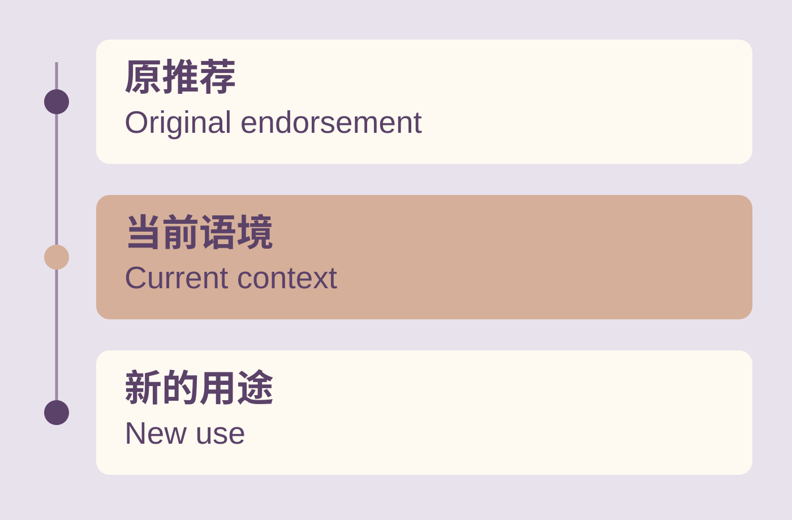

# 知名 YouTuber 的推荐怎样复用

状态：本地审阅稿；正式发布日期待确认。

知名 YouTuber 曾经提到产品，不等于今天同意代言或品牌可以随意复用。把原表达、当前产品与新用途分别核对。

在品牌合作中研究 famous YouTuber，不能把记得某人说过喜欢，直接改写成今天仍代言。先找到完整原作品，核对说的是哪个产品、什么条件、当时的关系与具体意见；再确认新用途所需许可和当前适用性。公开可看不等于可拿去做广告，准确摘录也不自动取得使用权。本文讨论如何把知名度连接到真实作品与合作，不提供虚构榜单，也不推断任何具名创作者的当前私人意见。

## 先从记忆回到具体作品

同事可能记得某位主持人曾推荐品牌，但记忆不是可直接发布的素材依据。先找到原作品与日期，确认是哪段表达，不从剪辑合集或二手转述推断完整意思。

如果找不到原资料，可以把它作为研究线索，不写成已确认推荐。相似产品、不同版本或另一位主持人的表达，都可能在转述中混在一起。知名度让人容易认得名字，却不能替代具体来源。

[热门创作者身份核对指南](https://www.quickkol.com/zh/blog/popular-youtuber-identity-program-verification/#answer)处理人、节目与账号的区分。本篇从确认作品后继续：品牌需要知道哪项表达与本次任务相关，而不是只拿熟悉面孔增加提案说服力。先把事实说准，才有合理的后续联系与许可讨论。

## 检查完整表达与限定条件

一句称赞可能只针对某个细节，也可能接着说明不适合某种场景。保留前后文、实际产品与体验条件，避免把有限意见改成无条件推荐。

[美国代言指导的语境要求](https://www.ecfr.gov/current/title-16/chapter-I/subchapter-B/part-255/section-255.1)在美国情境下强调诚实意见，以及不以断章取义或改写扭曲体验。它提供一般背景，不替本次用途作具体法律判断。

品牌编辑可以把拟用摘录与原段落并排审阅，问新版本是否仍表达同一意思。如果必须删掉关键限定才适合广告长度，就应改变形式或重新取得合适表达，而不是让时长成为改变意见的理由。准确不只意味着字没有拼错，也意味着保留它实际在回答的问题。

## 原视频存在不等于当前关系

旧推荐可能来自独立内容、过去合作或某次体验。原视频仍公开，不表示新的商业关系持续存在，也不代表今天能用“我们的代言人”描述对方。

区分历史表达与本次邀请。品牌可以准确提到研究了某项公开作品，再询问当前合作条件；不能把尚未联系写成已经确认的项目，也不把过去同意延伸到未来所有产品。

如果页面需要说明过去合作，保留适当日期与背景，并由合适人员审阅实际表达。新的广告共享、产品改变与新的推荐含义，需要重新确认；不能仅凭旧链接继续可打开，就认为所有当前使用问题都自动解决。

## 产品变化后重看推荐适用性

配图把原推荐、当前语境与新用途分开。产品型号、配方、功能或主要条件改变后，旧体验可能不再准确对应。不要只是把新包装盖在旧画面旁边。

假设创作者谈过一款便携设备的连接方式，新版接口不同。原评价可以仍是历史表达，但品牌主动重新用它宣传新版，会带来新的含义，需要确认是否适合。

核对的不只是视觉一致性，也包括观点是否仍可准确呈现。没有合适确认，就不把旧片段作为新版推荐。品牌可以改用准确产品说明或另讨论新任务，而不是用知名面孔补足没有发生过的新体验。

原表达真实，不代表每种新的用途都准确或已获许可。

## 准确摘录与取得许可分别处理

[YouTube 的版权说明](https://support.google.com/youtube/answer/2797466?hl=en)讨论作品权利人与许可、适用授权或例外等路径。公开上传本身不是任意广告复用许可；具体例外也不能只凭片段短就自动成立。

因此，即使摘录忠于原意，品牌还要确认实际用途与相关权利。创作者同意、音乐、摄影与其他人物等事项，可能需要不同处理；一个联系人说收到文件，不自动表示所有权利已确认。

把账号、平台、形式、时间、地区与编辑范围写清，交给适当人员按具体情况核对。本文不替任何素材宣布可用，也不提供一套绕过许可的固定规则。保持许可与意义两条审阅线，能避免准确内容被放进未经确认的用途。

## 重新发布时检查商业背景

[FTC 的代言指导问答](https://www.ftc.gov/business-guidance/resources/ftcs-endorsement-guides-what-people-are-asking)讨论美国语境下诚实、不误导的推荐与重要商业关系。品牌复用内容时，不能假设原平台的背景会自动跟到新的广告或页面。

一段原来带有说明的视频，经过裁切后可能只剩一句产品赞美。也可能原本是独立评价，品牌的新使用却让观众理解为当前受聘代言。实际关系与观众理解需要一起审阅。

在最终形式检查文字、声音、画面和周边页面，而不是只看原素材是否曾经公开。商业说明不会自动支持产品功效，也不代替许可；三项仍应分别处理，避免把一个披露动作当作所有问题的答案。

## 审稿时追踪意见有没有改变

编辑可能调整顺序、字幕、翻译或画面搭配。每项变化都应检查是否扩大、缩小或改变原观点，不只比较文件长度。

[产品陈述审阅指南](https://www.quickkol.com/zh/blog/creator-product-claims-review/#answer)帮助把具体陈述与依据对应。本篇还要看知名创作者的语气是否被改成品牌想要的另一种评价。翻译流畅不代表意思完全一致，新增标题也可能让有限体验变成广泛承诺。

让有能力的人审阅实际语言与成片，并把未确认部分留待处理。若需要创作者重新确认，就提供具体拟用版本和用途，不发一句“同意继续用吗”而隐去改变。可以给假设项目增加一个版本比较：原段落说这次开合方便，新标题却写全天候耐用。这个冲突应退回内容讨论，不由剪辑人员悄悄删词解决。若品牌改成新的产品任务，就明确哪些旧意见不再作为依据，再向创作者说明需要重新评估的部分。明确材料可以减少误解，也方便对方就实际表达提出意见。

## 用一个假设复用项目检查边界

假设品牌找到一段成年主持人介绍旧款水瓶的公开视频。原话只谈开合体验，品牌想把它剪进新款耐久广告。先确认具体来源与原条件，不把熟悉面孔当作当前证据。

第一项问题是意见：开合体验不能自动证明耐久。第二项是产品：新款是否仍对应原体验。第三项是使用：是否已取得新广告所需许可与相关权利。第四项是关系：观众会怎样理解这次展示。

如果其中任何关键问题未确认，可以暂不使用片段，另讨论新内容。无需把原推荐说成错误，也不要求创作者无条件重拍。这个假设不是实际合作案例；它说明同一段真实表达，在新语境下仍可能不适合品牌想做的用途。

## 让知名度连接真实合作

最终研究应说明原作品是什么、观点范围如何、当前产品与用途有什么变化、哪些许可与关系已确认。不能只把知名名字贴在方案上，就默认观众信任会自动转移。

品牌可以基于相关作品发出具体邀请，让创作者决定是否愿意参与当前任务。真实的新表达比未经确认的旧片段更容易对应当下事实，但仍需要明确范围与审阅。

Famous YouTuber 在达人营销中的价值，应连接实际贡献、准确意见与合适许可。交付不是一份虚构名气排行榜，而是一项双方能理解的内容安排，以及后续团队不会误用的清楚记录。

## 推荐复用的四项独立审阅

| 问题 | 核对 | 不能默认 |
| --- | --- | --- |
| 原意见 | 完整作品与限定 | 摘句保留全部意义 |
| 当前产品 | 版本与实际条件变化 | 旧体验覆盖新款 |
| 使用权利 | 具体用途与相关许可 | 公开可看等于可做广告 |
| 关系背景 | 真实关系与最终呈现 | 历史推荐等于当前代言 |

编辑研究框架，不是具体版权许可或法律结论。

## 复用推荐之前

把名气放回具体作品与用途。

- [ ] 找到原作品与准确日期。
- [ ] 保留完整观点与体验条件。
- [ ] 检查当前产品是否变化。
- [ ] 确认许可与相关第三方权利。
- [ ] 审阅新版本的关系背景。
- [ ] 把版本与确认范围交接清楚。

## 研究日期与使用边界

资料核验于 2026 年 11 月 16 日。文中方法、表格和决策规则为编辑建议，标为假设的示例不是实际客户结果或行业基准。外部资料的适用地区与时期按各段说明。

## 从任务开始达人研究

用 QuickKOL 理解 Brief、发现相关达人并研究作品与联系路径；数据、合作条件和结果仍需核验。

[了解 QuickKOL](https://www.quickkol.com/#capabilities)

## 来源

- [美国代言指导的语境要求](https://www.ecfr.gov/current/title-16/chapter-I/subchapter-B/part-255/section-255.1)
- [YouTube 的版权说明](https://support.google.com/youtube/answer/2797466?hl=en)
- [FTC 的代言指导问答](https://www.ftc.gov/business-guidance/resources/ftcs-endorsement-guides-what-people-are-asking)
