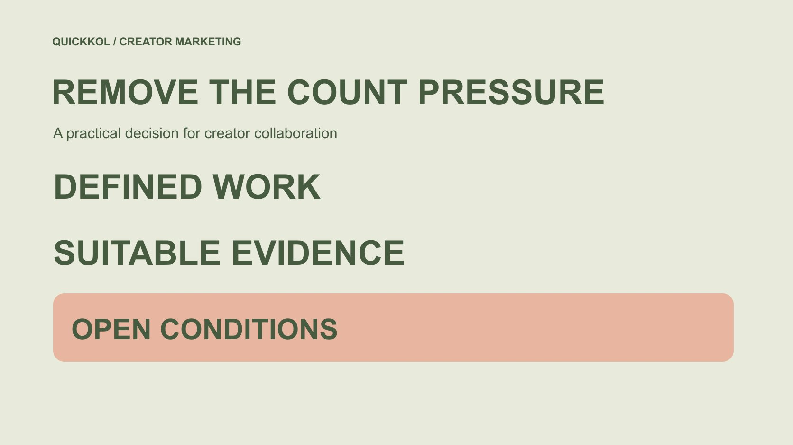

# Free Followers: Remove Incentives to Inflate a Brief

Status: local review draft; confirm the publication date before release.

When free-follower promises appear, inspect the brand brief too: an uncontrollable counter can become a supposed deliverable that rewards distorted reporting.

QuickKOL editorial graphic; not actual account metrics or a platform interface.

When a free followers promise appears, a brand should inspect both its source and its own demand for a guaranteed net increase the creator cannot reasonably control. Define assessable production, publication and use, while retaining follower movement as a sourced, windowed observation. Free top-ups or adding volume to meet a number should not become ways to complete the work. A growth objective is not itself misconduct, but it does not justify false indicators, concealed incentives or unsupported guarantees.

## Identify where count pressure enters the task

A brief may demand genuine experience, accurate expression and a fixed guaranteed follower increase simultaneously. If the last demand lacks measurement conditions, the executor may treat the counter as the only acceptance criterion and disregard the other work.

This is task-design review, not an inference about a creator’s motive. Ask how the team would assess accurately completed work with a smaller net change. If the only answer is that the number must be topped up, discuss the relationship between goal and assignment first.

The [executable creator-brief guide](https://www.quickkol.com/blog/write-a-useful-campaign-brief/#answer) helps define the content being purchased. This article examines incentives through free-follower risk without recommending growth sites or assuming every performance objective is wrong. Goals should support real collaboration rather than make any method reaching a total count as success. The question belongs to the brand as well as its partners, because a supplier promise can appear attractive precisely when the original brief rewards a number while leaving the acceptable means unexplained.

## Separate business ambition from deliverable work

A brand may want more relevant people to choose to follow. That is a business ambition. A creator can commit to defined production, expression and publication; results can also depend on product, destination, audience choice and concurrent activity. Desire alone cannot turn an outcome into a guaranteed fact.

Write the two separately and explain assessment. For a clear product-use demonstration, specify what must be shown and review the actual piece. Record follower movement separately rather than use it to replace an accuracy assessment.

If a performance arrangement is genuinely discussed, define object, window, source, conditions and responsibilities with appropriate commercial confirmation. One sentence promising growth is not the whole negotiation. This is an educational method, not a legal agreement drafted for particular parties or a universal payment and compensation rule. The practical result should let a reviewer tell which item is a production obligation, which is an observed outcome and which remains an aspiration requiring further discussion.

## Do not make free top-ups the default remedy

“If the number is short, we top it up free” needs an explanation of the object, method and reporting. No extra charge does not remove the source question. A larger total does not establish genuine interest or repair of the original collaboration.

[YouTube’s fake-engagement policy](https://support.google.com/youtube/answer/3399767?hl=en) provides a specific platform example: it prohibits artificial metric increases and addresses content existing solely to incentivize engagement. Do not apply that policy mechanically to every platform. Check the actual method against its relevant platform instead of treating free as approval.

A brand can discuss correction of an unclear shot, missing fact or agreed scope without requiring unexplained interactions to compensate for every result. Separate production issues from a counter promise so the creator knows what needs changing rather than search for the fastest way to enlarge a display. That approach also makes a supplier’s proposed remedy assessable: it must solve an identified task problem within acceptable conditions, not merely produce a number that makes the final slide easier to present.

## Distinguish voluntary following from false indicators

The [US fake-influence indicator rule](https://www.ecfr.gov/current/title-16/chapter-I/subchapter-D/part-465/section-465.8) includes conditions concerning indicators known or reasonably expected to be false and material misrepresentation for a commercial purpose. It should not become a statement that every growth goal is unlawful or that suspicious followers alone establish the same conclusion about a creator.

Real people choosing to follow relevant work differ from manufactured indicators. Preserve that distinction rather than stigmatize every unpaid distribution through the word free, or conceal artificial activity through the word growth.

This article makes no legal finding about a party. Understand method and evidence before accepting a promise. Where an arrangement needs legal assessment, supply actual facts and applicable conditions instead of a keyword or unusual curve as the entire basis. This keeps risk education connected to the rule’s real scope while leaving the practical brief review able to identify unsupported commitments without pretending to determine liability.

Retain a growth ambition without making unexplained top-ups a substitute for real work.

## Preserve room for genuine expression

If payment, future work or evaluation depends only on praising a product, honest experience can lose room. A brand needs accurate recommendations and suitable content rather than numerical targets requiring inconvenient facts to disappear.

[FTC’s endorsement-guidance FAQ](https://www.ftc.gov/business-guidance/resources/ftcs-endorsement-guides-what-people-are-asking) emphasizes honest, nonmisleading expression and relevant commercial connections in the US context. It is not a complete legal conclusion here for every region. Teams still need requirements suited to audience and format.

A brief can specify product facts and unsupported statements while allowing the creator to describe genuine conditions of use. If experience differs from the brand’s expectation, discuss narrower work or stopping a particular recommendation. Do not turn a factual concern into a compulsory marketing outcome through guaranteed followers or positive sentiment. This gives both parties a constructive alternative to forcing the original script: identify what can accurately be said, decide whether it still serves the assignment and revise the scope accordingly.

## Keep performance feedback on its proper basis

Feedback should identify account, field, window and source. Net follower-total change is not the same as new follows, and new follows are not brand orders. Retain unknowns where material is unavailable instead of turning a creator promise into an event already completed.

Where gifting, promotion or another incentive is known, record its conditions rather than compare directly with a sample lacking that arrangement. The [hidden-costs of free-following guide](https://www.quickkol.com/blog/free-instagram-followers-hidden-campaign-costs/#answer) addresses data and resource costs. This article connects those conditions to brief evaluation.

Do not change the basis only when performance disappoints, or stop checking because one number looks attractive. Agree a suitable observation method and retain a path for platform changes and corrections. Clear evaluation reduces pressure to settle a closeout dispute with unexplained additional numbers. It also makes a useful distinction in feedback: an inaccurate report needs correction, an incomplete task may need revision and an uncertain outcome may need a narrower conclusion rather than a manufactured replacement.

## Rehearse a hypothetical brief revision

Suppose a brief requires a product demonstration plus a fixed seven-day follower increase, with a supplier topping up any shortfall free. This is an editorial exercise, not a client arrangement or a recommended target.

Begin revision by defining the explanation, work and publication scope. Record relevant follower observations separately as learning with a window and source. Remove unexplained top-ups as the default completion method and route unresolved performance arrangements to an appropriate owner.

This does not abandon outcomes. It gives results appropriate evidence and production obligations assessable objects. If the brand needs stronger business evaluation, discuss a suitable design instead of assigning every unknown to the creator through an unexplained guarantee. A useful revision changes the relationship among tasks, measures and decisions, not merely guarantee to a softer verb. The recipient should understand how work will be reviewed if the desired growth does not occur, rather than face the same hidden top-up requirement after reading more polite wording.

Ask another colleague to identify the fact the piece must show, the evidence used for observation and the conditions requiring further discussion from the revised brief. If they can identify only a follower target, the task still needs work before it is sent.

## Align internal incentives with the external brief

If the external brief removes a guarantee while the internal team still uses only net growth to determine payment or renewal, the pressure remains. An owner should understand actual evaluation rather than leave creators facing conflicting standards.

Ask which evidence supports learning and which supports a decision. Content quality, factual accuracy, agreed scope and business observations do not have to become one mysterious score. Tasks can use different evidence, provided participants understand the relevant basis.

When a problem appears, correct the affected assignment and process instead of assigning every design gap to a person. A brand can reject false or unexplained methods and fairly assess genuine completed work. Those decisions can stand separately without one label of complete success or failure covering the entire collaboration. This makes it easier to identify a real remedy, because the team can address the particular shortcoming rather than demand more followers as compensation for everything it dislikes about the project.

## Close the loop with genuine work

The final brief should define expression, production, publication and use, with sources and limits for observed outcomes. Unsupported guarantees and top-up arrangements need explicit states rather than survive as hidden verbal requirements.

Fair expectations of a creator include performing the actual scope, communicating records accurately and correcting known errors. A brand supplies support, clear objectives and appropriate judgment instead of asking free numbers to close every issue.

The educational value of free followers includes more than recognizing an enticing promise. Examine why a brand wants to accept it. Return the collaboration to explainable tasks and credible records to reduce incentives for artificial engagement while leaving room for real audience choice and creative value. A useful brief does not need to promise control over every viewer’s decision; it needs to explain the work, the evidence and what the parties will reasonably do with the results.

## Goals and work in a brief

| Original issue | Clarify | Retain the boundary |
| --- | --- | --- |
| Followers must be topped up | Expression and work actually purchased | Unexplained volume is not a remedy |
| Evaluate net growth only | Field, window and appropriate decision | Net change is not new follows or orders |
| Experience must be positive | Genuine experience and product support | No unsupported recommendation |
| Shortfall means total failure | Separate work state from uncertain outcome | Handle the affected issue on its facts |

An educational assignment review, not a legal agreement, payment rule or guaranteed-growth plan.

## Review incentives before releasing a brief

Make evaluation support genuine work.

- [ ] Identify unexplained count guarantees.
- [ ] Separate business ambition from work.
- [ ] Reject free top-ups as default completion.
- [ ] Retain genuine experience and commercial context.
- [ ] Define observation source, window and limits.
- [ ] Align internal evaluation with the external task.

## Research date and limitations

Sources reviewed November 16, 2026. Methods, tables and decision rules are editorial recommendations. Hypothetical examples are not actual client results or industry benchmarks. Source geography and periods are specified where relevant.

## Continue learning about metrics and evidence

Understand sources, windows, permissions and unknowns without judging a person from one signal or promising complete detection.

[Read the metrics decision guide](https://www.quickkol.com/blog/social-media-metrics-creator-decision-tree/)

## Sources

- [YouTube’s fake-engagement policy](https://support.google.com/youtube/answer/3399767?hl=en)
- [the US fake-influence indicator rule](https://www.ecfr.gov/current/title-16/chapter-I/subchapter-D/part-465/section-465.8)
- [FTC’s endorsement-guidance FAQ](https://www.ftc.gov/business-guidance/resources/ftcs-endorsement-guides-what-people-are-asking)
