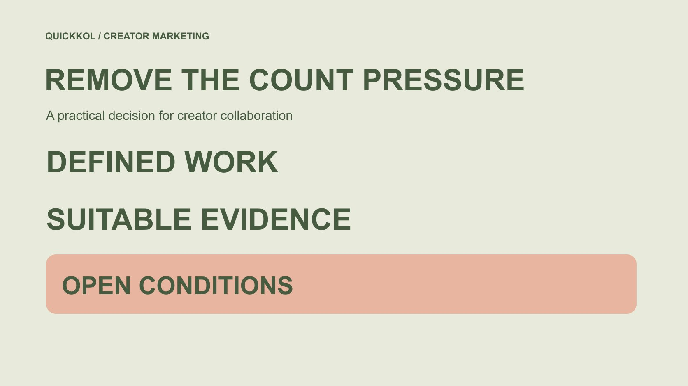

# 免费粉丝承诺怎样影响合作目标

状态：本地审阅稿；正式发布日期待确认。

免费粉丝承诺出现时，也检查品牌自己的 Brief：是否把不可控计数变成必须完成的工作，诱使团队用失真数据交差。

QuickKOL 编辑图形；不呈现真实账号指标或平台界面。

遇到免费粉丝承诺，品牌除了核对来源，也应检查自己是否要求达人保证一个无法合理控制的净增数字。把创作、发布与使用写成可评估任务，将粉丝变化保留为有来源、有窗口的观察；不要让“免费补粉”“数字不够就补量”成为完成工作的办法。增长目标本身不等于违法或操纵，但不能以目标为理由接受虚假指标、隐瞒激励或强迫没有依据的承诺。

## 先看压力从哪里进入任务

一份 Brief 可能同时要求真实体验、准确表达和保证增加固定粉丝。如果团队没有解释后者如何衡量与受哪些条件影响，执行者就可能把数字看成唯一验收标准，忽略前面的工作。

这不是对某位创作者动机的推断，而是检查任务设计。品牌可以问：如果约定作品准确完成，但粉丝净变化较小，团队准备怎样判断？如果答案只是必须补够，就需要先重新讨论目标与工作关系。

[可执行达人 Brief 指南](https://www.quickkol.com/zh/blog/write-a-useful-campaign-brief/#answer)帮助定义真正采购的内容。本篇从免费粉丝风险出发检查激励，不推荐增长网站，也不假设所有绩效目标都有问题。重点是让目标支持真实合作，而非让任何达到总量的办法都被视为成功。

## 区分业务目标与可交付工作

品牌可以希望更多适合的人主动关注，这是一项业务意图。达人可以承诺约定的制作、表达与发布工作；具体结果还可能受产品、页面、受众选择与同期活动等条件影响，不能仅凭愿望变成可保证事实。

将二者写在不同位置，并解释评价依据。比如需要一个清楚的产品使用示范，就说明必须展示什么，完成后按实际作品审阅；粉丝变化另记录，不取代内容是否准确的判断。

若确实讨论绩效安排，需要把对象、窗口、来源、条件与责任讲清，由适当商业人员确认，而不是让文案中的一句“保证增长”替代全部协商。本文提供教育方法，不替具体双方起草法律协议，也不给统一付款或赔偿规则。

## 不让免费补量成为默认修正

“数字不够可以免费补”需要问补什么、怎样发生及如何报告，不能因不额外收费就忽略来源。某个总数变大，不代表增加了真实兴趣，也不能说明原合作已经得到修复。

[YouTube 的虚假互动政策](https://support.google.com/youtube/answer/3399767?hl=en)是一个具体平台例子：禁止人为增加指标，并涉及仅以激励互动为目的的内容。这里不把其规则机械套到所有平台，而是提醒实际方法需要按相关平台核对，不由供应商一句免费自动获准。

品牌可以讨论修正不清楚的镜头、缺失事实或约定范围，不应要求用不明互动补偿一切表现。把制作问题与数字承诺分开，才能让创作者知道真正需要改什么，而不是被迫寻找最快让计数变大的办法。

## 把真实关注与虚假指标分清

[美国虚假影响力指标规则原文](https://www.ecfr.gov/current/title-16/chapter-I/subchapter-D/part-465/section-465.8)对明知或应知的虚假指标交易，以及商业目的下实质性歪曲影响力等条件作出规定。不能把它省略为所有增长目标违法，也不能仅因达人存在可疑粉丝就作同样结论。

真实用户因相关内容而选择关注，与制造虚假指标不是同一对象。品牌研究应该保留这种差别，不让免费一词把所有非付费传播污名化，也不让增长一词掩盖实际制造互动的行为。

本文不对任何主体作法律判断。教育重点是先理解方法与证据，再决定是否采用相关承诺。具体商业安排若需要法律评估，应提供真实事实与适用条件，而不是把一个关键词或不寻常曲线当作全部依据。

增长目标可以保留，但不让不明补量成为真实工作的替代。

## 保留创作者真实表达的空间

如果付款、追加合作或评价都只取决于对产品说好话，创作者可能无法诚实表达体验。品牌需要的是准确推荐与合适内容，而不是用数字目标要求删除不方便的事实。

[FTC 的代言指导问答](https://www.ftc.gov/business-guidance/resources/ftcs-endorsement-guides-what-people-are-asking)在美国情境下强调诚实、不误导的表达和相关商业关系。它有具体适用背景，不是本篇对所有地区的完整法律结论。实际团队仍要按受众与形式核对要求。

Brief 可以明确产品事实与不支持的说法，同时允许创作者说明真实使用条件。若体验与品牌预想不同，先讨论是否需要收窄任务或停止某项推荐，不通过保证涨粉或正面评价把事实问题变成必须配合的营销结果。

## 让数据反馈保留适当口径

反馈应说明用了哪个账号、字段、窗口与来源。粉丝总数净变化不等于新增关注量，新增关注也不等于品牌订单。没有资料时保留未知，不用创作者承诺补成已经发生的结果。

如果有赠品、投放或其他已知激励，记录条件，避免与没有相应安排的样本直接混用。[免费关注的隐藏成本指南](https://www.quickkol.com/zh/blog/free-instagram-followers-hidden-campaign-costs/#answer)讨论数据与资源代价；这里进一步把这些背景纳入 Brief 评价方式。

不要只在结果不理想时才改变口径，也不因一个数字好看就停止检查。品牌和达人可先约定适当观察方式，并为平台更新或资料更正留出路径。评价依据越清楚，越不需要在结项时以额外不明数字解决争议。

## 用一项假设 Brief 练习改写

假设原要求是完成产品演示并保证七天增加固定粉丝，不足时由供应商免费补足。这是编辑练习，不是实际客户方案，也不提供推荐的增长数字。

修改可以先明确演示要回答的问题、作品与发布范围，并把相关粉丝观察另列为有窗口与来源的学习记录。删去不明补量作为默认完成方式，未确认绩效安排交给适当负责人讨论。

这不等于品牌放弃成果。它让成果问题有适当证据，让制作义务有可评估对象。若品牌需要更强业务评估，可以另讨论合理设计，而不是把所有未知压给创作者，通过一项无法解释的保证补齐。有效改写改变的是任务关系，不只是把保证换成更柔和的动词。

修改后可请另一位同事按文稿回答：作品应展示哪项事实，什么资料用于观察，以及什么情况需要补充沟通。如果只能回答一个粉丝目标，说明任务仍然没有真正写清。

## 让内部激励与对外要求一致

如果外部文稿取消保证，内部团队却仍只按净增总数决定是否付款或续约，压力没有真正消失。负责人应知道实际评价怎样进行，不让创作者面对两套相互冲突的标准。

可以要求团队说明学习与决定分别看什么。内容质量、事实准确、约定范围和业务观察不是必须合成一个神秘分数。不同任务可有不同依据，但应在适当范围内让参与者理解。

发现问题时，先修正相关任务与流程，不把系统设计缺口全部变成个人责任。品牌仍可拒绝虚假或不明方法，也能公平处理已经完成的真实工作。两项判断分别成立，不需要把一个合作整体贴成绝对成功或绝对失败。

## 用真实工作结束数字压力

最终 Brief 应说明要完成的表达、制作、发布与使用，以及观察结果的来源与限制。未经支持的保证和补量安排，需要明确状态，不能悄悄留在口头要求中。

对创作者的公平要求，是按真实范围完成工作、准确沟通资料并纠正已知错误；对品牌的要求，是提供依据、清楚目标与适当判断，而不是让免费数字替所有问题收尾。

Free followers 的教育意义，不只是提醒读者远离一个诱人承诺，也包括检查品牌为什么会想接受它。让合作回到可解释任务与可信记录，才能减少虚假互动的诱因，同时为真实受众选择与创作价值留下空间。

## Brief 里的目标与工作

| 原问题 | 重新说明 | 保留边界 |
| --- | --- | --- |
| 必须补够粉丝 | 实际采购的表达与交付 | 不明数字不作为修正 |
| 只看净增评价 | 字段、窗口与适当决定 | 净变不等于新增或订单 |
| 必须正面体验 | 真实经验与产品依据 | 不要求不支持的推荐 |
| 结果不足即全部失败 | 分开工作状态与结果未知 | 按事实处理相关问题 |

教育向任务审阅，不是具体法律协议、付款规则或保证增长方案。

## 发布 Brief 前检查激励

让评价支持真实工作。

- [ ] 找出未解释的计数保证。
- [ ] 将业务目标与工作分开。
- [ ] 不接受免费补量作为默认完成。
- [ ] 保留真实体验与商业背景。
- [ ] 明确观察来源、窗口与限制。
- [ ] 让内部评价与对外任务一致。

## 研究日期与使用边界

资料核验于 2026 年 11 月 16 日。文中方法、表格和决策规则为编辑建议，标为假设的示例不是实际客户结果或行业基准。外部资料的适用地区与时期按各段说明。

## 继续学习指标与证据

理解来源、窗口、权限与未知；不凭单一信号判断个人，也不承诺完整检测。

[阅读指标决策指南](https://www.quickkol.com/zh/blog/social-media-metrics-creator-decision-tree/)

## 来源

- [YouTube 的虚假互动政策](https://support.google.com/youtube/answer/3399767?hl=en)
- [美国虚假影响力指标规则原文](https://www.ecfr.gov/current/title-16/chapter-I/subchapter-D/part-465/section-465.8)
- [FTC 的代言指导问答](https://www.ftc.gov/business-guidance/resources/ftcs-endorsement-guides-what-people-are-asking)
