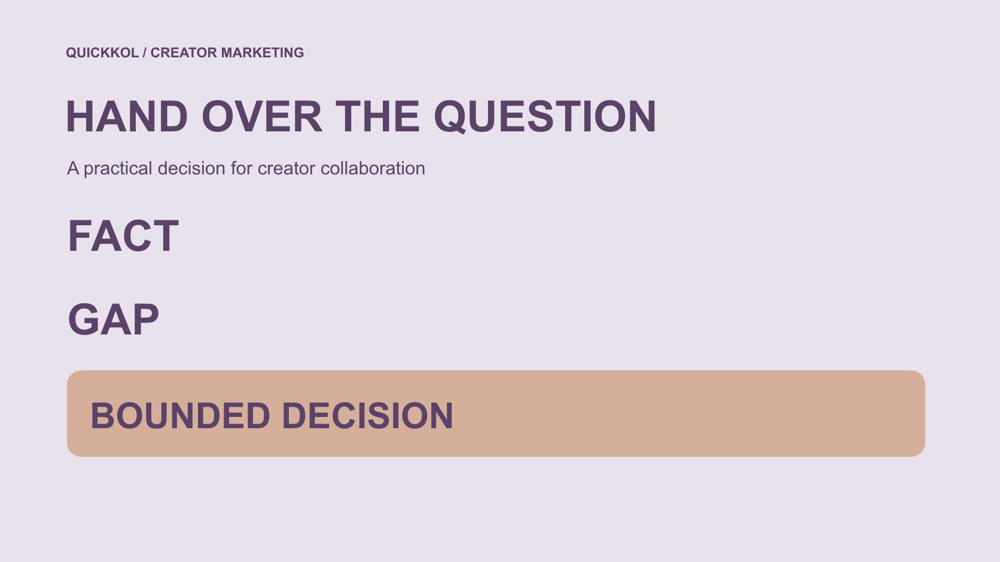
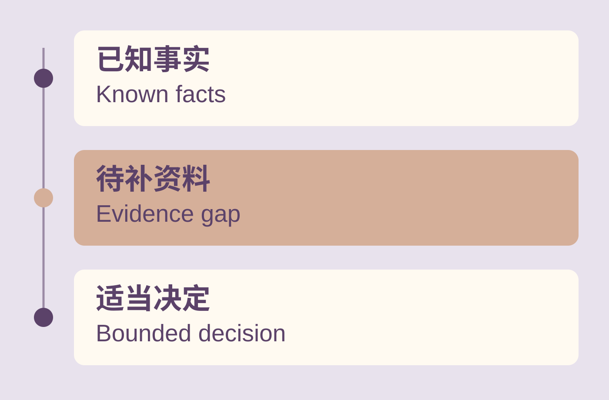

# Free Tik Tok Likes: Hand Over an Evidence Question

Status: local review draft; confirm the publication date before release.

When a free-like question reaches procurement, content and account owners, separate request, approval and execution. Use one bounded fact record rather than turn an unresolved question into a creator label.

QuickKOL editorial graphic; not actual account metrics or a platform interface.

When handing over a “free tik tok likes” question, state the actual decision: procurement, access approval or usability of a reporting claim. A received proposal is not approval, and approval is not execution. Retain necessary sources, their independence and unknowns, and identify someone able to handle the specific question. A brand can decline procurement or pause an unsupported decision without first finding a creator guilty of misconduct. This is an educational collaboration framework, not an engagement service or guaranteed identification method.

## Begin the handoff with the decision needed

Do not send procurement a pile of screenshots with check for problems. State whether someone proposed a purchase, requested an account connection or wants a figure in a report. These are different tasks requiring different owners and information.

Suppose content staff receive a free-like introduction without a procurement need. The handoff may simply request confirmation that it is outside supplier scope rather than launch a comprehensive investigation into a creator. Clear boundaries prevent excessive personal information gathering to satisfy an undefined risk assignment.

Write one answerable decision question, then identify affected work. Do not label every collaboration suspicious. An unnecessary service proposal does not automatically change completed production or establish execution. A recipient should understand what they are being asked to decide before opening attachments, and should not have to infer whether the sender wants a purchasing response, a security action or a revised campaign conclusion from a dramatic subject line alone.

## Separate request, approval and execution

A request may be unapproved, an approval may have unmet conditions and execution may involve only some steps. Describe the real state instead of using has been in contact as a substitute for the whole process.

Record who proposed the action, who has approval authority and what is known to have occurred. If authority is unclear, leave it as a question rather than make the first person to see a message the assumed buyer or account owner.

Do not request repeated actions to complete the record. Appropriate business records and a person’s explanation can clarify the existing state without another authorization or submission to demonstrate what could happen. A handoff should reduce confusion rather than involve more people in an unnecessary process. This distinction also protects the person who raised the concern: forwarding a proposal for advice should not later appear in a summary as their approval of the supplier or a statement that they used the service.

## Keep provenance rather than just the number of records

For each record, identify original source, time, object and how it was obtained. Copies of the same promotional image are not multiple independent checks, and a provider’s explanation should not automatically become a confirmed fact.

[NIST’s outlier explanation](https://www.itl.nist.gov/div898/handbook/eda/section3/eda35h.htm) reminds readers that an unusual value has several possible explanations. This is a general methodological boundary, not a true-user test performed here. A count change remains a lead requiring source, window and concurrent-event checks.

Separate confirmed information, original statements and unverified material. If a page is unreadable, record that limitation instead of inventing a complete experience. The recipient needs to know what the evidence answers and which actions this review did not perform. A concise source note can prevent the next team from assuming an attachment was independently reproduced or tested when it was only supplied by the party making the claim, which would otherwise make the handoff appear stronger than its underlying information.

## Give facts, gaps and decisions separate places

The diagram separates facts, gaps and decisions so a handoff does not jump from one signal to a personal verdict. Facts describe observations, gaps describe unknowns and decisions describe action under the current information.

Suppose material promises instant likes, and only receipt is known, with no approval or execution record. Gaps may concern action origin and access requirements. The decision may be no procurement for now. That does not require proving fraud or assuming a creator secretly used it.

Connect the three parts. If the reason is lack of need or insufficient support, state that scope. New information can change the gap and lead to reassessment rather than be blocked by a permanent label. Clear records make proportionate action easier. They also allow two teams to agree on a practical decision while acknowledging that neither has established the broader explanation, instead of forcing a false consensus about a person’s intentions before routine campaign work can continue.

Give the question to an appropriate owner without promoting unknowns into a personal finding.

## Rules cannot replace fact verification

[FTC’s fake-influence indicator FAQ](https://www.ftc.gov/business-guidance/resources/consumer-reviews-testimonials-rule-questions-answers) discusses knowledge and commercial-misrepresentation conditions under the US rule and distinguishes genuine voluntary actions. Attaching a rule title to a screenshot does not prove a specific purchase, knowledge or false indicator.

A handoff can explain why a promise deserves caution while separately supporting actual facts. Platform policy, legal conditions and the brand’s procurement choice are also distinct; declining an unnecessary service does not require a misconduct determination first.

A recipient handling a specific legal or policy question needs accurate relevant material and scope, not wording that has already decided the answer for them. Marketing can describe facts and needs without using forceful language to replace specialist judgment or treating an educational blog as a complete audit. A precise question helps the appropriate reviewer explain what additional information is genuinely needed, rather than invite a broad search for anything that might support a conclusion the sender already prefers.

## Route account concerns through an independent security path

If the handoff concerns possibly submitted secrets or approved access, prioritize the actual state with the account owner through independently located official security and support routes. Do not ask procurement to validate it by clicking the original link.

[FBI’s creator-account security alert](https://www.fbi.gov/contact-us/field-offices/atlanta/news/verified-influencer-accounts-are-being-hijacked-to-spread-scams-and-malicious-software) notes that familiar or verified accounts can be hijacked to spread malicious material. It supports independent verification without establishing that any account here has been hijacked.

Do not include passwords, verification codes, recovery information or irrelevant personal data. Appropriate people should handle necessary sensitive facts through a suitable route; ordinary project updates need affected matters and responsible roles. That advances handling without expanding account and privacy risk through repeated forwarding. Where marketing only needs to pause a publication, share that state rather than the full security record. Information should follow the recipient’s actual responsibility, not the assumption that everyone involved in the campaign needs every attachment to understand why a task is on hold.

## Assign an owner and the next check

Each question needs someone able to handle it. Procurement assesses task and supplier scope, the account owner handles actual access and content staff assess reporting interpretation. Roles may overlap in a small team without the responsibilities disappearing.

The [provider-claim review guide](https://www.quickkol.com/blog/tiktok-free-likes-provider-promise-check/#answer) organizes wording and evidence.

The [report-correction guide](https://www.quickkol.com/blog/instagram-free-likes-report-correction/#answer) handles an earlier inference. State the type of action needed so everyone is not waiting for another department.

The next step should be a specific check rather than keep looking. It can request confirmation of a business state or an existing source without unrestricted collection of a creator’s information. Set an update appropriate to the real work and retain an unfinished state. Time passing is not default approval or proof that risk is absent. The recipient should also be able to return the question when it falls outside their role, naming the needed responsibility rather than quietly leaving the sender to assume the matter has been accepted and resolved.

## Match the decision to the evidence

No procurement, no access or deferring one interpretation are bounded decisions. They do not mean banning a person, rejecting every collaboration or finding all interaction false. State reason and scope together.

If the material supports only an information gap, do not escalate it into malicious intent. Update specific matters when reliable new information arrives; the same screenshot circulating in more groups does not increase its certainty.

Payment, agreement and responsibility questions need appropriate owners considering actual arrangements. An educational evidence handoff does not decide those matters for them. The brand can maintain legitimate production while pausing unsupported procurement or data use, allowing caution and fairness together instead of forcing acceptance of everything or rejection of everything. Explain any operational pause in terms of the dependency it protects so another team does not quietly expand a temporary question into an enduring restriction unrelated to the available facts or the original campaign task.

## Deliver a working record that can be updated

For a hypothetical handoff, write that content received the proposal, procurement has not approved it and the account owner reports no connection performed. If one of those states is unconfirmed, mark it so. Do not compress them into a single label such as supplier checked, which conceals the question each person actually answered.

The final handoff contains the decision question, actual state, source provenance, unknowns, owner and next step. Keep original material separate from interpretation and explain changes in a new version rather than overwrite the earlier judgment and lose its origin.

The brand needs actionable collaboration, not a confident-looking accusation. A creator should be able to address a specific matter with relevant information rather than prove an undefined negative.

As an educational topic, free tik tok likes should help teams understand access, false-interaction and reporting risks, using bounded facts for bounded decisions. Preserve the value of real production, limit unnecessary information collection and leave room for reliable updates. The useful final document is one another responsible person can act on without guessing what was approved, what occurred or what remains uncertain. It should reduce the number of assumptions carried into the next campaign rather than give those assumptions a more official-looking format.

## Handing over a free-like question

| Question | Appropriate role | Needed state |
| --- | --- | --- |
| Whether to procure | Procurement or project owner | Task, request and approval scope |
| Account access | Account and security owner | Actual steps and necessary facts |
| Report interpretation | Content and data owner | Source, window and affected conclusion |
| Next decision | Owner of the relevant matter | Information gap, update and boundary |

An educational work handoff, not a supplier recommendation, full audit or personal adjudication.

## Clarify before handing over

Reduce misunderstanding with one bounded fact record.

- [ ] Who needs to decide what?
- [ ] What are the request, approval and execution states?
- [ ] Are sources independent, and where are the gaps?
- [ ] Which secrets should not circulate?
- [ ] Which work does the present decision affect?
- [ ] Who updates it, under which conditions?

## Research date and limitations

Sources reviewed November 16, 2026. Methods, tables and decision rules are editorial recommendations. Hypothetical examples are not actual client results or industry benchmarks. Source geography and periods are specified where relevant.

## Continue learning about metrics and evidence

Understand sources, windows, permissions and unknowns without judging a person from one signal or promising complete detection.

[Read the metrics decision guide](https://www.quickkol.com/blog/social-media-metrics-creator-decision-tree/)

## Sources

- [NIST: interpreting outlying observations](https://www.itl.nist.gov/div898/handbook/eda/section3/eda35h.htm)
- [FTC’s fake-influence indicator FAQ](https://www.ftc.gov/business-guidance/resources/consumer-reviews-testimonials-rule-questions-answers)
- [FBI’s creator-account security alert](https://www.fbi.gov/contact-us/field-offices/atlanta/news/verified-influencer-accounts-are-being-hijacked-to-spread-scams-and-malicious-software)
